# 02-16 · WLAN — Radio Resource Management: Channels, Power, Admission and the Roaming Algorithms

> **The thesis of this note.** IEEE 802.11 defines almost no radio resource management. It defines
> *measurements* (802.11k), *requests* (802.11v), *fast security* (802.11r) and *spectrum etiquette*
> (802.11h), but it never says who assigns a channel, who sets a power level, or when a station must
> move. RRM is therefore a **vendor function built on standardised primitives**, and every argument
> in this space is really an argument about three things: what the network can measure, what it is
> allowed to force, and what the client will do anyway.

RRM is the answer to one question asked four ways:

| Resource | Question | IEEE gives you | Vendors add |
| --- | --- | --- | --- |
| **Spectrum** | Which channel and how wide, for every radio | 802.11h DFS, CSA, 802.11be puncturing | DCA, AirMatch, ChannelFly, DBS, channel lists |
| **Power** | How loud may each radio transmit | 802.11h TPC, regulatory EIRP/PSD | TPCv1/v2, coverage hole detection, AFC |
| **Airtime** | Who transmits when, and how much | EDCA, OFDMA, trigger frames, BSS colour / OBSS_PD | Airtime fairness, scheduling policy, spatial reuse tuning |
| **Association** | Which STA sits on which AP, band and link | 802.11k/v/r, MLD link reconfiguration | Band steering, ClientMatch, load balancing, assoc control |

The four are not independent: changing a channel changes the interference graph, which changes the
achievable rate, which changes the airtime a STA consumes, which changes whether a load-balancing
decision was right. That coupling is why RRM is the part of Wi-Fi that most resists being "solved".

---

## 0. What RRM is — and what it is not

### 0.1 The definition that survives an interview

**Radio resource management is the set of control loops that allocate spectrum, transmit power and
airtime across a set of APs and their associated stations, and that decide which station is served by
which AP, band and link.**

Three consequences follow immediately, and each one is a common interview trap:

1. **RRM is not a protocol.** There is no "RRM" frame. What exists is a measurement framework
   (802.11k), a set of network-management actions (802.11v), a fast-security framework (802.11r),
   spectrum etiquette (802.11h), spatial reuse signalling (802.11ax/be), and multi-AP coordination
   (802.11bn). Everything else is a controller feature with a marketing name.
2. **RRM is mostly advisory.** The AP can *request*, *recommend*, *refuse* and *disconnect*. It
   cannot *move* a station. The one move primitive the network owns is destructive: deauthentication.
3. **RRM operates on information the client also has.** Both sides measure the same medium. The AP
   knows load, backhaul and every neighbour; the STA knows its own link quality and its own drivers.
   Neither has the other's picture, and the standard provides no obligation to share it.

### 0.2 The contrast with cellular, stated once and reused everywhere

| | Cellular (LTE/NR) RRM | Wi-Fi RRM |
| --- | --- | --- |
| Channel plan | Operator-planned, often static frequency reuse | Self-organising, per-AP, per-radio |
| Handover | **Network-controlled**: measurement report → HO command → the UE has no vote | **Client-controlled**: the STA decides, the network nudges |
| Power control | Closed-loop TPC per UE, uplink and downlink | AP-only, open-loop, slow; the STA's power is its own business |
| Admission | Explicit: bearer setup, QoS flows, reject with a cause | Weak: association control, TSPEC/SCS, or nothing |
| Coordination | Standardised: ICIC, eICIC, CoMP, Xn/X2 | 802.11bn MAPC is the first real answer, and it is not published yet |
| Timescale | Milliseconds to hundreds of milliseconds | Seconds to a day |

Every "Wi-Fi is unreliable" complaint that is really an RRM complaint traces to row two: the entity
with the best information is the entity with the least authority.

### 0.3 The four clocks

```mermaid
flowchart LR
    subgraph fast["Sub-second — the medium"]
        F1["EDCA backoff<br/>tens of microseconds"]
        F2["OFDMA / trigger<br/>per TXOP"]
        F3["BSS colour, OBSS_PD<br/>per frame"]
    end
    subgraph mid["Seconds to minutes — the clients"]
        M1["Steering: BTM,<br/>probe suppression"]
        M2["Roam trigger,<br/>scan, reassociation"]
        M3["ChannelFly capacity<br/>sample: 15 s"]
    end
    subgraph slow["Minutes to a day — the plan"]
        S1["Cisco DCA and TPC<br/>600 s default"]
        S2["Aruba AirMatch,<br/>Mist global: once a day"]
        S3["DFS: CAC 60 s,<br/>NOP 30 min"]
    end
    subgraph human["Weeks — the design"]
        H1["Site survey, channel list,<br/>min and max power"]
        H2["AP placement,<br/>backhaul, cabling"]
    end
    fast --> mid --> slow --> human
    human -.->|"constrains every loop below"| fast
```

The single most common RRM failure is a **slow loop trying to fix a fast problem**: an AP changes
channel every ten minutes to chase a contention that lasts ten seconds, and the churn costs more than
the interference did.

---

## 1. The loop: measure, decide, actuate, verify

Every RRM function in this note is the same four steps. What differs is the timescale, the metric and
the authority.

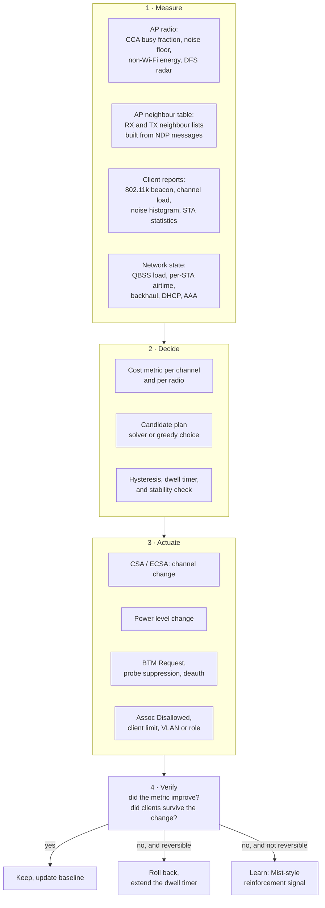

### 1.1 The authority gradient — the table that settles design arguments

| Actuator | Who initiates | Can the STA refuse? | Blast radius | Standard? |
| --- | --- | --- | --- | --- |
| Channel change (CSA / ECSA) | AP | No — clients follow or drop | Every STA on that radio | Yes, 802.11h / 802.11-2020 |
| Power change | AP | No | Every STA on that radio | Not an IEEE decision; a local one |
| Beacon Request (802.11k) | AP | Yes, and many do | One STA, one measurement | Yes |
| Neighbor Report (802.11k) | STA asks, AP answers | n/a | Read-only | Yes |
| BTM Request (802.11v) | AP | **Yes** — it is a recommendation | One STA | Yes |
| Assoc Disallowed (MBO) | AP | Effectively no | New STAs only | WFA MBO over 802.11v/11u |
| Association response failure | AP | n/a | One STA | Yes, status code |
| Deauthentication | AP | No | One STA, destructive | Yes |
| Band steering by probe suppression | AP | Client just retries | One STA, adds latency | **No — vendor behaviour** |
| Client roam decision | STA | It *is* the decision | One STA | **Not standardised at all** |

Read column three twice. Six of the ten rows are refusable, which is why "RRM moved the client" is
almost always shorthand for "RRM made staying unpleasant".

---

## 2. Measurement: what an RRM system can actually see

### 2.1 The inputs, and where each one lies to you

| Input | Source | What it is good for | How it misleads |
| --- | --- | --- | --- |
| **Channel busy fraction** | AP PHY/CCA, QBSS | Real contention, including OBSS and non-Wi-Fi | Says nothing about *who* is busy; 40% busy is fine for one STA and fatal for forty |
| **Noise floor / noise histogram** | AP, or 802.11k Noise Histogram | Non-Wi-Fi interferers: microwaves, BLE, video senders | Sampled when the medium is idle; misses interferers that only fire under load |
| **RX neighbour list** | NDP / over-the-air neighbour messages | "How loud do I hear my neighbours" | Symmetric-sounding but not symmetric: antenna gain and placement differ per AP |
| **TX neighbour list** | Neighbour reports echoed back | "How loud do my neighbours hear me" — the one that matters for cell sizing | Requires ≥4 APs to be meaningful (see Cisco TPC below) |
| **Per-STA statistics** | AP, 802.11k STA Statistics | Retries, failed counts, ACK failures, BSS average access delay | Counters are per-radio and reset on reassociation |
| **RCPI / RSNI** | Client measurement, reported via 802.11k | Signal *and* signal-to-noise, cross-vendor comparable | Many drivers still expose a vendor "RSSI" instead; RCPI is `dBm = RCPI/2 − 110` |
| **Beacon report** | STA, on AP request (802.11k) | The client's view of every candidate — the only way to see what the client sees | Costs the client airtime and battery; privacy-sensitive; many clients rate-limit it |
| **QBSS load** | AP beacon/probe response | Station count, channel utilisation, available admission capacity | Station count is a terrible proxy for load; one 1×1 IoT device ≠ one laptop |
| **Application SLE** | Cloud / telemetry | What the user actually experienced | Needs minutes of data; cannot drive a sub-second reaction — see §12 |

### 2.2 The cost of measuring

Measurement is not free. An AP that leaves its serving channel cannot serve.

| Vendor | Off-channel behaviour | Documented cost |
| --- | --- | --- |
| Cisco | Off-channel for **≤70 ms** at a time, **0.2%** of total airtime; defers if voice or critical traffic was seen in the last **100 ms** | The reason Cisco claims its RRM is the least disruptive in throughput tests |
| Aruba (ARM) | Per-AP periodic off-channel scan | Aruba has historically required a **110 ms** dwell; cited as a competitive difference |
| Ruckus | Background scan interval default **20 s**, used by ChannelFly 2.0 to collect neighbour RX utilisation | ChannelFly explicitly uses 802.11h CSA so the move itself is not lossy |

The design rule that follows: **off-channel scanning buys you the neighbour graph and costs you
latency**. In a network carrying voice or TSN traffic, the correct answer is usually a *narrower
channel list and a scheduled plan*, not more scanning.

### 2.3 The 802.11k measurement catalogue

802.11k (Radio Resource Measurement, folded into 802.11-2020 clause 11.10) is the only cross-vendor
vocabulary for RF measurement. The full request/report set:

| Measurement | What comes back | Used by RRM for |
| --- | --- | --- |
| **Beacon** | BSSIDs heard on a channel, RCPI, RSNI, channel utilisation — three modes: passive, active, beacon table | Building the candidate list; crowdsourcing the client's view |
| **Channel Load** | Channel utilisation as seen by the measuring STA | Load-aware steering |
| **Noise Histogram** | Power histogram of non-802.11 noise, sampled while idle | Detecting microwaves, jammers, BLE |
| **Frame** | Per-transmitter frame counts and average RCPI | Identifying who is actually using the channel |
| **STA Statistics** | Retry counts, failed counts, RTS/ACK failures, BSS average access delay, associated STA count | Per-STA health; the "sticky client" test |
| **Neighbor Report** | Candidate APs with operating class, channel, BSSID, capabilities, FT/mobility-domain match | Removing the need for a full scan before a roam |
| **Link Measurement** | RCPI, RSNI, link margin for the STA-to-STA link | Uplink-versus-downlink asymmetry |
| **LCI / Location** | Latitude, longitude, altitude, floor | Indoor positioning; rarely used for RRM |
| **AP Channel Report** | Channels the AP is considering or avoiding | Multi-band coordination |
| **Transmit Stream/Category** | Per-stream and per-AC QoS counters | TSPEC-era admission control |
| **Measurement Pause** | No report — a delay between measurements in one request frame | Rate-limiting the measurement itself |

Two deployment facts worth carrying:

- **Beacon Report modes matter.** *Passive* costs the client dwell time; *active* adds probe traffic;
  *beacon table* is nearly free but only replays what the STA already cached.
- **Measurement Pilot** was 802.11k's compact, high-rate beacon for faster scanning. It is defined,
  widely unimplemented, and in practice replaced by 6 GHz out-of-band discovery (RNR, FILS
  discovery) and 802.11be's shortened scanning.

---

## 3. Channel assignment

### 3.1 The problem, stated properly

Given N radios, a set of allowed channels per band, and a matrix of "how much does radio *i* hurt
radio *j* if they share or overlap", choose a channel and a width for each radio. The objectives
conflict:

- **Minimise co-channel interference** → spread radios apart in frequency → need more channels →
  want *narrow* channels.
- **Maximise peak rate per STA** → want *wide* channels → fewer non-overlapping channels → more
  co-channel interference.
- **Respect regulation** → DFS, AFC, PSD, indoor/outdoor, per-country lists.
- **Minimise churn** → a change costs every client a CSA and possibly a roam.

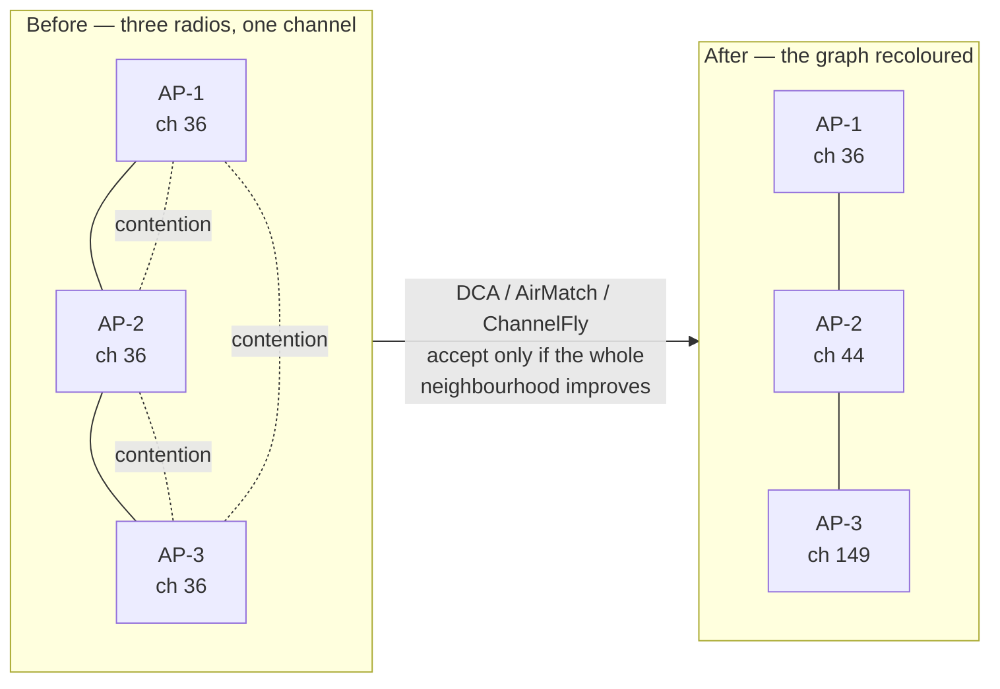

The dotted edges are the contention: on one channel, **every transmission defers every other
transmission**, so three radios on channel 36 share one contention domain rather than three.

It is not quite graph colouring, because the interference is weighted and asymmetric, the graph
changes with traffic, and the "colours" (channels) have different capacities — which is why the
interesting part of every vendor algorithm is its **cost metric**, not its search.

### 3.2 What a cost metric is made of

Cisco's DCA is the best-documented example and the vocabulary transfers:

> **Cost Metric (CM)** — a single number expressed as an RSSI that represents the overall goodness of
> a channel option: a weighted SNIR built from **same-channel contention** (co-channel APs and
> clients), **foreign/rogue AP energy**, **noise** (non-Wi-Fi), **channel load** (QBSS), and a
> user-selectable **sensitivity constant**.

Two structural details that generalise:

- **The worst radio initiates.** DCA ranks every radio by CM into a *Channel Plan Change Initiator*
  list and evaluates the worst first, alternating worst/random on later iterations. This is the
  standard defence against **pinning and cascading**: if the worst radio always drives the plan, one
  permanently-bad radio can force endless repaints; if a change is only accepted when the *neighbourhood*
  also improves, you avoid a cascade where AP-1's fix makes AP-2 worse, which makes AP-3 worse…
- **Sensitivity is hysteresis on the plan.** A new channel must beat the current CM by the sensitivity
  threshold before it is accepted. Cisco's thresholds by band:

| Sensitivity | 2.4 GHz threshold | 5 GHz threshold | Behaviour |
| --- | --- | --- | --- |
| High | 5 dB | 5 dB | Changes on small deltas; churns |
| **Medium (default)** | 10 dB | 15 dB | The sane default |
| Low | 20 dB | 20 dB | Only moves for a large, sustained win |

Values differ between Cisco releases (older documentation lists Low 30/35 dB), so quote the release
you are running rather than a blog.

### 3.3 Five algorithm families

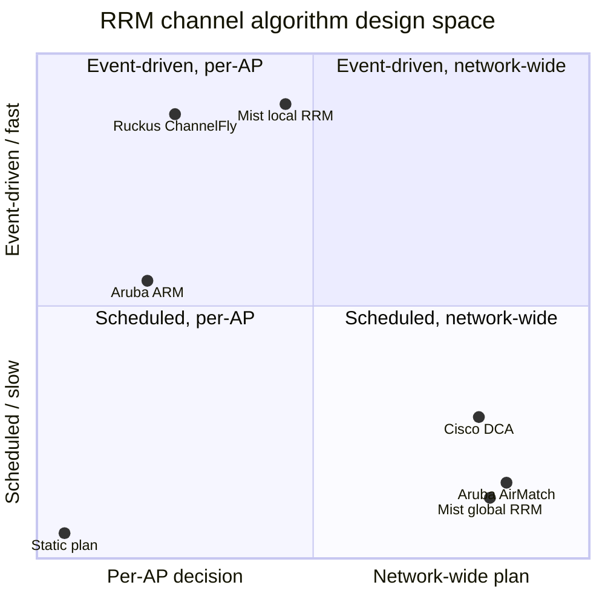

| Family | Representative | Metric | Decision scope | Cadence | Strength | Weakness |
| --- | --- | --- | --- | --- | --- | --- |
| **Static plan** | Site survey, manual assignment | Predicted coverage and reuse | Human | Never | Predictable; the only answer for TSN-grade networks | Wrong the moment the building changes |
| **Distributed interference minimisation** | Aruba ARM, legacy controller DCA | Noise, interference, neighbour RSSI | Each AP decides | Minutes | Robust, no dependency on a leader | Local optima; neighbours react to each other; ripples |
| **Centralised cost-metric solver** | Cisco DCA, Aruba AirMatch, Ruckus Cloud RRM | Composite CM (interference + noise + load) | One leader / cloud solves for every radio | 10 min (Cisco) to 24 h (AirMatch) | Global optimum; deploy together | Slow; a leader election or cloud outage freezes it |
| **Capacity sampling** | Ruckus ChannelFly | **Measured throughput / capacity**, not interference | Each AP | Assess every **15 s**, react to a large drop in **≤15 s** | Optimises what users feel; handles non-Wi-Fi interference | Needs 30–60 min to settle; disruptive on 802.11h-incapable clients |
| **Learning on an outcome metric** | Mist AI RRM | Capacity **SLE** (user-minutes) + reinforcement learning | Cloud global + AP local | Global once a day (2–3 AM local) + event-driven local | Optimises experience; learns per site; cross-site memory (e.g. airport DFS) | Opaque; needs data volume; cannot fix a bad design |

### 3.4 ChannelFly is worth understanding in detail, because it is the odd one out

Everyone else measures *interference* and infers capacity. ChannelFly measures **capacity** and
infers nothing.

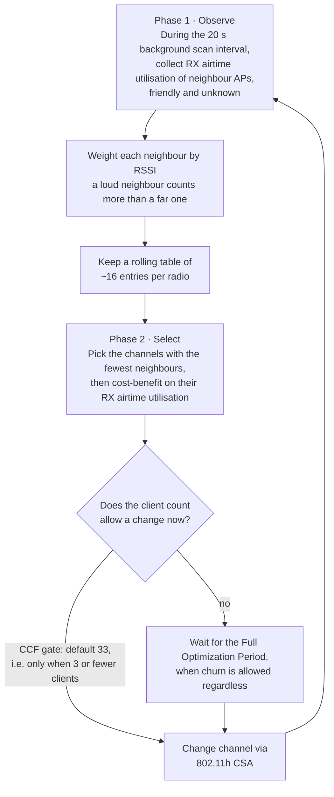

Two numbers make the trade explicit: **15 s** to assess and react to a large drop, and **CCF 33**
(the default channel-change-frequency gate, which permits a change only when three or fewer clients
are associated). The second number is the admission that capacity sampling is disruptive — which is
the honest version of an argument most vendors hide.

### 3.5 Channel width: the decision that dominates everything else

| Width | Non-overlapping channels (5 GHz, US, with DFS) | Peak rate | When it is right |
| --- | --- | --- | --- |
| 20 MHz | ~25 | Baseline | Dense offices, high AP count, voice, scanners |
| 40 MHz | ~12 | ~2× | Standard enterprise |
| 80 MHz | ~6 | ~4× | Low density, isolated high-throughput cells |
| 160 MHz | ~2 | ~8× | Almost never in enterprise; 6 GHz only |
| 320 MHz (6 GHz) | 3 in 1200 MHz | ~16× | Wi-Fi 7 marketing; a handful of real deployments |

The rule that follows from the table: **width is a function of AP density, not of ambition.** Cisco's
Dynamic Bandwidth Selection encodes it as a starting bias (80 MHz in full-spectrum 6 GHz countries,
40 MHz in partial-spectrum countries) that is *lowered* on neighbour density, interference, noise
floor and the observation that most clients are 20 MHz. Aruba AirMatch and Mist both treat width as a
per-radio variable inside the same solve.

### 3.6 DFS: the one RRM function with a regulator behind it

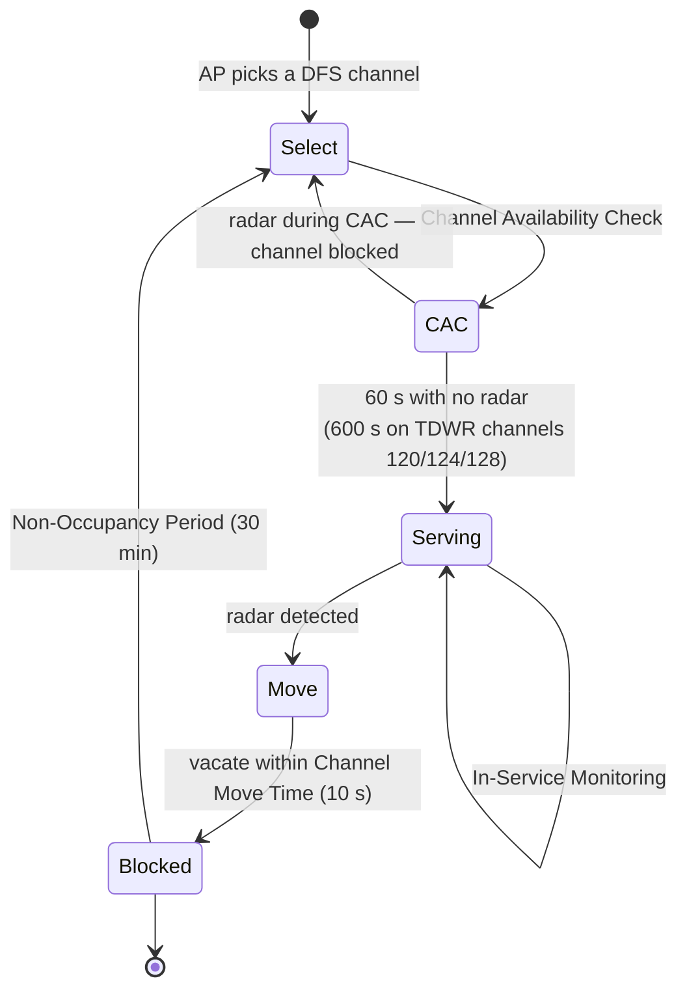

| Parameter | Value | Why it matters to RRM |
| --- | --- | --- |
| **CAC** | 60 s (US, most channels); **600 s** on 120/124/128 (TDWR overlap) | A DFS channel is silent for a minute after boot — a real coverage gap |
| **Channel Move Time** | 10 s | The AP must be gone; this is why event-driven RRM exists |
| **Non-Occupancy Period** | 30 min | The channel is unusable for half an hour, so the plan must have a fallback |
| **In-Service Monitoring** | Continuous | Radar detection runs while serving; a false positive costs a CSA |

Design rules that follow: exclude 120/124/128 from the DCA list near airports; keep a non-DFS
fallback plan (UNII-1 36–48 and UNII-3 149–165 in the US) or a radar strike will push everything onto
eight channels; and use "Smart DFS"/pre-staged alternates if the site is mission-critical. Zero-wait
DFS (a second radio pre-scanning the next channel) exists precisely because the 60 s CAC is
otherwise a visible outage.

---

## 4. Transmit power control

### 4.1 What power actually buys

Transmit power sets the **cell boundary**, and the cell boundary sets three things at once:

- **Coverage** — how far a client can be and still associate.
- **Contention domain** — how many other radios hear you and defer.
- **Uplink viability** — and this is the one everyone forgets: an AP at 20 dBm talking to a phone at
  12 dBm produces a cell where the downlink is fine and the uplink is not. The client's power is not
  under the AP's control.

So the objective is not "maximum power" or "minimum power". It is: **the smallest cell that still
covers the designed area, with neighbouring cells overlapping enough to roam but not enough to
collide.**

### 4.2 Cisco TPCv1, worked

The best-documented algorithm, and the shape generalises:

```
Tx_Ideal = Tx_Max + (TPC_threshold − RSSI_3rd)

where  Tx_Max          = maximum supported power for the radio
       TPC_threshold   = user-selectable, default −70 dBm  (−65 dBm before release 4.1.85.0;
                         valid range −50 to −80 dBm)
       RSSI_3rd        = RSSI of the third-loudest neighbour in the AP's TX neighbour list
```

Why the **third** loudest? Because three is the number of non-overlapping 2.4 GHz channels. Cisco
states the choice explicitly and notes that tests with the eighth neighbour showed no advantage.

**Worked example.** Radio with Tx_Max 20 dBm, third-loudest neighbour heard at −58 dBm, threshold
−70 dBm:

```
Tx_Ideal = 20 + (−70 − (−58)) = 20 − 12 = 8 dBm
```

The current level is 17 dBm. Delta = 9 dB.

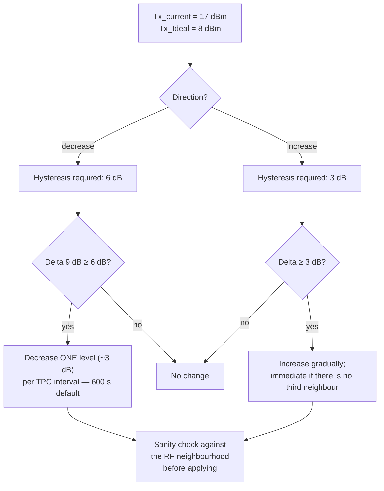

Three properties of this algorithm are the interesting part, and all three are general RRM wisdom:

1. **Decrease is gradual, increase is careful.** Power is lowered one level per interval (10 min
   default) so the environment can settle; increases are gated behind the coverage-hole algorithm,
   which raises power one level at a time. Sudden power *up* is the most destructive RRM action
   there is — it silently creates new co-channel interference for radios that did nothing wrong.
2. **Hysteresis is asymmetric: 3 dB up, 6 dB down.** The asymmetry encodes a prior: shrink cells
   readily, grow them reluctantly.
3. **TPC only turns power down.** Power increases belong to coverage hole detection — a separation
   that keeps the two failure modes from fighting each other.

It also explains a deployment rule people learn the hard way: **TPC needs at least four APs per
area.** With fewer than three neighbours, the third-loudest-neighbour term has no value and the radio
returns to Tx_Max.

### 4.3 Coverage hole detection

The complement to TPC: if clients are being heard poorly, raise power.

| Parameter | Typical Cisco default | Meaning |
| --- | --- | --- |
| Minimum Client Level | 3 | Ignore the AP until enough clients are attached for the statistic to mean anything |
| Data RSSI threshold | −80 dBm | A client below this is "weak" for data |
| Voice RSSI threshold | −80 dBm | A client below this is "weak" for voice |
| Exception Level | 25% | The percentage of weak clients that triggers correction |

Correction is TPC (raise power), then DCA if power alone does not close the hole. Note that other
Cisco documentation describes the weak-client threshold as −70 dBm with a 20% exception level —
releases differ, so read the controller, not a blog.

The honest caveat: a persistent coverage hole after power increase is almost never an RRM problem.
It is a missing AP, a dead zone behind a lift shaft, or an AP with a bad antenna.

### 4.4 Band-specific differences RRM must respect

| | 2.4 GHz | 5 GHz | 6 GHz |
| --- | --- | --- | --- |
| Non-overlapping 20 MHz channels | 3 | ~25 with DFS | Many (59 × 20 MHz in the US) |
| DFS | No | Yes (UNII-2A, 2C/2E) | No |
| Legacy clients | Yes, and they set the floor | Fewer | None — greenfield |
| Power regime | EIRP limits | EIRP + DFS + TPC | LPI vs standard power; **AFC** required above LPI |
| Typical TPC behaviour | Keep it small, or disable half the radios (FRA) | The main capacity band | TPC tolerates higher power because co-channel density is lower |

Flexible Radio Assignment (FRA) is the logical extreme of the 2.4 GHz argument: if the band has
three channels and no capacity, the best RRM action is to **turn radios off** and reuse the hardware
as a second 5 GHz radio or a dedicated monitoring radio.

---

## 5. Spatial reuse: BSS colour, OBSS_PD and the constant-product rule

Spatial reuse is the one place where the standard lets RRM act **per frame** rather than per plan, so
it belongs in any RRM note even though it is not "assignment".

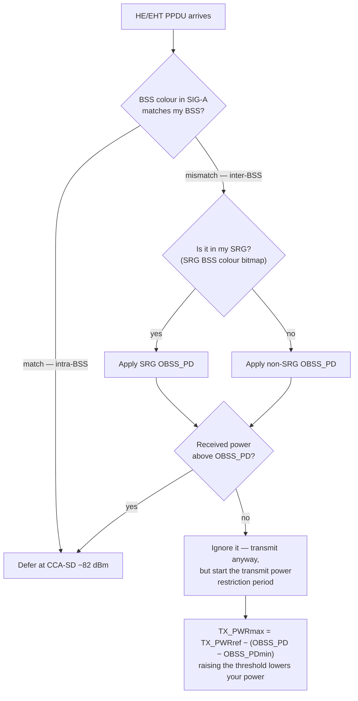

The arithmetic, from IEEE 802.11ax-2021 clause 26.10 and equation 26-5:

| Quantity | Value |
| --- | --- |
| `OBSS_PDmin` (non-SRG) | **−82 dBm** — identical to legacy CCA, i.e. spatial reuse does nothing |
| `OBSS_PDmax` (non-SRG) | **−62 dBm** — a 20 dB relaxation |
| Power constraint | `TX_PWRmax = TX_PWRref − (OBSS_PD − OBSS_PDmin)` |
| Reference power | `TX_PWRref` is defined per band and STA class; 21 dBm is the commonly cited value for a non-AP STA in 5 GHz |
| Adaptive rule | `OBSS_PD = min(OBSS_PDmax, OBSS_PDmin + (TX_PWRref − TX_PWR))` |

**Worked example.** AP transmitting at 15 dBm against a 21 dBm reference:

```
OBSS_PD = min(−62, −82 + (21 − 15)) = min(−62, −76) = −76 dBm
TX_PWRmax = 21 − (−76 − (−82)) = 21 − 6 = 15 dBm   (self-consistent)
```

The AP now ignores inter-BSS frames below −76 dBm — 6 dB less sensitive — and its clients inherit the
same threshold for triggered uplink via the SRP field in the trigger frame.

Three deployment truths:

- **The two equations are coupled on purpose.** This is the "constant product rule": you may trade
  sensitivity for transmit power, but the sum in dB stays constant. You cannot raise your ignore
  threshold *and* keep blasting.
- **Legacy preambles get nothing.** HT/VHT/OFDM frames carry no BSS colour, so a mixed 6/7 network
  sees only partial benefit. This is the strongest practical argument for retiring old APs before
  expecting reuse gains.
- **Colour collisions are a real failure mode.** With 6 bits (1–63) and random assignment, any two
  overlapping BSSes collide with probability 1/63 ≈ 1.6%. The standard handles it: a STA reports the
  collision, the AP announces a **BSS Color Change Announcement** with a Color Switch Countdown in
  TBTT units, and everyone switches together without losing association.

---

## 6. Admission control: what Wi-Fi can actually refuse

Admission control is the weakest of the four RRM resources, and saying why is a strong interview
answer.

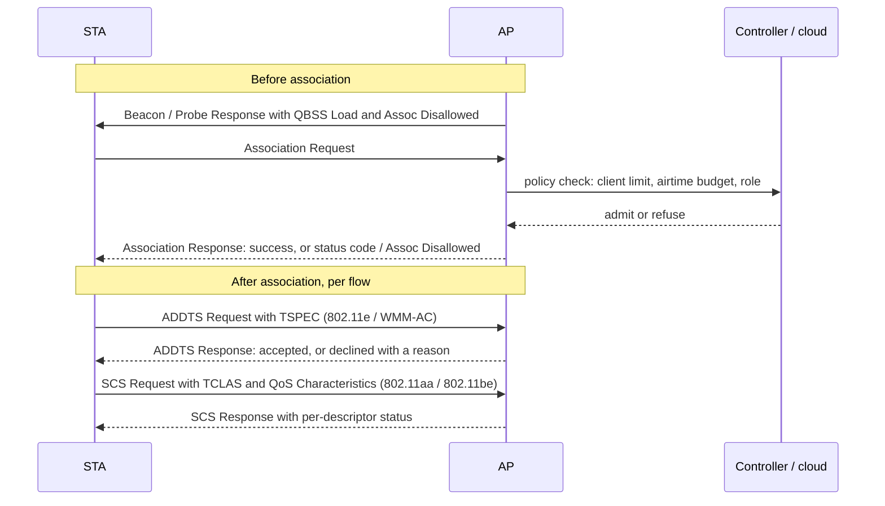

| Mechanism | Standard | What it can refuse | Deployed? |
| --- | --- | --- | --- |
| **Client count limit / SSID disable** | Vendor | New associations | Universally |
| **Assoc Disallowed (MBO)** | WFA MBO over 802.11v/11u | New associations, with a reason | Enterprise |
| **Association status code** | 802.11 | A specific STA | Universally, but blunt |
| **WMM Admission Control (ADDTS/TSPEC)** | 802.11e | A traffic stream, with a real bandwidth accounting | Rarely — only voice-era deployments |
| **HCCA (polled, guaranteed)** | 802.11e | n/a — it *grants* | **Effectively never implemented** |
| **SCS (Stream Classification Service)** | 802.11aa-2012 | Assigns a classifier → UP; the AP may decline a descriptor | Growing; Linux `mac80211` support landed 2025–2026 |
| **SCS with QoS Characteristics** | 802.11be-2024 | Requests a *service*: min/max service interval, max packet size, **delay bound**, **MSDU delivery ratio**, start time — mappable from 802.1Qbv/Qcc | New; the first real admission vocabulary Wi-Fi has had |
| **MSCS (Mirrored SCS)** | 802.11-2024 | Mirrors uplink priority onto the downlink of the same flow | New; useful precisely because downlink classification is otherwise impossible |
| **802.11bn HIP EDCA / TXOP preemption** | Draft | Priority for low-latency traffic and the right to preempt | Not published |

The honest summary: **Wi-Fi can refuse a station, and it can classify a flow. It cannot reserve
airtime in the way a cellular network reserves a bearer, except through SCS plus scheduling, which
requires the AP and the STA to both implement it.** Everything else is capacity planning plus hope.

---

## 7. Association steering: getting a STA onto the right AP, band and link

This is the "STA access" half of RRM: not whether a station may join, but *where* it joins.

### 7.1 The actuators

| Actuator | Mechanism | Band steering | AP steering | Load balancing | Can the STA ignore it? |
| --- | --- | --- | --- | --- | --- |
| Probe suppression | Delay or drop probe responses on the undesired band | Yes | Partially | No | Effectively no — it retries |
| Beacon/probe with reduced rates | Remove legacy rates so the cell looks smaller | Yes | No | No | No |
| **BTM Request (802.11v)** | Candidate list with preference 0–255, 0 = excluded | Yes | **Yes** | **Yes** | **Yes** |
| Assoc control (EasyMesh) | Refuse or allow per BSS | Yes | Yes | Yes | No |
| Deauth with reason | Disconnect | Yes | Yes | Yes | No — destructive |
| Neighbor Report (802.11k) | Give the STA the candidate list so it need not scan | Yes | Yes | No | It is advice |
| Assoc Disallowed (MBO) | Refuse new associations | Yes | Yes | Yes | No |
| Non-preferred channel report (MBO) | "Do not send me to these channels" | Yes | Yes | No | n/a — client's own constraint |

The MBO-OCE IE is the shared vocabulary here: element ID `0xDD`, OUI `50-6F-9A`, OUI type `0x16`.
It carries the association disallowed attribute, the non-preferred channel list, and the cellular
data capability/preference. Its value is that it lets the *client* state constraints the network must
respect — a client that cannot operate on channel 144 for regulatory reasons can now say so.

### 7.2 Band steering is not IEEE

Worth stating plainly: **there is no 802.11 band steering.** It is a vendor behaviour assembled from
probe suppression, rate manipulation, BTM and 802.11k. Two consequences:

- A client that retries hard enough wins. Every "we enabled band steering and some devices still join
  2.4 GHz" ticket is this.
- The 6 GHz generation added *standard* help (RNR, FILS discovery, out-of-band discovery, MBO
  preference), which is why band steering got measurably better in Wi-Fi 6E/7 without the mechanism
  being standardised.

### 7.3 Load balancing: count clients or count airtime?

The single most useful distinction in this section.

| Objective | Metric | What it gets right | What it gets wrong |
| --- | --- | --- | --- |
| **Client count** | Associated STA count per radio | Simple; available everywhere | A radio with 30 idle IoT sensors and a radio with 3 video clients look unbalanced when they are not |
| **Channel utilisation** | QBSS / CCA busy fraction | Reflects real contention | Doesn't attribute it to a station or a band |
| **Airtime per STA** | Per-STA TX/RX airtime accounting | The correct objective: airtime is the actual resource | Needs driver support; rarely exposed; changes minute to minute |
| **Capacity SLE** | User-minutes with sufficient capacity | The outcome metric | Needs cloud telemetry and minutes of history |

The mature implementations (Aruba ClientMatch, Mist) all moved from count to airtime or outcome. If
you are evaluating a system, ask which row it uses — it is the fastest way to tell a real load
balancer from a client-count reshuffle.

---

## 8. The decision function: a worked example

Everything above converges on one function: **given the current AP and a set of candidates, should
this STA move, and to where?** Here is one concrete instantiation, with weights that a real product
would tune.

```
Score(AP) = 40 · f_signal + 30 · (1 − utilisation) + w_band + 10 · f_capability − min(clients, 10)

f_signal(RCPI) = clamp((RCPI + 90) / 40, 0, 1)          # −50 dBm → 1.0, −90 dBm → 0.0
w_band         = 0 for 2.4 GHz, 10 for 5 GHz, 15 for 6 GHz
f_capability   = how well the AP matches what the STA can do (streams, bandwidth, MLO, 6 GHz)
```

**Worked case.** A Wi-Fi 7 phone, 2×2, 6 GHz capable, currently on AP-A. Three candidates:

| | AP-A (current) | AP-B | AP-C |
| --- | --- | --- | --- |
| Band | 2.4 GHz | 5 GHz | 6 GHz |
| RCPI | −55 dBm | −68 dBm | −74 dBm |
| `40 · f_signal` | 35.0 | 22.0 | 16.0 |
| Channel utilisation | 55% | 35% | 8% |
| `30 · (1 − util)` | 13.5 | 19.5 | 27.6 |
| `w_band` | 0 | 10 | 15 |
| `10 · f_capability` | 4 | 10 | 10 |
| `− min(clients, 10)` | −10 (18 clients) | −6 (6 clients) | −2 (2 clients) |
| **Total** | **42.5** | **55.5** | **66.6** |

The weakest signal wins by 24 points. That is the whole point of RRM: **signal strength is one term
in a cost function, not the cost function.**

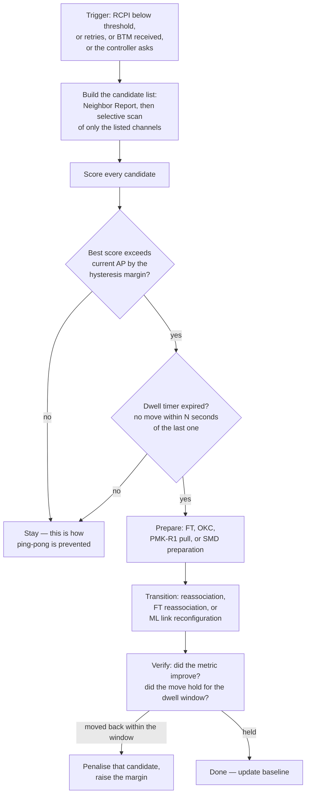

Three details that separate a working implementation from a demo:

- **The margin, not the score, decides.** Typical hysteresis is **3–6 dB** of signal-equivalent.
  Below 3 dB you oscillate; above 6 dB you stay on a bad AP for a long time.
- **Dwell timers and candidate penalties** are what actually stop ping-pong. Signal-based hysteresis
  alone does not, because a client moving through a corridor sees a monotone trend and a hysteresis
  window that is crossed once — the oscillation comes from *re-entering* a good cell, which only a
  timer catches.
- **The backhaul term matters in mesh.** In EasyMesh, a candidate with excellent fronthaul signal and
  a poor backhaul is a trap. That is why EasyMesh carries a link metric and a backhaul steering
  request, not just signal.

---

## 9. Roaming: the algorithm, end to end

### 9.1 Triggers

| Trigger | Where it lives | Notes |
| --- | --- | --- |
| RCPI/RSNI below threshold | STA driver / supplicant | The classical one; typical 5 GHz thresholds sit around −70 to −80 dBm |
| Background scan finds a better candidate | supplicant `bgscan` | e.g. `bgscan="simple:30:-70:3600"` — scan every 30 s, faster below −70 dBm, back off to 3600 s |
| Missed beacons | mac80211 / driver `beacon_loss` | May hold the association and simply stop transmitting |
| Retry exhaustion or latency | driver | Often a better trigger than RSSI, because it sees interference |
| BTM Request received | supplicant WNM code | The STA evaluates and may accept, reject or ignore |
| MLO link degradation | driver | Per-link recovery first; a full move only if the MLD-level metric fails |
| TWT / power-save mismatch | driver | A TWT agreement that no longer fits the traffic pattern is a real roam reason |

### 9.2 The six phases

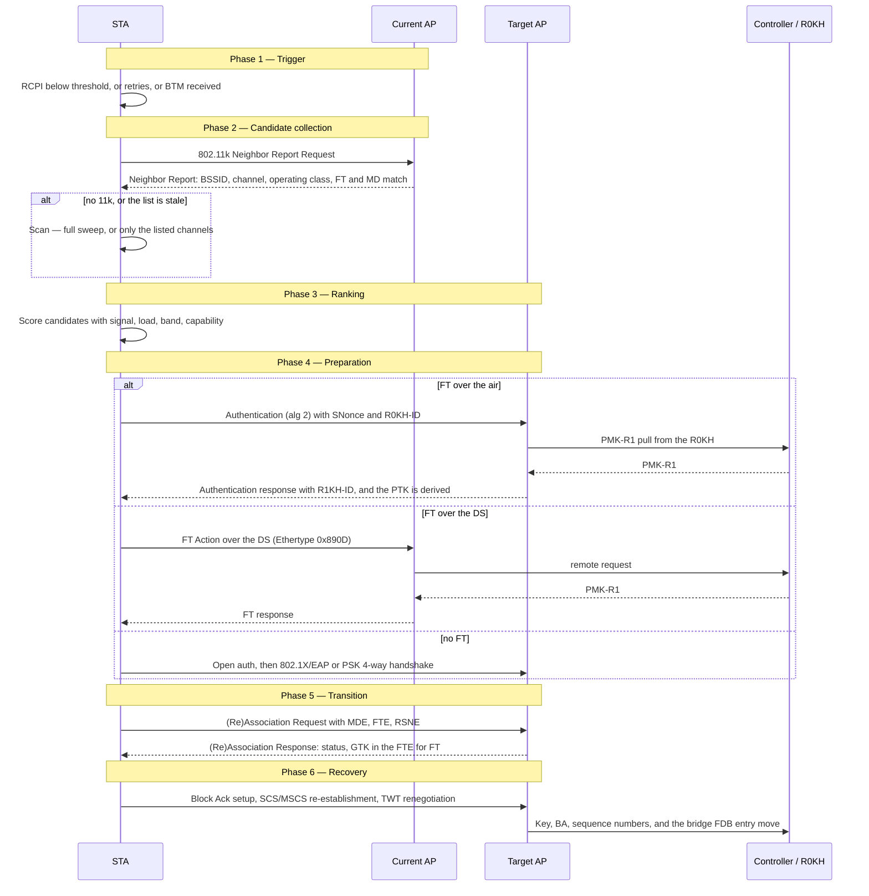

### 9.3 The state machine, including the failure edges

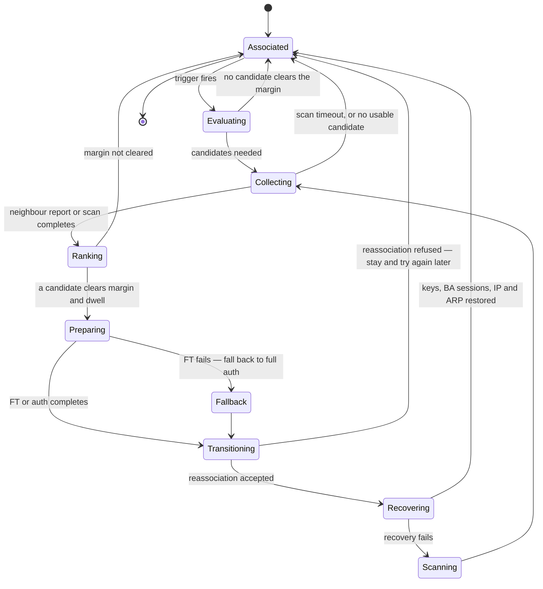

The two edges that matter operationally are **"no candidate clears the margin"** (the sticky client —
correct behaviour, bad outcome) and **"FT fails, fall back to full auth"** (the roam that takes
hundreds of milliseconds instead of tens, and the reason FT failure modes are worth knowing: a
mismatched Mobility Domain, an RSNE without an FT AKM, or an MDE that does not match the beacon all
produce a silent fallback).

### 9.4 Where the time goes

Indicative field values, not standardised — the point is the shape, not the digits:

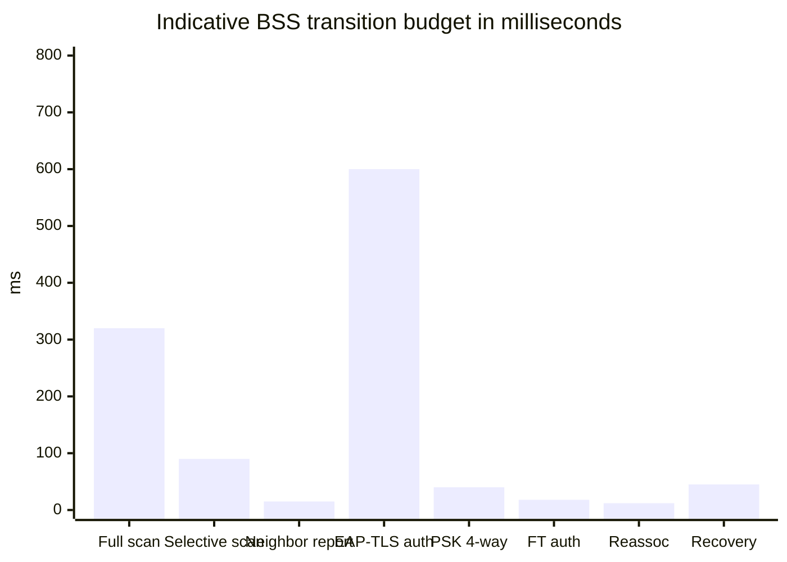

| Phase | Full 802.1X, no 11k | With 11k + FT | What removes the cost |
| --- | --- | --- | --- |
| Discovery | 200–400 ms (full sweep, every channel) | 10–30 ms | 802.11k Neighbor Report → selective scan; 6 GHz out-of-band discovery |
| Authentication | 300 ms – 2 s (EAP-TLS, RADIUS round trips) | 10–25 ms | 802.11r FT, or OKC (skips 802.1X, keeps the 4-way) |
| Reassociation | 10–20 ms | 10–20 ms | Nothing — it is two frames |
| Key and BA recovery | 5–50 ms | 1–5 ms | FT delivers the GTK inside the FTE |
| L2/L3 recovery | 0–50 ms same subnet | 0–50 ms | Bridge FDB update, ARP/ND refresh |
| **Total** | **0.5–3 s** | **typically tens of ms** | Vendor literature quotes sub-50 ms for FT; measure it, do not quote it |

Two things the table makes obvious:

- **Discovery and authentication are the cost.** Reassociation is two frames and is never the
  problem. Any optimisation that does not touch discovery or authentication is not a roaming
  optimisation.
- **The residual — L2/L3 recovery and application behaviour — is what users feel.** A 30 ms Wi-Fi
  roam still drops a TCP flow if the switch FDB has not learned the new port, which is why roaming is
  as much a wired design problem as a radio one.

### 9.5 Hysteresis, dwell and ping-pong

| Mechanism | Typical value | What it prevents |
| --- | --- | --- |
| Signal hysteresis | 3–6 dB | Oscillation between two cells of nearly equal signal |
| Dwell / minimum stay timer | seconds | Rapid re-roams after a successful move |
| Scan backoff | e.g. 30 s → 3600 s in `bgscan` | Battery drain from constant scanning |
| Candidate penalty after a bounce | vendor-specific | The specific pair of APs a corridor causes trouble between |
| BTM throttling | WFA-defined timeouts | An over-eager controller hammering clients |
| Roam attempt limit | vendor-specific | A client that repeatedly fails to reassociate burning airtime |

The failure mode is worth naming: **ping-pong is not caused by hysteresis being too small, it is
caused by the objective function being wrong.** A client oscillating between two APs at the cell edge
is usually chasing a signal metric when the real problem is that both cells are too large — which is
a power design problem, not a roaming parameter.

### 9.6 MLO changes the unit of roaming

With Multi-Link Operation the STA is an MLD with several links, and the roam decision splits in two:

| Layer | Decision | Mechanism |
| --- | --- | --- |
| **Link** | Which links are enabled, and which TID goes on which link | TID-to-link mapping, ML link reconfiguration, TID-to-link mapping negotiation |
| **AP MLD** | Leave this AP MLD for another | BSS transition management for MLDs (802.11be clause 35.3.23), with the Neighbor Report carrying a Basic Multi-Link element |

The consequence for RRM: **a Wi-Fi 7 client has a graceful degradation path that does not exist for
earlier clients.** It can drop 6 GHz and continue on 5 GHz inside the same association. So the first
RRM response to a degrading 6 GHz link is link reconfiguration, not a BSS transition — and an RRM
system that only knows how to steer whole associations will over-roam MLO clients.

---

## 10. Handoff mechanisms compared

| | Client-driven roam | 802.11k-assisted | BTM (802.11v) | FT (802.11r) | OKC | SMD (802.11bn) |
| --- | --- | --- | --- | --- | --- | --- |
| **Standardised** | No | Yes | Yes | Yes | No | Draft |
| **Who decides** | STA | STA, with better data | AP proposes, STA decides | STA, faster | STA | AP MLD set, with preparation |
| **Saves** | — | Scan time | Scan time and target choice | Authentication time | 802.1X time (keeps 4-way) | Everything, by preparing first |
| **Network can force it** | No | No | No | No | No | Yes, within the domain |
| **Make-before-break** | No | No | No | No | No | **Yes** |
| **Typical saving** | baseline | 100–300 ms of discovery | 100–300 ms, plus a better target | 300 ms–2 s of authentication | hundreds of ms | Removes the visible break |
| **Requires** | nothing | AP and STA support RM | AP and STA support WNM | PMK-R0/R1 hierarchy, an R0KH, matching MDID and an FT AKM | Shared PMK caching | SMD-ID, inter-AP communication, context transfer |
| **Fails when** | thresholds are wrong | client ignores RM | client ignores BTM | MD/RSNE mismatch → silent fallback to full auth | STA does not cache | not published yet |

The one-line version: **802.11k removes the scan, 802.11r removes the authentication, 802.11v tries
to remove the bad decision, and SMD tries to remove the gap.**

---

## 11. Two different "multi-AP": EasyMesh RRM vs 802.11bn MAPC

Both get called "multi-AP". They are not the same thing, and conflating them is a common error.

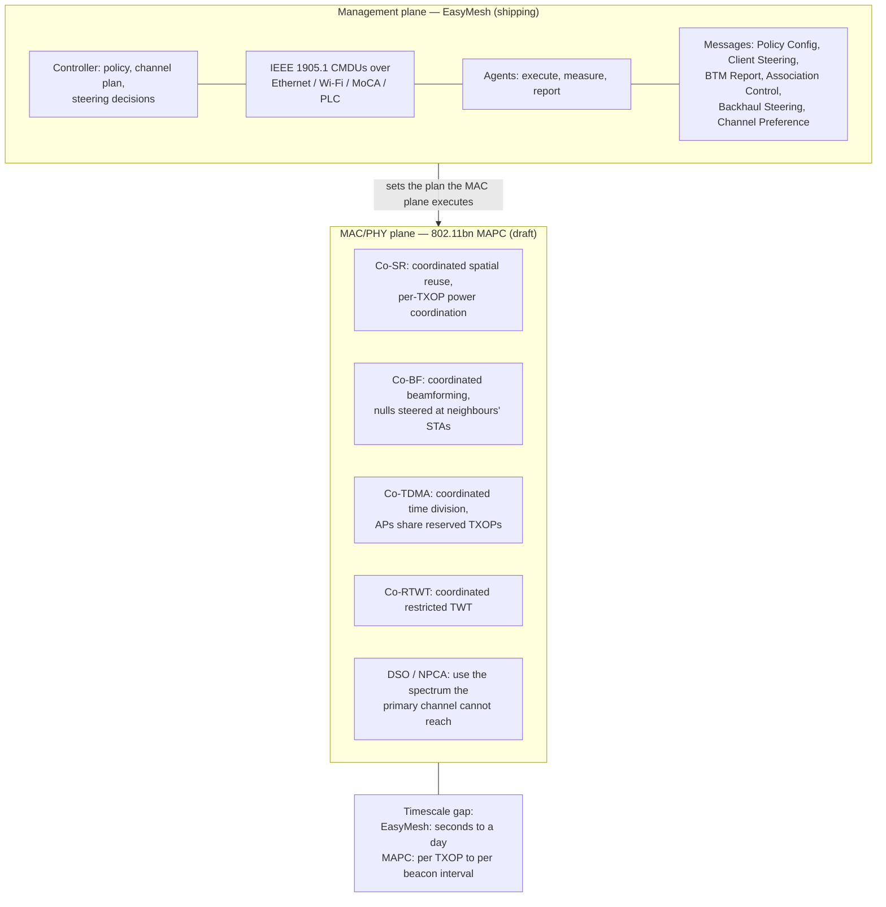

| | EasyMesh | 802.11bn MAPC |
| --- | --- | --- |
| Layer | Management: who plans the network | MAC/PHY: how APs transmit together |
| Timescale | Seconds to a day | Per TXOP, per beacon interval |
| Transport | IEEE 1905.1 CMDUs, any backhaul | Over-the-air coordination and inter-AP signalling |
| Authority | Controller is authoritative over agents | Peer coordination, no controller required |
| Certified | Yes — Wi-Fi EasyMesh R1–R6 | Not yet; programme not open |
| What it fixes | Wrong channel, wrong power, sticky clients, bad backhaul | Interference between APs that are correctly configured |
| Status | Shipping; v6.0 (Aug 2024) mandatory for newly tested devices from 31 Dec 2024 | D1.0 July 2025 (>8,000 comments), D1.3 Jan 2026, ~75% resolved May 2026, publication ~2028 |

The shift is significant enough to name: **for twenty-five years, Wi-Fi RRM has been a planning
problem — choose channels and power well. MAPC makes it a scheduling problem — coordinate every
transmission.** That is why 802.11bn's targets are expressed as *reliability* (+25% throughput at a
given SINR, −25% 95th-percentile latency, −25% MPDU loss including during BSS transitions) rather
than as a peak rate.

SMD deserves its own note here because it is a *roaming* feature built on coordination:

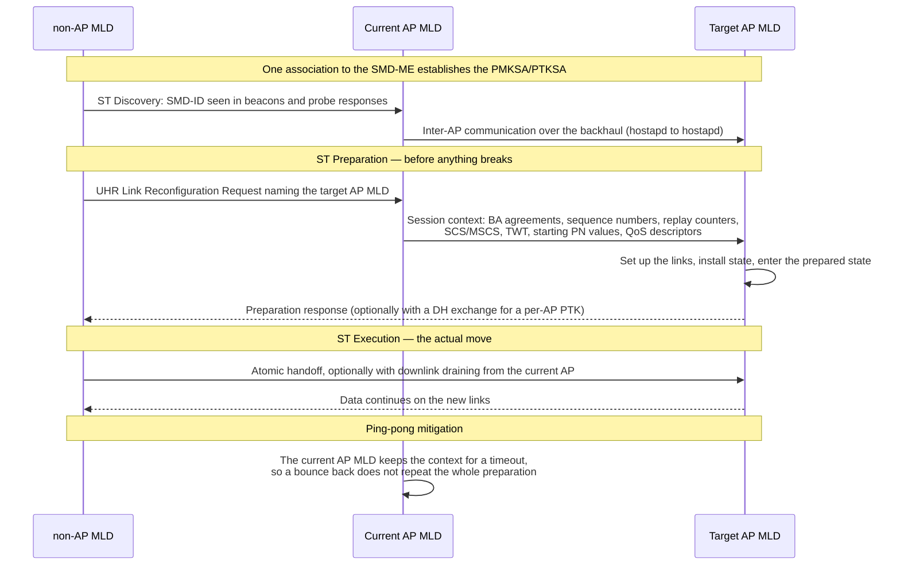

This is the first Wi-Fi mechanism that is genuinely **make-before-break**, and the reason it can be is
that the context — sequence numbers, BA state, keys, QoS descriptors — is *transferred* rather than
renegotiated. Note also that the spec defines only what may be exchanged over the inter-AP link, not
the protocol: that is left to implementations, which in practice means vendor lock-in inside an SMD.

---

## 12. What AI and ML actually change in RRM

| Vendor | Approach | Objective function | What is genuinely new |
| --- | --- | --- | --- |
| **Mist (HPE Juniper)** | Two-tier: global optimisation once a day (2–3 AM local) from long-term trends, plus event-driven local RRM; **reinforcement learning validated against the Capacity SLE** | Capacity SLE in user-minutes | The objective is an *outcome*, not a radio metric. Plus cross-site learning: radar/DFS events learned near one airport are applied to other sites near it |
| **Ruckus AI Cloud RRM** | ML over a network-wide database; solves across many APs at once and **presents the plan to the engineer** for acceptance or rejection | Channel plan quality | Human-in-the-loop, and a mesh-graph view of the proposed plan |
| **Aruba (HPE)** | AirMatch: centralised, machine-learning-assisted channel/width/EIRP plan from 24 hours of data; ClientMatch for per-client steering | Channel plan plus per-client experience | Separating the *plan* problem (AirMatch, daily) from the *client* problem (ClientMatch, continuous) |
| **Cisco** | RRM with CM-based DCA/TPC; AI-Enhanced RRM and AI endpoint analytics in Catalyst platforms; ED-RRM for event-driven changes | Cost metric | Off-channel cost discipline (≤70 ms, 0.2% of airtime) and the most documented metric |

The honest limits, which are the interesting part:

1. **AI cannot move a client.** The roam trigger is in the STA's driver. A perfect model that
   recommends a transition the client ignores has achieved nothing. Every ML-based RRM system is
   optimising over the set of things the network controls: channel, power, width, and the willingness
   to make staying unpleasant.
2. **AI fixes the objective function, not the physics.** The step from "minimise interference" to
   "maximise user-minutes with usable capacity" is a real improvement, because interference is a
   proxy and user experience is the thing. But if the AP density is wrong or the min power is set too
   low, no model helps.
3. **The data advantage is cross-site and long-term.** A controller with no memory makes one plan per
   day from today's data. A cloud with hundreds of sites can learn that a particular radar pattern
   recurs at 07:00 near an airport, or that this building's capacity collapses when a lecture
   changes. That is a genuinely new capability, and it is a *data* capability more than an algorithmic
   one.
4. **Explainability is a real requirement.** Ruckus requiring an engineer to accept the plan is not
   a limitation; it is the correct design for a system that can take a network down.

---

## 13. Tuning: the knobs, and the failure modes

### 13.1 The five settings that matter

| Setting | Why it dominates | Rule of thumb |
| --- | --- | --- |
| **Minimum transmit power** | Everything else adapts around it | Set it to the power the design was surveyed at. Letting RRM go below the design power creates holes |
| **Maximum transmit power** | Caps the damage from an AP failure | Design power plus 3–6 dB, so one dead AP can be covered by its neighbours |
| **Channel list** | The search space | Restrict it. A list of 25 channels in a three-AP office is an invitation to churn |
| **Channel width** | The biggest single lever | 20 MHz dense, 40 MHz standard, 80 MHz isolated. Never 160 MHz in enterprise |
| **DFS policy** | Compliance and outage risk | Exclude 120/124/128 near airports; always keep a non-DFS fallback |

### 13.2 Symptom → cause

| Symptom | Most likely RRM cause | First check |
| --- | --- | --- |
| Clients stick to a distant AP | Client threshold, not network; or power too high so the cell never becomes unattractive | Compare RCPI at the point of complaint with the client's roam threshold |
| Throughput collapses every 10 minutes | DCA churn, or TPC stepping power | Channel change log against the throughput graph |
| Coverage holes after an AP failure | Max power too low to let neighbours compensate | Max power and the TPC range |
| 60-second outage when an AP boots | DFS CAC on the selected channel | Channel list; move boot channels off DFS |
| Everything lands on eight channels after a radar hit | No non-DFS fallback in the plan | DCA channel list |
| Roam takes ~1 s | FT falling back to full authentication | FT status codes: MD match, FT AKM in the RSNE, MDE in the beacon |
| Bouncing between two APs | Cells too large, or a margin below 3 dB | Power, not the roam parameter |
| 2.4 GHz congested | Radios that should have been repurposed | FRA, or disable every other 2.4 GHz radio |
| MLO clients roam too often | RRM steering whole associations when link reconfiguration would do | TID-to-link mapping and link reconfiguration |
| "RRM made it worse" | A slow loop chasing a fast problem | Sensitivity and interval; widen both |

### 13.3 The rules that survive contact with production

1. **Fix the design first.** RRM cannot rescue a bad AP layout, and it will happily make a good one
   worse.
2. **Constrain before you enable.** Set min/max power and the channel list before turning DCA on.
3. **Slow it down.** The default cadences are already fast for most buildings; a daily plan with
   event-driven exceptions beats a ten-minute plan.
4. **Log the changes.** Every RRM incident I have seen was diagnosed by correlating a channel/power
   change log with a complaint graph. Without the log you are guessing.
5. **Turn one thing on at a time.** Band steering, load balancing, and FT interact; enabling all
   three in one change window means you learn nothing.

---

## 14. Interview package

### 14.1 Ten numbers worth memorising

| Number | What it is |
| --- | --- |
| **−82 dBm** | Legacy CCA-SD sensitivity, and `OBSS_PDmin` — where spatial reuse gives you nothing |
| **−62 dBm** | `OBSS_PDmax` — the maximum spatial reuse relaxation |
| **−70 dBm** | Cisco TPC default threshold (was −65 dBm before release 4.1.85.0) |
| **3 dB / 6 dB** | Cisco TPC hysteresis: increase 3 dB, decrease 6 dB |
| **600 s** | Cisco DCA and TPC default interval |
| **≤70 ms / 0.2%** | Cisco off-channel dwell and total off-channel time |
| **60 s / 10 s / 30 min** | DFS: CAC, Channel Move Time, Non-Occupancy Period |
| **15 s** | Ruckus ChannelFly capacity assessment interval, and its reaction time to a large drop |
| **−5 to −38 dB** | Allowed relative constellation error from BPSK to 4096-QAM — the constraint that sets how good the radio must be |
| **25% / 25% / 25%** | 802.11bn targets: throughput at a given SINR, 95th-percentile latency, MPDU loss including during BSS transitions |

### 14.2 Ten answers, one sentence each

1. **"What is RRM?"** The set of control loops that allocate spectrum, power and airtime across APs
   and decide which station is served by which AP, band and link.
2. **"Is RRM standardised?"** No. 802.11 standardises measurements (11k), requests (11v), fast
   security (11r) and etiquette (11h); the decision logic is vendor-specific.
3. **"Why can't the network just move a client?"** Because the roam trigger is in the STA. BTM is a
   recommendation; the only force primitive is deauthentication.
4. **"What does 802.11k give you that RSSI does not?"** RCPI and RSNI, channel load, noise
   histograms, STA statistics and a neighbour list — i.e. signal-to-noise and load, not just signal.
5. **"What does 802.11r actually save?"** The 802.1X exchange: PMK → PMK-R0 → PMK-R1 → PTK, so the
   reassociation carries the GTK inside the FTE. It saves hundreds of milliseconds, not the scan.
6. **"What is the difference between steering and roaming?"** Roaming is the STA's decision;
   steering is the network's attempt to influence it, using BTM, probe suppression and association
   control.
7. **"Why is hysteresis 3–6 dB?"** About 3 dB per MCS step: below 3 dB you oscillate, above 6 dB you
   stay on a bad AP.
8. **"What is the constant product rule?"** In spatial reuse, raising your OBSS_PD threshold by X dB
   forces your transmit power down by X dB, so you cannot ignore your neighbours and shout at the
   same time.
9. **"Why is load balancing by client count wrong?"** Because airtime is the resource, not
   associations: 30 idle sensors and 3 video clients are not comparable.
10. **"What changes in Wi-Fi 8?"** Multi-AP coordination moves RRM from a planning problem to a
    scheduling problem, and SMD makes roaming make-before-break by transferring context instead of
    renegotiating it.

### 14.3 Ten corrections — things popular sources get wrong

1. **"RRM is 802.11k."** Wrong: 802.11k is a *measurement* framework. It does not assign anything.
2. **"802.11v lets the AP move a client."** Wrong: BTM is a request. The STA may reject or ignore it.
3. **"Band steering is an IEEE feature."** Wrong: it is a vendor behaviour built from probe
   suppression, rate manipulation, BTM and 11k.
4. **"More transmit power is better coverage."** Wrong: it grows the contention domain and breaks the
   uplink before it helps the downlink.
5. **"Spatial reuse is free throughput."** Wrong: it is a trade regulated by equation 26-5, and
   legacy preambles get none of it.
6. **"DFS channels are just extra channels."** Wrong: 60 s CAC on boot, 600 s on TDWR channels,
   10 s to vacate, 30 min blocked.
7. **"FT is always fast."** Wrong: an MD mismatch, a missing FT AKM, or an MDE that does not match
   the beacon produces a silent fallback to full authentication.
8. **"Load balancing and steering are the same thing."** Wrong: same actuators, different objective
   function — RF quality versus airtime.
9. **"Ping-pong means the hysteresis is too small."** Usually wrong: it means the cells are too
   large, which is a power design problem.
10. **"EasyMesh multi-AP and 802.11bn multi-AP coordination are the same idea."** Wrong: one is a
    management plane on 1905.1 with a timescale of seconds to a day; the other is per-TXOP MAC/PHY
    coordination.

---

## Anchors

- **Cisco RRM** (documented in the Catalyst 9800 configuration guide and the RRM white paper): APs go
  off-channel for **not more than 70 ms** and spend **0.2%** of their time off channel; off-channel
  measurement is deferred if voice or other critical traffic was seen in the **last 100 ms**. An RF
  neighbourhood forms between controllers when validated neighbour messages are heard at **−80 dBm or
  stronger**; the RF group leader is the controller with the greatest AP capacity.
- **Cisco DCA**: an RSSI-based **Cost Metric** combining same-channel contention, foreign/rogue
  energy, noise, channel load and a user sensitivity constant. Default interval **600 s**; sensitivity
  thresholds **High 5 dB, Medium 10 dB (2.4 GHz) / 15 dB (5 GHz), Low 20 dB** in the 8.10
  configuration guide — earlier releases list Low as 30/35 dB, so quote the release. DCA ranks radios
  into a Channel Plan Change Initiator list and evaluates the worst first to avoid pinning and
  cascading. Dynamic Bandwidth Selection starts at 80 MHz and lowers width on neighbour density,
  interference, noise floor and client capability.
- **Cisco TPCv1**: `Tx_Ideal = Tx_Max + (TPC_threshold − RSSI_3rd)`; default threshold **−70 dBm**
  (changed from −65 dBm at release 4.1.85.0; valid range −50 to −80 dBm); the **third-loudest**
  neighbour is used because three is the number of non-overlapping 2.4 GHz channels; hysteresis
  **3 dB for an increase, 6 dB for a decrease**; decreases one level per interval, increases are
  handled through coverage hole detection; **TPC only turns power down**; the algorithm needs at
  least **four APs** in the area to work.
- **Cisco coverage hole detection defaults**: Minimum Client Level **3**, Data RSSI **−80 dBm**,
  Voice RSSI **−80 dBm**, Exception Level **25%**. Some Cisco documentation describes the weak-client
  threshold as −70 dBm at a 20% exception level — releases differ, verify on the controller.
- **Aruba**: **ARM** (Adaptive Radio Management) is the distributed, per-AP original, still used by
  Instant APs. **AirMatch** (AOS 8, Mobility Conductor) is the centralised replacement: it solves
  channel, channel width and EIRP for every radio from the previous **24 hours** of data, deploys a
  new plan **once a day** by default in the early morning, and only if the plan is meaningfully
  better; radar and severe interference trigger **event-driven** local changes. **ClientMatch** is the
  per-client layer: sticky-client correction, band steering and load balancing, requiring no client
  software, and working with 802.11r FT and OKC through Cloud-Assisted Roaming Services.
- **Ruckus ChannelFly**: chooses channels from **measured capacity**, not interference characterisation;
  assesses channel capacity every **15 s** and can react to a large measured drop in **under 15 s**;
  changes channel with **802.11h** channel switch announcements; the first **30–60 minutes** are
  unsettled while it learns. ChannelFly 2.0: phase 1 collects neighbour **RX airtime utilisation**
  during the default **20 s** background scan, weighted by RSSI, keeping about **16 entries**; phase 2
  picks channels with the fewest neighbours and then cost-benefits on RX utilisation. Two user
  controls gate disruption: **Channel Change Frequency** (default **33**, permitting changes only at
  three or fewer associated clients) and **Full Optimization Period**. Ruckus **AI-Driven Cloud RRM**
  is ML-based, network-wide, and presents the plan to the engineer for acceptance or rejection.
- **Mist (HPE Juniper) AI RRM**: a **two-tier** model — global optimisation once a day (about 2–3 AM
  local) from long-term trend baselines, plus **event-driven local RRM** that acts immediately on
  deviation. A **reinforcement-learning** feedback model is trained and validated against the
  **Capacity SLE** (user-minutes with usable capacity, accounting for client count, client usage, and
  Wi-Fi and non-Wi-Fi interference). Only **power range** and **channel list** are exposed; a
  two-sigma deviation in per-client bandwidth is flagged in the client usage classifier but does not
  by itself cause a channel change. The cloud cross-pollinates learning between sites (documented
  example: radar/DFS events near airports).
- **802.11k** (Radio Resource Measurement, now 802.11-2020 clause 11.10) defines the request/report
  pairs: **Beacon** (passive, active and beacon-table modes), **Frame**, **Channel Load**, **Noise
  Histogram**, **STA Statistics**, **Link Measurement**, **Neighbor Report**, **LCI/Location**,
  **Transmit Stream/Category**, **AP Channel Report**, **Measurement Pause**, plus **Hidden Node** and
  **Medium Sensing Time Histogram** from the original amendment. **RCPI** is encoded so that
  `dBm = RCPI/2 − 110`; **RSNI** uses the same encoding.
- **802.11v** (WNM): **BSS Transition Management** uses action category **10**, actions **6** Query,
  **7** Request, **8** Response; candidate preference is **0–255** where **0 means excluded**; the
  disassociation-imminent flag and WFA reason codes plus throttling timeouts apply. Other WNM
  features: WNM-Sleep, BSS Max Idle, Directed Multicast Service, TIM Broadcast, triggered STA
  statistics, collocated interference reporting.
- **802.11r** (Fast BSS Transition): **PMK → PMK-R0** (SSID, MDID, R0KH-ID, SPA) **→ PMK-R1**
  (BSSID, SPA) **→ PTK**; authentication algorithm **2**; **MDID is 2 octets**; over-the-DS uses a
  remote frame with **Ethertype 0x890D**; the **GTK is delivered in the FTE** of the Reassociation
  Response, so a later 4-way handshake means the transition fell back.
- **WFA MBO / Agile Multiband**: the **MBO-OCE IE** is element ID `0xDD`, OUI `50-6F-9A`, OUI type
  `0x16`. Agile Multiband certifies features from 802.11k, 802.11v and 802.11u plus WFA
  specifications, **requires PMF**, and defines the **Assoc Disallowed** attribute, the
  **non-preferred channel** report and the cellular data capability/preference.
- **Spatial reuse** (802.11ax-2021 clause 26.10, equation 26-5): `OBSS_PDmin = −82 dBm`,
  `OBSS_PDmax = −62 dBm`; `TX_PWRmax = TX_PWRref − (OBSS_PD − OBSS_PDmin)`; adaptive rule
  `OBSS_PD = min(OBSS_PDmax, OBSS_PDmin + (TX_PWRref − TX_PWR))`. BSS colour is **6 bits (1–63)**,
  so two overlapping BSSes collide with probability **1/63 ≈ 1.6%**; recovery uses the **BSS Color
  Change Announcement** with a Color Switch Countdown in TBTT units. Legacy HT/VHT/OFDM preambles
  carry no BSS colour and get no benefit.
- **DFS** (802.11h, now in 802.11-2020): **Channel Availability Check 60 s** (and **600 s** on US
  channels 120/124/128 overlapping TDWR), **Channel Move Time 10 s**, **Non-Occupancy Period
  30 minutes**, continuous in-service monitoring. US 5 GHz: UNII-1 (36–48) and UNII-3 (149–165) are
  non-DFS; UNII-2A (52–64) and UNII-2C/2E (100–144) require DFS.
- **Admission control**: 802.11e WMM-AC uses **ADDTS/TSPEC**; **HCCA was never deployed**. 802.11aa
  (2012) introduced **SCS**. 802.11be-2024 adds the **QoS Characteristics element (9.4.2.326)** —
  flow identifier, minimum and maximum service interval, maximum packet size, **delay bound**,
  **MSDU delivery ratio**, start time — designed to map from 802.1Qbv/Qcc. SCS procedure is 802.11-2024
  clause **11.25.2**, MSCS **11.25.3**; TCLAS element **9.4.2.29/9.4.2.31**.
- **802.11bn (UHR / Wi-Fi 8)**: TG formed May 2021, work began November 2023, **D1.0 July 2025** with
  more than 8,000 comments, **D1.3 approved January 2026**, roughly 75% of comments resolved by
  May 2026, publication projected **2028**. Targets: **+25% throughput at a given SINR, −25%
  95th-percentile latency, −25% MPDU loss including during BSS transitions**. MAPC schemes:
  **Co-SR, Co-BF, Co-TDMA, Co-RTWT, Co-CR**, plus **DSO**, **NPCA**, **DRU**, **ELR** (20 MHz,
  BPSK/QPSK), **HIP EDCA**, **TXOP preemption**, and in-device coexistence with **PUO/DUO**
  unavailability reporting.
- **SMD (Seamless Mobility Domain)** in P802.11bn: a single entity spanning multiple AP MLDs;
  **SMD-ID** advertised as a 6-byte MAC in beacons; **ST Preparation** (context transfer or
  renegotiation, link setup) followed by **ST Execution** (atomic handoff, optional downlink
  draining); transferred context covers block-ack agreements, sequence numbers, replay counters,
  SCS/MSCS, TWT, starting PNs and QoS descriptors; inter-AP communication is defined in scope but its
  protocol is left to implementations. TGbn has agreed context transfer and renegotiation, and the
  current AP MLD may preserve context for a timeout to mitigate **ping-pong** roaming.
- **EasyMesh**: releases **R1–R6**; **v6.0** announced August 2024 and mandatory for newly tested
  devices from **31 December 2024**; control plane is IEEE 1905.1 CMDUs, with Client Steering
  Request, Client Steering BTM Report, Client Association Control Request and Backhaul Steering
  Request among the Multi-AP message types.
- **Not standardised at all**: the client roam trigger, band steering, load balancing policy, airtime
  fairness, and the choice of channel/power algorithm. `VERIFY` any vendor claim of "standard
  roaming" against these.

## Related

- [[02-6 WLAN - Multi-AP Roaming, Healing and Steering - 802.11k, 11v, 11r, BTM and Self-Healing]] — the companion note: the same territory from the client's side, with the full K-V-R triad, the FT key chain, the EasyMesh steering message semantics, and why the client owns the trigger
- [[02-8 WLAN - Scheduling - Channel Access, EDCA, OFDMA Resource Allocation, Airtime and Implementation]] — the airtime half of the resource: per-station airtime accounting is the objective this note's load balancing wants, and scheduling is the actuator spatial reuse feeds
- [[02-7 WLAN - Wi-Fi EasyMesh - Operation, Tuning and Troubleshooting]] — the management plane this note's §11 compares against MAPC: 1905.1 CMDUs, controller/agent roles, channel planning and the steering exchange with its real field semantics
- [[02-5 WLAN - STA-AP Discovery, Authentication and Association - Scanning, WPA3 and the Join State Machine]] — what §9's preparation phase is trying to avoid repeating: the full join, the PMK chain and the association state machine
- [[02-3 WLAN - Ecosystem - WFA Certification, EasyMesh and prpl]] — who certifies the primitives this note relies on: Agile Multiband for 11k/v/r, EasyMesh for multi-AP, and why PMF is a precondition
- [[02-1 WLAN - Wi-Fi Generations Evolution - Wi-Fi 4 to Wi-Fi 8 and Beyond]] — which generation contributed which RRM primitive, and the two clocks (IEEE publication versus WFA programme) that decide when a feature is usable
- [[02-14 WLAN - Wi-Fi Fundamentals - History, Architecture, PHY, MAC and the Road to Wi-Fi 7]] — the substrate: BSS and ESS, the join sequence, CSMA/CA and EDCA, and the numerology that makes the channel-width trade in §3.5 concrete
- [[02-15 WLAN - The Transceiver - From Superheterodyne to Wi-Fi 7 and the AI-Native Radio]] — what the RRM decisions are physically buying: the noise and EVM budget behind every sensitivity number, and why transmit power is not a free parameter
- [[02-13 WLAN - Reliability, Low Latency and Determinism - What the Wi-Fi Stack Can Actually Do]] — the reason §6's admission control matters: a roam is a hole in any latency bound, and SCS plus scheduling is the only way to close it
- [[02-10 WLAN - Baseband and Driver Architecture for Wi-Fi 6, 7 and 8 - Qualcomm as the Reference Design]] — where the roam preparation state actually lives: peer and key state in firmware, and what context transfer demands of the station state machine
- [[02-2 WLAN - Power Saving Mechanisms and Evolution - Legacy PS, TWT and Wake-Up Radio]] — the constraint §9 works around: a sleeping client misses the frames that would have triggered its roam, and a TWT agreement constrains the target AP
- [[02-4 WLAN - Packet TX-RX Datapath and Offload Evolution - Aggregation, Block Ack and the Host-Device Split]] — what has to be rebuilt after a transition: keys, BA sessions, FDB entries and flow-offload state, which is the real "recovery" phase
- [[02-9 WLAN - Time-Sensitive Networking Across Wi-Fi Generations - From WMM to 802.11bn and IEC-IEEE 60802]] — the destination for SCS with QoS Characteristics: mapping 802.1Qbv schedules onto the Wi-Fi MAC
- [[01-2 5G NR RAN Layer 2 Protocol Stack]] — the cellular contrast in §0.2: handover is network-controlled with a preparation phase, and the UE has no vote
- [[04-3 Embedded Software Architecture - Patterns, Layering and Wireless System Structure]] — the controller/agent split as an architectural pattern: policy at the top, mechanism at the bottom, and why the critical path must not cross a control-plane boundary
- [[06-3 Machine Learning - Foundations, Core Algorithms and Applications]] — what §12's reinforcement-learning RRM actually optimises, and why "validated against an outcome metric" is the whole trick

## References

1. IEEE. *Part 11: Wireless LAN Medium Access Control (MAC) and Physical Layer (PHY)
   Specifications*, IEEE Std 802.11-2024. — Clauses 11.10 (radio measurement) and 11.11 (WNM), the
   consolidated text for everything in §2.3, §6 and §7.
2. IEEE. *Part 11: Amendment 1: Radio Resource Measurement of Wireless LANs*, IEEE Std 802.11k-2008.
   — The measurement catalogue in §2.3 and the Neighbor Report that removes the scan from a roam.
3. IEEE. *Part 11: Amendment 8: IEEE 802.11 Wireless Network Management*, IEEE Std 802.11v-2011. —
   BSS Transition Management, the WNM action frames, and the preference and reason codes of §7.1.
4. IEEE. *Part 11: Amendment 2: Fast Basic Service Set (BSS) Transition*, IEEE Std 802.11r-2008. —
   The PMK-R0/R1 hierarchy, over-the-air and over-the-DS, and the FTE that carries the GTK.
5. IEEE. *Part 11: Amendment 5: Spectrum and Transmit Power Management Extensions in the 5 GHz Band in
   Europe*, IEEE Std 802.11h-2003. — DFS and TPC, now folded into 802.11-2020; the source for §4 and
   the DFS timings in §3.6.
6. IEEE. *Part 11: Amendment 4: Enhancements for Very High Throughput for Operation in Bands below
   6 GHz*, IEEE Std 802.11ac-2013, and *Amendment 6: Enhancements for High Efficiency WLAN*, IEEE Std
   802.11ax-2021. — Clause 26.10 of 802.11ax is the spatial reuse specification behind §5, including
   equation 26-5.
7. IEEE. *Part 11: Amendment: Enhancements for Extremely High Throughput*, IEEE Std 802.11be-2024. —
   Clause 35.3.23 (BSS transition management for MLDs), the QoS Characteristics element 9.4.2.326, and
   the MLD-level primitives of §6 and §9.6.
8. IEEE. *Part 11: Amendment 2: MAC Enhancements for Robust Audio Video Streaming*, IEEE Std
   802.11aa-2012. — The original Stream Classification Service and OBSS management.
9. IEEE P802.11bn/D1.x, *Amendment: Enhancements for Ultra High Reliability*. — MAPC, DSO, NPCA,
   HIP EDCA, and the SMD clauses (37.16.x) discussed in §11.
10. IEEE 802.11 WG. *Amendment: Enhancements for WLAN Sensing*, IEEE Std 802.11bf-2025 (published
    26 September 2025). — Included because sensing is the next input RRM controllers will consume.
11. Cisco Systems. *Radio Resource Management White Paper*, chapters "RRM Data Collection
    Activities", "Dynamic Channel Assignment (DCA)", "Transmit Power Control (TPC) Algorithm",
    "Coverage Hole Detection and Mitigation Algorithm". — The primary source for §3.2, §4.2 and the
    cost-metric vocabulary: CM composition, DCA sensitivity thresholds, CPCI, the TPCv1 equation,
    the third-neighbour rationale, and the 3 dB / 6 dB hysteresis.
12. Cisco Systems. *Catalyst 9800 Series Wireless Controller Software Configuration Guide*, chapters
    "Radio Resource Management" and "Wi-Fi Alliance Agile Multiband". — Off-channel ≤70 ms and 0.2%
    of airtime, the 100 ms voice deferral, RF group formation at −80 dBm, DBS and PSC, 6 GHz client
    steering thresholds, and the MBO IE list.
13. HPE Aruba Networking. *AOS 10 Architecture* and *Cloud Services* documentation. — The ARM /
    AirMatch / ClientMatch definitions in §3.3 and §12, and Cloud-Assisted Roaming with FT and OKC.
14. CommScope RUCKUS. *ChannelFly and Background Scanning*, SmartZone administrator documentation,
    and the *ChannelFly Predictive Capacity Management* feature brief. — Capacity-based selection,
    the 15 s assessment, 802.11h channel change announcements, and the 25–50% capacity claim.
15. CommScope RUCKUS. *ChannelFly 2.0: Smart Interference Management* (2023). — Phase 1 / phase 2
    algorithm, the 20 s background scan, ~16-entry table, RSSI weighting, CCF default 33 and the Full
    Optimization Period; plus the Cloud RRM comparison.
16. Juniper Networks / HPE Mist. *Radio Management* and *Wireless Assurance* documentation, and the
    Mist AI RRM design notes. — The two-tier RRM model, the Capacity SLE, the reinforcement-learning
    feedback loop, the two-sigma client usage classifier, and the minimum-power-should-match-design
    rule.
17. Wi-Fi Alliance. *Wi-Fi CERTIFIED Agile Multiband Technology Overview* (2021). — The MBO-OCE IE
    (element ID 0xDD, OUI 50-6F-9A, OUI type 0x16), Assoc Disallowed, the non-preferred channel
    report, and the beacon request/report modes used for candidate discovery.
18. Wi-Fi Alliance. *Wi-Fi CERTIFIED 7*, programme announcement, 8 January 2024. — The generation
    context for why 6 GHz steering and MLO change the RRM problem.
19. Khorov, E., Kiryanov, A., Lyakhov, A., and Bianchi, G. *A Tutorial on IEEE 802.11ax High
    Efficiency WLANs*. IEEE Communications Surveys & Tutorials 21(1), 2019. — The analysis behind the
    spatial reuse and OFDMA scheduling costs in §5 and §6.
20. Geraci, G., et al. *Wi-Fi: Twenty-Five Years and Counting*. Proceedings of the IEEE 113(11), 2025
    · arXiv:2507.09613. — The independent timeline and 802.11bn status used in §11.
21. Karamyshev, A., Levitsky, D., and Khorov, E. *A Tutorial on Wi-Fi 8: The Journey to Ultra High
    Reliability*. Problems of Information Transmission, 2025 · DOI 10.1134/S003294602502005X. — The
    UHR feature set: SMD, MAPC, DSO, NPCA, DRU, ELR, HIP EDCA and the unavailability reporting modes.
22. Shi, Z., et al. (Huawei). *Thoughts on Context Transfer in Seamless Roaming*, IEEE 802.11
    document 11-25-0040-01-00bn, February 2025. — The primary source for §11's context transfer
    discussion: static versus dynamic context, preparation versus transition phase, and the
    ping-pong mitigation of preserving context at the current AP MLD.
23. LWN.net. *wifi: Add Seamless Mobility Domain (SMD) AP support* and *wifi: SCS and MSCS*
    (2025–2026). — The implementation view of SMD (SMD-ID, ST Preparation/Execution, inter-AP
    communication) and of the SCS/MSCS split between hostapd, mac80211 and the driver.
24. IEEE 802.11 WG. *Liaison Communication on TSN Support* (2022) and *Reply to the WBA Liaison
    Statement on 5G & Wi-Fi RAN Convergence, QoS* (2021). — The mapping of 802.1Qbv/Qcc onto SCS QoS
    Characteristics, and 5QI-to-UP mapping considerations.
25. FCC. *Report and Order*, ET Docket No. 18-295 (April 2020); 47 CFR §15.407. — The 6 GHz
    allocation, device power classes and AFC, which constrain §3 and §4 in the 6 GHz band.
26. ETSI. EN 301 893, *5 GHz RLAN; Harmonised Standard covering the essential requirements of article
    3.2 of Directive 2014/53/EU*. — The European DFS and TPC requirements whose timings differ from
    the FCC's.
27. Gast, M. S. *802.11 Wireless Networks: The Definitive Guide*, 2nd ed., O'Reilly, 2005. — Still
    the clearest account of the management frames and the association state machine that §9 assumes.
28. Henry, J., Gupta, B., Hart, B., and Smith, M. *Wi-Fi 7 In Depth*. Cisco Press, 2024. — Chapters
    6 and 7 for MLO modes and the latency mechanisms that §9.6 and §6 refer to.
29. Cheng, G., et al. *Wi-Fi 7: Principles, Technology, and Applications*. Springer, 2025 · DOI
    10.1007/978-981-97-9026-5. — Chapter 4 (product development and test) is the closest published
    account of how RRM behaviour is validated before a product ships.
30. IEEE. *Standard for a Convergent Digital Home Network for Heterogeneous Technologies*, IEEE Std
    1905.1a-2014. — The abstraction layer EasyMesh uses, and the substrate of §11.

---

_Copyright (c) 2026 Washington Ruan and contributors · licensed under **GPL-3.0-or-later** or **AGPL-3.0-or-later**, at your option · see `LICENSE` and `LICENSE-AGPL`._
