# 02-17 · WLAN — Dynamic Frequency Selection: Radar Detection, Channel Rules and Regulatory Behaviour

> **The thesis of this note.** Dynamic Frequency Selection is the only place in Wi-Fi where the
> protocol is not the specification — the regulator is. IEEE 802.11h supplies the *mechanisms*
> (listen, quiet the BSS, announce a switch, limit power); the FCC, ETSI, ISED, the MIC and the
> ACMA supply the *numbers*, and those numbers differ. Everything distinctive about DFS follows from
> one fact: **in parts of the 5 GHz band Wi-Fi is the secondary user and radar is the primary user.** A
> Wi-Fi network does not negotiate with radar, does not coexist with it, and does not get a vote. It
> listens, it leaves, and it stays away for half an hour.

Three laws fall out of that, and they are worth memorising because every DFS argument in a design
review is one of them wearing a different hat:

| Law | Statement | The number that enforces it |
| --- | --- | --- |
| **1. Radar always wins** | On detection the AP must stop transmitting and vacate | Channel Move Time **10 s**; Channel Closing Transmission Time **200 ms + 60 ms** (FCC) / **1 s** (ETSI) |
| **2. Silence before service** | A DFS channel may not be used until it has been listened to | Channel Availability Check **60 s** (**600 s** for ETSI channels overlapping 5600–5650 MHz) |
| **3. The half-hour exile** | A channel that produced a detection is unusable afterwards | Non-Occupancy Period **≥ 30 minutes**, from the instant of detection |

DFS is also the one RRM function that a controller cannot optimise away: it is not a heuristic, it
carries a certification obligation, and in the United States the rule explicitly says the operator
may not switch it off.

---

## 0. What DFS is — and what it is not

### 0.1 The definition that survives an interview

**Dynamic Frequency Selection is the set of procedures by which a Wi-Fi device detects the presence
of a primary (radiodetermination) user in a shared band, avoids co-channel operation with it, and
spreads its own load over the channels that remain.**

Four consequences follow, each of which is a common trap:

1. **DFS is a regulatory obligation implemented with 802.11 primitives.** The standard supplies the
   elements (Country 802.11d, Power Constraint, CSA, Quiet, IBSS DFS) and the action frames; the
   regulator supplies the thresholds, the timings and the detection statistics. An AP that
   implements 802.11h perfectly can still be illegal, because 802.11h specifies no numbers.
2. **DFS applies to channels, not to radios or BSSs.** The trigger is *"does any part of my emission
   bandwidth fall in a DFS sub-band"* (FCC: *"any part of its 26 dB emission bandwidth"*). That is why
   channel width is a DFS decision, and why 160 MHz in 5 GHz is necessarily a DFS channel (§1.5).
3. **The obligation is asymmetric between AP and client.** The master device does the channel
   availability check and the in-service monitoring; a client without radar detection only has to
   obey a channel move. A client that *does* detect radar inherits the same duty as the master (§2.2).
4. **DFS is a probability engine, not a detector.** Conformance is expressed as a minimum percentage
   of successful detections over 30 trials per waveform: **60 %** per radar burst in the FCC regime
   and in ETSI in-service monitoring, **80 %** for FCC long-pulse, **70 %** for frequency hopping, and
   **99.99 %** for ETSI channels overlapping 5600–5650 MHz. Nothing requires 100 %, and nothing can.

### 0.2 Who is primary, and where that comes from

The 5 GHz radiodetermination allocation predates Wi-Fi; Wi-Fi was admitted as a secondary, licence-exempt
user on condition that it protect it. The international instrument is **ITU-R Recommendation M.1652**,
*Dynamic frequency selection in wireless access systems including radio local area networks for the
purpose of protecting the radiodetermination service in the 5 GHz band*: **M.1652-0 (06/2003)** was the
original, **M.1652-1 (05/2011)** is in force and is incorporated by reference in the Radio Regulations.
**IEEE Std 802.11h-2003** — *Spectrum and Transmit Power Management Extensions* — is the amendment that
implemented it in Wi-Fi, approved in September 2003, folded into IEEE Std 802.11-2007 and present
since; the DFS procedures live in the MLME clause of the rolled-up standard (**clause 11** of IEEE Std
802.11-2020).

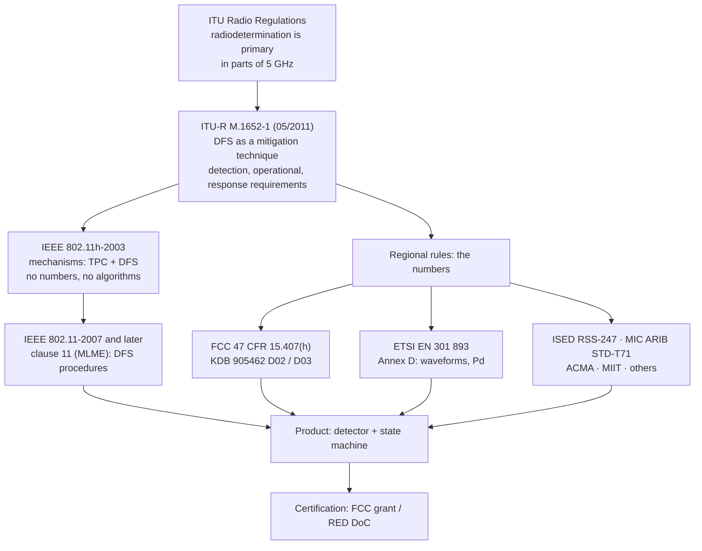

### 0.3 DFS is not AFC, and neither is LBT

Three "listen before you use" mechanisms get confused with each other. They protect different
incumbents, run on different timescales, and live in different places.

| | **DFS** | **AFC** | **LBT / CCA** |
| --- | --- | --- | --- |
| Protects | Radar (radiodetermination), 5 GHz | Fixed microwave links and satellite uplinks, 6 GHz | Other Wi-Fi and other users of the same channel |
| Where | 5.25–5.35 and 5.47–5.725 GHz | US U-NII-5 and U-NII-7 (5.925–6.425, 6.525–6.875 GHz) | Every unlicensed band |
| Mechanism | Listen for radar signatures, then vacate | Ask a database, then transmit only where allowed | Sense the medium before each frame |
| Timescale | Seconds to minutes; 30-minute exclusion | Hours to days; re-query on the order of a day | Microseconds |
| Who decides | The device, in real time | The AFC system, from geography and a database | The device, per frame |
| Standard hook | 802.11h / clause 11 | FCC 47 CFR 15.407(j)–(k), not IEEE | 802.11 CSMA/CA, ETSI adaptivity (LBE/FBE) |
| Failure mode | Mandatory vacate plus 30 minutes off | No transmit at all on unavailable frequencies | Defer and retry |

The confusion matters because the mitigation for a DFS problem is often "move to 6 GHz" — which works
because 6 GHz has **no DFS at all** anywhere in the world today (§1.4), not because 6 GHz is quieter.

---

## 1. The spectrum: which channels carry a radar obligation

### 1.1 The United States: U-NII

The FCC splits 5 GHz into U-NII sub-bands and attaches DFS only to the middle ones.

| Sub-band | Range | 20 MHz channels | DFS | TPC | Notes |
| --- | --- | --- | --- | --- | --- |
| **U-NII-1** | 5.150–5.250 GHz | 36, 40, 44, 48 | No | No | Indoor and outdoor; the "safe" 5 GHz block |
| **U-NII-2A** | 5.250–5.350 GHz | 52, 56, 60, 64 | **Yes** | **Yes** | Military and other radiodetermination |
| **U-NII-2C** | 5.470–5.725 GHz | 100, 104, 108, 112, 116, 120, 124, 128, 132, 136, 140, 144 | **Yes** | **Yes** | Includes TDWR weather radar at 5.600–5.650 GHz |
| **U-NII-3** | 5.725–5.850 GHz | 149, 153, 157, 161, 165 | No | No | Highest power class in 5 GHz; outdoor point-to-point |
| **U-NII-4** | 5.850–5.895 GHz | 20 MHz-only channels | No | No | Outdoor, added for 5.9 GHz use |

Count them: **16 DFS channels against 9 non-DFS channels** in the US. That is the whole argument for
DFS — it more than doubles the usable 5 GHz spectrum — and the whole argument against it — every one
of those 16 channels can be taken away for 30 minutes without warning.

The trigger condition is worth quoting precisely, because it is what catches wide channels:
*U-NII devices operating with any part of its 26 dB emission bandwidth in the 5.25–5.35 GHz and
5.47–5.725 GHz bands shall employ a DFS radar detection mechanism.* One 20 MHz sub-channel inside a
DFS band is enough to make the whole BSS a DFS BSS.

### 1.2 Europe: ETSI EN 301 893

The European harmonised standard covers **5150–5350 MHz** (indoor, 200 mW EIRP) and **5470–5725 MHz**
(1 W EIRP); DFS is required in **5250–5350 MHz** and **5470–5725 MHz**. There is no European RLAN
allocation at 5725–5875 MHz, which is why **channels 149–165 are not available in the EU**, and why
**channel 144 is not either**: a 20 MHz channel centred at 5720 MHz spans 5710–5730 MHz, which runs
past the 5725 MHz band edge.

| Range | Channels | Available in EU | DFS |
| --- | --- | --- | --- |
| 5150–5250 MHz | 36–48 | Yes, indoor only | No |
| 5250–5350 MHz | 52–64 | Yes, indoor only | **Yes** |
| 5470–5725 MHz | 100–140 | Yes, indoor and outdoor | **Yes** |
| 5725–5875 MHz | 144, 149–165 | No (not RLAN under EN 301 893) | — |

### 1.3 The rest of the world, in two families

Most regulators adopt one of the two families above, then add a local exception. The exceptions that
matter in practice:

| Domain | Rule | DFS sub-bands | Local exception |
| --- | --- | --- | --- |
| **US (FCC)** | 47 CFR 15.407(h) | 5250–5350, 5470–5725 | 5600–5650 MHz allowed since 2014 if TDWR waveforms are tested; CAC is a flat 60 s |
| **Canada (ISED)** | RSS-247 | 5250–5350, 5470–5725 | **No operation permitted in 5600–5650 MHz** — Environment Canada weather radars. Channels 120/124/128 are simply unavailable |
| **EU / UK (ETSI)** | EN 301 893 | 5250–5350, 5470–5725 | **600 s CAC and 99.99 % detection probability** on channels overlapping 5600–5650 MHz; off-channel CAC is regulated |
| **Japan (MIC / ARIB STD-T71)** | W52 / W53 / W56 | W53 (5250–5350), W56 (5470–5725) | `VERIFY` the exact CAC and waveform tables — Japan publishes its own radar test set |
| **China (MIIT)** | 5150–5350 indoor, 5725–5850 | 5250–5350 | `VERIFY`: China does not allocate 5470–5725 MHz to RLAN, so U-NII-2C is unavailable |
| **Australia / New Zealand** | ACMA / AS-NZS 4268 | As ETSI | `VERIFY` per-release references: the Australian standard cites both ETSI and FCC test suites |
| **Korea, Taiwan, Brazil, India** | Local adoptions | As ETSI or FCC | `VERIFY` per country before shipping |

The engineering consequence: **a product that ships globally must carry every table** and select among
them from the country code (802.11d Country element), and a deployment engineer must know which family
the local domain follows, because the 10-minute CAC is real in one family and absent in the other.

### 1.4 6 GHz: the escape hatch

There is no DFS in 6 GHz anywhere, because there is no radar there.

| Region | 6 GHz regime | DFS? | What replaces it |
| --- | --- | --- | --- |
| **US** (U-NII-5 … U-NII-8, 5.925–7.125 GHz) | Standard power APs and fixed clients must query an **AFC** system; low-power indoor and very-low-power are unrestricted by AFC | **No** | AFC exclusion zones around fixed microwave receivers |
| **EU** (5945–6425 MHz) | EN 303 687: **LPI** (200 mW EIRP, indoor) and **VLP** (25 mW EIRP, indoor and outdoor) | **No** — the standard states explicitly that DFS, as used for certain 5 GHz RLAN bands, is *not* a requirement of EN 303 687 | Power and indoor-only limits |

That single row is the strongest argument in Wi-Fi 6E and Wi-Fi 7 design: 6 GHz gives you 320 MHz,
more non-overlapping channels than 5 GHz has in total, and **zero DFS events**. When a customer's
complaint is "the network drops every afternoon at 3 pm", the answer is frequently not a better DFS
algorithm — it is a 6 GHz radio.

### 1.5 The channel-width trap: 160 MHz in 5 GHz is a DFS channel

Channel bonding is where DFS stops being a regulatory footnote and becomes a design constraint. In
5 GHz, the only two contiguous 160 MHz channels both cover DFS spectrum:

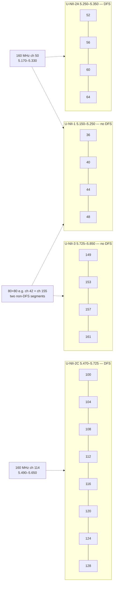

| Configuration | Spans DFS? | Consequence |
| --- | --- | --- |
| 20 MHz on 36 | No | Clean; the default for voice and critical SSIDs |
| 40 MHz (36+40) | No | Clean, one bonded pair |
| 80 MHz ch 42 (5.170–5.250) | No | Clean; the widest non-DFS channel in most domains |
| 80 MHz ch 58 (5.250–5.330) | **Yes**, entirely | One radar hit takes the whole 80 MHz |
| 80 MHz ch 106/122/138 | **Yes** | Ditto |
| **160 MHz ch 50 (5.170–5.330)** | **Yes** — U-NII-1 plus U-NII-2A | 160 MHz in 5 GHz always inherits DFS |
| **160 MHz ch 114 (5.490–5.650)** | **Yes** — all U-NII-2C, and it covers 5600–5650 | ETSI: **600 s CAC** plus the 99.99 % detection bar |
| **80+80 MHz (ch 42 + ch 155)** | **No**, if both segments are chosen outside DFS bands | The only way to get "160 MHz" without DFS in 5 GHz |

Two design rules follow directly. First, **enabling 160 MHz on a 5 GHz radio is a decision to put the
cell on DFS spectrum**; if the deployment cannot tolerate a 30-minute channel loss, run 80 MHz on
U-NII-1. Second, **80+80 MHz is the escape**: it is the only 160 MHz-class configuration that can be
built entirely from non-DFS segments, at the cost of two non-contiguous RF chains and a wider
spectral footprint.

---

## 2. The rules: six obligations and who carries them

### 2.1 Master and slave

Both regimes divide devices into a **master** (the AP, or generally the device that controls the
channel) and a **slave / client** (a device that transmits only under the master's control). The
client category is split again by whether it implements radar detection.

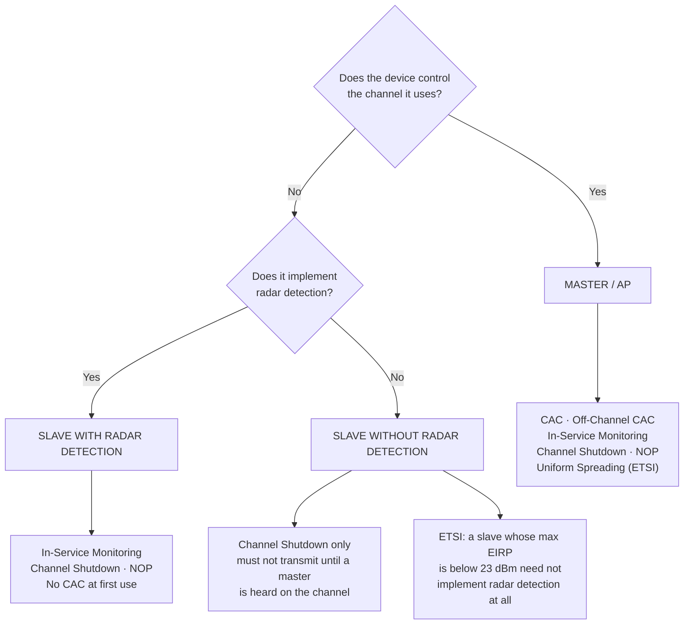

Under the FCC test procedure (KDB 905462 D02, Table 1 and Table 2) this resolves to:

| Requirement | Master | Client without radar detection | Client with radar detection |
| --- | --- | --- | --- |
| **Non-Occupancy Period** | Required | Not required | Required |
| **DFS Detection Threshold** | Required | Not required | Required |
| **Channel Availability Check Time** | Required | Not required | Not required |
| **U-NII Detection Bandwidth** | Required | Not required | Required |
| **Channel Closing Transmission Time** (in service) | Required | Required | Required |
| **Channel Move Time** (in service) | Required | Required | Required |

ETSI EN 301 893 states the same split with two extra rows — off-channel CAC and uniform spreading — and
one important extra: a client with radar detection **is not required to perform a CAC at initial use**,
only after it has itself detected radar and the resulting NOP has expired.

| Requirement (ETSI) | Master | Slave w/o radar detection | Slave with radar detection |
| --- | --- | --- | --- |
| Channel Availability Check | Required | Not required | See §2.1 note |
| Off-Channel CAC (where implemented) | Required | Not required | See §2.1 note |
| In-Service Monitoring | Required | Not required | Required |
| Channel Shutdown | Required | Required | Required |
| Non-Occupancy Period | Required | Not required | Required |
| Uniform Spreading | Required | Not required | Not required |

### 2.2 The obligation catalogue, defined once

| Obligation | What it means | FCC | ETSI |
| --- | --- | --- | --- |
| **Channel Availability Check (CAC)** | Passive listen before any transmission on a DFS channel; no beacons, no probe responses, no clients | **60 s**, master only | **60 s**; **600 s (10 min)** for any channel whose nominal bandwidth falls completely or partly in 5600–5650 MHz |
| **Off-Channel CAC** | Optional: monitor a channel other than the operating one, so a later move needs no in-band silence | Not defined in FCC rules | **Minimum 6 minutes, maximum 4 hours**; for 5600–5650 MHz, **1 hour to 24 hours** |
| **In-Service Monitoring** | Continuous radar search while serving clients, including during the device's own transmissions | Required; tested with ≥ ~17 % channel loading | Required |
| **Channel Shutdown / Channel Move** | On detection, cease transmissions and move the BSS | **10 s**; normal traffic ≤ **200 ms** after detection, plus intermittent management/control signals | **10 s**; Channel Closing Transmission Time **1 s** |
| **Non-Occupancy Period (NOP)** | The channel is unusable after a detection | **≥ 30 minutes** from detection | **30 minutes** |
| **Uniform Spreading** | Spread load over available channels rather than piling onto one | Removed in the 2014 revision; manual and random channel selection both permitted | Required for master devices |
| **Detection bandwidth** | Fraction of the emission bandwidth that must be searched | **100 %** of the 99 % power bandwidth (KDB 905462 D02 v02; earlier procedure used 80 %) | Radar centre frequencies assumed within the **central 80 %** of the Occupied Channel Bandwidth |

### 2.3 The numbers, side by side

This is the table to quote in a design review.

| Parameter | FCC (47 CFR 15.407(h) + KDB 905462 D02) | ETSI (EN 301 893 v2.1.1 Annex D) |
| --- | --- | --- |
| Bands with DFS | 5.25–5.35 and 5.47–5.725 GHz | 5.250–5.350 and 5.470–5.725 GHz |
| Detection threshold, high power | **−64 dBm** (max EIRP 200 mW–1 W) | **−62 dBm** at 10 dBm/MHz EIRP spectral density; floor **−64 dBm** |
| Detection threshold, low power | **−62 dBm** (EIRP < 200 mW and PSD < 10 dBm/MHz) | `TH = −62 + 10 − PSD(dBm/MHz) + G(dBi)`, not lower than −64 dBm |
| Threshold reference | Received power averaged over **1 µs**, referenced to a 0 dBi antenna | Same definition, expressed per MHz of EIRP density |
| CAC | **60 s** | **60 s**; **600 s** in 5600–5650 MHz |
| Off-channel CAC | — | **6 min – 4 h**; **1 h – 24 h** in 5600–5650 MHz |
| Channel Move Time | **10 s** | **10 s** |
| Channel Closing Transmission Time | **200 ms** of normal traffic + an aggregate **60 ms** of control signalling over the remaining 10 s | **1 s** |
| Non-Occupancy Period | **≥ 30 min** | **30 min** |
| Detection probability | 60 % per short-pulse type; aggregate 80 % over types 1–4; 80 % long pulse; 70 % hopping | **60 %** for CAC and in-service monitoring; **99.99 %** for CAC/off-channel CAC in 5600–5650 MHz |
| Trials | 30 per waveform type | 30 per radar test signal |
| TPC | Required in the same two bands; capability of at least **6 dB** below a mean EIRP of 30 dBm; **not required** if EIRP < 500 mW | Required; mitigation factor of at least **3 dB** on average output power |
| Uniform spreading | Not required (removed 2014) | Required for masters |
| Client exemption | Client without radar detection: channel move only | Slave with max EIRP < **23 dBm**: no radar detection needed |

### 2.4 The two clocks nobody reconciles

DFS timings are specified from two different instants, and mixing them up is the most common
arithmetic error in outage estimates:

- The **CAC clock** starts when the device begins listening and ends when it is allowed to transmit. It
  is measured *before* service.
- The **NOP clock** starts at the instant the radar was detected, not when the AP finished moving, and
  not when the new channel came up.

So a channel that produced a detection at 14:00:00 becomes available at 14:30:00, even if the AP spent
sixty of those seconds silently CAC-ing on a different channel.

---

## 3. The state machine: the life of a DFS channel

### 3.1 The whole life, drawn once

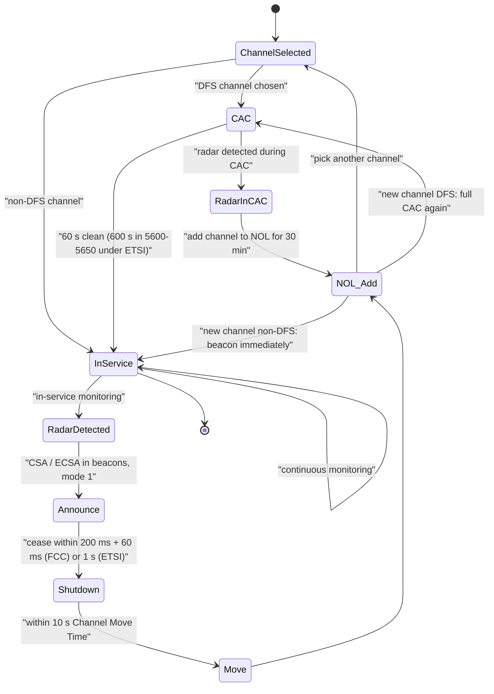

### 3.2 Boot: the minute of silence

A DFS-capable AP that is configured for — or that selects — a DFS channel cannot transmit anything
until the CAC completes. No beacons means no SSID in the air, means clients cannot find it, means the
radio looks broken.

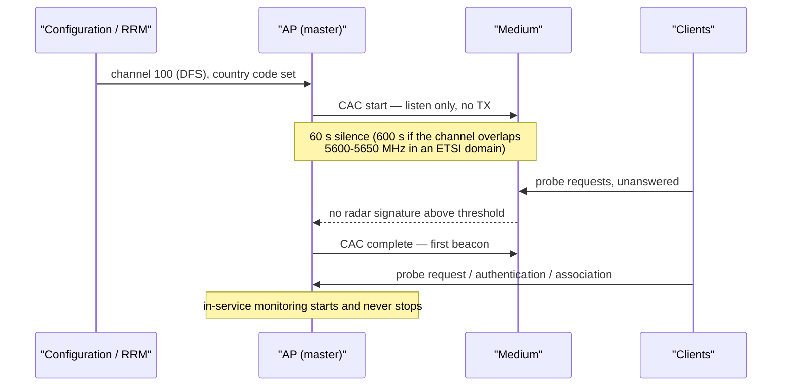

This is why "the AP took a minute to come up after reboot" is expected behaviour and not a fault, and
why vendors built **zero-wait DFS** (§6.3): do the listening on a channel you are not using yet, so the
move has no silent gap.

### 3.3 In-service monitoring: the hard half

CAC is easy — the medium is quiet because the AP is quiet. In-service monitoring has to find 1 µs
pulses at −64 dBm **while the AP and its clients are transmitting**, at a mandated duty cycle (the FCC
procedure loads the channel to roughly 17 % or more with real traffic during the test). Design
consequences:

- The detector must run on the receive path continuously; it cannot be a scheduled scan.
- The AP's own transmitter is the loudest thing in the band, so the front end needs either sufficient
  isolation, a dedicated sniffing path, or a quiet interval.
- The **Quiet element** (element ID 40) is the standards-blessed way to buy silence: the AP schedules
  a quiet interval, every STA sets its NAV for the duration, and the detector listens in a known-clean
  window. In practice this costs airtime and is used sparingly.

### 3.4 Detection: the ten seconds that matter

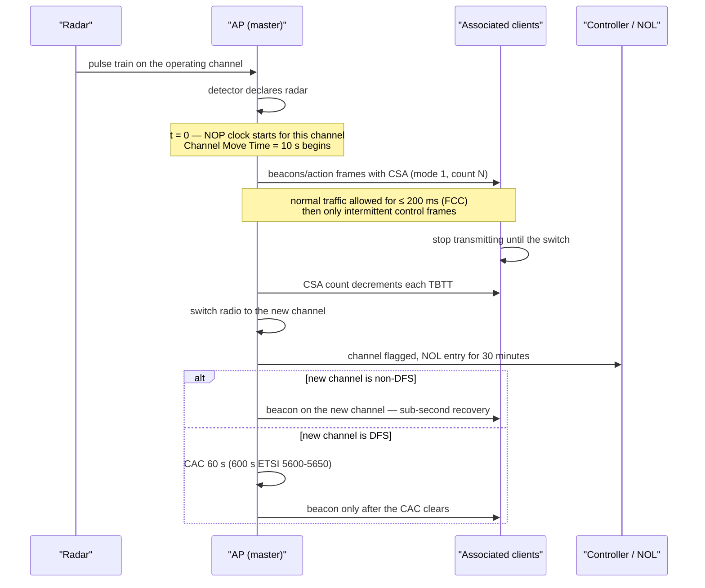

The AP's own decision cycle inside those ten seconds is short and fixed: stop forwarding data
(practically within 200 ms), emit enough CSA-bearing beacons that every associated client — including
power-save clients — receives at least one, then move. Cisco's autonomous AP implementation is a good
concrete reference: it stops forwarding data packets within 200 ms and broadcasts **five** beacons
carrying the 802.11h channel switch announcement.

### 3.5 The move: CSA, mode and count

| Field | Value | Meaning |
| --- | --- | --- |
| Element ID | **37** (Channel Switch Announcement), **60** (Extended CSA) | Present in Beacons, Probe Responses and Spectrum Management action frames |
| **Channel Switch Mode** | **0** = no restriction, clients may keep transmitting; **1** = clients shall not transmit until the switch | DFS moves set **1**: the AP must go quiet quickly, so it silences the BSS with it |
| **New Channel Number** | Target channel | With ECSA: new **operating class** plus new channel, so width can change in the same announcement |
| **Channel Switch Count** | TBTTs until the switch; 0 = any time after this frame | Typically a handful of beacons — hundreds of milliseconds |

Companion elements for a width-changing move: **Supported Operating Classes** (59), **Wide Bandwidth
Channel Switch** (194), **Secondary Channel Offset** (62), and the **Channel Switch Wrapper** (196)
that carries them as a set. A STA is not obliged to follow the switch — it may roam to another BSS
instead — but if it stays it must be silent until the count expires.

### 3.6 The non-occupancy list

The NOP is implemented as a per-channel blacklist with a 30-minute timer. Vendor details that matter
operationally:

| Behaviour | Detail |
| --- | --- |
| Persistence | Cisco APs keep a flag per channel in non-volatile storage for the channels on which radar was detected in the last 30 minutes |
| Reboot | Cisco: if the AP reboots before a flag clears, the non-occupancy time is **reset to 30 minutes** on channel initialisation — a reboot does not shorten the exile |
| Scope | The flag is per channel, not per radio: an 80 MHz channel is flagged as a unit |
| Interaction with RRM | The channel must be removed from the DCA candidate list for the duration; a channel planner that re-picks a NOL channel will simply trigger another CAC and another 30-minute penalty |
| Re-entry | After the NOP, the channel is usable again but still requires a fresh CAC before service |

---

## 4. What the detector actually has to find

### 4.1 The incumbents

| Radar | Where | Why it matters to Wi-Fi |
| --- | --- | --- |
| **Terminal Doppler Weather Radar (TDWR)** | 5.600–5.650 GHz, at major airports | The reason channels 120/124/128 are special; driven ETSI's 600 s CAC and the FCC's dedicated TDWR waveform tests |
| **Other meteorological radar** | 5.250–5.350, 5.470–5.725 GHz | The dominant real source of DFS events near coasts and weather-radar sites |
| **Military / radiodetermination radar** | Across the DFS sub-bands | Short-pulse and frequency-hopping signatures |
| **Marine and navigation radar** | Often outside 5 GHz (S/X band) | Frequently blamed, usually innocent — a venue beside a port may never log a DFS event |

### 4.2 FCC waveforms: the bins

The FCC test procedure (KDB 905462 D02 v02) defines a **Bin 0** fixed waveform plus types 1–6.

| Bin / Type | Category | Pulse width | PRI | Pulses per burst | Min. detection | Trials |
| --- | --- | --- | --- | --- | --- | --- |
| **Bin 0** (formerly Bin 1) | Fixed short pulse | 1 µs | 1428 µs | 18 | Used for radar detection bandwidth, channel move and channel closing tests | — |
| **Type 1** | Short pulse | 1 µs | 1428 µs | 18 | 60 % | 30 |
| **Type 2** | Short pulse, variable | 1–5 µs | 150–230 µs | 23–29 | 60 % | 30 (30 unique waveforms) |
| **Type 3** | Short pulse, variable | 6–10 µs | 200–500 µs | 16–18 | 60 % | 30 (unique) |
| **Type 4** | Short pulse, variable | 11–20 µs | 200–500 µs | 12–16 | 60 % | 30 (unique) |
| **Aggregate 1–4** | — | — | — | — | **80 %** | 120 |
| **Type 5** | Long pulse, chirped | 50–100 µs, chirp 5–20 MHz | 1000–2000 µs | 1–3 pulses × 8–20 bursts over a 12 s period | 80 % | 30 |
| **Type 6** | Frequency hopping | 1 µs | 333 µs | 9 pulses × 100 bursts, 100 hops across the band | 70 % | 30 |

### 4.3 ETSI radar test signals

EN 301 893 Annex D defines a **reference** signal used to set the detection threshold plus six test
signals.

| Signal | Pulse width W | PRF | PRFs | Pulses per burst per PRF | Character |
| --- | --- | --- | --- | --- | --- |
| **Reference** | 1 µs | 700 pps | 1 | 18 | Sets the threshold point for the test |
| **1** | 0.5–5 µs | 200–1000 pps | 1 | 10 | Constant PRF |
| **2** | 0.5–15 µs | 200–1600 pps | 1 | 15 | Constant PRF |
| **3** | 0.5–15 µs | 2300–4000 pps | 1 | 25 | Constant PRF |
| **4** | 20–30 µs | 2000–4000 pps | 1 | 20 | Constant PRF **plus chirp, ±2.5 MHz deviation** |
| **5** | 0.5–2 µs | 300–400 pps | 2–3 staggered (Δ 20–50 pps) | 10 | Staggered PRF — weather-radar-like |
| **6** | 0.5–2 µs | 400–1200 pps | 2–3 staggered (Δ 80–400 pps) | 15 | Wider stagger |
| **5600–5650 MHz special** | — | — | — | **minimum 18 pulses per PRF** for CAC and off-channel CAC | Raised bar for the TDWR band |

### 4.4 Detection probability: what "compliant" actually means

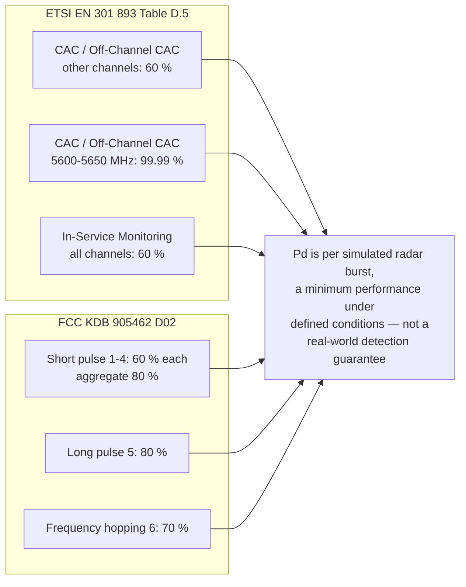

The standard's own note is the important part: *Pd gives the probability of detection per
simulated radar burst and represents a minimum level of detection performance under defined
conditions. Therefore Pd does not represent the overall detection probability for any
particular radar under real life conditions.*

### 4.5 Inside the detector

Although the algorithms are vendor secrets, the structure is forced by the waveforms: a detector must
decide "this is a radar" from pulse-level evidence, not from energy alone.

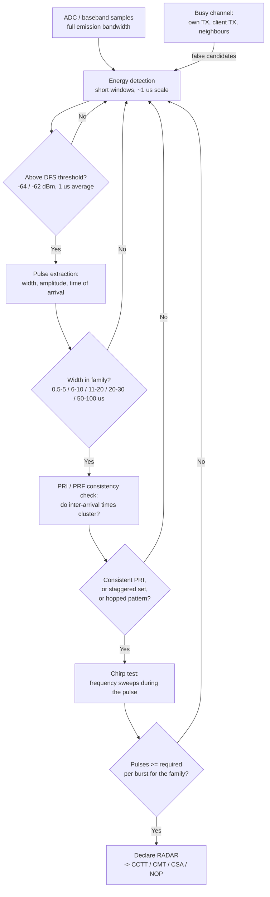

The tension is visible in the diagram: everything that makes detection more sensitive also makes false
positives more likely, and there is no regulatory requirement that balances the two. The FCC rule
text contains no false-alarm limit; `VERIFY` any vendor statement of a specific false-detection rate
against the clause and the KDB revision you are quoting.

### 4.6 False positives: sources, cost, mitigation

| Source | Signature | Mitigation |
| --- | --- | --- |
| Co-located AP or P2P link on a nearby channel | Out-of-band pulses read as in-band, because the receiver is desensitised | Channel planning and physical separation; more RF filtering |
| Radar on an adjacent channel with strong sidebands | Real radar energy, wrong channel | Move further away in frequency; reduce bandwidth |
| Third-party or client chipsets emitting pulse-like bursts | Random, uncorrelated with any radar site | Firmware updates; vendor DFS tuning releases |
| Wide channels | More spectrum means more candidate pulses; one sub-channel hit moves the whole channel | Prefer 40/80 MHz in DFS; consider 80+80 outside DFS |
| Detector tuning drift | One AP logs repeated events while neighbours with the same view of the sky log none | Software update; compare against CleanAir/spectrum-analyser cross-check where available |

The cost asymmetry is the reason to care: **a false positive is indistinguishable from a real one in
the logs and identical in consequence** — the AP must vacate and stay off for 30 minutes. Cisco APs with
a CleanAir or RF ASIC chip cross-check the Wi-Fi detector against the spectrum analyser and raise a
radar event only when both agree, which is why platforms with a dedicated RF frontend have markedly
fewer false events.

---

## 5. The 802.11h machinery: elements, frames and procedures

### 5.1 The catalogue

| Element / frame | ID | Carried in | DFS or TPC role |
| --- | --- | --- | --- |
| **Country element** | — (802.11d) | Beacon, Probe Response | Regulatory domain, allowed channels, maximum power — the input that tells a device which DFS table applies |
| **Power Constraint** | 32 | Beacon, Probe Response | Local power limit in dB below the regulatory maximum; STA computes `max TX = regulatory max − constraint` |
| **Power Capability** | 33 | Association Request | STA's minimum and maximum transmit power; lets the AP decide whether the STA is usable on this channel |
| **TPC Request** | 34 | Spectrum Management action frame | AP asks a STA for its transmit power and link margin |
| **TPC Report** | 35 | Spectrum Management action frame | STA answers with the power used and the link margin |
| **Supported Channels** | 36 | Association Request, action frames | Which channels the STA supports — the AP may reject a STA whose list is too short to survive a channel move |
| **Channel Switch Announcement (CSA)** | 37 | Beacon, Probe Response, action frame | The move: mode, new channel, count |
| **Measurement Request / Report** | 38 / 39 | Spectrum Management action frames | Requesting and returning channel measurements, including radar-related measurements |
| **Quiet** | 40 | Beacon, Probe Response | Schedules a silent interval so the detector can listen |
| **IBSS DFS** | 41 | Beacon, Probe Response (IBSS) | DFS owner identity, DFS recovery interval and the IBSS channel map |
| **Supported Operating Classes** | 59 | Various | Which (band, width) operating classes the device supports — needed to interpret an ECSA |
| **Extended Channel Switch Announcement (ECSA)** | 60 | Beacon, Probe Response, action frame | CSA plus new operating class — a move that also changes bandwidth |
| **Wide Bandwidth Channel Switch** | 194 | With ECSA | New channel width and centre frequencies |
| **Channel Switch Wrapper** | 196 | Beacon, Probe Response | Carries the width-changing elements as a set |

### 5.2 Quiet: buying silence legally

The Quiet element schedules an interval during which no station in the BSS transmits. Every STA sets
its NAV for the duration, any frame exchange must finish before the interval begins, and when the
interval ends everyone contends again — medium access is not preserved across it.

| Field | Meaning |
| --- | --- |
| Quiet Count | TBTTs until the next quiet period starts; 1 means the next TBTT |
| Quiet Period | TBTTs between regularly scheduled quiet periods; 0 means no periodic schedule |
| Quiet Duration | Length of the quiet interval, in TUs |
| Quiet Offset | Offset from the TBTT identified by Quiet Count, in TUs; must be less than one beacon interval |

Quiet is the standards-blessed mechanism for in-service monitoring, but it is rarely the primary
method in shipping products: it costs airtime on every repetition, and modern detectors run
continuously alongside traffic instead. It remains the right answer when a specific, bounded
measurement is needed.

### 5.3 TPC: the other half of 802.11h

TPC came from the same European requirement and is bound to the same bands. Both regimes require it;

| | FCC | ETSI |
| --- | --- | --- |
| Where | 5.25–5.35 and 5.47–5.725 GHz | 5.250–5.350 and 5.470–5.725 GHz |
| Requirement | Capability to operate at least **6 dB** below a mean EIRP of **30 dBm** | Mitigation factor of at least **3 dB** on average output power |
| Exemption | **No TPC needed if EIRP < 500 mW** | Power limits are set per band: 200 mW (5150–5350, indoor), 1 W (5470–5725) |
| Mechanism | Power Constraint element (32) plus Power Capability (33) plus TPC Request/Report (34/35) | Same 802.11h mechanisms |

Note the asymmetry engineers forget: the Power Constraint element constrains the *client*. A network
that turns AP power down to shrink cells but leaves the constraint at zero gets clients that still
transmit at full power and are heard far beyond their cell — the classic power-imbalance complaint.

### 5.4 IBSS DFS: who decides when there is no AP

In an IBSS there is no master, so 802.11h defines a **DFS owner**: one station elects itself, carries
the IBSS DFS element (41) with the DFS owner address, the recovery interval and the channel map, and
co-ordinates the move. The standard cannot guarantee that a DFS owner exists at every instant, so IBSS
DFS has to tolerate absence and duplicate owners — which is one reason ad-hoc DFS is best treated as a
curiosity in interviews rather than a deployment reality.

### 5.5 The announcement chain, drawn as one sequence

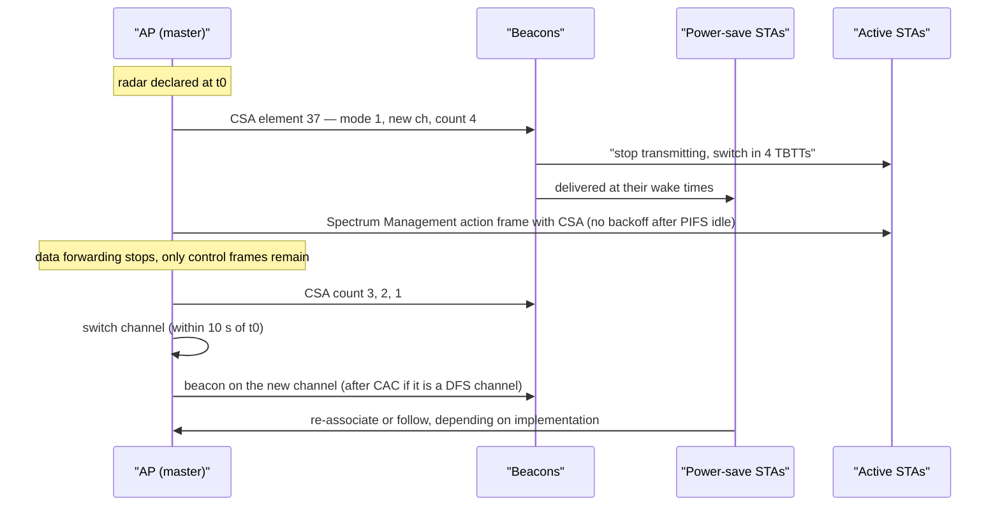

---

## 6. The outage budget: what a DFS event actually costs

### 6.1 Two very different outcomes

```mermaid
gantt
    title DFS outage budget — same event, two destinations
    dateFormat x
    axisFormat %S
    section Move to a non-DFS channel
    Radar detected, CMT begins   :milestone, m1, 0, 0s
    Stop data, CSA beacons       :a1, 0, 1s
    Switch and beacon            :a2, 1, 2s
    Service restored             :milestone, m2, 2, 0s
    section Move to another DFS channel
    Radar detected, CMT begins   :milestone, m3, 0, 0s
    Stop data, CSA beacons       :b1, 0, 1s
    Switch, then CAC silence     :b2, 1, 61s
    Service restored             :milestone, m4, 62, 0s
    section ETSI 5600-5650 destination
    Radar detected, CMT begins   :milestone, m5, 0, 0s
    Stop data, CSA beacons       :c1, 0, 1s
    Switch, then 600 s CAC       :c2, 1, 601s
    Service restored             :milestone, m6, 602, 0s
```

| Destination | Silence | Total interruption | Comment |
| --- | --- | --- | --- |
| Non-DFS channel (36–48, 149–165) | ~0 s | **~1–2 s** | The good case: CSA countdown, move, beacon |
| DFS channel, FCC/ETSI standard | 60 s | **~60–70 s** | Every client that cannot wait reassociates elsewhere |
| DFS channel overlapping 5600–5650 MHz, ETSI | 600 s | **~10 minutes** | The reason many European designs exclude 120/124/128 outright |
| DFS channel with a second detection during CAC | 60 s per attempt | **unbounded** | Each failed CAC restarts the clock and adds another NOP |

The client-side cost is separate and often larger: a client that does not honour the CSA loses the
BSS, rescans (and DFS channels are expensive to scan, because the client may not transmit probe
requests on them and must wait for a beacon), and frequently lands on 2.4 GHz or a neighbouring AP.
Many client vendors deliberately de-prioritise DFS channels in their scan and roam algorithms for
exactly this reason.

### 6.2 What the AP does in those ten seconds, in order

Vendor implementations differ in detail but not in shape:

1. Block new transmissions on the channel.
2. Flush power-save client queues (frames buffered for sleeping clients become stale).
3. Broadcast the 802.11h channel switch announcement — enough beacons that every client, including
   power-save clients, receives one.
4. Disassociate clients that do not follow (implementation-dependent).
5. Notify the controller / WDS peers that the radio is leaving the frequency.
6. Select a new channel — randomly, or from the DCA candidate list minus the NOL.
7. If the new channel is a DFS channel, run a full CAC before beaconing; if not, beacon immediately.
8. Notify peers of the new operating frequency.

### 6.3 Zero-wait DFS and off-channel CAC

The 60-second silence is the only part of DFS that engineering can remove, and there are exactly two
ways to remove it.

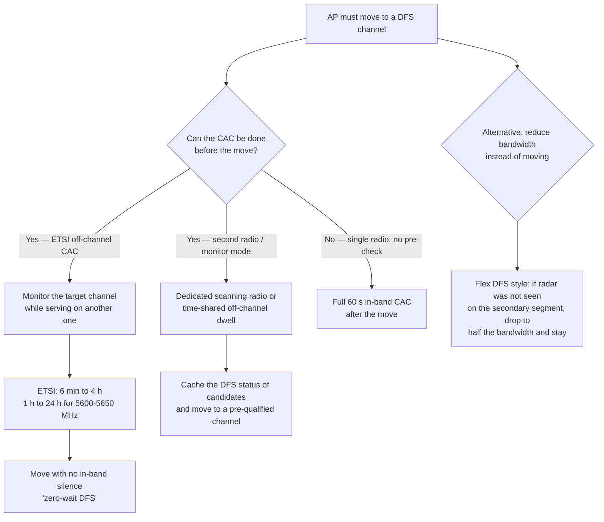

| Approach | Standards basis | Availability |
| --- | --- | --- |
| **Off-channel CAC** | ETSI EN 301 893: 6 min–4 h (1 h–24 h in 5600–5650 MHz); performed on a channel other than the operating channel | Europe |
| **Zero-wait DFS** | Vendor feature built on pre-checking candidate channels; Cisco documents it as available in **US and Europe** only | US + EU on supported platforms |
| **Flex DFS / bandwidth reduction** | Vendor behaviour: if radar is detected on part of a bonded channel, move to the unaffected segment at reduced width instead of blocking the whole channel | Vendor-specific; not a standard |

Note the trap in the last row: **preamble puncturing (Wi-Fi 7) is not a DFS mechanism.** Puncturing
lets a BSS avoid a busy 20 MHz sub-channel; the DFS obligation is about a channel in which radar has
been detected, and the standard's answer to that is to vacate or to change channel, not to puncture
around it. `VERIFY` any claim that puncturing can be used to keep serving around a radar hit against
the regulatory text: the regulator's requirement is to cease transmission on the operating channel.

### 6.4 What Wi-Fi 7 changes

Two 802.11be features change the blast radius of a DFS event rather than its probability:

| Feature | Effect on a DFS event |
| --- | --- |
| **MLO (multi-link operation)** | If the 5 GHz link goes down for a CAC, the association survives on the other link: a DFS event becomes a throughput dip rather than a disconnect. This is the strongest practical argument for MLO in a DFS-heavy design |
| **EMLSR / link reconfiguration** | A single-radio STA can be steered off the affected link before the switch, and re-added when the CAC completes |
| **320 MHz** | Not a 5 GHz option: 320 MHz exists only in 6 GHz, which has no DFS. In 5 GHz the widest channel remains 160 MHz, and it is always a DFS channel (§1.5) |
| **Puncturing** | Helps with congestion, not with radar (§6.3) |

Hostapd's AP MLD code carries explicit machinery for this: a `radar_detected` flag is tracked per link
so that, when DFS is offloaded to the driver, the interface is only set up after a CAC-end event with
no radar, and a driver-initiated switch to a non-DFS channel lets setup proceed immediately.

### 6.5 Interaction with RRM and EasyMesh

DFS is the one RRM function with a hard external deadline, so it sits above the planner:

- The channel planner must treat the NOL as a hard exclusion list for 30 minutes; a plan that
  re-selects a NOL channel costs another CAC and possibly another NOP.
- Radar-driven moves are **event-driven** and bypass the daily optimisation window: Aruba AirMatch
  plans once a day but reacts immediately to radar; Mist's local RRM acts on deviation including
  learned radar patterns near airports; Ruckus ChannelFly treats a radar hit as an immediate
  capacity loss.
- In EasyMesh, the controller may own channel planning, but the DFS *detection* is per radio and the
  move is executed by the agent; a channel plan that ignores per-AP NOL state will oscillate.
- Repeated DFS events at a site are a planning input: they tell you the band is contested at that
  location, which is an argument for 6 GHz, for narrower channels, or for excluding the affected
  channels from the plan entirely.

---

## 7. Design guidance: when to use DFS and when to avoid it

### 7.1 The decision, drawn

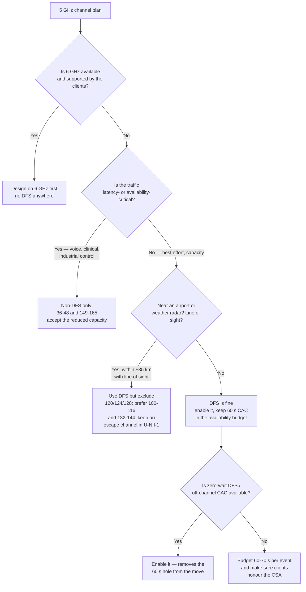

### 7.2 The trade, stated as a table

| | Use DFS | Avoid DFS |
| --- | --- | --- |
| **When** | Capacity-limited, best-effort traffic; low client density per channel; 6 GHz not available | Voice, roaming-critical, clinical or industrial traffic; single-radio APs with no zero-wait; sites with known radar exposure |
| **Gain** | 16 extra 20 MHz channels in the US — more than double the 5 GHz spectrum; the only route to 160 MHz in 5 GHz | Predictability: no 30-minute channel loss, no 60-second boot delay, no CSA-driven client confusion |
| **Cost** | 60 s (or 600 s) silence before service; 10 s mandatory vacate; 30-minute NOP per event; false positives you cannot overrule | Co-channel contention on 9 channels; 80 MHz maximum in U-NII-1; no 160 MHz |
| **Mitigations** | Zero-wait/off-channel CAC; exclude 120/124/128 near airports; keep a non-DFS fallback channel; prefer 40/80 MHz | 6 GHz; 80+80 MHz from non-DFS segments; densify with more APs at lower power |

### 7.3 Practical rules that survive contact with production

1. **Always leave one non-DFS channel as the fallback.** A DFS move to another DFS channel costs a
   minute; a move to U-NII-1 costs a second. Make the planner prefer the latter under load.
2. **Exclude 120/124/128 where TDWR or weather radar is in view.** In ETSI domains those channels carry
   a 600-second CAC; in Canada they are not available at all; in the US they are legal but are the
   channels most likely to see a hit near a major airport.
3. **Budget the boot delay.** Every AP on a DFS channel is silent for at least a minute after a reboot
   or a channel change. Monitoring that alerts on "SSID missing" must know this.
4. **Treat a burst of events on one AP as a false positive until proven otherwise.** One AP logging
   repeated radar events while its neighbours see nothing is a detector or hardware problem, not a
   radar problem.
5. **Do not disable DFS.** It is not a tuning knob: the FCC requires manufacturers to take steps to
   ensure DFS functionality cannot be disabled by the operator, and operators must use equipment with
   DFS turned on in these bands.
6. **Check the country code first.** Almost every "DFS is not working" complaint is a regulatory-domain
   mismatch: the wrong table means the wrong channels, the wrong thresholds and the wrong CAC.

---

## 8. Implementation: what the software actually does

### 8.1 The Linux split: hostapd is the DFS master

The design decision in Linux is that **the DFS master algorithm lives in userspace, in hostapd**, and
nl80211/cfg80211/mac80211 pipe commands and events between hostapd and the driver. The driver supplies
radar detection in one of two ways: pattern detection in hardware (the device emits a radar_detected
event) or pattern detection in the driver (the device reports raw pulses, the driver matches them).

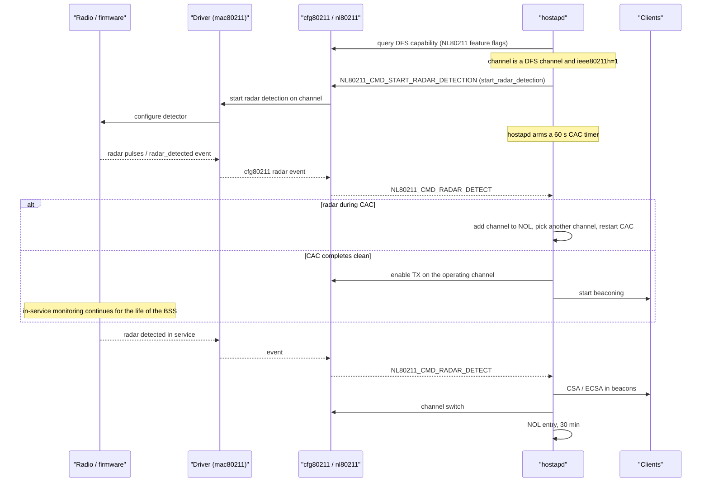

### 8.2 Where DFS is offloaded

Most modern chipsets implement **DFS offload**: the firmware performs the CAC, the in-service
monitoring and the channel move, and only informs the host with CAC-start, CAC-end and radar-detected
events. In hostapd this is the `WPA_DRIVER_FLAGS_DFS_OFFLOAD` path: `hostapd_dfs_complete_cac()` logs
`DFS_EVENT_CAC_COMPLETED` with `success`, frequency, channel width and centre frequencies, and the
interface is only brought up when the CAC completed without a detection. The host-side state machine
still owns the NOL and the choice of the next channel, because those are policy, not physics.

### 8.3 What it looks like from the shell

| Observation | Where | Example |
| --- | --- | --- |
| Channel flagged as radar | `iw phy` / `iw list` | `* 5260 MHz [20.0 dBm] (radar detection)`, `DFS state: usable`, `DFS CAC time: 60000 ms` |
| Regulatory domain | `iw reg get` | country code and the derived channel flags |
| CAC start | hostapd log | `DFS-CAC-START freq=5680 chan=136 sec_chan=-1, width=0, seg0=0, seg1=0, cac_time=60s` |
| CAC end | hostapd log | `DFS-CAC-COMPLETED success=1 freq=... ht_enabled=... chan_width=... cf1=... cf2=...` |
| Radar found | kernel log | `ieee80211 phy0: Radar detected on channel 52 (5260 MHz)!` |
| Interface states | hostapd log | `UNINITIALIZED -> COUNTRY_UPDATE -> HT_SCAN -> DFS -> ENABLED` |
| Common failure | hostapd log | `DFS start_dfs_cac() failed, -1` — typically a width or regulatory-domain mismatch, so the interface goes to `DISABLED` |
| Vendor CLI (Broadcom-class) | `wl` | `wl dfs_preism X` (default −1, i.e. 60 s), `wl radar 1`, `wl spect 1`, `wl dfs_status`, `wl chanspec 100/80` |
| Enterprise (Cisco) | controller / AP | `%DOT11-6-DFS_SCAN_START`, `%DOT11-6-DFS_SCAN_COMPLETE`, `%DOT11-6-DFS_TRIGGERED`, `show ap dot11 5ghz summary`, `show wireless dot11h` |

### 8.4 The implementation checklist

| Item | Why it fails in the field |
| --- | --- |
| Country code and 802.11d/802.11h enabled | Without `ieee80211d=1` and `ieee80211h=1` (and a correct `country_code`), hostapd will not treat the channel as DFS at all |
| Driver reports radar detection capability | Without the feature flag, hostapd cannot use DFS channels regardless of hardware |
| NOL is maintained across channel changes | A hostapd restart that forgets the NOL re-enters a channel that is still inside its 30-minute window |
| Width is legal for the channel | Requesting HT40/VHT80 on a DFS channel the regulatory domain forbids produces `DFS start_dfs_cac() failed` and no SSID |
| CAC timer matches the domain | 60 s normally; 600 s on ETSI channels overlapping 5600–5650 MHz |
| CSA is emitted with mode 1 and a sane count | Too few beacons and power-save clients never learn the new channel |

---

## 9. Conformance: how a product proves it

### 9.1 United States

| Item | Source |
| --- | --- |
| DFS requirement | 47 CFR § 15.407(h)(2) |
| TPC requirement | 47 CFR § 15.407(h)(1) |
| Test procedure for masters and clients with radar detection | **KDB 905462 D02** — *Compliance Measurement Procedures for Unlicensed-National Information Infrastructure Devices Operating in the 5250–5350 MHz and 5470–5725 MHz Bands Incorporating Dynamic Frequency Selection* |
| Test procedure for clients without radar detection | **KDB 905462 D03** |
| TDWR waveforms | Added by the 2014 UNII report and order (FCC 14-30, addendum FCC 14-141): Test A uses 15 unique PRI values from a list of 23 TDWR PRI values; Test B uses 15 unique PRI values randomly selected in 518–3066 µs with at least 1 µs spacing; 30 trials, 60 % detection |
| Device security | 47 CFR § 15.407(i): manufacturers must prevent third parties reprogramming RF parameters, and must take steps to ensure **DFS functionality cannot be disabled by the operator** |
| 6 GHz | 47 CFR § 15.407(j)–(k): AFC for standard-power APs and fixed clients; no DFS |

### 9.2 Europe

| Item | Source |
| --- | --- |
| Harmonised standard | **ETSI EN 301 893** — *5 GHz RLAN; Harmonised Standard covering the essential requirements of article 3.2 of Directive 2014/53/EU* (v2.1.1, 2017-05) |
| DFS requirements | Clause 4.7 (requirements) and Annex D (radar test signals, thresholds, detection probabilities) |
| Conformance tests | Clause 5.3.8, with **Set-up A** (master as UUT), **Set-up B** (slave as UUT, radar injected into the master) and **Set-up C** (slave with radar detection, radar injected into the slave) |
| 6 GHz | **ETSI EN 303 687** (v1.1.1, June 2023) — LPI and VLP; DFS is explicitly not a requirement |

### 9.3 International

- **ITU-R M.1652-1 (05/2011)** — the DFS recommendation itself, incorporated by reference in the Radio
  Regulations. The annexes give the detection, operational and response requirements that the regional
  rules implement differently.
- **ITU-R Report M.2115** — *Testing procedures for implementation of dynamic frequency selection* —
  useful historically because it tabulates the differences between successive EN 301 893 versions
  (v1.4.1 vs v1.5.1: threshold definition, 10-minute CAC for 5600–5650 MHz, off-channel CAC and its
  99.99 % detection probability, staggered-PRF signals).

### 9.4 The test matrix in one table

| Test | FCC | ETSI |
| --- | --- | --- |
| Detection threshold | Inject at threshold + 1 dB (procedure adjustment), check response | Radiated/conducted threshold from the PSD formula; reference signal at 1 µs / 700 pps / 18 pulses |
| Detection bandwidth | Bin 0 stepped across the band; 5 MHz steps, 1 MHz where detection falls; radar centre frequencies across the emission bandwidth | Centre frequencies within the central 80 % of the occupied channel bandwidth |
| Channel move and closing | Bin 0; measure the 200 ms and the aggregate 60 ms | Measure the 10 s and the 1 s |
| Statistical performance | 30 trials per waveform; percentages per type | 30 trials per radar test signal; 60 % / 99.99 % |
| Channel loading | ≥ ~17 % of the channel with typical traffic | Traffic required during in-service monitoring tests |
| Multi-bandwidth devices | Detection bandwidth and statistical performance tested in **all** bandwidth modes; move and closing times in the widest mode | Every operational mode assessed separately |

---

## 10. Troubleshooting: symptom to cause to action

| Symptom | Likely cause | Check | Action |
| --- | --- | --- | --- |
| SSID missing for ~60 s after a reboot or config change | CAC on a DFS channel | hostapd `DFS-CAC-START` / `DFS-CAC-COMPLETED`; `iw phy` showing `(radar detection)` | Expected. Enable zero-wait/off-channel CAC, or move to a non-DFS channel |
| SSID never appears; `DFS start_dfs_cac() failed` | Width or regulatory-domain mismatch (e.g. HT40/80 requested on a channel the domain forbids) | `iw reg get`, `country_code`, `ieee80211d`/`ieee80211h`, hostapd error line | Fix width and country code; verify the channel is legal at that width in the domain |
| Clients drop, return ~1 s later on a different channel | Radar hit, move to a non-DFS channel | Controller DFS/radar event log | Working as designed. Confirm the event frequency before changing anything |
| Clients drop, return ~60–70 s later | Radar hit, move to another DFS channel | Channel before and after; CAC log lines | Enable zero-wait DFS; make the planner prefer a non-DFS fallback |
| One AP logs repeated radar events; neighbours log none | False positive from co-located radios, a P2P link, or a detector issue | Compare event timestamps across APs; check for nearby links on adjacent channels; check firmware release notes | Improve filtering and placement; cross-check with a spectrum analyser where available; update firmware |
| Events cluster near an airport or coast, at similar times | Real radar (TDWR or weather radar) with line of sight | Event log against time of day; geography | Exclude 120/124/128; prefer lower U-NII-2C or U-NII-1; consider 6 GHz |
| 5 GHz capacity collapses but no radar logged | Too many channels already in the NOL, or a channel plan depleted by repeated hits | NOL state per AP; available channel count | Widen the plan to non-DFS channels; add 6 GHz; reduce channel width |
| APs in one country behave differently from the same model elsewhere | Different regulatory family (ETSI vs FCC vs ISED) | Country code, CAC duration observed (60 s vs 600 s), channel availability (120/124/128, 144, 149–165) | Nothing to fix — document the difference in the design |
| Clients roam to 2.4 GHz after a DFS event | Client did not honour the CSA, or de-prioritises DFS channels when scanning | Client behaviour after the move; scan cost on DFS channels | Keep a non-DFS fallback; enable 11k/11v so the client has a candidate list; set 6 GHz preference |
| Repeated NOP violations across reboots | NOL not persisted, or reset behaviour misunderstood | Per-channel flag storage; vendor documentation | Cisco-class APs reset the non-occupancy time to 30 minutes on reboot by design; do not rely on rebooting to clear it |

---

## 11. Interview package

### 11.1 Fifteen numbers worth memorising

| Number | What it is |
| --- | --- |
| **60 s** | Channel Availability Check, master mode — FCC and ETSI standard case |
| **600 s** | CAC for ETSI channels overlapping 5600–5650 MHz (channels 120/124/128) |
| **10 s** | Channel Move Time — everything stops within ten seconds of detection |
| **200 ms** | Normal traffic allowed after detection (FCC), plus an aggregate **60 ms** of control signalling |
| **1 s** | Channel Closing Transmission Time (ETSI) |
| **30 min** | Non-Occupancy Period, from the instant of detection |
| **−64 dBm** | Detection threshold for devices with max EIRP 200 mW–1 W |
| **−62 dBm** | Detection threshold below 200 mW EIRP and PSD below 10 dBm/MHz |
| **1 µs, 0 dBi** | How the threshold is defined: received power averaged over one microsecond, referenced to a 0 dBi antenna |
| **16 vs 9** | DFS channels vs non-DFS channels in 5 GHz (US) |
| **60 % / 80 % / 70 %** | FCC minimum detection: short-pulse types, aggregate of types 1–4, frequency hopping |
| **99.99 %** | ETSI CAC/off-channel CAC detection probability in 5600–5650 MHz |
| **6 min – 4 h** | ETSI off-channel CAC (1 h–24 h in 5600–5650 MHz) |
| **6 dB / 500 mW** | FCC TPC: at least 6 dB below a mean EIRP of 30 dBm; not required below 500 mW EIRP |
| **23 dBm** | ETSI: a slave below this max EIRP need not implement radar detection |

### 11.2 Ten answers, one sentence each

1. **What is DFS?** The mechanism that lets Wi-Fi share 5 GHz with radar by detecting radar signatures,
   vacating the channel within ten seconds, and staying off it for thirty minutes.
2. **Where does it come from?** ITU-R M.1652 internationally; IEEE 802.11h supplies the mechanisms; the
   FCC (15.407(h)), ETSI (EN 301 893) and their imitators supply the numbers.
3. **Why is there a minute of silence?** The Channel Availability Check: a master may not transmit on a
   DFS channel until it has listened for 60 seconds (600 in the ETSI weather-radar channels) without
   hearing radar.
4. **Who has to detect radar?** The master. A client without radar detection only has to obey the
   channel move; a client with radar detection inherits the full duty.
5. **Does the client disconnect?** Not necessarily — the AP sends a Channel Switch Announcement with a
   countdown and keeps the associations; clients that ignore it fall back to scanning.
6. **Why do wide channels make it worse?** The obligation triggers on any part of the emission
   bandwidth falling in a DFS band, so one 20 MHz sub-channel detection moves the whole bonded channel.
7. **Is 160 MHz in 5 GHz a DFS channel?** Always: both 160 MHz channels span DFS spectrum.
8. **How do you get 160 MHz without DFS?** 80+80 MHz built from two non-DFS segments, or 6 GHz, where
   320 MHz exists and DFS does not.
9. **What is zero-wait DFS?** Doing the availability check on the target channel before the move —
   ETSI regulates it as off-channel CAC (6 min–4 h), and vendors implement it for US and EU domains.
10. **Can the operator disable DFS?** No. FCC 15.407(i) requires manufacturers to ensure it cannot be
    disabled, and operators must use equipment with DFS enabled in these bands.

### 11.3 Ten corrections — things popular sources get wrong

1. **"The 10-minute CAC is an FCC rule for channels 120/124/128."** Wrong. The FCC's CAC is a flat
   **60 s**; the 600-second CAC is the **ETSI** requirement for channels overlapping 5600–5650 MHz. The
   US answer to TDWR is a dedicated waveform test (Bin 1: 15 PRI values from a list of 23, plus 15
   random values in 518–3066 µs), not a longer silence.
2. **"DFS makes clients roam."** A CSA is not a roam. It is a scheduled channel change with a countdown;
   the AP keeps the association state.
3. **"Every 5 GHz device must detect radar."** No: a client without radar detection has no detection
   duty, and ETSI exempts slaves below 23 dBm EIRP entirely.
4. **"CCTT is 200 ms everywhere."** That is the FCC figure (200 ms plus an aggregate 60 ms). ETSI states
   **1 s**.
5. **"Uniform spreading is required."** Not in the US: it was removed in the 2014 revision, which also
   permitted manual channel selection. ETSI still requires it for master devices.
6. **"The detection threshold is −64 dBm."** It depends on transmit power: −64 dBm for 200 mW–1 W EIRP,
   −62 dBm below 200 mW with PSD below 10 dBm/MHz, and in ETSI terms it is derived from EIRP spectral
   density and antenna gain with a −64 dBm floor.
7. **"Detection is reliable."** No: conformance is 60 % per burst for most cases (80 % aggregate for
   FCC short pulses, 70 % for hopping). The standard says explicitly that Pd is not a
   real-world guarantee.
8. **"6 GHz needs DFS too."** No. 6 GHz has no radar incumbents: the US uses AFC for standard power, and
   the EU uses LPI/VLP power limits; EN 303 687 states that DFS is not one of its requirements.
9. **"Rebooting clears the non-occupancy period."** On Cisco-class APs a reboot **resets** the
   non-occupancy time to the full 30 minutes.
10. **"You can puncture around the radar."** Preamble puncturing is a congestion feature. The regulatory
    duty is to cease transmission on a channel where radar has been detected; bandwidth reduction
    ("Flex DFS" style) is a vendor behaviour, not a standardised DFS response.

---

## Anchors

- **47 CFR § 15.407(h)(2)** (current eCFR text): DFS applies to devices with *any part of its 26 dB
  emission bandwidth* in **5.25–5.35 GHz** and **5.47–5.725 GHz**; operators shall only use equipment
  with DFS **turned on**; the device must sense at **100 percent of its emission bandwidth**; minimum
  detection threshold **−64 dBm** for max EIRP 200 mW–1 W and **−62 dBm** for EIRP < 200 mW with PSD
  < 10 dBm/MHz, defined as received power averaged over **1 µs** referenced to a **0 dBi** antenna;
  initial channel setting may be random or manual; **CAC 60 s** (master mode); **Channel Move Time
  10 s**, with normal traffic for at most **200 ms** after detection plus intermittent management and
  control signals; **Non-Occupancy Period at least 30 minutes** from detection. The current text
  contains **no uniform-spreading clause** and **no 5600–5650 MHz special case**.
- **47 CFR § 15.407(h)(1)** TPC: required in the same two bands; capability to operate at least **6 dB
  below the mean EIRP value of 30 dBm**; **not required for systems with an e.i.r.p. of less than
  500 mW**.
- **47 CFR § 15.407(i)** device security: manufacturers must prevent third parties reprogramming RF
  parameters and must take steps to ensure **DFS functionality cannot be disabled by the operator**.
- **FCC KDB 905462 D02** (DFS compliance procedures) and **D03** (clients without radar detection):
  Channel Closing Transmission Time = **200 ms + an aggregate of 60 ms** over the remaining 10 s;
  U-NII detection bandwidth = minimum **100 %** of the 99 % transmission power bandwidth (v02; the
  earlier FCC 06-96 procedure used **80 %**); **Bin 0** fixed waveform = 1 µs pulse width, 1428 µs PRI,
  18 pulses (formerly Bin 1); short-pulse types 1–4 at **60 %** each with an **80 %** aggregate over 120
  trials; long-pulse type 5 (50–100 µs, chirp 5–20 MHz, PRI 1000–2000 µs, 8–20 bursts in a 12 s period)
  at **80 %**; frequency-hopping type 6 at **70 %**; 30 trials per type; channel loading of roughly
  **17 % or greater** during tests.
- **FCC 14-30** (UNII Docket 13-49 Report and Order) with addendum **FCC 14-141** (2014): the TDWR band
  is **no longer required to be blocked**; new TDWR waveforms ("Bin 1") require Test A with **15 unique
  PRI values** drawn from a list of **23 TDWR PRI values** and Test B with 15 unique PRI values randomly
  selected in **518–3066 µs** with at least 1 µs spacing — 30 trials, **60 %** detection. The same
  revision removed **uniform spreading** and permitted manual channel selection. (Pre-2014, an FCC
  interim plan blocked 5600–5650 MHz outright and required devices within 35 km of multiple TDWRs to
  avoid operation within 30 MHz of each — which is why channels 116 and 132 were also discouraged.)
- **ETSI EN 301 893 v2.1.1** (2017-05), clause 4.7 and Annex D: **CAC 60 s**, and **10 minutes** for
  channels whose nominal bandwidth falls completely or partly in **5600–5650 MHz**; **Off-Channel CAC
  minimum 6 minutes, maximum 4 hours** (1–24 hours in 5600–5650 MHz); **Channel Move Time 10 s**;
  **Channel Closing Transmission Time 1 s**; **Non-Occupancy Period 30 minutes**; interference threshold
  **−62 dBm** for an EIRP spectral density of 10 dBm/MHz with a 0 dBi antenna, derived as
  `−62 + 10 − PSD(dBm/MHz) + G(dBi)` and **not lower than −64 dBm**; **slave devices with max EIRP
  below 23 dBm need not implement radar detection**; radar centre frequencies assumed within the
  **central 80 %** of the occupied channel bandwidth. Annex D **Table D.5**: detection probability
  **99.99 %** for CAC/off-channel CAC in 5600–5650 MHz, **60 %** for CAC/off-channel CAC elsewhere and
  **60 %** for in-service monitoring everywhere. Radar test signals 1–6 range from 0.5–30 µs pulse
  width and 200–4000 pps PRF, signal 4 is chirped with **±2.5 MHz** deviation, signals 5 and 6 use
  staggered PRF, and the reference signal is 1 µs / 700 pps / 18 pulses per burst.
- **ETSI applicability matrix**: Master — CAC, off-channel CAC (where implemented), in-service
  monitoring, channel shutdown, NOP and uniform spreading. Slave without radar detection — channel
  shutdown only. Slave with radar detection — in-service monitoring, channel shutdown and NOP, but
  **no CAC at initial use** (only after it has itself detected radar and that NOP has expired) and no
  uniform spreading.
- **ITU-R M.1652-1 (05/2011)**, *Dynamic frequency selection in wireless access systems including radio
  local area networks for the purpose of protecting the radiodetermination service in the 5 GHz band* —
  in force and **incorporated by reference in the Radio Regulations**; M.1652-0 (06/2003) is superseded.
  IEEE Std **802.11h-2003** was approved in **September 2003** to implement it and was folded into
  IEEE Std 802.11-2007; the DFS procedures now sit in **clause 11 (MLME)** of IEEE Std 802.11-2020.
- **ISED Canada RSS-247**: DFS aligned with the FCC, but **no operation is permitted in 5600–5650 MHz**
  for the protection of Environment Canada weather radars — channels 120, 124 and 128 are unavailable in
  Canada regardless of what the hardware can do.
- **6 GHz**: United States uses **AFC** (47 CFR 15.407(j)–(k)) for standard-power APs and fixed clients;
  the EU uses **EN 303 687** LPI (200 mW EIRP, indoor) and VLP (25 mW EIRP, indoor and outdoor) in
  5945–6425 MHz, and the standard states explicitly that **DFS is not a requirement**. EN 303 687
  v1.1.1 was published **June 2023** and cited in the Official Journal on **15 May 2025** by Commission
  Implementing Decision (EU) 2025/893.
- **Channelisation facts**: US 5 GHz has **16 DFS channels** (52–64, 100–144) and **9 non-DFS channels**
  (36–48, 149–165). The EU has no RLAN allocation at 5725–5875 MHz, so **149–165 are unavailable**, and
  **channel 144 is excluded** because 5720 MHz ± 10 MHz crosses the 5725 MHz band edge. The two 5 GHz
  160 MHz channels (50 and 114) both span DFS spectrum, and 114 covers 5600–5650 MHz.
- **802.11h elements**: Power Constraint **32**, Power Capability **33**, TPC Request **34**, TPC Report
  **35**, Supported Channels **36**, Channel Switch Announcement **37**, Measurement Request **38**,
  Measurement Report **39**, Quiet **40**, IBSS DFS **41**, Supported Operating Classes **59**,
  Extended CSA **60**, Wide Bandwidth Channel Switch **194**, Channel Switch Wrapper **196**. CSA
  **Channel Switch Mode 1** means a STA shall not transmit until the switch; **0** means no restriction;
  **Channel Switch Count** counts TBTTs, and 0 means the switch may occur at any time after the frame.
- **Vendor behaviour (Cisco)**: CAC at boot takes **between 1 and 10 minutes depending on the country**;
  on detection the AP stops forwarding data packets **within 200 ms** and broadcasts **five** beacons
  carrying the 802.11h CSA; the channel is flagged for **30 minutes**, the flag is kept in **non-volatile
  storage**, and a reboot **resets the non-occupancy time to 30 minutes**; **Zero Wait DFS** (IOS XE
  **17.5.1**) is supported in the **US and Europe**; **Flex DFS** reduces bandwidth and moves to the
  secondary channel instead of blocking the whole bonded channel; CleanAir/RF ASIC cross-checking
  reduces false positives by requiring both analysers to agree.
- **Linux implementation**: the DFS master algorithm is in **hostapd**; nl80211/cfg80211/mac80211 carry
  `start_radar_detection`, radar-detected events and AP channel-switch commands (LWN patch series by
  Victor Goldenshtein, 2012); hostapd arms a **60 s** CAC timer and maintains the NOL; with
  `WPA_DRIVER_FLAGS_DFS_OFFLOAD` the firmware owns detection and hostapd reacts to CAC-start, CAC-end
  and radar events (`hostapd_dfs_complete_cac()`, `DFS_EVENT_CAC_COMPLETED`); the 2024 hostap commit
  **f4b84ec** tracks a per-link `radar_detected` flag for **AP MLD** operation in the offloaded case.
- **`VERIFY` before quoting**: the exact sub-clause numbering of DFS and TPC inside clause 11 of
  IEEE Std 802.11-2020 (commonly cited as 11.8 and 11.9 — check the copy you own); Japan's MIC/ARIB
  STD-T71 waveform and CAC tables; China's MIIT rules for 5250–5350 MHz and the absence of 5470–5725 MHz
  for RLAN; the current Australian/New Zealand reference; and any vendor figure for a false-detection
  rate, since the FCC rule text contains no false-alarm limit.

---

## Related

- [[02-16 WLAN - Radio Resource Management - Channels, Power, Admission and the Roaming Algorithms]] — the parent view: DFS as the one RRM function with a regulator behind it, channel-width trade-offs, and how DCA/AirMatch/ChannelFly must treat the NOL
- [[02-14 WLAN - Wi-Fi Fundamentals - History, Architecture, PHY, MAC and the Road to Wi-Fi 7]] — the substrate: 5 GHz channelisation, bonding, the PPDU and the numerology that make the 160 MHz trap in §1.5 concrete
- [[02-1 WLAN - Wi-Fi Generations Evolution - Wi-Fi 4 to Wi-Fi 8 and Beyond]] — which generation moved Wi-Fi into which band, and why 6 GHz changes the DFS question entirely
- [[02-15 WLAN - The Transceiver - From Superheterodyne to Wi-Fi 7 and the AI-Native Radio]] — why −64 dBm detection in a busy channel is a receiver problem: noise figure, EVM, and the cost of sharing a front end between Wi-Fi reception and radar detection
- [[02-6 WLAN - Multi-AP Roaming, Healing and Steering - 802.11k, 11v, 11r, BTM and Self-Healing]] — what happens to clients that do not follow a CSA, and how 11k/11v give them somewhere better to go
- [[02-8 WLAN - Scheduling - Channel Access, EDCA, OFDMA Resource Allocation, Airtime and Implementation]] — the airtime cost of quiet intervals and off-channel dwells, and why a CAC is invisible to the scheduler but not to the clients
- [[02-3 WLAN - Ecosystem - WFA Certification, EasyMesh and prpl]] — who certifies what: regulatory certification is not WFA certification, and both are needed before a DFS channel can be sold
- [[02-7 WLAN - Wi-Fi EasyMesh - Operation, Tuning and Troubleshooting]] — multi-AP channel planning against per-radio NOL state, and why a controller-driven plan must respect local radar events
- [[02-10 WLAN - Baseband and Driver Architecture for Wi-Fi 6, 7 and 8 - Qualcomm as the Reference Design]] — where DFS offload actually lives: firmware owns detection, the host owns policy, and MLD adds a per-link dimension
- [[02-11 WLAN - OpenWrt and the Software Architecture of a Wireless System - netifd, ubus, hostapd and the SDK Trade-Off]] — the practical end of §8: regulatory database, hostapd configuration and the country-code plumbing
- [[02-13 WLAN - Reliability, Low Latency and Determinism - What the Wi-Fi Stack Can Actually Do]] — the reason DFS is disqualifying for some workloads: a 60-second hole is not a latency outlier, it is an outage
- [[02-5 WLAN - STA-AP Discovery, Authentication and Association - Scanning, WPA3 and the Join State Machine]] — why a silent DFS channel is expensive for a scanning client: no probe request allowed until a beacon is heard
- [[02-9 WLAN - Time-Sensitive Networking Across Wi-Fi Generations - From WMM to 802.11bn and IEC-IEEE 60802]] — for the workloads where a DFS event cannot be tolerated, and what has to be engineered instead
- [[02-12 WLAN - openwifi - An Open-Source FPGA 802.11 Platform]] — what an open-source stack does and does not implement: DFS requires a certified detector, which is the hardest part to reproduce in an SDR
- [[04-6 Linux Device Drivers - Model, Probe, Data Path, Power and Bring-Up]] — the kernel side of §8: how a driver reports radar events, how regulatory hints flow, and why bring-up order matters
- [[09-1 Engineering Project Management - Methodology, Lifecycle, Tools and Best Practice]] — certification as a project gate: the DFS test campaign is a schedule item with a fixed duration and no fast path

---

## References

1. IEEE. *IEEE Standard for Information technology — Telecommunications and information exchange
   between systems — Local and metropolitan area networks — Specific requirements — Part 11: Wireless
   LAN Medium Access Control (MAC) and Physical Layer (PHY) specifications — Amendment 5: Spectrum and
   Transmit Power Management Extensions in the 5 GHz band in Europe*, IEEE Std 802.11h-2003. — The
   originating amendment: TPC and DFS mechanisms, the elements in §5, the Quiet element, and the IBSS
   DFS owner.
2. IEEE. *IEEE Standard for Information Technology … Part 11: Wireless LAN MAC and PHY
   Specifications*, IEEE Std 802.11-2020 (revision of 802.11-2016), ISBN 9781504472845. — The rolled-up
   text; the DFS and TPC procedures now live in clause 11 (MLME). `VERIFY` the sub-clause number in the
   copy you own before citing it.
3. FCC. *47 CFR § 15.407 — General technical requirements* (eCFR current text). — §15.407(h)(1) TPC,
   §15.407(h)(2) DFS with the thresholds, CAC, CMT and NOP values quoted in §2.3, §15.407(i) device
   security and the operator cannot disable DFS, §15.407(j)–(k) AFC for 6 GHz.
4. FCC, Office of Engineering and Technology. *KDB Publication 905462 D02 — Compliance Measurement
   Procedures for Unlicensed-National Information Infrastructure Devices Operating in the 5250–5350 MHz
   and 5470–5725 MHz Bands Incorporating Dynamic Frequency Selection*; and *D03 — U-NII Client Devices
   Without Radar Detection Capability*, v01r01/v02. — The master/client applicability tables, the Bin
   0–6 waveforms, the 200 ms + 60 ms definition, the 100 % detection bandwidth and the channel-loading
   rule.
5. FCC. *Report and Order*, ET Docket No. 03-122, **FCC 06-96** (2006). — The earlier DFS response
   requirement values and radar test waveform tables (60 % per short-pulse type, 80 % aggregate, 80 %
   long pulse, 70 % hopping; detection bandwidth then 80 %) — useful for understanding why older
   documentation quotes different numbers.
6. FCC. *Report and Order*, GN Docket No. 13-49 (UNII), **FCC 14-30**, with addendum **FCC 14-141**
   (2014). — Opened the 5600–5650 MHz TDWR band to U-NII devices under dedicated TDWR waveform testing,
   removed uniform spreading and permitted manual channel selection.
7. FCC, OET Laboratory Division. *DFS New Rules — KDB Publication 905462*, TCB Workshop presentation,
   October 2014 (Andy Leimer). — The clearest public summary of what changed: harmonised thresholds,
   detection bandwidth of 100 % OBW, Bin 0/Bin 1 renaming, TDWR Tests A and B (23 PRI values,
   518–3066 µs), uniform spreading removed, ~17 % channel loading.
8. ETSI. *EN 301 893, 5 GHz RLAN; Harmonised Standard covering the essential requirements of article
   3.2 of Directive 2014/53/EU*, v2.1.1 (2017-05). — Clause 4.7 and Annex D: every ETSI number in §2.3
   and §4.3, the master/slave applicability matrix, off-channel CAC, and Table D.5 detection
   probabilities.
9. ETSI. *EN 303 687, 6 GHz WAS/RLAN; Harmonised Standard for access to radio spectrum*, v1.1.1
   (2023-06). — LPI and VLP categories for 5945–6425 MHz, and the statement that DFS, as used for
   certain 5 GHz RLAN bands, is not a requirement of the standard.
10. European Commission. *Commission Implementing Decision (EU) 2025/893*, OJEU citation of EN 303 687
    v1.1.1, 15 May 2025. — The date from which the 6 GHz standard gives a presumption of conformity,
    with the two documented restrictions.
11. ITU-R. *Recommendation M.1652-1 (05/2011), Dynamic frequency selection in wireless access systems
    including radio local area networks for the purpose of protecting the radiodetermination service in
    the 5 GHz band*. — The international instrument, incorporated by reference in the Radio Regulations;
    M.1652-0 (06/2003) is the superseded original that 802.11h implemented.
12. ITU-R. *Report M.2115-1 (2009), Testing procedures for implementation of dynamic frequency
    selection*. — Tabulates the differences between EN 301 893 versions and between regional test
    procedures; the source for the historical comparison in §9.3.
13. Innovation, Science and Economic Development Canada. *RSS-247, Digital Transmission Systems (DTS),
    Frequency Hopping Systems (FHS) and Licence-Exempt Local Area Network (LE-LAN) Devices*, issue 2. —
    The Canadian alignment with the FCC plus the prohibition on operation in 5600–5650 MHz.
14. Cisco Systems. *Overview on 802.11h, Transmit Power Control and Dynamic Frequency Selection*
    (document 200069). — The practitioner's view: the 10-minute wait on channels 120/124/128, why
    clients de-prioritise DFS channels when scanning, false-positive sources, and CleanAir cross-checking.
15. Cisco Systems. *Dynamic Frequency Selection*, Catalyst 9800 Wireless Controller Configuration Guide,
    IOS XE 17.10. — CAC feature history (introduced 17.5.1), the 1-to-10-minute boot delay by country,
    Zero Wait DFS and its US/EU-only support, and Flex DFS bandwidth reduction.
16. Cisco Systems. *Configuring the Radio*, autonomous AP configuration guide — DFS channel list, the
    60-second CAC console messages, the 200 ms stop plus five CSA beacons, and the non-volatile
    non-occupancy flag that resets to 30 minutes on reboot.
17. Goldenshtein, V. *nl/cfg/mac80211: add DFS master ability*, Linux wireless patch series, 2012 ·
    LWN.net article 478095. — The primary description of the Linux split: hostapd as DFS master,
    start_radar_detection, the radar_detected event, the 60 s timer and the NOL blacklist.
18. hostap (Jouni Malinen). Commit **f4b84ecaf7980474d05a449c1b1f30b03ad62533**, *AP MLD: Track radar
    detection in offloaded DFS case*, March 2024, author Chenming Huang (Qualcomm). — The AP MLD
    `radar_detected` state machine for driver-offloaded DFS, and how CAC start/end and channel-switch
    events map onto link setup.
19. OpenWrt Project. *Wireless configuration / DFS* documentation and `uci_wireless.txt`. — The
    operator's view of §8: `country_code`, `ieee80211d`, `ieee80211h`, `iw phy` DFS state and CAC time
    output, the hostapd DFS-CAC-START log line and the `DFS start_dfs_cac() failed` width trap.
20. Infineon (Cypress) Developer Community. *Steps to Perform Wi-Fi DFS: Channel Availability Check
    (CAC) using WL Commands*. — `wl dfs_preism`, `wl radar`, `wl spect`, `wl dfs_status`, and how a test
    house injects the radar signal 6 s and 54 s into the CAC.
21. Sierra Wireless. *FCC Restrictions on 802.11n channel use for TDWR* (2010 advisory). — Historical:
    the interim FCC plan that blocked 5600–5650 MHz and required avoidance within 30 MHz for devices
    within 35 km of TDWR sites, which is why 116 and 132 were discouraged before 2014.
22. ITU-R / ETSI test evidence: accredited 5 GHz RLAN test reports against EN 301 893 v2.1.1 (for
    example the TP-Link CPE510 5 GHz report, 2026) reproduce Annex D Tables D.1–D.5 verbatim. — Used
    here to confirm the CAC values, off-channel CAC limits, thresholds and detection probabilities.
23. Gast, M. S. *802.11 Wireless Networks: The Definitive Guide*, 2nd ed., O'Reilly, 2005. — Still the
    clearest account of the spectrum-management elements, quiet periods and the supported-channels
    exchange in §5.
24. Henry, J., Gupta, B., Hart, B., and Smith, M. *Wi-Fi 7 In Depth*. Cisco Press, 2024. — 5 GHz and
    6 GHz channel plans, MLO, and the practical framing of why 6 GHz removes the DFS problem.
25. Cheng, G., et al. *Wi-Fi 7: Principles, Technology, and Applications*. Springer, 2025 · DOI
    10.1007/978-981-97-9026-5. — Channelisation and product/test chapters; the closest published account
    of how DFS behaviour is validated before a product ships.
26. FCC. *Report and Order*, ET Docket No. 18-295 (April 2020); 47 CFR § 15.407(j)–(k). — The 6 GHz
    allocation, device power classes and AFC, which is the reason 6 GHz has no DFS.
27. Berezin, S. *Cross-layer techniques for Wireless Local Area Networks*, PhD thesis, 2013 (HAL
    tel-01167127). — Academic statement of the CSA element semantics and the DFS/TPC split in §5.
28. Perahia, E., and Stacey, R. *Next Generation Wireless LANs: 802.11n and 802.11ac*, 2nd ed.,
    Cambridge University Press, 2013. — Channel bonding, 40/80/160 MHz channelisation and the 80+80
    mode that §1.5 relies on.

---

_Copyright (c) 2026 Washington Ruan and contributors · licensed under **GPL-3.0-or-later** or **AGPL-3.0-or-later**, at your option · see `LICENSE` and `LICENSE-AGPL`._
