# 02-18 · WLAN — AI in Wi-Fi: Learning Inside the Protocol and the 802.11bx Vision for PHY and MAC

> **The thesis of this note.** Every Wi-Fi generation had one organising idea that explained its feature
> list: 802.11n had MIMO, 802.11ac had wider channels, 802.11ax had efficiency in dense cells, 802.11be
> had multi-link and latency, 802.11bn had reliability and multi-AP coordination. The generation after
> 802.11bn has been given the organising idea **artificial intelligence** — the amendment is being drafted
> under the name **WLAN Intelligent Networking (WIN)**. That is a different kind of claim from the previous
> five, because AI is not a mechanism. It is a way of choosing mechanisms, and Wi-Fi's conformance model is
> built on the assumption that the mechanism is written down and can be tested. This note is about where
> learning can actually sit in a Wi-Fi device, what the two defining papers of the Wi-Fi 9 conversation
> propose at PHY and MAC, and — the part that decides whether any of it ships — **which of those proposals
> can be given a bound**.

Two papers carry most of the argument, and they agree on almost everything:

| Paper | What it is | Why it matters here |
| --- | --- | --- |
| Wilhelmi, Kosek-Szott, Szott, Bellalta. *IEEE 802.11bx — WLAN Intelligent Networking (WIN): Toward an AI-Ready Wi-Fi 9*. arXiv:2610.07900, submitted 2026-10-06 | A tutorial from four people inside the 802.11 process, naming the three roles AI can play and backing the third with a simulation | The most precise public statement of the **amendment's name and framing**, and the only source with a worked **AI traffic class** study |
| Karamyshev, Levitsky, Khorov. *Towards Wi-Fi 9: Vision, Requirements, and Candidate Technologies*. Problems of Information Transmission **61**(4):383–406, 2025. DOI 10.1134/S0032946025040040 | A synthesis of the WNG SC contributions tabled in early 2026, with requirements, candidate technologies and a timeline | The only source that turns the discussion into **numbers and dates**, and it is candid about which candidates were already tried and dropped |

They differ in one important way, and the difference is diagnostic. Karamyshev et al. frame the problem as
**"Wi-Fi for AI" and "AI for Wi-Fi"** — two directions, both about radio performance. Wilhelmi et al. split
it three ways and put **AI as a platform** in the middle, which is not about radio performance at all: it is
about the AP becoming a compute node. That third leg is already a task group (802.11bu, AI Offload) with an
approved PAR, while the radio-performance leg is still a study group drafting a scope. **The first thing
Wi-Fi will standardise about AI is not AI in the radio. It is AI behind the radio.**

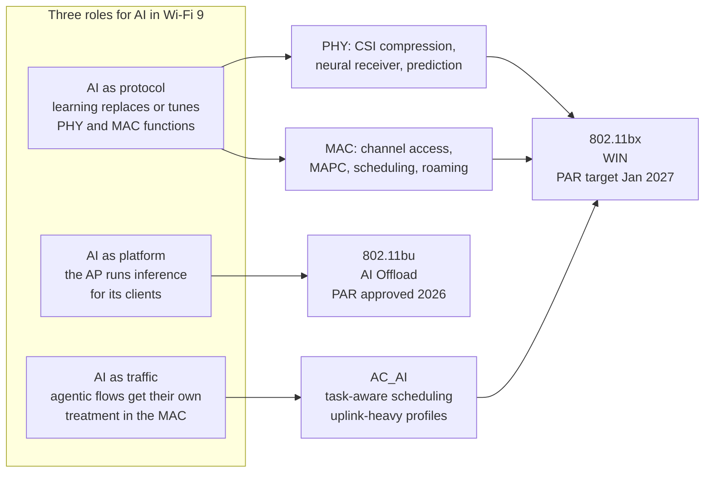

---

## 1. What each generation was actually selling

The generational story is worth restating in one table, because the Wi-Fi 9 claim only makes sense as the
next entry in a sequence that has been changing shape for a decade.

| Generation | Amendment | The organising idea | The mechanism that carried it | What it optimised |
| --- | --- | --- | --- | --- |
| Wi-Fi 4 | 802.11n (2009) | Spatial multiplexing | MIMO, 40 MHz, A-MPDU | Peak rate |
| Wi-Fi 5 | 802.11ac (2013) | Wider channels | 80/160 MHz, 256-QAM, DL MU-MIMO | Peak rate |
| Wi-Fi 6 | 802.11ax (2021) | Efficiency in density | OFDMA, trigger frames, TWT, BSS colour, SR | Aggregate throughput per Hz per area |
| Wi-Fi 7 | 802.11be (2024) | Deterministic-ish latency | MLO, 320 MHz, 4096-QAM, r-TWT, puncturing | Latency tail and peak rate together |
| Wi-Fi 8 | 802.11bn (draft) | Ultra-high reliability | MAPC (Co-TDMA, Co-SR, Co-BF, Co-RTWT), DRU, ELR, UEQM, NPCA, P-EDCA, SMD | The **worst case**, not the average |
| Wi-Fi 9 | 802.11bx (pre-PAR) | Intelligence | Undecided — the candidate set is AI as protocol, platform and traffic | A **guarantee**, and a new service class |

The Karamyshev paper makes the sharpest observation in either document about this sequence: observers like to
call it Intel's **tick-tock**, alternating a throughput generation with an efficiency generation. But tick-tock
ended at Intel in 2016 when transistor scaling hit a wall, and the same wall is now visible in Wi-Fi. A
throughput "tick" needs either new spectrum (7–24 GHz, regulatory uncertainty) or more spatial streams (device
form factor, cost, sounding overhead). **Neither is available on demand, so the alternation cannot continue as
an alternation.** Wi-Fi 9 is the first generation that has to find its gains somewhere other than the two
places every previous generation found them.

That is why "intelligence" is the name rather than a feature. It is what is left.

---

## 2. The paper trail: how AI got into 802.11

Nothing about this was sudden, and the dates matter because they tell you which parts are real.

| Body | Formed | Mandate | Output |
| --- | --- | --- | --- |
| **AI/ML TIG** (Topic Interest Group) | Approved **May 2022** | Identify AI/ML use cases applicable to 802.11 and assess technical feasibility | A report naming five use cases: **CSI feedback compression, enhanced roaming, DRL-based channel access, AI/ML-driven MAPC, model sharing**. The TIG then closed |
| **AI/ML SC** (Standing Committee) | After the TIG report | Permanent liaison point for AI/ML contributions across 802.11 meetings | Contributions, no amendment |
| **AIO SG** (AI Offload Study Group) | Approved **March 2026**, first meeting **May 2026** in Antwerp | MAC mechanisms to offload compute-intensive inference to APs and Wi-Fi edge devices | PAR and CSD approved by the working group **July 2026**; 802 Executive Committee review expected **November 2026** |
| **TGbu** (AI Offload task group) | PAR approved as **P802.11bu** | Mechanisms and interfaces that let a client offload compute to an AP | Inaugural meeting expected **January 2027** |
| **WNG SC** (Wireless Next Generation) | Standing | Incubator for the generation after 802.11bn; activity spiked through 2026 on the role of AI/ML, novel backoff, open-source tooling | Produced the **WIN Study Group** |
| **WIN SG** (WLAN Intelligent Networking) | 2026 | Draft the PAR and CSD that define Wi-Fi 9's scope | **PAR/CSD target January 2027**; debated scope through September and November 2026 plenaries |
| **TGbx** | After the PAR | Write the 802.11bx amendment | Formation expected mid-2027 |

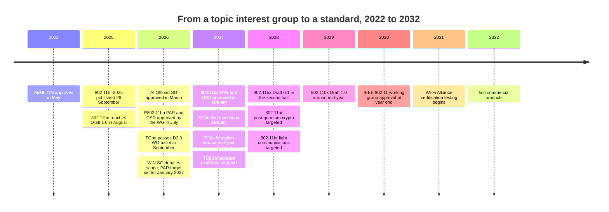

Three things to read out of that table.

**The AI/ML TIG's five use cases are still the candidate list.** Four years passed between the TIG report and
the WIN SG, and the list did not grow much: CSI compression, roaming, learned channel access, MAPC, model
sharing. What changed is that two of them acquired their own task groups (model sharing became the seed of AI
Offload; MAPC became 802.11bn's main feature and then the platform for the AI-driven version).

**AI Offload moved at a speed 802.11 does not normally move at.** March 2026 study group, May first meeting,
July approved PAR. That is four months from "we should study this" to "we have a project". The reason is that
it needed no PHY work: it is a MAC transport and signalling problem, and the industry already had a product
story (glasses, robots, enterprise assistants) that wanted it.

**The amendment number is not settled.** Wilhelmi et al. write **802.11bx**. Karamyshev et al. write
**"802.11bX"** and add a footnote saying the precise designation has not been determined. The working group's
own page calls the group **WIN SG** without committing to a letter. Treat "802.11bx" as the working name, not
a certainty.

---

## 3. Why now: four drivers, and the numbers that make them real

The case for an AI-shaped generation is not "AI is fashionable". It is that four separate curves crossed in
the same two years, and each one lands on a different part of the MAC.

### 3.1 The traffic inverted

This is the most concrete claim in either paper, and it is the one that changes the scheduler.

| Claim | Number | Source |
| --- | --- | --- |
| Downlink-to-uplink ratio of conventional Internet traffic | about **9:1** | WNG contribution 26/0180, via Karamyshev et al. |
| Uplink share of an AI flow | about **9 %** | Cisco, via Wilhelmi et al. |
| Uplink share of typical web traffic | about **0.5 %** | Cisco, via Wilhelmi et al. |
| Growth of AI-driven load in enterprise networks | **+30 % year over year** | WNG contribution 26/0180 |
| Share of WAN traffic that is AI inference by 2035 | up to **25 %** | Cisco, via Wilhelmi et al. |

Read the two uplink numbers together and the shape of the problem appears: an AI flow is not "a web flow with
more upstream". It is **18 times more uplink-heavy at the flow level** while the aggregate still looks
downlink-dominant, which means the aggregate statistic will hide the problem until it is a problem. A classroom
of twenty students on a hosted model is about **6 Mb/s** of AI load in the case study below — trivial in
aggregate, and enough to wreck best-effort latency in a 23-station cell.

Why this matters structurally: **EDCA is symmetric by design but asymmetric in effect.** Every station gets its
own contention instance, so N uplink-heavy clients produce N independent contenders; the AP's downlink for all
of them is a single contender. The MAC was tuned for the second pattern and is now being asked to serve the
first.

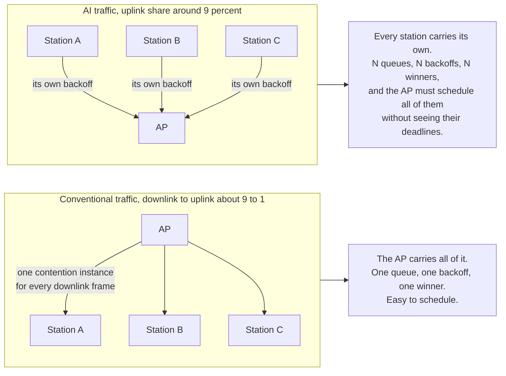

### 3.2 The latency requirement split into classes that cannot share one mechanism

| Application class | Rate | Latency | Jitter | Reliability | What actually binds |
| --- | --- | --- | --- | --- | --- |
| Consumer XR, split rendering | ~50 Mb/s | **< 10–15 ms** stable | low | high | Motion-to-photon, not throughput |
| Location-based XR venue, per headset | **1 Gbps** | **5 ms** | tight | high | Simultaneous heterogeneous streams |
| Same venue, per motion-tracking camera | up to **9 Gbps** | **3 ms** | tight | high | Uplink capacity |
| Same venue, haptics | 100 Mb/s | **1 ms** | very tight | high | The tightest loop in the building |
| Industrial remote monitoring | low | up to **100 ms** | — | moderate | Coverage and cost |
| Collaborative robotics, temperature control | moderate | about **10 ms** | bounded | high | Determinism |
| Robot motion control | low | **sub-millisecond** | very tight | **99.9999 %** | The worst case |
| Agentic AI interaction | ~6 Mb/s per classroom | **10–50 ms** | moderate | high | Uplink scheduling and tail |
| Mission-critical flow in a managed network | — | **< 5 ms** worst case, **99.999 %** probability | minimised | high | A guarantee, not an average |

The last row is the one that redefines the problem. Every previous latency target in Wi-Fi was a **percentile**:
802.11bn's own targets are stated as improvements in the **95th percentile** of latency. A target of
"**Pr(latency > 5 ms) ≤ 10⁻⁵**" is a different mathematical object. It is a statement about the tail of a
distribution, and you cannot verify it by measuring an average. Hold that thought — it is the reason §11 exists.

### 3.3 Compute moved to the edge, and then to the AP

| Claim | Number | Consequence |
| --- | --- | --- |
| Production AI deployments that struggle to hold latency at scale because of cloud delay | **50 %** (Akamai, *State of AI Inference 2026*) | Offload to something closer than a region |
| Round-trip delay required between a physical-AI controller and its actuators | **sub-millisecond** | Only the local network can meet it |
| Local compute baseline for an on-device AI PC | **40 TOPS** (Copilot+ class) | The bar a client must clear to avoid offloading |
| Accuracy of deep-learning gesture recognition from Wi-Fi CSI | **92–95 %** | Sensing inference fits on an AP |

The AP is the natural host for three reasons that have nothing to do with technology: **it is already there,
it is already powered, and it is one wireless hop from the user.** A cloud region is 20–80 ms away; an AP is
2 ms away in the same room. That distance is the entire business case for 802.11bu.

### 3.4 The competitive pressure is now explicit

Karamyshev et al. say it without hedging: 5G-Advanced and 6G are adding **integrated sensing, AI-native air
interfaces and hyper-reliable low-latency**, narrowing Wi-Fi's indoor advantage, while private 5G sells
*guarantees* that Wi-Fi cannot currently sign. Wi-Fi's counter-arguments — cost, unlicensed spectrum, zero
planning, an interoperable multi-vendor ecosystem — all survive only if Wi-Fi closes the determinism gap. If it
does not, the industrial segment migrates to cellular at higher cost, and the migration is sticky.

That is the strategic frame for everything below: **AI is not being added to Wi-Fi because it is interesting.
It is being added because the two things Wi-Fi still loses on — worst-case behaviour and the cost of running a
model next to the user — are both things learning is good at.**

---

## 4. The taxonomy: three roles, three layers, and one question

Before the PHY and MAC detail, fix the map. The two papers' categories combine into a single grid, and the
grid is what makes the rest of the note navigable.

| | **PHY** | **MAC** | **Above the MAC** |
| --- | --- | --- | --- |
| **AI as protocol** learning inside the protocol's own operation | CSI compression, channel estimation and prediction, neural receiver, beam management, interference classification, constellation shaping | Learned backoff and CW, MCS and bandwidth selection, aggregation sizing, TID-to-link mapping, TWT service-period scheduling, predictive roaming, AI-driven MAPC | Load balancing, client steering, anomaly detection, intent-driven configuration, security analytics |
| **AI as platform** the network runs models for its users | — | 802.11bu offload transport, service discovery, capability advertisement, compute admission control, model distribution | Orchestration of models across APs and a controller; federated training |
| **AI as traffic** flows generated by AI get their own treatment | — | AC_AI, task- and dependency-aware scheduling, semantic differentiation (conceptual) | Application-layer awareness of the network's AI classes |

Three observations from building that grid.

**The bottom-right half is where all the shipped value is.** Everything in the "above the MAC" column and most
of the MAC column can be built today by a vendor, in a driver or a controller, with no standard change at all.
Cisco, Juniper Mist, HPE and Huawei have all shipped ML-driven RRM, steering and anomaly detection for years.
The Karamyshev paper says it plainly: "many MAC-layer optimizations can be implemented without standardization
changes".

**The top-left corner is where the standard would have to move, and it is the emptiest.** A neural receiver
needs no frame change, so it needs no standard. A pilotless PPDU needs a new frame format, so it needs a
standard, and it is therefore the least likely thing on the grid to happen this decade.

**The middle row is the only genuinely new capability.** Offload is not "Wi-Fi but better"; it is Wi-Fi
becoming a different kind of product. It is also the only row with an approved PAR.

And the question that organises the whole note:

> **Can the thing you are standardising be given a bound, and can it be tested without knowing the model?**
>
> A mechanism that answers yes can go in the amendment. A mechanism that answers no can go in a vendor's
> firmware, where nobody has to write a conformance test for it. Almost every controversy below is a
> disagreement about which side of that line a proposal falls on.

---

## 5. PHY, part 1: the time budget decides everything

A Wi-Fi PHY is a hard-real-time pipeline, and the deadlines are not negotiable because they are written into
the frame exchange. The numbers are from [[02-15 WLAN - The Transceiver - From Superheterodyne to Wi-Fi 7 and the AI-Native Radio]] §17, restated here because every PHY claim below depends on them:

| Deadline | Budget | What must complete inside it |
| --- | --- | --- |
| Last symbol to ACK on air (**SIFS**) | **16 µs** | Demodulate and decode the frame, check FCS, build and start the response |
| One HE/EHT OFDM symbol | **12.8 µs** + 0.8 µs GI = **13.6 µs** | Demodulate and track phase for one symbol |
| Preamble, energy detect to channel estimate | about **56 µs** | AGC, timing and CFO sync, channel estimation |
| One 1500-byte MPDU at MCS 13, 320 MHz | **4.2 µs** | The entire payload the network exists to deliver |
| Published neural-receiver inference (5G NR, ~730k weights, A100 + TensorRT) | **< 1 ms** | The whole slot |

A millisecond is **60 times** the SIFS budget. That is not a gap a smaller model closes; it is a gap that says
something structural: **the learned block cannot sit in the per-symbol path at 2026 silicon budgets.** The
model is not too big — a Wi-Fi SoC has room for 730k weights. The arithmetic has to finish in 13.6 µs, in a
device decoding four streams, on a battery, while the radio is also expected to be cheap.

So the useful question is not "can AI be in the PHY" but **which loop**. There are four, and they differ by six
orders of magnitude in the time they allow.

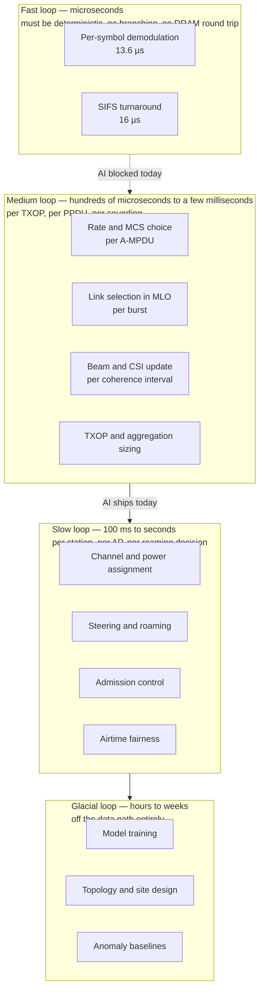

The rule of thumb that makes this usable in design reviews:

> **Inference has to finish in about a tenth of the deadline it lives inside**, because the rest of the
> pipeline needs the other nine tenths and the timing has to survive a bad case. A 100 µs model can serve a
> 1 ms loop. A 1 ms model can serve a 10 ms loop. Nothing can serve a 16 µs loop except a fixed function.

That single line explains the entire pattern of what has shipped: **AI in Wi-Fi is everywhere except the
symbol rate.** Digital pre-distortion adaptation, calibration, thermal compensation, rate adaptation, MLO link
selection, roaming, channel assignment, client steering, anomaly detection — all of them live in the medium,
slow or glacial loops and all of them have been in products for years. The famous "AI-native radio" headlines
are about the fast loop, and the fast loop is the one that has not moved.

---

## 6. PHY, part 2: the five candidate functions, one at a time

### 6.1 CSI feedback compression — the strongest case in the whole PHY

This is the one PHY candidate that is both technically compelling and cleanly standardisable, and the reason is
arithmetic rather than fashion.

Sounding works like this: the AP sends a null-data packet, the station estimates the channel per subcarrier per
antenna pair, compresses the result into a **compressed beamforming report**, and sends it back. The report is a
bit-exact field in a defined frame, which is exactly the kind of object an amendment can replace.

The size scales as `N_subcarriers × N_c × N_r`. Put real numbers on it for the case that Wi-Fi 9 is heading
towards — 8 spatial streams, 320 MHz, a report every fourth subcarrier:

| Quantity | Value | Note |
| --- | --- | --- |
| Subcarriers in 320 MHz | 3984 | 4 × 996-tone segments |
| Report granularity `Ng = 4` | 996 reports | Standard practice at wide bandwidth |
| Angles per report, 8 × 8 | about **128** | Of order `2 · N_c · N_r` |
| Quantisation | 10 bits | Typical for the phi/psi angle set |
| **Total feedback per sounding** | about **1.27 Mbit** | 996 × 128 × 10 bits |

Now the part that makes it a problem rather than a curiosity: **that report has to travel at whatever MCS the
link supports**, and the links that most need beamforming are the ones with the worst MCS.

| The report is sent at | Effective rate | Airtime for 1.27 Mbit |
| --- | --- | --- |
| MCS 0, 20 MHz, 1 SS (HE) | 8.6 Mb/s | about **148 ms** |
| MCS 7, 80 MHz, 2 SS (EHT) | 1.2 Gb/s | about **1.1 ms** |
| MCS 13, 320 MHz, 4 SS | 11.5 Gb/s | about **0.11 ms** |

Two conclusions follow, and they are the reason 802.11bn's Coordinated Beamforming is hard and the reason
Wilhelmi et al. call AI-based CSI compression *necessary* rather than nice-to-have:

1. **Sounding cost is set by the weakest participant.** One client at cell edge can consume more airtime
   reporting the channel than it consumes receiving data.
2. **Coordinated beamforming multiplies it.** Co-BF needs the channel between every AP and every station in
   the coordination set, so a two-AP scheme roughly doubles the matrices and a scheme with more than two APs
   grows faster than linearly. At some point the null-steering gain is paid for entirely by feedback overhead.

What learning buys: an autoencoder trained end-to-end on "compress this channel, reconstruct it well enough
that the precoder is still good". The reconstruction error does not have to be small in the least-squares
sense — it has to be small **in the sense that matters for the beamforming gain**, which is a different
objective than the hand-designed Givens-rotation plus delta quantisation. Published numbers are real but
moderate: a **dual-differential feedback** scheme reported **up to 40 % reduction in feedback size** at
comparable complexity (Barannikov, Levitsky, Loginov and Khorov, *IEEE Wireless Communications Letters*
14(2):475–478, 2025).

Why this one will standardise when the others will not: **it is a field, not a behaviour.** You can write down
the format, both ends can implement it independently, a conformance test can check that a given channel matrix
produces a given bit string, and a capability bit lets legacy devices ignore it. That is the shape of every
successful 802.11 PHY amendment.

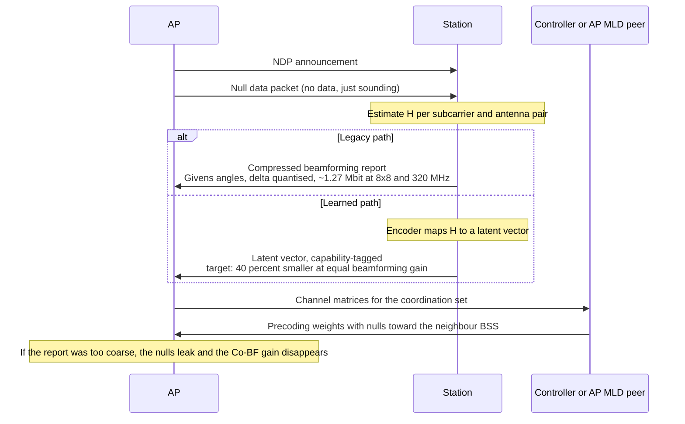

### 6.2 Neural receiver and channel estimation — allowed, because the bits do not change

The neural receiver is one network that jointly does channel estimation, equalisation and demapping, replacing
three hand-designed blocks. Karamyshev et al. add the two details that matter for Wi-Fi: it is **particularly
effective at compensating non-linearities** — power-amplifier compression and I/Q imbalance — which are exactly
the impairments that a linear MMSE model gets wrong, and the 5G Open-RAN deployments that have tried it report
**double-digit throughput improvements**.

It is also the safest AI proposal in the document, for a reason that has nothing to do with performance:

> **A better receiver does not require a different waveform.** The transmitter still sends the same PPDU. The
> bits on the air are unchanged, so every conformance test still passes, every legacy device still
> interoperates, and the improvement is invisible to the standard.

This is the same status that LDPC decoding, maximum-likelihood detection and interference cancellation had
before it: implementation quality, not specification. A vendor can ship it tomorrow, and several have shipped
pieces of it. What it cannot do is run in 13.6 µs, which is why the credible placement is **the AP first** —
mains power, thermal headroom, a dedicated inference block, and a receiver that is allowed a few extra
microseconds because the AP is not the one on a battery.

### 6.3 Prediction — the medium loop, and the honest wins

Everything in this group is a *forecast used to move a decision earlier*, and all of it is unstandardisable in
the good sense: it changes what the device chooses, not what it transmits.

| Function | What is predicted | Decision moved earlier | Where it fits |
| --- | --- | --- | --- |
| Channel prediction | The channel a few coherence intervals ahead | Precoder and MCS refresh before the channel decorrelates | AP, with a fast enough inference block |
| Beam management | Which beam pair will be best | Beam sweep skipped or shortened | Mostly 60 GHz (802.11bq), where sweeps are expensive |
| Rate and MCS selection | The delivery probability at each MCS | Rate chosen before the first retry, not after it | Every driver, already partly learned |
| MLO link selection | Per-link congestion and latency | TID-to-link mapping changed before the queue builds | Multi-link devices, today |
| Roaming trigger | RSSI trajectory from neighbour reports | Scan and roam start before the link fails, not after | Controller, today |

The MLO row deserves emphasis because it is the one where AI has an unambiguous structural advantage. A
multi-link device has to choose, per traffic identifier, which link to use — and the right answer changes on a
timescale of tens of milliseconds as other users come and go. A static mapping policy is always wrong for some
traffic; a learned policy that reads per-link queue and airtime counters can be right more often. This is why
every Wi-Fi 7 chipset vendor advertises "AI-driven MLO" and none of them had to ask IEEE for permission.

### 6.4 Interference classification — the coexistence case

Karamyshev et al. name **interference detection** and **spectral sculpting**; Wilhelmi et al. give the sharper
version: **deep-learning frame-format detection**, classifying a transmission from its preamble *before* full
decode, so that a device can apply a different spatial-reuse policy to a legacy 802.11 frame than to a
non-802.11 interferer.

The reason this matters is that the current spatial-reuse rules are deliberately conservative precisely because
the device cannot tell what it is hearing. 802.11ax's OBSS_PD threshold has to assume the worst. If a PHY can
say "that is a 20 MHz 802.11n beacon from a neighbouring BSS, not a radar-like burst", the threshold can be
raised for that case only. The gain is real and the mechanism is already in the standard: what changes is the
input to the decision.

Note what this is *not*: it is not a new frame format, and it does not need one. It is a receiver-side
classifier feeding an existing MAC parameter. That is the pattern that recurs throughout this note.

### 6.5 Pilotless reception, learned constellations, semantic coding — the waveform

This is the group that would make "AI-native PHY" literally true, and it is the group that is blocked.

| Proposal | What it changes | Why it is blocked |
| --- | --- | --- |
| **Pilotless reception** — omit training symbols and pilot tones, let the receiver infer the channel | The preamble and the pilot pattern, i.e. **the PPDU itself** | Needs a new preamble and frame structure, so it needs a new amendment and a legacy-detection story. Karamyshev et al. state this explicitly |
| **Learned constellations / constellation shaping** | The symbol alphabet | Not on the QAM ladder, so no MCS index describes it; EVM conformance and the spectral mask are defined against the standard constellation |
| **Semantic or task-oriented coding** | What "delivered" means | Replaces all-or-nothing retransmission with a task-level objective, which the MAC's Block Ack and retry logic has no vocabulary for. Wilhelmi et al. label it *conceptual only* |
| **Joint PHY/MAC learning** — link adaptation and channel coding learned together | The division of labour between the two layers | Requires both ends to share a model and a training objective; there is no interoperability story |

The engineering reason all four fail is the same, and it is not "the maths is hard":

> **The standard specifies the PPDU so that a 2026 device can hear a 2016 one.** A learned constellation is a
> new PPDU. A spectral mask is a statement about the emitted waveform, and a regulator enforces it against a
> measurement, not against a model. Certification requires a test vector, and a test vector requires that the
> expected output be reproducible on a third party's equipment.

There is a precedent for how this ends. **802.11n shipped a Greenfield mode** — a preamble with no legacy
header, for networks with no legacy devices — and it was abandoned in later generations because almost nobody
could use it: the moment one old device appears, the mode is unusable, and the mode's benefit never justified
the cost of a second detection path. Karamyshev et al. cite exactly this when they discuss the Greenfield
proposals now circulating for Wi-Fi 9, and they note the condition any such mode needs: separation from legacy
devices **in frequency, in time, in space, or by protocol**, with legacy procedures retained for association.

---

## 7. What "AI-native PHY" would actually require

The phrase gets used loosely, so it is worth writing down what it would take. A genuinely AI-native PHY is not
"a neural network somewhere in the receive chain". It is a PHY whose **transmitted signal** is designed by a
model, and that triggers a chain of consequences.

| Requirement | Why it follows | Who owns it |
| --- | --- | --- |
| A new preamble that legacy devices either ignore or defer to | A device that cannot parse the preamble cannot set its NAV, so it will transmit into the middle of the frame | IEEE |
| A legacy-detection path that still works | Every deployed device must be able to tell "not for me" from "noise" | IEEE, and it is the hard part |
| A conformance definition that is not a bit-exact vector | A learned demapper's soft outputs differ run to run unless the model is frozen bit-exactly | IEEE and the test houses together |
| An EVM and spectral-mask definition that survives a non-standard constellation | The regulator measures power in a mask; a shaped constellation has a different envelope | Regulators, not IEEE |
| A capability and versioning scheme for the model itself | Two devices must agree on which model produced which waveform | IEEE, and nobody has proposed a mechanism |
| A reason to prefer this over simply using more spectrum | The gain has to exceed the cost of a second detection path | The market |

That last row is the one that kills most proposals, and it is worth stating as a design rule: **the PHY has
already extracted most of what Shannon and the mask allow.** 4096-QAM at MCS 13 with 4 streams is 23 Gbps
nominal and about 2.5 m of range. A learned waveform might buy a few dB at the edges. A new detection path
costs every device in the ecosystem a permanent tax. The trade does not close, which is why the honest reading
of the Wi-Fi 9 PHY conversation is:

> **The receiver will learn. The transmitter will not.** Everything credible in the PHY column is a receiver
> or a feedback improvement, because those are the two places where you can win without changing what goes on
> the air.

---

## 8. MAC, part 1: four decisions, and only one of them is safe to learn outright

The MAC makes four decisions. They have different timescales, different owners and very different tolerance for
a learned policy.

| Decision | Question | Timescale | What learning can change | Risk |
| --- | --- | --- | --- | --- |
| **Channel access** | Who transmits next | Per contention, tens to hundreds of µs | CW, AIFS, backoff distribution, deferral policy | **High** — it is a shared game, not a private optimisation |
| **Transmission size** | How much to send once you win | Per TXOP, 0.1–5 ms | A-MPDU size, TXOP use, RU width, aggregation | Low — private to the sender |
| **Multi-user allocation** | Which stations share the next PPDU, in which RUs | Per trigger, ~1 ms | RU assignment, MCS per user, trigger scheduling | Medium — needs a model of every client |
| **Attachment** | Which AP and which link | 100 ms to seconds | Steering target, roam timing, TID-to-link map | Low per decision, high in aggregate (oscillation) |

The pattern: **the further a decision is from the shared medium, the safer it is to learn.** Transmission size
and attachment are private or nearly private; a bad choice costs you and nobody else. Channel access is a game
with N players, and a learned policy changes the equilibrium for everyone — including the players who did not
learn.

That distinction is the single most useful thing to carry into the rest of this note, because the two papers
treat it very differently. Wilhelmi et al. list "RL-learned, DCF-unconstrained protocol" as a candidate under
*AI as protocol*, in the same breath as CSI compression. Those two proposals have almost nothing in common
technically: one is a feedback field, the other is a change to the rules of a commons.

---

## 9. AI-driven channel access: three levels, and a warning

### 9.1 The three levels

| Level | What is learned | Is the DCF envelope preserved? | Ships today? | Standard needed? |
| --- | --- | --- | --- | --- |
| **0 — parameter adaptation** | `CW_min`, `CW_max`, AIFSN, TXOP limit, per-AC, per-link, per-load | Yes, entirely | Yes, in several chipsets under names like adaptive EDCA | No |
| **1 — learned backoff inside DCF** | The policy that picks the backoff counter, constrained to a legal window | Yes — the frame exchange and the contention rules are unchanged | Partly, in research and in a few vendor implementations | No, but a parameter interface helps |
| **2 — learned protocol** | The access mechanism itself, DCF-unconstrained, possibly joint with PHY | **No** | No | Yes, and nobody has proposed how |

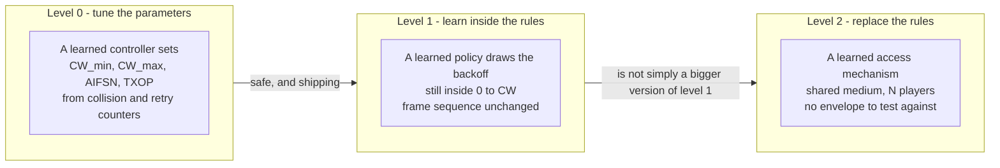

Level 0 is what "AI-driven EDCA tuning" means in a product datasheet, and it is genuinely useful: a controller
that reads per-AC collision and retry counters and moves `CW_min` in response is doing exactly what a good
engineer does by hand, more often. Wilhelmi et al. put it precisely — this is *architectural optimisation with
DCF preserved*, and it is the version of "AI as protocol" that has no interoperability problem at all.

Level 1 is the interesting research space. A policy that picks backoff values from a learned distribution,
still bounded by `[0, CW]`, still obeying the same frame sequence, can beat a fixed uniform draw on latency
tail — because a uniform draw is a strange thing to do when you have side information about the traffic you are
about to send. This is the "learned CW adaptation replacing static DCF rules" proposal, and it is defensible
precisely because the envelope is intact: any conformance test that passes for a fixed CW passes for an
adaptive one, as long as the adaptation stays within the advertised range.

### 9.2 Why level 2 is not a bigger version of level 1

The temptation is to say: if learning the backoff helps, learning the whole protocol helps more. That inference
is wrong, and the reason is the most important theoretical point in this note.

EDCA's behaviour is analysable because **every station runs the same rule with a parameter set drawn from the
same small space.** That is what lets a Bianchi-style model predict throughput and collision probability, and
it is what lets an operator reason about a deployment before installing it. The guarantee is not a property of
one station's policy; it is a property of the **equilibrium** of N stations running the same policy class.

Now let one station learn. It will find, among other things, that a slightly smaller effective backoff wins
more airtime. That is a true fact about the game and a bad fact about the network: the other stations lose
throughput, they respond by retrying more, and the aggregate collapses toward the same total with worse tail
latency. This is the classic congestion externality, and it does not disappear because the policy was learned.
It gets worse, because a learned policy explores.

Three consequences, all of which the papers acknowledge in different words:

- **A learned MAC cannot be evaluated per device.** Its performance claim is only meaningful against a stated
  population of other devices — which is exactly what a conformance test cannot specify.
- **Fairness becomes a design parameter, not a consequence.** With a fixed rule, fairness falls out of
  symmetry. With learned rules, someone has to decide what fairness means and enforce it.
- **The standard's real function is to make everyone play the same game.** That is why the amendment is where
  the interesting constraints live, and why "we will just let each vendor's AI optimise" is not an answer for
  unlicensed spectrum.

Karamyshev et al. put the deterministic version of the same point in their MAC section: a fully scheduled mode
assumes every device respects slot boundaries, and **uncoordinated legacy transmissions can disrupt the
timing**. Their conclusion is the one that follows from all of the above: deterministic operation needs either a
managed environment with a controlled device population, or new spectrum with no legacy devices in it.

---

## 10. AI as traffic, in detail: the AC_AI case study

This is the only part of the Wi-Fi 9 conversation with a published simulation, so it is worth doing properly.

### 10.1 The claim

Agentic AI traffic does not look like voice, video or best effort. It is **uplink-heavy, sustained, small-frame
and latency-sensitive in bursts**, with a dependency structure that none of the four existing access categories
models. Wilhelmi et al. therefore propose a fifth access category, `AC_AI`, sitting between video and best
effort, and they simulate what happens when AI packets are assigned to each of the four existing classes versus
the new one.

### 10.2 The parameters

| Parameter | AC_VO | AC_VI | **AC_AI (proposed)** | AC_BE | AC_BK |
| --- | --- | --- | --- | --- | --- |
| `CW_min` | 4 | 16 | **8** | 32 | 32 |
| `CW_max` | 16 | 32 | **64** | 1024 | 1024 |
| AIFSN | 2 | 2 | **4** | 5 | 7 |
| TXOP limit | 1.504 ms | 3.008 ms | **0** (one PPDU or A-MPDU) | 0 | 0 |

The stated intent: `AC_VO ≻ AC_VI ≻ AC_AI ≻ AC_BE ≻ AC_BK`. The design rationale given is `CW_min = 8` for
faster access under light contention, `CW_max = 64` to cap aggressiveness and improve reliability, and
`TXOP = 0` so that a small AI payload flushes in a single aggregated transmission rather than being split.

For reference, the Wi-Fi Alliance's default EDCA set is `VO 2/3/7/1.504 ms`, `VI 2/7/15/3.008 ms`,
`BE 3/15/1023/0`, `BK 7/15/1023/0`. The paper's table is its own parameterisation, not the WFA default — worth
noticing, because it means the numbers below are a study of *these* values.

### 10.3 The arithmetic nobody puts in the slide

Convert the parameters into the two quantities that actually decide who wins: the arbitration wait and the mean
backoff, at 5/6 GHz where SIFS is 16 µs and a slot is 9 µs.

| AC | AIFS = 16 + AIFSN × 9 | Mean backoff = `CW_min`/2 slots | Mean wait before first attempt |
| --- | --- | --- | --- |
| AC_VO | 34 µs | 2 slots = 18 µs | **52 µs** |
| AC_VI | 34 µs | 8 slots = 72 µs | **106 µs** |
| **AC_AI** | **52 µs** | **4 slots = 36 µs** | **88 µs** |
| AC_BE | 61 µs | 16 slots = 144 µs | **205 µs** |

Read the last column twice. **At zero load, `AC_AI` beats video**: 88 µs against 106 µs. The reason is that
`CW_min = 8` is smaller than video's 16, and the backoff term dominates the AIFS term. The paper's stated
ordering — AI below video — holds on the AIFS axis and not on the contention-window axis.

Now raise the load. Under contention the window doubles on every failure up to `CW_max`:

| AC | `CW_max` | Mean backoff at the ceiling | Mean wait at the ceiling |
| --- | --- | --- | --- |
| AC_VO | 16 | 8 slots = 72 µs | 106 µs |
| AC_VI | 32 | 16 slots = 144 µs | 178 µs |
| **AC_AI** | **64** | **32 slots = 288 µs** | **340 µs** |
| AC_BE | 1024 | 512 slots = 4.6 ms | 4.66 ms |

**The ordering inverts.** At low load AI is ahead of video; at high load, video's smaller ceiling puts it back
in front. So `AC_AI` is not "between video and best effort" as a fixed fact — it is between them **on average
across the load range**, and a deployment that operates at either extreme will see something different.

This is not a criticism of the proposal; it is a property of EDCA that is worth internalising. **An access
category is a five-dimensional parameter vector, and a vector does not define a total order.** "Higher
priority" is shorthand that works only when one AC dominates on every axis, which is true for VO against BE and
false for a carefully tuned middle class. Anyone who tunes a fifth AC will discover this.

The inversion also explains a design choice that looks arbitrary and is not: `CW_max = 64` is what keeps AI
ahead of best effort at saturation. Without it, an AI flow that collides twice would be competing with
background backups.

### 10.4 The simulation

| Setting | Value |
| --- | --- |
| Simulator | Komondor (ns-3 based), commit `4e1cca5` |
| Topology | 1 BSS, 23 stations, all 3 m from the AP |
| Load generators | 3 stations carrying VO / VI / BE; **20 stations** representing a classroom using LLMs |
| AI load | about **6 Mb/s** total, prompts upstream and responses downstream |
| AI session model | uplink bursty token stream, **4 kbit** frames, inter-arrival U[10, 33] ms, bursts of U[10, 60] s, idle gaps U[5, 30] s |
| Legacy load | Poisson: VO 5, VI 40, BE 80 Mb/s; frames 1.2 / 12 / 12 kbit |
| PHY | 5 GHz, 80 MHz, 20 dBm, TGax residential path loss, carrier sense −82 dBm |
| Aggregation | up to 64 MPDUs |
| Duration | 300 s |

### 10.5 The results

End-to-end delay in ms, median with the upper whisker where reported:

| AI packets assigned to | AI median | AI tail | VO median | VI median | BE median | BE tail |
| --- | --- | --- | --- | --- | --- | --- |
| AC_VO | **1.15** | — | — | — | **12.04** | **47.59** |
| AC_VI | 1.71 | 10.49 | — | — | — | — |
| **AC_AI** | **1.43** | **7.99** | +1 % vs VI case | +2 % vs VI case | +8 % vs VI case | — |
| AC_BE | 2.08 (+45 %) | 16.75 | — | — | 7.60 | 27.93 |

The conclusion the paper draws is that **no existing assignment is safe for every traffic type**, and it is
hard to argue with: putting AI in voice minimises AI's own delay and produces the worst best-effort tail in the
study (47.59 ms); putting AI in best effort protects best effort and more than doubles AI's tail; the new class
costs the legacy flows single-digit percentages and gives AI a better median and tail than video does.

### 10.6 What the case study actually shows, and what it does not

What it shows, and this is the durable part:

- **A new traffic class is cheap in legacy terms.** Single-digit median penalties for existing classes is the
  kind of number that makes a standards body comfortable, because EDCA is designed to protect VO and VI and the
  study confirms it does.
- **The tail, not the median, is where the argument is won.** The medians differ by tenths of a millisecond;
  the tails differ by 2–40 ms. AI traffic is a tail problem, like every other latency problem in Wi-Fi.
- **Mapping matters more than parameters.** The gap between "AI in voice" and "AI in best effort" is larger
  than the gap between "AI in video" and any tuned `AC_AI`. Get the class wrong and no amount of tuning saves
  you.

What it does not show, and this is where an interviewer will push:

| Gap | Why it matters |
| --- | --- |
| The AI traffic model is a guess | 4 kbit frames with uniform inter-arrivals inside bursts. Real agentic traffic has dependencies between subtasks, and the paper says so — which is why task-aware scheduling is a separate proposal |
| One topology, 3 m, no interference | The case for a new class is strongest in a clean cell; dense OBSS behaviour is untested |
| The parameters were hand-picked, not searched | The authors say the ranking could reverse under other settings within the same priority window — the arithmetic in §10.3 shows exactly where |
| No uplink airtime analysis | The class changes *who goes first*, not *how much the uplink costs*. See §10.7; that is the bigger number |
| Cost of the class itself is not counted | A fifth AC is not a free queue. See §10.8 |

### 10.7 The number the case study leaves out: AI frames are preamble-bound

A 4 kbit frame is 500 bytes. At MCS 7, 80 MHz, one spatial stream — about 433 Mb/s — the payload occupies
roughly **9 µs**. The preamble in front of it, for an HE or EHT single-user PPDU, is roughly **40 µs**.

So a typical AI uplink frame is about **four-fifths overhead**. Three things follow, and they are more
consequential than the choice of access category:

1. **Raising the MCS does almost nothing.** The frame is not rate-limited; it is fixed-cost-limited. Doubling
   the rate saves 4 µs out of 49.
2. **Preamble reduction or aggregation is where the win is.** That means trigger-based OFDMA — one preamble
   amortised across twenty users — not a better contention parameter. It is also why "enhanced uplink
   scheduling" appears in the requirements of both papers.
3. **The uplink load is not 6 Mb/s of airtime, it is 6 Mb/s of frames.** At 4 kbit per frame, 6 Mb/s is 1500
   frames per second; at ~49 µs each, about **7.5 % of the channel**, of which roughly **6 % is preamble**.
   A classroom paying 6 % of its Wi-Fi to preambles is the actual inefficiency, and it is invisible in every
   throughput chart.

This is the note's clearest example of why the AI-as-traffic discussion keeps turning into an uplink-scheduling
discussion: the traffic class fixes the queueing, and the queueing is not the bottleneck.

### 10.8 What a fifth access category costs

`AC_AI` sounds like adding a queue. It is not, and the difference is worth knowing before arguing about it in a
review.

| Cost | Detail |
| --- | --- |
| **The user-priority to AC table is fixed** | 802.11 maps the eight user priorities (and therefore the eight TIDs) onto four ACs by a table in the MAC. A fifth class means changing a mapping that every driver, every QoS Map element and every WMM certification test hard-codes |
| **Eight TIDs, five classes** | There is no spare TID. Something has to be re-mapped, which means an existing application's traffic changes class unless the mapping becomes dynamic |
| **Certification** | WMM certification tests the four-AC behaviour. A fifth class is a new test suite, a new set of interop combinations, and a new failure mode for legacy APs that receive an unrecognised class |
| **Benefit is conditional** | It helps when AI traffic shares a cell with voice and video. In a cell that is all AI, it is a no-op |

The honest summary: **`AC_AI` is a good idea with a real cost, and the cost is in the mapping layer rather than
the scheduler.** That is the kind of thing that decides whether a proposal becomes a feature or a paragraph in
a tutorial.

---

## 11. Determinism: where AI helps, and where it must not be in the loop

The `AC_AI` discussion is about *relative* priority. The determinism discussion is about *absolute* bounds, and
they are different problems with different mechanisms.

### 11.1 The mechanisms on the table

| Mechanism | What it does | Status | Does it give a bound? |
| --- | --- | --- | --- |
| **Trigger-based OFDMA** (802.11ax) | AP allocates RUs and schedules uplink | Standard, deployed | A bound per trigger, not per packet arrival |
| **r-TWT / Co-RTWT** (802.11be / 802.11bn) | Protected service periods; stations finish before the window | Standard / draft | A protected window, if everyone respects it |
| **LLI** (802.11bn draft) | Client signals buffered low-latency traffic per SCS stream with timing constraints | In draft | Signalling only — **the TXOP holder has no obligation to act** |
| **LLI-CF** (proposed for 802.11bx) | Adds a commitment from the holder: whether and when the traffic will be scheduled | Proposal (doc 26/0064) | Turns a request into a two-sided contract |
| **Preemption, TXOP-level** | A station with urgent traffic injects frames inside another station's TXOP | Discussed for 802.11bn, **not included** | Bounds waiting time to one frame |
| **Preemption, frame-level** | Splits a long frame into segments with short preemption intervals; a busy tone or short signal claims one | Discussed, not included | Bounds waiting time to one segment |
| **Scheduled / slotted operation** | Periodic slots synchronised across OBSS, static or dynamic allocation | Proposal | **The only mechanism that can bound the tail by construction** |
| **Co-TDMA** (802.11bn) | Coordinating AP shares its TXOP with a neighbour in time slices | In draft | Bounds interference from the coordinated BSS |

Two things are worth noticing.

**LLI is an example of the gap the papers keep pointing at.** 802.11bn defines how a client *tells* the AP that
it has urgent traffic and what its deadline is. It does not define what the AP must do about it. So the
mechanism exists, the obligation does not, and the client gets no feedback — it cannot tell whether its request
was heard. `LLI-CF` is the minimal fix: a deterministic acknowledgement that says "yes, and at this point", so
the client can stop contending and stop wasting airtime on requests that were ignored. It is a small proposal
and it exposes a structural habit in 802.11: **the standard is much better at defining signalling than at
defining obligations.**

**Preemption was tried and deferred.** It is the standard TSN tool, it is implemented in Ethernet and in
cellular, and it was discussed in the UHR study group — but it did not go into the 802.11bn draft because of
complexity. The frame-level variant is the more elegant of the two (it avoids repeating headers across
preemptible segments, at the cost of a preamble that has to be resumable), and it is the one that will be
argued about again for 802.11bx.

### 11.2 The architecture that reconciles learning with a guarantee

Here is the position that both papers circle and neither states as a design rule. It is the most useful
sentence in this note for an architecture review.

> **A guarantee is a statement about a bound, and a bound has to be enforced by something that cannot be
> preempted. Learning can decide what to admit, how much to reserve and when to reserve it. It cannot be the
> thing that enforces the bound, because a learned function's output has no worst case.**

Put operationally, the split is:

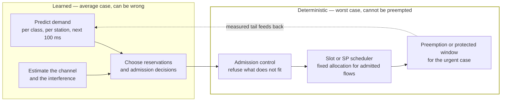

The predictive half can be as clever as you like, because a wrong prediction costs utilisation. The enforcing
half must be simple enough to analyse, because it is what the 99.999 % claim rests on. The feedback arrow is
what makes it a system rather than a policy: measured tail latency is the input that keeps the predictor
honest, and it is also the input that a certification test could actually observe.

This is also the answer to the question "is AI compatible with determinism?" — yes, if it is **outside** the
bound and not **inside** it. A learned scheduler that occasionally admits one flow too many and misses a
deadline is worse than a fixed scheduler that admits conservatively, because the fixed one can be reasoned
about and the learned one cannot.

---

## 12. Multi-AP: the one place where AI is not optional

Karamyshev et al. devote a whole subsection to what 802.11bn's MAPC left undone, and it reads like a list of
problems that are combinatorial rather than architectural.

| Extension | What it adds | Why it matters | What blocks it |
| --- | --- | --- | --- |
| **Coordination beyond two APs** | 3, 4, N cooperating APs instead of a coordinating/coordinated pair | Dense ceilings and venues have more than two APs per coverage area | Scheduling and synchronisation complexity grows faster than the AP count |
| **Global resource allocation** | A central controller with visibility of all BSSs schedules everyone jointly, instead of each AP partitioning then scheduling its share | The current two-stage distributed process optimises locally and cannot see cross-BSS demand | Needs low-latency backhaul to convey decisions in real time |
| **Coordinated OFDMA (Co-OFDMA)** | Coordinated APs share time **and** frequency | Theoretically better than time slicing | Considered for 802.11bn and dropped: gains comparable to Co-TDMA, PHY complications worse |
| **Joint transmission / D-MIMO** | Multiple APs act as one distributed antenna array, sharing user data | The largest theoretical throughput gain in the whole space | Multi-gigabit backhaul and tight time/frequency sync; not in 802.11bn |
| **Flexible primary channel** | Let coordinated APs negotiate on secondary channels instead of forcing a shared primary | The shared-primary constraint raises contention for every associated station | Needs a negotiation channel; DBE extension is one candidate |
| **AI-based CSI compression** | Shrink the feedback that Co-BF needs | Without it, the sounding overhead eats the null-steering gain (§6.1) | Nothing structural — this is the one that should happen |

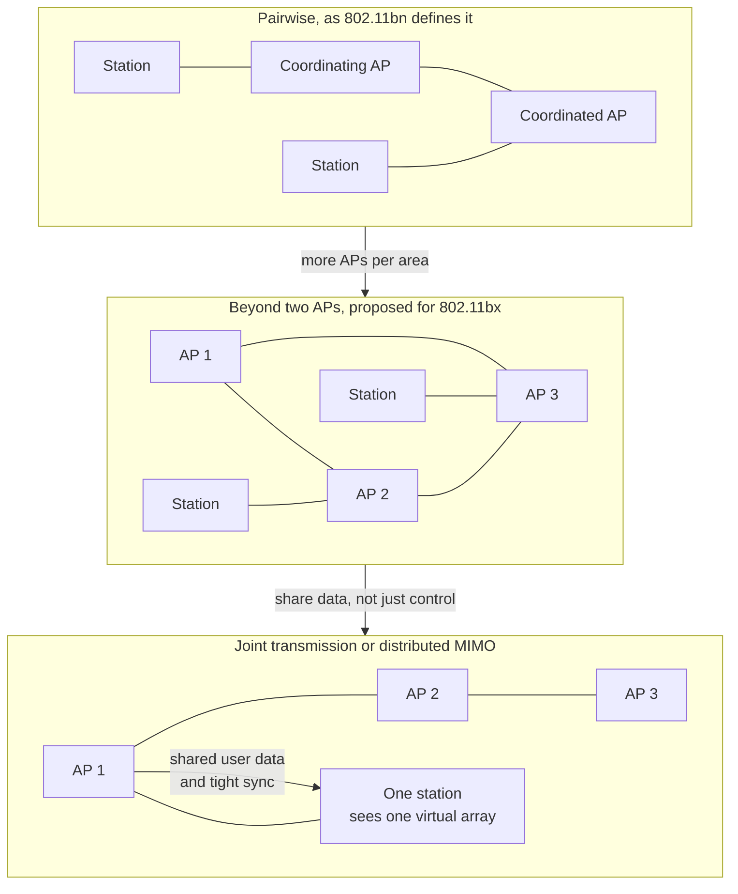

This is where the case for AI in the MAC becomes genuinely strong rather than fashionable, and the reason is
complexity, not latency:

> **A three-AP coordination decision has to choose, per TXOP, a time split, an RU split, a power level per AP
> and a precoder per station, against traffic it cannot see and a channel it estimates imperfectly. That is a
> combinatorial problem with a millisecond deadline. There is no closed form, and a heuristic leaves gain on
> the table. This is the textbook case for a learned policy.**

Wilhelmi et al. give the four concrete ways learning enters, and they are worth naming because they map onto
different distributed-computing patterns:

| Pattern | What it does | Why it suits MAPC |
| --- | --- | --- |
| **Clustering and hierarchical learning** | Partition APs into groups; learn per group, coordinate between groups | Keeps the action space small as N grows |
| **Traffic forecasting as an input** | Predict each BSS's demand before the TXOP | Turns a reactive split into a reservation |
| **Federated learning** | Train across APs without centralising raw channel or traffic data | Privacy across administrative domains |
| **Graph neural networks / multi-agent RL** | Model the APs as a graph with interference edges; learn a topology-aware policy | The interference graph *is* the problem structure |

The catch, and it is the same catch as §9: a multi-agent policy is a policy over a population. If one vendor's
APs learn and another's do not, the coordination protocol is the only thing keeping them compatible — which
means the standard has to define the **message semantics** precisely enough that a learned coordinator and a
rule-based one can still negotiate. 802.11bn's MAPC does this; anything beyond two APs will have to do it
harder.

---

## 13. Power and the mobile AP: two drivers nobody puts on the slide

### 13.1 The sleep-versus-latency tension, and what prediction buys

Every power-saving mechanism in Wi-Fi is a bet about when the next packet will arrive. TWT, r-TWT, Co-RTWT,
802.11bn's AP power save and cross-link power save are all refinements of the same bet. Karamyshev et al. state
the tension exactly: neither transmitter nor receiver knows when the next packet arrives, so the device chooses
between aggressive sleep (low power, high latency) and frequent wake-ups (low latency, high power).

A learned arrival predictor changes the shape of that trade rather than its existence: if the device can
predict a packet within a window, it can wake for the window and sleep outside it, instead of waking
periodically. This is **traffic-aware duty cycling**, and it is the most plausible consumer-facing AI feature in
the whole document, because it is measurable in milliwatts and it needs no standard at all.

The honest limit: the predictor has to be right about *this* application's traffic, which means it has to be
trained per application class, which means somebody has to ship a model that generalises. The Karamyshev paper
frames the same problem as a standardisation question (what measurements, whose model) and the Wilhelmi paper
frames it as a traffic-class question. Both are circling the same missing piece: **there is no standard way for
an AP to know what kind of flow it is carrying.**

### 13.2 The mobile AP is the most underrated driver in the list

| Fact | Number |
| --- | --- |
| Users who regularly use a phone as a Wi-Fi AP | up to **45 %** |
| The problem | The phone has a cellular backhaul whose rate, latency and jitter change constantly, and the Wi-Fi MAC is **not aware of any of it** |
| The second problem | Wi-Fi, multi-band cellular and Bluetooth share one small enclosure: in-device coexistence, heat, and battery |
| What is proposed | **Backhaul-aware MAC** — hooks that let airtime allocation and queue management respond to cellular latency, capacity and handover events; multi-device fairness; IDC-aware scheduling; faster transition between mobile and infrastructure APs on top of 802.11bn's SMD |

Why it belongs in an AI note: a backhaul-aware scheduler is a prediction problem. The MAC needs to know what the
cellular link will do in the next 50 ms, and the only available signal is a history of what it did. That is a
learned model of a link the Wi-Fi chip does not control — and there is no way to standardise it, because the
cellular modem's internals are not exposed to the Wi-Fi MAC. It will be a vendor feature, in a phone, invisible
to the standard, and it will affect more users than any PHY proposal in this note.

---

## 14. AI as platform: 802.11bu and the two-resource scheduler

This is the leg of the tripod that already has a project, so it deserves to be described as an engineering
proposal rather than a vision.

### 14.1 What the PAR actually asks for

| Element | What it means |
| --- | --- |
| **Scope** | MAC mechanisms and signalling that let a client offload compute-intensive inference to an AP, or to another Wi-Fi-enabled edge device |
| **Workloads named** | Sensing inference, generative XR content, agentic reasoning |
| **Discovery and advertisement** | A client has to find out *that* an AP offers compute, *what* it offers, and *where* it is — the last because an AP that is one hop away is a different proposition from one behind a distribution system |
| **Request and result retrieval** | The transport itself: submit a task, get a result, with some notion of ordering and cancellation |
| **Session negotiation** | Compute and communication requirements agreed at setup — the Qualcomm framework contribution (`11-26/1391`) has the glasses negotiate against an AP that fetches the model from a repository |
| **Trust** | Mutual authentication of the offload relationship, because you are handing your data and possibly your model to somebody else's box |

The scope is deliberately narrow, and the narrowness is why it moved in four months. It touches the MAC and
nothing below it. No PHY, no preamble, no waveform. The hard part is not radio; it is the fact that **802.11 has
never scheduled anything except airtime.**

### 14.2 Compute is a second scarce resource, and it is coupled to the first

This is the idea that makes 802.11bu more than a transport amendment, and it is worth drawing because it is
usually missed.

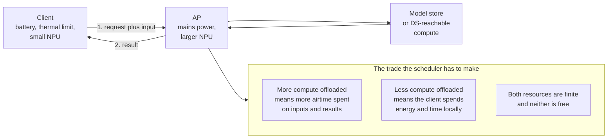

Offloading a task spends **airtime** to save **client energy and client latency**. Both are scarce; both are
shared with other stations; and they are exchanged at a rate that depends on the task (a 4 kbit prompt that
produces a 40 kbit answer is a very different trade from a 2 Mbit image that produces 200 bytes of labels). So
an AP that accepts offloads needs to schedule **two resources jointly**: airtime, which 802.11 already knows how
to schedule, and compute, which it does not.

The precedent that makes this tractable: **802.11 already has admission control.** Voice over WLAN uses TSPEC
with an admission-control flag — a station asks, the AP decides whether the reservation fits, and refuses if it
does not. Compute admission control is the same shape with a much worse measurement problem, because compute
capability is:

- **heterogeneous** — a GPU and an NPU with the same nominal throughput behave differently on the same model;
- **dynamic** — free compute depends on memory state, thermal state and what else is running;
- **not a fixed hardware property** — which is why "standardise the capability advertisement" is harder than it
  sounds, and why Karamyshev et al. list it as an open problem rather than a design choice.

### 14.3 What standardisation has to add, and what it must not

| Must be standardised | Must not be standardised |
| --- | --- |
| The discovery and advertisement message format | The model architecture |
| The request, result and cancellation semantics | The inference engine |
| The session-negotiation parameters (compute class, deadline, bandwidth) | The TOPS figure, beyond a coarse class |
| Accounting for the airtime the offload consumes | The scheduling algorithm inside the AP |
| Mutual authentication and privacy rules | The training data and the training procedure |

The right-hand column is why this amendment can work. It standardises a **contract**, not an implementation. A
vendor can put a better NPU in the AP and a better model in the store without touching the standard, which is
exactly the property that made Wi-Fi's earlier amendments survive a decade of silicon.

The left column has one item nobody has solved: **model distribution and versioning.** Karamyshev et al. list
compression, versioning and rollback, and suggest codebook-based exchange between APs and stations. The
difficulty is not the transport — it is that a model is a versioned artefact with a lifecycle, and 802.11 has
never distributed an artefact with a lifecycle. The nearest precedent is 802.11's own firmware update
mechanisms, which are vendor-specific and out of scope.

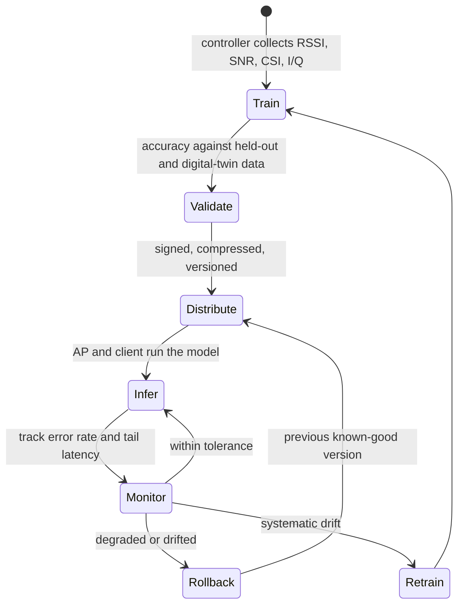

Note what the diagram implies: **the interesting engineering is in `Monitor`, `Rollback` and `Retrain`, not in
`Infer`.** A model that cannot be rolled back is a liability in a network that has to be up. This is the part
the WNG contributions under-specify and the part an operator will ask about first.

---

## 15. The queueing view: why agentic traffic is not a bigger voice flow

The `AC_AI` proposal is a queueing fix, so it is worth being explicit about what is different in the queue. Four
properties distinguish AI flows from the traffic EDCA was designed around, and each one breaks a different
assumption.

| Property | What EDCA assumes | What AI traffic does | Consequence |
| --- | --- | --- | --- |
| **Direction** | Downlink-dominant | Uplink-dominant (about 9 % uplink versus 0.5 % for web) | N stations contend, not one AP |
| **Arrival process** | Bursty but independent; often Poisson-like at the aggregate | ON/OFF with long bursts and long idle gaps; **heavy-tailed** | Tail latency decays slower than exponential, so a 95th-percentile target says nothing about the 99.999th |
| **Structure** | Each packet independent | Subtasks in a dependency chain: step k+1 cannot start until step k returns | Latency **compounds**; jitter compounds worse |
| **Consumer** | A human tolerating a buffer | A closed loop where the user waits for the model | Network tail becomes the application's think time |

The third row is the one that has no precedent in Wi-Fi and the one that produces the most interesting research
proposal. If a task decomposes into A → B → C and the network delays A by 20 ms, the task is late by 20 ms plus
whatever B and C would have taken — **the delay is not amortised, it is inherited.** Prioritising by packet is
therefore the wrong granularity: the right granularity is the **critical path of the task graph**.

Wilhelmi et al. cite the result that makes this concrete: **task-aware scheduling** — differentiating subtasks
*within* a single AI flow by their dependency structure, so that a subtask others depend on goes first — reports
**about 20 % lower end-to-end latency and an 80 % improvement in task reward** against task-unaware scheduling
(Han and Sun, arXiv:2604.21399, 2026). An 80 % reward improvement for a 20 % latency improvement is a strong
hint that the latency number is the wrong metric: what changed is that the *right* packets arrived early.

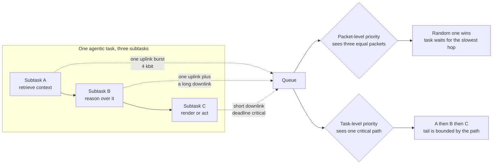

The fourth property, **semantic or task-oriented differentiation**, is where the paper plants a flag and admits
it has no flagpole: Wilhelmi et al. explicitly footnote it as *conceptual, not a standardisation proposal*. The
idea is that if both ends understand the meaning of a message — which MCP and agent-to-agent protocols make
newly plausible, because the message now carries an explicit intent — then the network can decide that a
partially delivered answer is useless while a partially delivered video frame is fine. That would break the
all-or-nothing retransmission model that Block Ack is built on. Nobody has proposed how, and it is the right
thing to say in an interview: **it is the only proposal in the space that would require changing what "delivery"
means, which is why it will not be in 802.11bx.**

---

## 16. The four gates: what decides whether any of this ships

Both papers converge on a filter. It is worth writing it as an explicit checklist, because it is the tool you
need when someone presents an AI feature for Wi-Fi.

### Gate 1 — the gain must exceed the cost, measured on the same axis

Karamyshev et al.: AI features must demonstrate benefits that justify their **computational complexity, power
consumption and latency overhead**. Wilhelmi et al. make the same point with a sharper edge: the benefit has to
be measurable, because "it is more intelligent" is not a spec.

This gate kills a surprising number of proposals. A learned scheduler that improves median latency by 8 % while
adding 400 mW to an AP that is already thermally limited is a net loss for the operator paying the electricity
bill and the fan.

### Gate 2 — compatibility, and the Greenfield escape hatch

Every amendment builds on a frame structure that a 2016 device must still parse. The Karamyshev paper is blunt
about the cost: coexistence with legacy devices has become a major constraint that is **gradually narrowing the
space for innovation**, and the assumption may need revisiting.

The escape hatch is a **Greenfield mode**: no backward compatibility, separated from legacy devices in frequency,
in time, in space, or by protocol, with legacy procedures retained only for association and parameter
negotiation. And the precedent is discouraging — 802.11n shipped exactly this and it died, because the benefit
never justified a second detection path in a device that has to work everywhere.

### Gate 3 — testability, which is the gate nobody talks about

This is the one that decides whether a proposal is a standard or a firmware feature, and it can be stated as a
sharp question:

> **Can a third party, with no access to your model, decide whether your implementation conforms?**

| Kind of AI feature | Testable? | How |
| --- | --- | --- |
| Learned function **behind a compliant interface** (neural receiver, channel estimator) | **Yes** | Test the output: PER and throughput curves at defined SNRs, against the same vectors used for a conventional receiver |
| Learned **parameter adaptation** inside a defined range (CW adaptation, MCS choice) | **Yes** | Test that the parameter stays in range and that the frame exchange is legal |
| Learned **compression** with a defined format (CSI feedback) | **Yes** | Test that a given input produces a decodable output; the format is the contract |
| Learned **scheduler** whose decisions are the output | **No** | There is no expected output; only a distribution, over inputs a test cannot enumerate |
| Learned **waveform** | **No**, not by the current model | Requires a bit-exact reference the model does not produce |

The middle rows are why the receiver will learn and the scheduler will not. A receiver's output is checkable
against a bit stream. A scheduler's output is a choice, and a choice can only be checked against a *policy* —
which is the thing you were trying not to standardise.

The practical consequence for 802.11bx: expect the text to standardise **interfaces, parameters and envelopes**
and to leave the functions inside them to vendors. That is not a failure of ambition; it is the only shape that
survives a plugfest.

### Gate 4 — data, privacy and security

| Risk | Why it is specific to Wi-Fi | Mitigation named in the papers |
| --- | --- | --- |
| **CSI and I/Q are biometric-adjacent** | 802.11bf made channel state a sensing input; a fall detector and a gait identifier use the same data | Privacy-preserving collection; federated learning; on-AP inference so raw data never leaves the box |
| **Model exchange is an attack surface** | A model distributed to thousands of APs is a supply chain | Signed distribution, versioning, rollback (§14.3) |
| **Model poisoning through training data** | The controller trains on measurements reported by devices it does not control | Anomaly detection on the training set; the same behavioural analytics the AI/ML SC wants for security |
| **The offload relationship crosses a trust boundary** | A client hands data and possibly a model to an AP it may not own | Mutual authentication in the 802.11bu scope; a natural synergy with 802.11bt's post-quantum primitives |

The last row is the one with a schedule. 802.11bt (post-quantum cryptography) is in working-group ballot and
targets 2028; 802.11bu will need authentication for the offload session; and the two amendments will be in the
same products. This is the least glamorous and most certain part of the AI-in-Wi-Fi story: **the security work
is on a timetable and the AI features are not.**

Put the four gates in series and you get the decision procedure that a standards body actually applies, whether
or not it says so:

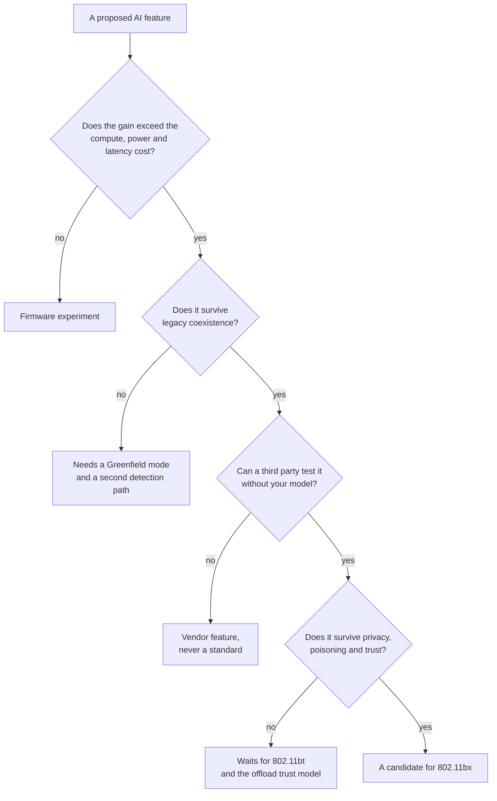

---

## 17. What is actually standardised, and what is a slide

The single most useful table in this note for anyone preparing for an interview, because the gap between the
two columns is where most confident statements about "AI in Wi-Fi" go wrong.

| Item | Where it lives | Status at November 2026 |
| --- | --- | --- |
| **Sensing** | IEEE 802.11bf-2025, published **2025-09-26** | **Standard.** The enabler for on-AP sensing inference |
| **Multi-AP coordination** | 802.11bn draft (Co-TDMA, Co-SR, Co-BF, Co-RTWT, Co-CR) | **Draft.** D2.0 passed working-group ballot Sept 2026 with 8000+ comments; approval targeted 2028 |
| **Deterministic-ish latency** | 802.11be-2024 (r-TWT, MLO), 802.11bn (P-EDCA, NPCA, LLI) | **Standard** (be) and **draft** (bn) |
| **AI Offload** | P802.11bu; AIO SG March 2026 → PAR approved by the WG July 2026 | **Project approved, EC review pending.** First meeting 2027 |
| **Wi-Fi 9 / WIN** | WIN SG; PAR/CSD target Jan 2027 | **Study group.** No performance targets, no committed features |
| **Ambient power communications** | 802.11bp | Draft 1.0 approved for working-group ballot, Oct 2026 |
| **Integrated mmWave** | 802.11bq; 42.5–48.4 GHz and 57–71 GHz, non-standalone over MLO | **Draft in progress**, PPDU format agreed March 2026, targeted 2027 |
| **Post-quantum cryptography** | 802.11bt; SAE, OWE, AP PeerKey, FILS, PASN | **Draft**, D1.0 ballot passed Sept 2026 with 651 comments, targeted 2028 |
| **Light communications** | 802.11br; visible 400–600 nm and IR 1200–1600 nm, WDM, MLO across optical and RF | **Draft in progress**, targeted 2028 |
| **Enhanced privacy** | 802.11bi-2026 | **Published 2026-10-23** |
| `AC_AI`, a fifth access category | Wilhelmi et al. case study | **Research.** Not a proposal to a task group |
| Task-aware scheduling | arXiv:2604.21399 | **Research** |
| Neural receivers | Vendor implementations | **Product**, no standard |
| Learned channel access beyond parameter tuning | Literature | **Research** |
| Pilotless transmission, learned constellations, semantic coding | WNG contributions | **Research**, needs a new PPDU |

Three rules for reading claims about this space:

1. **A date attached to a draft is a forecast, not a fact.** The 2027, 2028 and 2030 dates above come from
   contributions and from papers reporting them. Every 802.11 generation has slipped at least once.
2. **"802.11bx will do X" almost always means "somebody proposed X".** The PAR did not exist in November 2026.
   The scope was still being debated in plenary. Wilhelmi et al. say the inclusion of specific AI features
   "remains uncertain", which is as direct as a paper from inside the process gets.
3. **The product will lead the standard, not the other way round.** Every MAC-layer AI feature in this note can
   ship without a standard, and several already have. The standard's role is to make them interoperate, and
   interoperability is not the current bottleneck — deployment is.

---

## 18. The interview package

Ten questions, with the answer this note is built to support.

| Question | The answer |
| --- | --- |
| *Why is Wi-Fi 9 called WIN?* | **WLAN Intelligent Networking.** AI is the amendment's organising idea rather than one feature, in the way reliability is 802.11bn's. The name is settled; the scope is not |
| *What are the three roles of AI in Wi-Fi 9?* | **As a protocol** (learning inside PHY/MAC), **as a platform** (the AP runs inference for clients, which is 802.11bu), **as traffic** (agentic flows get their own treatment, which is `AC_AI`) |
| *Which of the three is actually standardised?* | Only the platform leg has a project. It is the narrowest scope and it needs no PHY work, which is why it moved in four months |
| *Can a neural receiver go into a Wi-Fi chip?* | Behind a compliant interface, yes — the bits on the air are unchanged, so conformance is untouched. In the per-symbol path, no: inference is ~1 ms against a 13.6 µs symbol and a 16 µs SIFS. Expect it in APs first |
| *What is the strongest PHY candidate?* | **AI-based CSI compression for coordinated beamforming.** It is a feedback field rather than a behaviour, so it can be specified and tested; and the arithmetic forces it, because an 8 × 8 sounding report at 320 MHz is of order 1.3 Mbit sent at the weakest participant's MCS |
| *Why can't you just learn the whole MAC?* | Because EDCA's guarantees are properties of the **equilibrium** of N stations running the same rule. A learned policy changes the equilibrium for everyone, is unfair by construction unless fairness is imposed, and has no worst case to bound |
| *How does a fifth access category behave?* | Not as a total order. On the paper's parameters `AC_AI` beats video at zero load (88 µs against 106 µs mean wait) and loses to it at saturation, because `CW_min` favours AI and `CW_max` favours video. The cost is not the queue, it is the fixed user-priority-to-AC table |
| *What is the actual bottleneck for AI uplink?* | **Preamble, not rate.** A 4 kbit frame is ~9 µs of payload behind ~40 µs of preamble, so a classroom's 6 Mb/s costs about 7.5 % of the channel of which ~6 % is preamble. Trigger-based OFDMA fixes it; a better MCS does not |
| *Is AI compatible with determinism?* | Yes, if it is **outside** the bound. Learning predicts demand, chooses reservations and makes admission decisions; a simple, analysable mechanism enforces the bound. A learned scheduler cannot be the thing that guarantees 99.999 % |
| *What decides whether an AI feature becomes a standard?* | Four gates: gain exceeds compute, power and latency cost; it survives legacy coexistence; **a third party can test it without your model**; and it survives the privacy and poisoning analysis. The third gate is the one that separates receivers from schedulers |

---

## 19. Anchors

Every number below is traceable to a dated source; anything not independently confirmed is marked `VERIFY`.

### 19.1 The two reference papers

- **Wilhelmi, F., Kosek-Szott, K., Szott, S., Bellalta, B.** *IEEE 802.11bx — WLAN Intelligent Networking
  (WIN): Toward an AI-Ready Wi-Fi 9*. arXiv:2610.07900 [cs.NI], submitted **2026-10-06**, published 2026-10-07.
  Affiliations: Universitat Pompeu Fabra and AGH University of Krakow.
- **Karamyshev, A., Levitsky, I., Khorov, E.** *Towards Wi-Fi 9: Vision, Requirements, and Candidate
  Technologies*. *Problems of Information Transmission* **61**(4):383–406, 2025. DOI
  **10.1134/S0032946025040040**. Received 2026-01-25, accepted 2026-02-16. Open access, CC BY 4.0.

### 19.2 Standardisation state, November 2026

- **AI/ML TIG** approved **May 2022**; its report named five use cases — **CSI feedback compression, enhanced
  roaming, DRL-based channel access, AI/ML-driven MAPC, AI/ML model sharing** — after which it was elevated to
  a standing committee.
- **AI Offload SG** approved **March 2026**; first meeting **May 2026** (Antwerp interim). **P802.11bu** PAR
  and CSD approved by the 802.11 working group in **July 2026** (DCN 11-26/978r7 and 11-26/979r7); IEEE 802
  Executive Committee review expected **November 2026**. TGbu's inaugural meeting is expected **January 2027**.
- **WIN SG** (WLAN Intelligent Networking) is drafting the 802.11bx PAR/CSD, with approval targeted for
  **January 2027**; scope was still under debate at the September and November 2026 plenaries.
- **TGbn (Wi-Fi 8)**: D2.0 passed working-group ballot in **September 2026** with **8000+ comments** and about
  **76.5 %** approval; roughly 20 % of comments resolved at that session; the draft was released for sale.
- **Publication dates**: 802.11bi-2026 (**2026-10-23**), 802.11bf-2025 (**2025-09-26**), 802.11bk-2025
  (**2025-09-05**), 802.11be-2024 (**2025-07-22**), 802.11bh-2024 (**2025-06-03**), 802.11-2024
  (**2025-04-28**).
- **Timeline forecast** (Karamyshev et al., citing WNG contributions): SG mid-2026 → TG mid-2027 → **Draft 0.1
  H2 2028** → **Draft 1.0 mid-2029** → **working-group approval end 2030** → WFA testing **2031** → products
  **2032**. The Wilhelmi paper says only "targeted for the early 2030s". Both are forecasts.
- **Amendment designation**: "802.11bx" is the working name; Karamyshev et al. write "802.11bX" and state the
  precise designation is undetermined. `VERIFY` before using either as a settled fact.

### 19.3 Requirements and drivers

- Conventional downlink-to-uplink ratio **~9:1**; AI flows about **9 % uplink** versus **0.5 %** for web
  traffic; enterprise AI load growing **~30 % per year**; AI inference up to **25 % of WAN traffic by 2035**.
- XR split rendering: **~50 Mb/s**, **< 10–15 ms**. Venue XR per headset: **1 Gbps at 5 ms**; per motion
  tracking camera: **up to 9 Gbps at 3 ms**; haptics **100 Mb/s at 1 ms**. Acceptable XR latency **< 50 ms**,
  seamless **< 20 ms**, unusable **> 100 ms**.
- Industrial: **up to 100 ms** for remote monitoring, **~10 ms** for collaborative robotics, **sub-millisecond**
  for robot motion control; **99.9999 %** packet reliability in the most demanding scenarios; mission-critical
  worst-case latency **< 5 ms** with **99.999 %** probability in a managed environment.
- Agentic AI interaction latency: **10–50 ms**.
- Compute: **50 %** of production AI deployments struggle with latency at scale (Akamai, *State of AI Inference
  2026*); **sub-millisecond** round trip for physical AI; **40 TOPS** as the Copilot+ on-device baseline;
  **92–95 %** accuracy for CSI-based gesture recognition.
- Mobile APs: up to **45 %** of users tether regularly.
- **Nominal rates are flat**: 802.11bn keeps 802.11be's ceiling — 320 MHz, 8 spatial streams, MCS 13
  (4096-QAM, 5/6) → **~23 Gbps**. A **10 Gbps sustained** client target has been proposed for the next
  generation; **100 Gbps** was mentioned in contributions but is not a working target.

### 19.4 The AC_AI case study (all figures are from the paper; the derived columns are arithmetic on them)

- Parameters: `AC_AI` **AIFSN 4, CW_min 8, CW_max 64, TXOP 0**, intended priority between AC_VI and AC_BE.
- Derived at 5/6 GHz (SIFS 16 µs, slot 9 µs): AIFS **52 µs** for AI, **34 µs** for VO and VI, **61 µs** for BE;
  mean wait before first attempt **88 µs** (AI), **52 µs** (VO), **106 µs** (VI), **205 µs** (BE).
- Simulation: Komondor commit `4e1cca5`; 1 BSS, 23 stations at 3 m; 20 LLM users generating **~6 Mb/s**;
  **4 kbit** AI frames, inter-arrival U[10, 33] ms, bursts U[10, 60] s, idle U[5, 30] s; Poisson VO 5 / VI 40 /
  BE 80 Mb/s; 5 GHz, 80 MHz, 20 dBm, −82 dBm carrier sense, 64-MPDU aggregation; 300 s.
- Results: AI→VO gives AI **1.15 ms** but BE **12.04 ms median / 47.59 ms tail**; AI→BE gives AI
  **2.08 ms / 16.75 ms** with BE **7.60 / 27.93**; `AC_AI` gives AI **1.43 ms / 7.99 ms** against video's
  **1.71 / 10.49**, costing VO **+1 %**, VI **+2 %**, BE **+8 %** median.
- `VERIFY` on the derived preamble claim in §10.7: the ~40 µs figure is an order-of-magnitude estimate for an
  HE/EHT SU PPDU at 80 MHz including L-STF, L-LTF, L-SIG, RL-SIG, U-SIG/HE-SIG-A and HE-STF. It is used to make
  a ratio argument, not as a specification value.
- `VERIFY` on the CSI figure in §6.1: **~1.27 Mbit** is this note's arithmetic (996 reports × ~128 angles × 10
  bits) at 8 × 8 and 320 MHz with `Ng = 4`. The angle count is order-of-magnitude, and real implementations
  vary with `Ng`, codebook and quantisation.

### 19.5 What 802.11bn already contains, which the AI discussion builds on

MAPC modes **Co-TDMA, Co-SR, Co-BF, Co-RTWT, Co-CR**; **DRU** (distributed-tone RUs, to beat power spectral
density limits on uplink), **ELR** (extended long range, repeated data), **UEQM** (unequal modulation per
spatial stream), **IMP** (interference mitigation pilots), **NPCA** (non-primary channel access), **P-EDCA**
(prioritised EDCA with a defer signal), **DSO** and **DBE** (dynamic subband operation and bandwidth expansion),
**SMD** (seamless mobility domain), **PUO** (periodic unavailability for AP power save), **LLI** (low latency
indication), plus cross-link power save and unavailability reporting for in-device coexistence.

---

## 20. Related

- [[02-1 WLAN - Wi-Fi Generations Evolution - Wi-Fi 4 to Wi-Fi 8 and Beyond]] — the generation ladder this note
  sits on top of, and the shorter summary of the same Wi-Fi 9 conversation in its §7
- [[02-15 WLAN - The Transceiver - From Superheterodyne to Wi-Fi 7 and the AI-Native Radio]] — the arithmetic
  behind the 16 µs wall, the neural receiver's published cost, and why the receiver can learn while the waveform
  cannot
- [[02-16 WLAN - Radio Resource Management - Channels, Power, Admission and the Roaming Algorithms]] — the slow
  loop where AI already ships: channel assignment, power control, admission and steering
- [[02-8 WLAN - Scheduling - Channel Access, EDCA, OFDMA Resource Allocation, Airtime and Implementation]] — the
  EDCA machine that `AC_AI` would extend, and the airtime accounting an AI class would have to pay for
- [[02-13 WLAN - Reliability, Low Latency and Determinism - What the Wi-Fi Stack Can Actually Do]] — what a
  latency target means mechanistically, which is the constraint every AI proposal here has to satisfy
- [[02-9 WLAN - Time-Sensitive Networking Across Wi-Fi Generations - From WMM to 802.11bn and IEC-IEEE 60802]] —
  where preemption and scheduled operation come from, and why 802.11bn deferred them
- [[02-4 WLAN - Packet TX-RX Datapath and Offload Evolution - Aggregation, Block Ack and the Host-Device Split]] —
  the aggregation and offload machinery that determines whether a small AI frame is preamble-bound
- [[01-3 AI-ML for RAN and O-RAN RIC]] — the same three-role question in cellular: AI inside the RAN, AI as a
  service, and the RIC as the place where non-real-time learning meets real-time control
- [[06-1 LLM Inference Engines and xLLM]] — what the AP is actually being asked to run, and why token-stream
  latency looks the way it does on the wire
- [[06-2 Agent Systems and Edge Orchestration]] — the multi-agent and task-decomposition view that makes
  task-aware scheduling a network problem rather than an application problem
- [[05-2 Cloud-Edge-End Collaboration and Heterogeneous Computing]] — the offload economics 802.11bu is
  inserting itself into, one hop closer to the user

---

## 21. References

1. Wilhelmi, F., Kosek-Szott, K., Szott, S., and Bellalta, B. *IEEE 802.11bx — WLAN Intelligent Networking
   (WIN): Toward an AI-Ready Wi-Fi 9*. arXiv:2610.07900 [cs.NI], 2026. — The three-role framing, the driver
   numbers, the standardisation timeline and the `AC_AI` case study reproduced in §10.
2. Karamyshev, A., Levitsky, I., and Khorov, E. *Towards Wi-Fi 9: Vision, Requirements, and Candidate
   Technologies*. Problems of Information Transmission, 61(4):383–406, 2025. DOI 10.1134/S0032946025040040. —
   The requirements ladder, the PHY and MAC candidate tables, and the Greenfield and spectrum discussion.
3. Karamyshev, A., Levitsky, I., Bankov, D., and Khorov, E. *A Tutorial on Wi-Fi 8: The Journey to Ultra High
   Reliability*. Problems of Information Transmission, 61(2):164–210, 2025. DOI 10.1134/S003294602502005X. —
   The 802.11bn feature set that every Wi-Fi 9 proposal extends.
4. Wilhelmi, F., Szott, S., Kosek-Szott, K., and Bellalta, B. *Machine learning and Wi-Fi: Unveiling the path
   toward AI/ML-native IEEE 802.11 networks*. IEEE Communications Magazine, 63(7):114–120, 2025. — The
   AI/ML-native argument in the authors' own earlier framing.
5. Wilhelmi, F., Bellalta, B., Geraci, G., Galati-Giordano, L., Meneghello, F., Kijanka, A., Val, I., and
   López-Pérez, D. *A Tutorial on IEEE 802.11bn Multi-AP Coordination for Wi-Fi 8*. arXiv:2606.13759, 2026. —
   The MAPC baseline that the "beyond two APs" proposals in §12 extend.
6. Szott, S., Kosek-Szott, K., Gawłowicz, P., Gómez, J. T., Bellalta, B., Zubow, A., and Dressler, F. *Wi-Fi
   Meets ML: A Survey on Improving IEEE 802.11 Performance with Machine Learning*. IEEE Communications
   Surveys and Tutorials, 24(3):1843–1893, 2022. DOI 10.1109/COMST.2022.3179242. — The reference survey for
   learned channel access, rate adaptation and the fairness objections in §9.
7. Hoydis, J., Aït Aoudia, F., Valcarce, A., and Viswanathan, H. *Toward a 6G AI-Native Air Interface*. IEEE
   Communications Magazine, 59(5):76–81, 2021. DOI 10.1109/MCOM.001.2001187. — The neural-receiver and
   pilotless-reception programme, and the reference point for how far Wi-Fi's version of it is from shipping.
8. Barannikov, A., Levitsky, I., Loginov, V., and Khorov, E. *CSI Compression Method With Dual Differential
   Feedback for Next-Generation Wi-Fi Networks*. IEEE Wireless Communications Letters, 14(2):475–478, 2025.
   DOI 10.1109/LWC.2024.3510215. — The up-to-40 % feedback reduction quoted in §6.1.
9. Han, M., and Sun, X. *A Task Decomposition and Planning Framework for Efficient LLM Inference in
   AI-Enabled WiFi-Offload Networks*. arXiv:2604.21399, 2026. — The task-aware scheduling result: ~20 % lower
   end-to-end latency and ~80 % better task reward in §15.
10. Cavalcanti, D., Cordeiro, C., Smith, M., and Regev, A. *WiFi TSN: Enabling Deterministic Wireless
    Connectivity over 802.11*. IEEE Communications Standards Magazine, 6(4):22–29, 2022. DOI
    10.1109/MCOMSTD.0002.2200039. — The determinism target and the TSN mechanisms that §11 measures Wi-Fi
    against.
11. IEEE 802.11 Working Group. *P802.11bu PAR and CSD: Enhancements to enable Artificial Intelligence (AI)
    Offload*, DCN 11-26/978 and 11-26/979, 2026. — The scope of the AI Offload amendment in §14.
12. IEEE 802.11 Working Group. *WLAN Intelligent Networking (WIN) Study Group meeting update and closing
    reports*, 2026. <https://www.ieee802.org/11/Reports/win_update.htm>. — The authoritative status of the
    PAR/CSD target and the scope debate.
13. IEEE 802.11 Working Group. *Artificial Intelligence Offload (AIO) Study Group meeting update*, 2026.
    <https://www.ieee802.org/11/Reports/aio_update.htm>. — Meeting history, officer list, and the technical
    contributions that defined the offload use cases.
14. IEEE 802.11 Working Group. *802.11 home page: recent standards approvals and ballot status*, 2026.
    <https://www.ieee802.org/11/>. — Publication dates for 802.11bi-2026, 802.11bf-2025, 802.11bk-2025,
    802.11be-2024, 802.11bh-2024 and 802.11-2024, and the TGbn ballot status.
15. Bianchi, G. *Performance Analysis of the IEEE 802.11 Distributed Coordination Function*. IEEE Journal on
    Selected Areas in Communications, 18(3):535–547, 2000. DOI 10.1109/49.840210. — The equilibrium analysis
    that §9.2 uses to explain why a learned MAC cannot be evaluated per device.
16. Geraci, G., Meneghello, F., Wilhelmi, F., López-Pérez, D., Val, I., Galati Giordano, L., Cordeiro, C.,
    Ghosh, M., Knightly, E., and Bellalta, B. *Wi-Fi: 25 Years and Counting*. Proceedings of the IEEE, 2026. —
    The generational history that §1 compresses into a table.
17. Meneghello, F., Chen, C., Cordeiro, C., and Restuccia, F. *Toward Integrated Sensing and Communications in
    IEEE 802.11bf Wi-Fi Networks*. IEEE Communications Magazine, 61(7):128–133, 2023. — Why sensing is the
    first workload that makes sense to run on an AP (§3.3, §14).
18. IEEE Std 802.11-2024, clause 10 (MAC) and clause 9.4.2 (QoS Map Set element and user-priority mapping). —
    The fixed user-priority-to-access-category table that makes a fifth AC expensive (§10.8).
19. IEEE Std 802.11e-2005, now consolidated in 802.11-2024 clause 10.23.2. — EDCA, the AIFSN/CW/TXOP
    parameterisation, and the admission-control precedent that 802.11bu's compute admission resembles.
20. Cisco. *AI impact on wide area networks*, technical report, 2026; and Akamai. *The State of AI Inference
    2026*, research report, 2026. — The 25 %-of-WAN and 50 %-of-deployments figures in §3.
21. Ericsson. *The rise of uplink demand in AI-driven mobile networks*. Ericsson Mobility Report, 2026. — The
    uplink-inversion argument, from the cellular side of the same problem.
22. Strinati, E. C., et al. *Goal-oriented and semantic communication in 6G AI-native networks: The 6G-GOALS
    approach*. EuCNC/6G Summit, 2024, pp. 1–6. — The semantic-communication programme that §6.5 and §15 place
    outside Wi-Fi's current frame model.
23. IEEE 802.11 Working Group. *802.11bf-2025, 802.11bn (D2.0), 802.11bq, 802.11bt, 802.11br and 802.11bp
    task group updates*, September 2026 session report. — The parallel-track status in §17.

---

_Copyright (c) 2026 Washington Ruan and contributors · licensed under **GPL-3.0-or-later** or **AGPL-3.0-or-later**, at your option · see `LICENSE` and `LICENSE-AGPL`._
