# 02-19 · WLAN — Security: RSNA, WPA3, Mesh Security and the Threat Horizon

Wi-Fi security is usually taught as a list of acronyms in release order — WEP, WPA, WPA2, WPA3 — as if
each one replaced the last and the story ended. That framing hides the only thing worth knowing: the
acronyms are not four protocols, they are **four attempts to answer the same four questions**, and the
attacks that matter are the ones that exploit a question nobody asked.

| Question | Mechanism that answers it | What breaks when the answer is wrong |
| --- | --- | --- |
| **Who are you?** | SAE, 802.1X/EAP, DPP, PSK | Offline dictionary attack, evil twin, credential relay |
| **What may you say?** | CCMP-128, GCMP-256, BIP | Frame injection, decryption, nonce reuse |
| **What may you do?** | Authorization, VLAN, client isolation, ACL | Lateral movement, isolation bypass, RADIUS theft |
| **Who may watch you?** | MAC randomization, 802.11bi, OWE | Tracking, profiling, presence inference |

Almost every CVE in this note is a **fifth** question: *what did the standard assume but never
authenticate?* The A-MSDU flag, the power-save bit, the SSID, the fragment cache, the transmit queue's
security context, the EasyMesh control channel — none of these were cryptographically broken. They were
**unauthenticated assumptions sitting next to strong cryptography**, and an attacker who can write one
bit in a header does not need to break AES.

> **The one-sentence thesis.** Wi-Fi's cryptography has been sound since 2004. Its *framing*, *state
> machines* and *control planes* have not, and that is where every serious attack from 2017 to 2026 has
> landed — which is also why the fixes keep arriving as standard amendments that take five years to
> reach the fleet.

## How this note is organised: fifteen rungs, not fifteen topics

The note is a ladder. Each rung answers a question that the rung below it raised, and you can stop
climbing wherever your question is answered.

| Rung | Section | The question it answers |
| --- | --- | --- |
| 1 | §1 The problem | What is being protected on a medium with no wire, and from whom? |
| 2 | §2 WEP and WPA | What did the first attempt look like, and why did it fail so completely? |
| 3 | §3 RSNA | What architecture replaced it, and who are the three parties? |
| 4 | §4 The handshake | How does a key come into existence, message by message? |
| 5 | §5 CCMP and GCMP | What does that key actually do to a frame — and to which bytes? |
| 6 | §6 Personal | How do you authenticate with a password without handing out an offline oracle? |
| 7 | §7 Enterprise | How do you authenticate with a certificate, and what does the AP trust? |
| 8 | §8 Management frames | What does the data cipher leave unprotected? |
| 9 | §9 The design-flaw class | What does the protocol itself leave unprotected? |
| 10 | §10 Privacy | Who is allowed to watch, and what do they learn without decrypting anything? |
| 11 | §11 Mesh, 802.11s | What happens when every node is a peer and a forwarder? |
| 12 | §12 Mesh, EasyMesh | What happens when a controller decides for you, and how do nodes join? |
| 13 | §13 Operations | What do you configure, how do you verify it, and how do you migrate? |
| 14 | §14 The horizon | What changes next: post-quantum, multi-link, AI, regulation? |
| 15 | §15 Synthesis | What do you actually say when someone asks whether it is safe? |

Two consequences follow from the framing above, and they organise the whole note:

1. **Encryption is a property of a link, not of a session.** A correctly configured WPA3 network still
   hands every client a group key, still lets a client talk to the AP's control plane, and still trusts
   the AP's own forwarding. Anything you actually care about has to be protected again above layer 2.
2. **A mesh multiplies the attack surface without multiplying the mechanisms.** Every mesh node is an
   authenticator, a supplicant, a forwarder, a controller client and a physical object in someone's
   living room. The security model that works for one AP-to-one-STA does not survive that multiplication
   unchanged, and the 2024–2026 research on home mesh shows exactly where it fails.

---

## 1. The problem: a shared medium with no wire

Most Wi-Fi security writing starts with the protocol. Start instead with the constraint that produced
the protocol: **there is no wire.** On a wired segment, "access" is a physical act — you find a port, or
you do not. On a radio, access is a *reception* act, and the receiver has no way to know who else is
listening, how far away they are, or whether the frame it just accepted came from the device named in
the transmitter address.

### 1.1 What the first designers were asked to do

WEP was specified in IEEE 802.11-1997 with an explicit and modest goal, stated in its own name:
**wired equivalent privacy** — traffic on the radio should be about as protected as traffic on a cable.
That is a statement about *casual* interception, not about an adversary with equipment. Three
constraints shaped the result, and each is a historical fact rather than an excuse:

- **Export control.** Strong cryptography could not be exported from the United States in 1997 in a
  product like a PC card, so the design started at a 40-bit key. The 104-bit variant that arrived with
  802.11b kept the same 24-bit IV and the same construction; it changed one number.
- **Silicon cost.** WEP had to run on 1997 access-point hardware at line rate. RC4 was the cheapest
  respectable stream cipher available in gates, and a CRC-32 was already in the MAC for error detection,
  so it was reused as an integrity check.
- **No key management in scope.** The standard defined a secret and a way to use it; it did not define
  how the secret gets to a device, how it changes, or what happens when a laptop is lost.

The first two are the interesting ones, because they are the two decisions that later research turned
into attacks: a stream cipher whose keystream must never repeat, and a checksum that is linear.

### 1.2 Eight adversaries

The protocol choice only makes sense against a named adversary, so name them. The rows are ordered by
capability, and the last three are the ones that get skipped.

| Adversary | Capability | What they want | Which mechanism is supposed to stop them |
| --- | --- | --- | --- |
| **Passive eavesdropper** | Receive only, no transmit | Traffic content, metadata, presence | CCMP/GCMP, and nothing else — a passive attacker who cannot decrypt still sees MAC addresses, frame sizes and timing |
| **Active outsider** | Transmit, jam, spoof | Inject frames, force a downgrade, DoS | PMF, SAE, OCV, beacon protection, transition disable |
| **Rogue AP / evil twin** | Full AP, own certificates or none | Credentials, MitM | Server certificate validation, SAE's binding of the password to the exchange, DPP, beacon protection |
| **Insider with the PSK** | Legitimate association | Lateral movement, other clients' traffic | Client isolation, per-client GTK, VLAN, above-L2 encryption — **not** the PSK |
| **The AP itself** | Terminates every key, sees every frame in the clear, decides whether to forward | Everything the standard does not forbid | Above-L2 encryption, traffic auditing, and a legal contract; no layer-2 mechanism defends you from the box you chose to trust |
| **Malicious mesh node** | Legitimate node, forwarding rights | All traffic that transits it, routing control | Segmentation, per-node credentials, control-plane isolation, inspection at the portal |
| **Supply chain / implementation** | Firmware, driver, SDK | Anything | Patchability, secure boot, code review, and the regulatory regime in §14.5 |
| **Future quantum adversary** | Record now, decrypt later | Long-lived secrets | PQC AKMs (802.11bt), hybrid key establishment |

The **insider** row is the one people skip, and the **AP itself** row is the one people deny. WPA3 does
not defend against someone who knows the passphrase — it defends against someone who *does not* and is
guessing. Once you are in, the only remaining controls are authorization and isolation, which live above
the security protocol. AirSnitch (§9.7) is the proof: no key was broken, and a client still achieved a
full MitM position.

### 1.3 What "secure" can and cannot mean on a shared medium

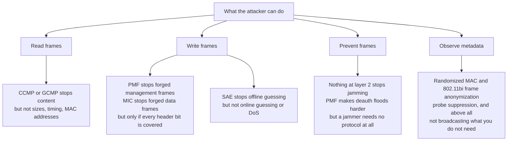

Three honest limits, stated once and used throughout:

- **Availability is not defended at layer 2.** A cheap jammer beats any cipher. Deterministic behaviour
  under attack is a *system* property (see `02-13`), not a cryptographic one.
- **Metadata survives encryption.** Frame sizes leak video versus voice; timing leaks activity; MAC
  addresses leak presence unless randomised, and randomised addresses leak fingerprints through
  information elements instead.
- **The AP is trusted by construction.** In infrastructure mode the AP terminates your encryption, sees
  your traffic and decides whether to forward it to another client. Every "the network is encrypted,
  therefore I am safe from the other clients" argument fails here.

The habit that follows from this section, and that pays for itself in §9: when you read any 802.11
frame, ask **who can change this field, and what does the receiver do differently because of it?**
Two of the fields in that question — the ones with the worst answers — are the QoS control byte and the
SSID. Both were in the clear in 1997, and both were still in the clear in 2026.

---

## 2. The first attempt: WEP, and the four attacks that ended it

WEP is worth a full section rather than a footnote, because every later design decision is a reaction to
one of its failures. It failed in four independent ways, which is why it could not be repaired.

### 2.1 The design, as specified

| Element | Value | Why it matters later |
| --- | --- | --- |
| Cipher | RC4, a stream cipher | Keystream must never repeat; the IV is the only thing preventing it |
| Integrity | CRC-32 (called the ICV) | Linear over GF(2): a bit flip can be corrected in the checksum without the key |
| Key | 40 bits, later 104 bits | Short, static, shared by every user on the AP |
| IV | 24 bits, sent in the clear | 16.7 million values, reused within hours on a busy AP |
| Key selection | Four "default keys" indexed by a 2-bit field | Rotation meant "type the new key into every device" |
| Per-packet key | **None** — the IV is concatenated to the key | So every packet with the same IV uses the same keystream |
| Replay protection | **None** | Captured frames can be replayed indefinitely |
| Authentication | Open, or "shared key" challenge-response | The shared-key option leaks keystream (§2.2) |

### 2.2 Shared-key authentication made it worse

802.11-1997 offered two authentication modes, and the one that sounds stronger is the one that destroys
the confidentiality of the network.

- **Open authentication** is a null exchange: the station asks, the AP says yes. It provides no security
  and, importantly, no oracle.
- **Shared-key authentication** is a four-message challenge: the station sends a random challenge, the
  AP returns the same bytes encrypted under WEP, the station decrypts and returns them. The point of the
  exchange is to prove knowledge of the key.

The problem is the second message. An eavesdropper sees a **known plaintext and its ciphertext**, which
yields that packet's keystream directly. The attacker can then encrypt their own challenge response with
the recovered keystream and authenticate — without ever learning the key. This was documented in 2001
and it has a permanent lesson attached:

> **An authentication protocol that hands out an encryption oracle is worse than no authentication at
> all.** Open authentication plus a good bulk cipher (which is what OWE is, in §10.3) beats shared-key
> authentication plus WEP. It is the earliest instance in this note of a mechanism that made things
> worse by trying to help.

### 2.3 Borisov, Goldberg and Wagner: four attacks, one structure

The 2001 MobiCom paper that ended WEP's reputation did not present a single clever break. It presented a
**taxonomy**, which is why it is still the right thing to read: each class needs less from the attacker
than the last.

| Class | What the attacker needs | What they get |
| --- | --- | --- |
| **Passive** | A receiver | Keystream for any IV they observe; enough traffic and IV collisions reveal plaintext XOR |
| **Active** | A transmitter | Inject a known plaintext, then read the ciphertext of the same IV — a chosen-plaintext oracle |
| **Active with known plaintext** | Knowledge of one field (an ARP header, a login) | The keystream for that IV, hence forgery of an equal-length frame |
| **Table-based ("reaction")** | Time and traffic | A dictionary of IV → keystream, built once, reusable against every network using the same key |

All four exploit the same two decisions: the IV is too short to avoid reuse, and the ICV is linear so a
modified frame can carry a valid checksum. The **chopchop** attack (KoreK, 2004) turned the second into a
decryption oracle: truncate a frame, fix the ICV, watch whether the receiver accepts it, and learn the
last byte one guess at a time.

### 2.4 How fast it fell, in public

| Year | Result |
| --- | --- |
| 2001 | Borisov-Goldberg-Wagner taxonomy; AirSnort and WEPCrack released |
| 2001 | Fluhrer, Mantin and Shamir show that RC4's key schedule leaks key bytes when the IV is prepended — the FMS attack |
| 2004 | Stubblefield, Ioannidis and Rubin turn FMS into a practical key-recovery attack on 802.11b |
| 2005 | FBI demonstration: a 128-bit WEP key recovered in about **three minutes** |
| 2007 | Tews, Weinmann and Pyshkin: 104-bit WEP in **under 60 seconds** (aircrack-ptw), from roughly 40,000 frames |

That table is the reason WEP's replacement had to be architectural rather than cryptographic. Once key
recovery takes a minute on commodity hardware, "a stronger RC4" is not a plan.

### 2.5 WPA: the emergency certification

The IEEE's real fix, 802.11i, was not finished in 2003, and the industry could not wait. So the Wi-Fi
Alliance certified **WPA** — a snapshot of the draft standard's *TKIP* cipher plus 802.1X
authentication, sold as a firmware upgrade for hardware that already had WEP.

TKIP kept RC4 because it had to run on existing chips, and tried to fix each WEP failure with a
countermeasure:

| WEP failure | TKIP's answer | Why it was not enough |
| --- | --- | --- |
| Static key | Per-packet key mixing from the base key, the transmitter address and a 48-bit sequence counter (TSC) | The mixing function was reverse-engineered |
| Same IV, same keystream | The TSC is expanded into the IV space, and increments per packet | The expanded IV still feeds RC4's weak key schedule |
| Linear checksum | **Michael** MIC, a keyed 64-bit MAC, in addition to the CRC | Michael is weak by design (it had to fit old hardware) and, crucially, **reversible** |
| No replay protection | TSC must increase; out-of-order frames are dropped | The replay window is per TID, which is what Beck and Tews used |
| No attack response | **Countermeasures**: two MIC failures within 60 s shut the BSS down, rekey, and impose a 60 s penalty | The countermeasure is a remote DoS lever, and it is the oracle the attack needs |

**Beck and Tews (disclosed 2008, published at WiSec 2009)** turned the countermeasures into the attack.
The procedure is a chopchop variant run on a *different* QoS channel from the one the target frame
arrived on, so the TSC check never fires: an incorrect guess is silently dropped, a correct guess
produces a Michael MIC failure report, and the attacker waits 60 seconds between guesses to stay under
the two-failures-per-minute threshold. Twelve minutes of patience decrypts the last twelve bytes of an
ARP reply — the 8-byte MIC and the 4-byte ICV — and because **Michael is as cheap to invert as to
compute**, those twelve bytes yield the MIC key. The attacker can then forge frames for every TID whose
counter is still low.

TKIP's last reprieve died in 2015, when Vanhoef and Piessens showed that RC4 itself — not the MIC
handling — could be attacked in about an hour (the NOMORE attack), and that later fragmentation work removed
the length limit on forged frames. Since 2012 the Wi-Fi Alliance has not certified TKIP-only equipment, and
every current profile forbids it: **a beacon that advertises cipher `00-0F-AC:2` in 2026 is a finding,
not a configuration choice.**

### 2.6 The three structural lessons

Everything after this section is a consequence of these three sentences.

1. **A cipher without a key-exchange protocol is not a security architecture.** WEP had a secret and no
   way to change it; the entire WPA2/WPA3 story is about how a secret becomes a per-session key.
2. **Integrity must not be linear.** CRC-32 detects accidents; it cannot detect an adversary. Every
   cipher since uses a keyed MAC or an AEAD construction, and every "we also have a checksum" argument
   since 2001 is a regression.
3. **Countermeasures are protocol surface.** TKIP's MIC-failure shutdown was a safety feature that
   became an oracle and a DoS. The same shape reappears in §9.2: a reliability mechanism (retransmission)
   becoming the attack.

### 2.7 The arc, in one picture

```mermaid
flowchart LR
    A["1997<br/>WEP in 802.11-1997<br/>RC4, 40-bit key, 24-bit IV"] --> B["2001<br/>Borisov-Goldberg-Wagner taxonomy<br/>Fluhrer-Mantin-Shamir on RC4"]
    B --> C["2003<br/>WPA certification by the Wi-Fi Alliance<br/>TKIP plus Michael, still RC4"]
    C --> D["2004<br/>802.11i ratified 24 June<br/>RSNA and CCMP with AES<br/>WPA2 certified September"]
    D --> E["2008<br/>Beck-Tews breaks TKIP<br/>the last RC4 option dies"]
    D --> F["2009<br/>802.11w<br/>PMF, BIP-CMAC-128, SA Query"]
    F --> G["2017<br/>KRACK breaks the 4-way handshake<br/>FT and TDLS as well"]
    G --> H["2018<br/>WPA3 launched 25 June<br/>SAE, PMF mandatory, 192-bit mode, OWE, DPP"]
    H --> I["2019<br/>Dragonblood<br/>SAE downgrade and side channels"]
    I --> J["2020<br/>WPA3 update<br/>OCV plus beacon protection"]
    J --> K["2021<br/>FragAttacks<br/>aggregation and fragmentation"]
    K --> L["2024<br/>Wi-Fi 7 requires WPA3, PMF and beacon protection<br/>SSID Confusion published"]
    L --> M["2024 to 2026<br/>802.11bh random MAC services,<br/>802.11bi privacy, 802.11bt post-quantum"]
```

The shape of that diagram is the argument of this note. Every box from 1997 to 2004 is about **how the
key is agreed**. Every box from 2017 onward is about **what happens to a frame after the key exists**.

---

## 3. The architecture that replaced it: RSNA and the three parties

### 3.1 802.1X's port model, imported

802.11i did not invent an authentication protocol; it imported **IEEE 802.1X** and its notion of a
**controlled port**. The model has three roles, and the split is the most important idea in the note:

- **Supplicant** — the client, holding a credential.
- **Authenticator** — the AP (or the controller), holding a *port* that is closed until told otherwise.
- **Authentication server** — usually RADIUS, holding the actual decision.

The authenticator is deliberately dumb: it relays an extensible authentication conversation and enforces
the verdict. It is not supposed to be the party that checks the password, and every deployment that
moves the check onto the AP ("EAP termination") weakens the model by putting the credential check on a
device in a ceiling.

### 3.2 The four phases of an RSNA association

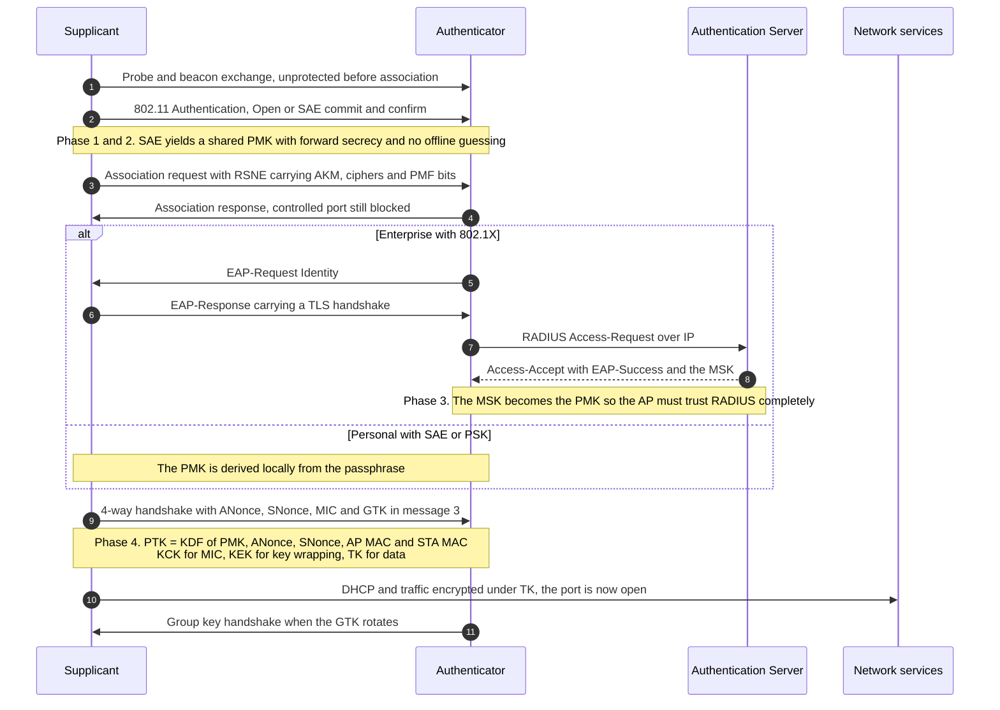

Read the diagram as a **trust ladder**: each rung converts a weaker credential into a stronger key, and
each rung is where a specific class of attack lives. SAE's rung is attacked by Dragonblood, EAP's rung by
evil twin and credential relay, the 4-way handshake's rung by KRACK, and the traffic rung by
FragAttacks and Framing Frames. The rungs are the sections: §4 is rung four, §6 and §7 climb rungs two
and three by two different routes.

### 3.3 The key ladder

```
passphrase  ──(SAE)──►  PMK  ──(4-way, nonces, MACs)──►  PTK ──► KCK (MIC) / KEK (wrap) / TK (data)
                             │
                             └──(AP generates)──►  GTK  (broadcast data)
                                                   IGTK (broadcast mgmt, PMF)
                                                   BIGTK (beacon integrity)
```

- **PMK** — 256 bits, from SAE, PSK, or the MSK exported by 802.1X. Its *provenance* is the whole
  security story: a PSK-derived PMK is a function of a human-chosen string, an EAP-derived PMK is a
  function of a certificate exchange, and an SAE-derived PMK is a function of an ephemeral
  Diffie-Hellman plus the passphrase.
- **PTK** — derived per association from PMK, both nonces and both MAC addresses. It is split into
  **KCK** (key confirmation, protects EAPOL MICs), **KEK** (key encryption, wraps the GTK), and **TK**
  (the actual data key). This split is why a flaw that only exposes the KCK is still serious: MIC
  forgery on handshake messages follows.
- **GTK / IGTK / BIGTK** — group keys, generated by the AP, distributed in message 3 of the 4-way
  handshake and rotated by the group key handshake. Everyone in the BSS holds the same GTK; that single
  fact is the root cause of the AirSnitch GTK attack and of a long history of broadcast-frame trickery.
- **PMKSA caching and OKC** — a client that reconnects can skip SAE/802.1X by reusing a PMKSA. Fast and
  convenient, and it means the PMK's lifetime is longer than the association's. PMK caching is also a
  privacy surface: the PMKID identifies a cached association.
- **FT (802.11r)** — pre-derives PMK-R0 and PMK-R1 for neighbouring APs so a roam skips the full
  handshake. The keys are scoped to a mobility domain, and KRACK's FT variant (CVE-2017-13082) showed
  what happens when a retransmitted Reassociation Request can reinstall the pairwise key.

### 3.4 The RSNE, field by field

Everything above is negotiated in one information element, and reading it is the single most useful
diagnostic skill in Wi-Fi security. The RSN element carries, in order:

| Field | What it says | What to look for |
| --- | --- | --- |
| Version | 1 | Always 1; a version 2 does not exist in the field |
| Group data cipher | The GTK's cipher | `GCMP-256` on Wi-Fi 7, `CCMP-128` acceptable, `TKIP` is a finding |
| Pairwise cipher count and list | Every cipher the AP will accept | A list containing TKIP means the strongest offered is optional |
| AKM count and list | Every key-management suite the AP will accept | The **weakest** entry is the security level, not the strongest |
| RSN capabilities | MFPC, MFPR, and the pre-auth/PTKSA-replay bits | `MFPR=0` in 2026 is a deliberate downgrade |
| PMKID count and list | Cached PMKSAs the AP offers | A PMKID in a beacon is a hash of a known input — free offline guessing |
| Group management cipher | The IGTK's cipher | Required when MFPC=1; `BIP-GMAC-256` for the 192-bit profile |

Two habits come out of that table. First, **a security level is the minimum over the advertised lists**,
because an attacker chooses; an AP offering SAE and PSK is a PSK network with a nicer beacon. Second,
the PMKID is the reason "passive capture cannot be attacked offline" is false in WPA2: the PMKID is
derived from the PMK, the AP MAC and the client MAC, all of which are public, so a single beacon frame
is enough material for a dictionary attack — no handshake, no deauth, no client present. WPA3 removed
this by deriving the PMKID from the SAE key.

### 3.5 Selectors that matter

The RSN Information Element names algorithms by four-byte selector: `00-0F-AC:n`. Know these numbers and
you can read a beacon the way a clinician reads an ECG.

| Selector | Name | Used by | Note |
| --- | --- | --- | --- |
| `00-0F-AC:1` | 802.1X with SHA-1 | WPA2-Enterprise | **Not permitted with EHT/MLO or in 6 GHz** (WPA3 spec v3.5) |
| `00-0F-AC:2` | PSK | WPA2-Personal | The offline-dictionary target, and the PMKID source |
| `00-0F-AC:4` | FT-PSK | 802.11r over WPA2 | Fast roaming, WPA2-era |
| `00-0F-AC:5` | 802.1X with SHA-256 | WPA3-Enterprise standard | The default enterprise AKM now |
| `00-0F-AC:6` | PSK with SHA-256 | WPA2/WPA3 transition, PMF-only | PMF-capable PSK networks |
| `00-0F-AC:8` | SAE | WPA3-Personal | The Dragonfly AKM |
| `00-0F-AC:9` | FT-SAE | 802.11r over WPA3 | Fast roaming, WPA3-era |
| `00-0F-AC:12` | 802.1X with SHA-384, Suite B 192 | WPA3-Enterprise 192-bit | Interoperates with nothing else |
| `00-0F-AC:18` | OWE | Enhanced Open | Encryption without authentication |
| `00-0F-AC:24` | SAE-EXT-KEY, group-dependent hash | WPA3 R3 and Wi-Fi 7 | H2E, longer keys |
| `00-0F-AC:25` | FT-SAE-EXT-KEY | 802.11r over SAE-EXT-KEY | First in the STA preference order |

Ciphers: `00-0F-AC:2` TKIP, `:4` CCMP-128, `:8` GCMP-128, `:9` GCMP-256, `:10` CCMP-256. Group
management ciphers: `:6` BIP-CMAC-128, `:12` BIP-GMAC-256. A beacon that advertises `:1` and `:2` only
is WPA2 with an offline-crackable handshake; one that advertises `:8` and `:24` with MFP-required is
current WPA3-Personal; one that advertises `:12` alone is the 192-bit profile and will refuse every
phone you own.

### 3.6 Why both MAC addresses are in the KDF

The KDF inputs include both MAC addresses. That is a design decision with three consequences worth
remembering, because they recur in §9 and §13:

- **A client that changes its MAC must re-derive.** Randomisation therefore interacts with roaming and
  with fast transition, which is why 802.11bi has to specify how anonymization behaves across a BSS
  transition (§10.2).
- **The AP's identity is bound to the key.** An attacker who impersonates the AP cannot produce a PTK
  that matches, *provided* the client validates the AP's identity by other means — a certificate, or
  SAE with the right password. That is exactly the gap that evil twin exploits when the certificate
  check is missing.
- **Multi-link breaks the assumption that a link owns a key.** In 802.11be the PMKSA and PTK belong to
  the **MLD pair**, not to a link: `PTK = KDF(PMK, ANonce, SNonce, AP MLD MAC, non-AP MLD MAC)`, one PTK
  shared by all links, and per-link GTK/IGTK/BIGTK carried in MLO KDEs. The standard also keeps **one PN
  space for the PTKSA across all setup links**, which means the 48-bit packet number is a shared counter
  that firmware must synchronise across radios. Get that wrong and you get replay-counter desync on one
  link while the others keep working — a bug class that did not exist before Wi-Fi 7.

---

## 4. The handshake: how a key comes to exist

The 4-way handshake is four EAPOL-Key frames with an odd job: prove to each other that both sides hold
the PMK, without sending it, and then derive a fresh PTK that depends on randomness from both sides.

### 4.1 Message by message

| Message | Direction | Carries | Protected by | What an attacker who sees it learns |
| --- | --- | --- | --- | --- |
| **1** | AP → STA | ANonce, the AP's random 256-bit value | Nothing (no key yet) | The AP's nonce, and that a handshake started |
| **2** | STA → AP | SNonce, the RSNE, and a MIC over message 1's content | KCK, derived from the PMK | A MIC — which is an offline verifier for a password guess. This is the PSK attack's raw material |
| **3** | AP → STA | ANonce again, the RSNE, the MIC, and the GTK wrapped under the KEK | KCK and KEK | Nothing usable without the PMK; the GTK is encrypted |
| **4** | STA → AP | A MIC acknowledgement, sequence number | KCK | Nothing |

Three things follow from the table, and they are the reason it is laid out as one:

1. **The MIC in message 2 is the offline dictionary oracle.** It is a keyed hash of a message the
   attacker also saw, keyed by a value derived from a password. Everything in §6.1 follows from this
   one cell.
2. **The PTK depends on both nonces and both MACs,** so neither side can force a key it already knows,
   and the key is bound to the pair of devices rather than to the network.
3. **The GTK arrives in message 3**, which is why message 3 is the interesting one for an attacker who
   can *block* and *replay* rather than compute. §9.2 is exactly that.

### 4.2 What the MIC proves — and what it does not

The MIC proves possession of the PMK. It does **not** prove:

- **that the AP is the AP you meant.** Nothing in messages 1–4 names the network. The SSID is not an
  input to any key (§9.6), and the AP's identity is only established if 802.1X carried a certificate or
  SAE was run with the right password.
- **that the frame arrived on the channel it claims.** That is what OCV adds (§8.2), by putting the
  operating channel information into the handshake.
- **that the message is fresh.** Replay protection is a sequence number in EAPOL-Key, and the
  retransmission rules are what KRACK abuses.

> **The pattern worth carrying.** Message 2 proves *knowledge of a secret*. Everything else you might
> want — identity, channel, freshness, network name — has to be added by a mechanism that was designed
> later, and every one of those additions arrived after an attack.

### 4.3 The group key handshake

The GTK has to change whenever a client leaves, or the departing client keeps reading broadcast traffic.
The group key handshake does that with two frames: the AP sends the new GTK encrypted under each
client's KEK, the client acknowledges with a MIC. It is simple, and it has two persistent problems:

- **It is per client but the key is per BSS**, so revocation is O(number of clients) and a failure in one
  client's rekey leaves that client on the old group key with no error visible to the AP.
- **It inherits the same state-machine risk as the 4-way handshake.** KRACK's group-key variant
  (CVE-2017-13078/13079) is a reinstall of the group key, with the same nonce-reuse consequence.

### 4.4 Caching and fast transition

Real networks cannot afford a full EAP exchange on every roam, so three shortcuts exist, each with a
security cost:

| Shortcut | What it saves | What it costs |
| --- | --- | --- |
| **PMKSA caching** | The whole 802.1X or SAE exchange on reconnect | A longer-lived PMK; the PMKID identifies the cache |
| **OKC** (opportunistic key caching) | Deriving a new PMK for a neighbour AP | A PMK shared across APs, so one AP's compromise reaches the others |
| **FT (802.11r)** | The 4-way handshake, replaced by a 2-message reassociation | A key hierarchy (PMK-R0/R1) scoped to a mobility domain, and the CVE-2017-13082 reinstall |

The point to carry into a design review: **every one of these converts a per-association secret into a
per-domain secret.** They are the correct engineering trade, and they mean that "the PMK is fresh" stops
being true the moment you enable fast roaming.

### 4.5 Why a proved protocol still failed

802.11i's handshake was formally analysed early, and the result was reassuring: He, Sundararajan, Datta,
Derek and Mitchell gave a modular proof of the 802.1X phase, the 4-way handshake and the group key
handshake with an unbounded number of principals and sessions (CCS 2005), including a range of failure
recovery flows. The protocol was not the problem, and KRACK twelve years later did not contradict the
proof.

That is the most useful thing in this section. The proof says: *given a principal that installs a key
exactly once per session, the session key is secret.* KRACK showed that **the implementation's notion of
"once" was the attacker's to decide**, because a retransmitted message 3 is a legitimate protocol event.
Formal analysis and implementation state are different objects, and the gap between them is where
2017–2026 happened. Read the proof and then read §9, and the shape of the last decade becomes obvious.

---

## 5. What the key does to a frame: CCMP, GCMP and what they cover

### 5.1 CCMP-128

CCMP is AES in CCM mode with a 128-bit key, a 48-bit packet number, and an AAD built from the MAC header.

```
nonce = PN(48) || A2(48) || priority(8)      -> 104 bits, fed to CCM
AAD   = FC | A1 | A2 | A3 | SC | A4 | QC     -> the header fields that must not change
CCM   = CTR for confidentiality, CBC-MAC for integrity over AAD || payload
MIC   = 8 bytes (or 16 in some profiles)
```

Three properties worth being precise about:

- **The PN is per-key, strictly increasing, and never repeats.** Replay protection is the receiving side
  comparing PN against a window. Every attack that forces a PN reset — KRACK is exactly this — converts
  CCMP from a secure AEAD into a keystream-reuse disaster.
- **Only part of the header is authenticated.** The AAD covers addresses and sequence control, but the
  **QoS control field's A-MSDU-present bit was not covered** in the original design, which is
  CVE-2020-24588 and the heart of FragAttacks.
- **The nonce includes the priority.** That is why mixing TIDs under one key needs care, and why the
  multi-link "one PN space" decision in 802.11be is a real constraint rather than a formality.

### 5.2 What "authenticated" actually covers

This table is the hinge of the note. Everything above it is about keys; everything below it is about the
bytes those keys do not cover.

| MAC header field | In the CCMP AAD? | Who can change it | Consequence if the receiver trusts it |
| --- | --- | --- | --- |
| Frame control | Yes (partly — the protocol version and type bits) | Nobody in a protected frame | — |
| Address 1/2/3, address 4 | Yes | Nobody | — |
| Sequence control | Yes | Nobody | Replay detection works |
| QoS control, **A-MSDU present** | **No** | An attacker who can retransmit a frame | Payload is reparsed as nested frames (FragAttacks) |
| QoS control, **TID** | No (but it is in the nonce) | An attacker choosing a TID | Keystream selection, and TKIP's TSC bypass |
| **Power-save bit** (frame control) | **No** | Any transmitter | AP buffers frames for a victim, or releases them on command (Framing Frames) |
| **SSID** (not in the header at all) | **No** | Any AP | Client joins the wrong network with the right password (SSID Confusion) |

Read down the "No" column: those are the six attacks of §9, before any of them is described. That is the
argument of this note in one table — the cipher was never the weak part.

### 5.3 GCMP-256 and BIP

GCMP is GCM with a 256-bit key: faster than CCM on hardware that has an AES-GCM engine, and it gives a
16-byte MIC. GCMP-256 is required for the 192-bit profile, and the WPA3 specification requires that a BSS
enabling EHT or MLO **shall** enable GCMP-256 as a pairwise cipher — so Wi-Fi 7 in practice means
GCMP-256, even in a "normal" WPA3-Enterprise deployment.

For management frames, **BIP-CMAC-128** (WPA2-era) and **BIP-GMAC-256** (192-bit profile) protect
broadcast robust management frames. BIP is a MIC over the frame body with a separate IGTK, and its
existence is why a forged deauth costs an attacker the IGTK rather than nothing.

### 5.4 Why the cipher suite is the least interesting decision

A well-run network in 2026 has exactly one cipher question left — CCMP-128 or GCMP-256 — and both are
sound. The interesting decisions are all *around* the cipher: which AKM is enabled (§3.5), whether PMF is
required (§8), whether the frame path authenticates what it parses (§9), and whether anything above
layer 2 exists (§13). A design review that spends its time on key length and none on those four is
reviewing the wrong thing.

---

## 6. Personal networks: from a password to a key

Home and small-business networks authenticate with a **passphrase**, and the whole history of
WPA2-Personal to WPA3-Personal is one question: *how do you turn a human-chosen string into a key without
handing an attacker a way to test guesses offline?*

### 6.1 WPA2-PSK: the password is the key material

WPA2-Personal derives the PMK directly from the passphrase:

```
PMK = PBKDF2(HMAC-SHA1, passphrase, SSID, 4096 iterations, 256 bits)
```

The SSID is the salt. The SSID is public. So the PMK is a **publicly computable** function of a
low-entropy secret, and everything downstream — PTK, MIC — is a deterministic function of the PMK.

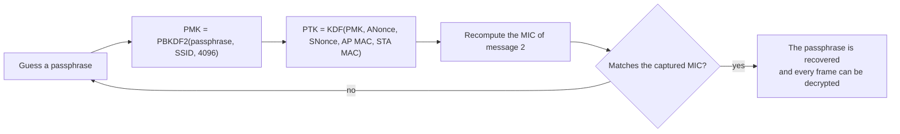

That loop is why a captured handshake is worth capturing, and it needs only **message 2** — one frame,
four bytes of which are a verifier for the whole password space. Two variants make it cheaper still:

- **The PMKID attack (2018).** The PMKID in a beacon or association response is `HMAC(PMK, "PMK Name" ||
  AP MAC || STA MAC)`, so a single frame with no client present and no deauthentication is enough to run
  the same loop. Its existence is a direct consequence of the field described in §3.4.
- **The deauth.** A forged deauthentication forces a reconnect, so the attacker does not have to wait for
  a handshake to happen — they can cause one (§8.1 explains why that frame was unprotected until 2009).

The economics are the whole argument. An 8-character lowercase passphrase is 26⁸ ≈ 2.1 × 10¹¹
candidates; at an illustrative 10⁶ guesses per second that is about two and a half days, and commercial
clusters do better. A 12-character passphrase drawn from a *real* wordlist — the kind a shop picks, like
the street name and a year — falls in hours, because the search is against a dictionary of maybe 10⁹
plausible strings, not against the full space. Nothing about AES is at risk here. The password is the key
material, and the attacker can test key material at leisure.

### 6.2 SAE: what changes

**SAE** (Simultaneous Authentication of Equals) is the WPA3-Personal key exchange, built on the
**Dragonfly** password-authenticated key exchange (Harkins, RFC 7664). Its contribution is not a stronger
password; it is a different *shape* of exchange.

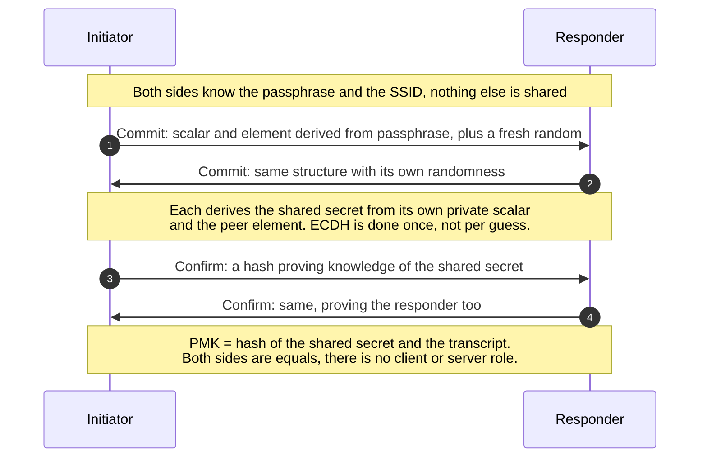

Three properties follow, and they are the whole point:

- **No offline dictionary attack.** A captured exchange contains no verifier of the passphrase. Each guess
  must be tested by running a *live* exchange against a party that holds the password — which means
  guessing is rate-limited, observable and attributable.
- **Forward secrecy.** The PMK comes from an ephemeral Diffie-Hellman, so compromising the passphrase
  tomorrow does not decrypt traffic captured today. WPA2 never had this.
- **Mutual authentication by construction.** Both sides prove knowledge of the password; there is no
  "client proves, server listens" asymmetry to exploit.

What it does not give you: protection against a *weak* passphrase beyond rate limiting, protection
against an insider who knows the passphrase, or any protection at all if the deployment is running
transition mode and an attacker can push the client back to WPA2 (§6.6).

### 6.3 Two ways to turn a password into a curve point

Dragonfly needs a curve element derived from the password, and the two ways of producing it differ in
exactly the way that matters — whether the work is data-dependent.

- **Hunting-and-pecking** (the original): hash the password with a counter, test whether the result is a
  valid curve point, increment the counter until it is. The **number of iterations depends on the
  password**, so a cache or timing observer learns something about it. That leak is Dragonblood's main
  finding.
- **Hash-to-Element (H2E)**: a constant-time map with no loop and no data-dependent iteration count.
  Faster, and nothing to leak.

H2E is the required method now: WPA3 Release 3 and the 6 GHz rules assume it, and the SAE-EXT-KEY AKMs
(`00-0F-AC:24` and `:25`) are the group-dependent-hash variants. Groups 19 (P-256), 20 (P-384) and 21
(P-521) are the elliptic-curve options; group 19 is the interoperable default and the one every client
supports.

### 6.4 Dragonblood: what actually broke

Vanhoef and Ronen's analysis (disclosed April 2019, published at IEEE S&P 2020) is the canonical case
study in *"the mathematics survived, the engineering did not"*. Five findings, five CVEs:

| Finding | CVE | Mechanism | Fix |
| --- | --- | --- | --- |
| Cache-based side channel on SAE | CVE-2019-9494 | Hunting-and-pecking's branch pattern leaks through cache timing | H2E, constant-time encoding |
| Cache-based side channel on EAP-pwd | CVE-2019-9495 | Same leak in the enterprise EAP method | Constant-time EAP-pwd, group restrictions |
| Missing SAE confirm validation | CVE-2019-9496 | A malformed confirm crashes or misbehaves the AP | Validation, plus anti-DoS work |
| EAP-pwd reflection and invalid-curve attacks | CVE-2019-9497, CVE-2019-11235 | The symmetric handshake can be reflected, and a crafted point bypasses authentication | Compare scalar and element, validate that points lie on the curve |
| Downgrade to WPA2 in transition mode | — (design) | A rogue AP advertising WPA2-only pulls a WPA3-capable client down to the crackable handshake | Transition Disable |

Two details are worth carrying into an interview because they show how the attack economics work:

- **The side channel is a partitioning attack, not a brute force.** Recovering the *iteration count* only
  splits the dictionary into buckets. But repeated queries split it again and again, and the published
  analysis prices the result at **under $1 of EC2 time for a 10¹⁰-entry dictionary** — cheap because the
  leak converts one enormous search into a series of small ones. (Earlier drafts quoted about $125 for an
  8-character lowercase space; the published figure is the one to cite.)
- **The downgrade is not detected in time.** The client does notice that the 4-way handshake is WPA2's,
  but by then messages 1 and 2 have been exchanged, which is enough for the offline attack. Detection
  after the fact is not a defence.

The remediation is the interesting part, because it is a template for every transition problem in Wi-Fi:

1. **H2E mandatory** — removes the side channel by construction rather than by patching timing.
2. **Transition Disable** — once a client has successfully connected with WPA3, it sets a flag in its
   network profile and refuses to fall back to WPA2 for that network. The client, not the AP, closes the
   downgrade door.
3. **SAE-PK** — see §6.5.

### 6.5 SAE-PK: when the passphrase is public

SAE protects a *secret* passphrase. It cannot protect a passphrase printed on a menu board, and those
deployments exist. **SAE-PK** (SAE Public Key) handles them by adding a signature to the exchange: the AP
owns a key pair whose fingerprint is derived from the SSID and the passphrase combined, and it signs part
of the SAE exchange. A client that has connected before can therefore verify that the AP it is joining is
the *same* AP as last time, even though everyone in the street knows the password. A rogue AP that knows
the passphrase but not the private key is detected.

The mechanism is worth knowing because it is the only standardised answer to "the password is not a
secret, but the network identity still is", and because it is the shape that post-quantum Wi-Fi will
inherit: identity carried by a key, not by knowledge. `VERIFY` the exact Wi-Fi Alliance release naming —
the feature ships under WPA3 R3 in vendor documentation, not under a numbered public specification.

### 6.6 Transition mode, and the honest way to run it

WPA3-Personal Transition Mode (PTM) advertises both SAE and PSK on one BSS so legacy clients can still
join. It is the pragmatic bridge and it is also a permanent downgrade path. Two mechanisms make it
survivable:

- **Transition Disable** as above, set by the client after a successful SAE association.
- **WPA3-Personal Compatibility Mode (PCM) with RSNO elements** — the newer approach, where the WPA2
  parameters live in the legacy RSNE and the WPA3/Wi-Fi 7 parameters live in separate **RSN Override**
  elements. Legacy clients that mis-parse unfamiliar RSNEs (a real and common failure) keep working, and
  clients that understand RSNO get the strong parameters. The catch is a chicken-and-egg problem:
  without RSNO support in the client, PCM still connects but stays at Wi-Fi 6 behaviour and WPA2 security.

> **The rule.** Transition mode is a *migration state with an exit condition*, not a configuration. If
> you cannot name the date you will turn PSK off, you have not deployed WPA3 — you have deployed WPA2
> with extra beacons.

### 6.7 The residual attack on SAE: cost

SAE's commit frame is expensive to verify — an elliptic-curve operation per attempt. That asymmetry is an
amplifier: a flood of commits forces the AP to burn CPU, and the attacker spends almost nothing. This is
why the anti-DoS work in the post-quantum amendment matters more than it sounds: 802.11bt adds **proof of
work** to the authentication exchange, so a client must spend computation before the AP does. It is a
general lesson — **whenever authentication becomes asymmetric in cost, it becomes a DoS vector**, and the
fix is to make the cheap side pay first.

---

## 7. Enterprise networks: from a certificate to a key

### 7.1 Three roles, and an AP that is not the authenticator

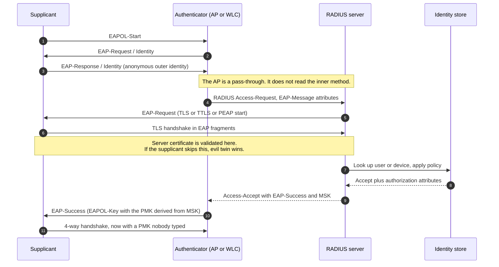

### 7.2 Three structural facts hidden in that diagram

- **The AP is not the authenticator in the cryptographic sense.** It relays EAP and enforces the result.
  That is why "EAP termination" on the AP is a downgrade: it moves the credential check to a device that
  is physically accessible.
- **The MSK becomes the PMK.** RADIUS is therefore inside the trust boundary of every wireless
  association. A forged Access-Accept is a network compromise, which is why RADIUS shared secrets,
  Message-Authenticator validation and RadSec (RADIUS over TLS, RFC 6614) matter — and why hostapd
  advisories about RADIUS forgery are wireless security advisories.
- **Authorization is decided once and enforced forever.** The Access-Accept carries VLAN, role and
  filter attributes; dynamic authorization (RFC 5176 CoA/Disconnect) is how a policy change reaches an
  already-connected client. Without CoA, "revocation" means "wait for the next roam".

### 7.3 EAP methods, ranked by what they actually guarantee

| Method | Server auth | Client auth | Credential exposed to a rogue server | Verdict |
| --- | --- | --- | --- | --- |
| **EAP-TLS** (RFC 5216, TLS 1.3 in RFC 9190) | Certificate | Certificate | Nothing | The only method that authenticates both ends with keys |
| **EAP-TEAP** (RFC 7170) | Certificate | Certificate or inner | Nothing, plus posture and multiple inner methods | The modern tunnel for mixed estates |
| **EAP-TTLS** (RFC 5281) | Certificate | Inner method | Inner credential, if the server cert is not validated | Acceptable with strict validation |
| **PEAPv0/MS-CHAPv2** | Certificate | Password hash | The NT hash, crackable, if validation is skipped | Legacy; audit every profile |
| **EAP-pwd** (RFC 5931) | Password | Password | Nothing, but see Dragonblood | Only with the fixed implementations |
| **EAP-SIM / AKA / AKA'** | Carrier | SIM | Nothing | Hotspot 2.0 and carrier offload |
| **LEAP, EAP-MD5** | None or weak | Weak | Everything | Never |

The single most valuable audit in an enterprise WLAN is not "which EAP method" but **"does the supplicant
validate the server certificate, including the name, and is the CA pinned?"** A PEAP deployment with
validation enforced is stronger than an EAP-TLS deployment where the client accepts any certificate. This
is also what the WPA3 December 2019 update codified: server certificate validation requirements for
EAP-TLS, EAP-TTLS and PEAP, specifically to blunt evil twin.

### 7.4 The 192-bit mode, precisely

WPA3-Enterprise 192-bit mode is a CNSA-aligned profile, and its value in an interview is that it is a
*closed* suite: it interoperates with nothing else, by design.

| Layer | Requirement | Selector |
| --- | --- | --- |
| AKM | 802.1X with SHA-384, and **no other AKM enabled** | `00-0F-AC:12` |
| Pairwise cipher | GCMP-256 only | `00-0F-AC:9` |
| Group data cipher | GCMP-256 only | `00-0F-AC:9` |
| Group management cipher | BIP-GMAC-256 only | `00-0F-AC:12` |
| PMF | Required (MFPC=1, MFPR=1) | RSNE capability bits |
| EAP method | EAP-TLS only, no PEAP, no TTLS | — |
| TLS suites | `TLS_ECDHE_ECDSA_WITH_AES_256_GCM_SHA384`, `TLS_ECDHE_RSA_WITH_AES_256_GCM_SHA384`, `TLS_DHE_RSA_WITH_AES_256_GCM_SHA384` | — |
| Key sizes | P-384 for ECDHE/ECDSA, RSA ≥ 3072 bits | — |
| KDF | HMAC-SHA-384 for the PTK derivation | — |

> **Read the table as a design statement.** 192-bit mode says: no downgrade, no negotiation, no legacy
> client, no exception. That is exactly why it is deployable in defence and government estates and
> exactly why it will never be the default anywhere else.

### 7.5 The enterprise failure modes that actually get exploited

Ranked by how often they appear in real assessments, not by novelty:

1. **No certificate validation on the supplicant.** Evil twin with a self-signed certificate harvests
   credentials or the MSCHAPv2 challenge/response.
2. **Credential reuse across SSIDs.** The SSID is not bound into the key derivation (§9.6), so a rogue
   AP advertising a *different* SSID with the same RADIUS credentials is accepted — and any VPN that
   auto-disables on "trusted" SSIDs turns itself off.
3. **EAP termination on the controller.** The credential check moves to the AP, where the shared secret
   and the certificate live in a device in a ceiling.
4. **RADIUS without Message-Authenticator validation.** Forged Access-Accept or forged CoA.
5. **The captive portal as the only gate.** A pre-authentication ACL that permits DNS, DHCP and the
   portal's IP range is a network segment; if the portal is on the same L2 as the corporate VLAN, it is a
   hole.
6. **PSK for "IoT" with the same PSK as the corporate SSID.** The single most common way an enterprise
   becomes a flat network.

### 7.6 What to check first, in order

If you have an hour and an unfamiliar enterprise WLAN, spend it in this order, because each step is
cheaper than the next and rules out more:

1. **One beacon of each SSID, read as in §3.4.** The AKM list, the cipher list and the PMF bits answer
   most of the questions before you touch a client.
2. **One supplicant profile.** Does it validate the certificate, check the Common Name, and pin the CA?
3. **One RADIUS conversation.** Is Message-Authenticator validated? Is the shared secret per-AP?
4. **One VLAN map.** Which SSID lands where, and what can reach the RADIUS server and the controller?

Everything else — posture, CoA, 192-bit, TEAP provisioning — is refinement on top of those four.

---

## 8. What the cipher does not cover: the management plane

### 8.1 Why management frames needed their own protocol

Before 802.11w, deauthentication and disassociation were **unauthenticated management frames**. Anyone
within range could forge one from the AP's address and disconnect any client — a one-packet DoS, and the
basis of a whole tool ecosystem (deauth floods, "Wi-Fi jammers" that are really just frame injectors).
The same lack of protection made **evil twin** easy: a rogue AP's beacons are indistinguishable from the
real AP's.

That is worth pausing on, because it is the origin of the habit this note keeps recommending. A deauth
frame is 26 bytes, carries no key material, and its only security-relevant content is the reason code and
the two MAC addresses. It was, for twelve years, a remote "disconnect anything" primitive that required
no cryptography to be broken — only a transmitter.

### 8.2 The catalogue

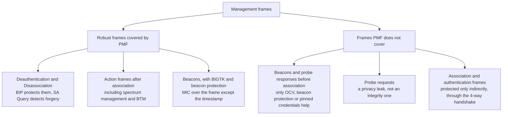

Mechanisms, in the order they arrived:

- **802.11w-2009 (PMF).** Adds BIP-CMAC-128 for broadcast/multicast robust management frames, protects
  unicast deauth/disassoc with the PTK, and adds **SA Query** — after a protected deauth, the client
  asks the AP "are you still there?" before tearing down. Forged deauth then costs the attacker a real
  association, not one packet.
- **PMF capability bits.** MFPC (capable) and MFPR (required). WPA3 requires PMF; WPA2 deployments should
  set MFPC=1 and MFPR=0 to avoid locking out old clients, then move to MFPR=1.
- **Beacon protection (WPA3 December 2020 update; mandatory in Wi-Fi 7).** The AP provisions a **BIGTK**
  and adds a MIC element covering the beacon body except the timestamp. Clients can therefore detect
  forged beacons — which matters because a forged beacon can *steer behaviour*: change the channel,
  force lower rates, advertise different capabilities, or claim weaker security.
- **OCV, Operating Channel Validation (same update).** The OCI (channel, bandwidth, power limits) is
  included in the 4-way handshake and checked against the channel the frame actually arrived on. This
  closes the **channel-based MitM** that KRACK used: an attacker on a different channel relaying frames
  is detected because the OCI does not match. OCV is also confirmed on FT and FILS, and on every channel
  switch.
- **SSID binding — still not done.** The SSID is not part of the 4-way handshake, which is the whole of
  §9.6.

> **The pattern, stated once:** PMF protects management frames *after* association. Everything an attacker
> needs to *get* a client to associate — beacons, probe responses, the SSID's identity — is protected only
> if beacon protection is on and the client checks it, or if the credential itself is bound to the network
> identity.

### 8.3 What PMF costs

PMF is not free, and the costs are the reason some legacy deployments still run without it:

- **IGTK management.** Rotating IGTK and BIGTK means more key state and more handshake variants; a bug in
  rotation is a bug in connectivity.
- **SA Query timeouts.** A protected deauth that is genuine still has to complete the SA Query exchange,
  which adds tens to hundreds of milliseconds to a legitimate disconnect — noticeable in voice.
- **Mixed-mode complexity.** MFPC=1/MFPR=0 requires the AP to track per-client capability, and to send
  both protected and unprotected variants where the standard demands it.
- **Interop.** Clients that claim PMF and then break on BIP are common enough that certification tests
  exist specifically for them.

### 8.4 The pre-association gap

Three things remain outside every mechanism above, and all three are exploited by cheap equipment:

| Gap | Why it survives | What actually helps |
| --- | --- | --- |
| **Beacons are public by design** | A client must find the network before it can trust it | Beacon protection with BIGTK, or 802.11bi's AP-side beacon privacy (§10.2) |
| **Probe requests name every network you know** | Active scanning reveals the client's history | Probe suppression, directed probing, per-SSID MAC randomisation |
| **The SSID is not in the handshake** | It was never an input to the KDF | No credential reuse, distinct certificate Common Names per SSID (§9.6) |

The three together are the reason "hidden SSID" is not a control and never was: it removes one beacon
field and leaves the probe response, the association exchange and the client's own probe request
untouched.

---

## 9. What the protocol does not cover: six attacks that never touched the cipher

This is the most important section in the note, because it is the one that predicts the next attack.
Six disclosures between 2017 and 2026 share a single shape: **a field or a state transition that the
standard never authenticated, adjacent to cryptography that was working perfectly.**

### 9.1 The shape of the class

Three questions separate this class from ordinary CVEs, and every one of them is answerable from the
standard text rather than from an implementation:

- **Which bytes did the sender intend as data, and which did the receiver treat as control?** The
  A-MSDU bit, the power-save bit, the SSID, the TID.
- **Who owns the state when a frame leaves one context and enters another?** A queued frame on
  disassociation, a fragment cache surviving reassociation, a key installed twice.
- **Which protocol endpoints are reachable from which roles?** 1905 from a client VLAN, WSC M1 from an
  ordinary station.

### 9.2 KRACK (2017): reinstall the key, reset the counter

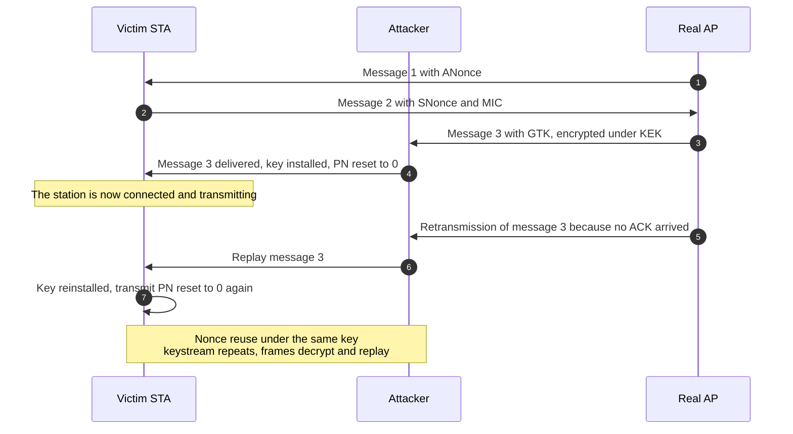

- **Published** 16 October 2017 by Mathy Vanhoef (KU Leuven), presented at CCS and Black Hat Europe.
- **Root cause** is in the standard: the 4-way handshake does not require a key to be installed only once.
  A retransmitted message 3 — which the protocol mandates for reliability — causes a reinstallation, and
  reinstallation resets the nonce and replay counter.
- **Scope** was wider than the 4-way handshake: the group key handshake, 802.11r FT, PeerKey, TDLS and
  the WNM sleep-mode response were all affected. CERT/CC VU#228519 lists **ten CVEs**, CVE-2017-13077
  through CVE-2017-13088.
- **Worst case** was Linux and Android 6.0+, where a reinstall could be driven to install an **all-zero
  key** — full decryption of the victim's traffic, demonstrated on video.
- **Fix** was threefold: implementations must track handshake state and refuse to reinstall; the standard
  was clarified on retransmission handling; and WPA3 later added **OCV** to defeat the channel-based MitM
  that made the attack practical.

> **The reusable lesson.** Reliability mechanisms are attack surface. Every "retransmit if no ACK" in a
> security protocol is a request for the peer to redo something, and *redoing* must be idempotent with
> respect to key state.

### 9.3 Kr00k (2020): the key that becomes zero on disconnect

ESET disclosed CVE-2019-15126 in February 2020: Broadcom and Cypress Wi-Fi chips, under specific
conditions, transmitted frames queued in the hardware **after disassociation using an all-zero temporal
key**. The victim's own frames, still in the transmit buffer, go out in a form any receiver can decrypt.
Impact per event is small — kilobytes — but the trigger is a forged or genuine disassociation, which an
attacker can cause at will.

Kr00k matters in this note not because it is severe but because it is **the first mainstream example of a
security-context bug in a queue** rather than in a protocol, and it is the direct ancestor of Framing
Frames three years later.

### 9.4 FragAttacks (2021): fragmentation and aggregation were never authenticated

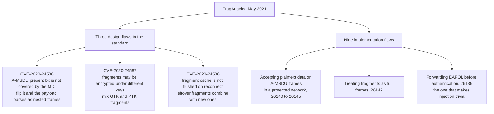

- **Published** 11 May 2021, presented at USENIX Security 2021 as *Fragment and Forge*.
- **Why it worked**: 802.11n made A-MSDU reception mandatory, and the bit that says "this payload is an
  aggregate" lives in the plaintext QoS header while the MIC covers the payload. An attacker who can get
  *any* frame encrypted under a known plaintext can flip that bit on a later frame and have the receiver
  parse attacker-chosen inner frames. Chain it with an AP that forwards EAPOL before authentication and
  you can inject from outside without a key.
- **What it defeated**: WPA2 **and** WPA3, because the flaw is in framing, not in the key exchange. That
  is the point: FragAttacks did not break SAE, and it did not need to.
- **Fix**: the standard changed to require that the A-MSDU flag be authenticated, that all fragments of a
  frame use the same key, and that the fragment cache be flushed on (re)association. Nine months of
  coordinated disclosure, then driver and firmware updates across the industry.

### 9.5 Framing Frames (2023): the transmit queue is part of the security model

Schepers, Ranganathan and Vanhoef, USENIX Security 2023. Three findings:

1. **The power-save bit is unauthenticated.** An attacker can forge a frame that appears to come from a
   victim and set the power-save bit, causing the AP to *buffer* frames for that victim (a trivial DoS),
   or clear it to force delivery at a moment of the attacker's choosing.
2. **Queued frames do not have a well-defined security context.** After a client disconnects, frames still
   in the AP's queue can be transmitted in plaintext, under the group key, or under an all-zero key. The
   standard gives no guidance on what should happen to the security context of a buffered frame when the
   association changes.
3. **The security context can be overridden for frames not yet queued.** In hotspot-like deployments, an
   attacker can influence which security context a future frame will use — encrypting it under an
   attacker-chosen key, which bypasses Wi-Fi encryption entirely.

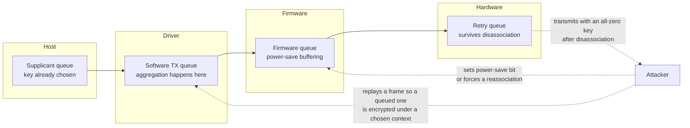

The structural conclusion the authors draw is the one to memorise: **a frame is not secure because it is
encrypted, but because it is encrypted under the context it was meant for, at the layer where it was
queued.** In a stack with a driver queue, a firmware queue, a hostapd queue and a hardware retry queue,
that is four places to get it wrong — and the four boxes in that diagram are four different teams.

### 9.6 SSID Confusion (2024): the network name was never part of the key

CVE-2023-52424, disclosed May 2024 by Héloïse Gollier and Mathy Vanhoef. The SSID is not an input to the
PMK derivation and is not carried in the protected part of the 4-way handshake. So if two networks share
credentials — the same PSK, or the same RADIUS server — an attacker can run an AP with **a different SSID
and the same credentials**, and a client that intended to join "TrustedNet" will join "WrongNet" while
displaying "TrustedNet".

Consequences:

- **VPN auto-disable.** Any client that turns off its VPN on a "trusted" SSID turns it off here.
- **Credential reuse becomes a vulnerability.** The mitigation is to never reuse credentials across
  SSIDs: a distinct password per home SSID, a distinct RADIUS server certificate Common Name per
  enterprise SSID.
- **It applies to AMPE mesh peering too**, which is why it appears again in §11.
- **The proposed fix is a standard change**: bind the SSID into the 4-way handshake, and/or let a client
  store a reference beacon and verify the SSID's authenticity during the handshake. Until that ships,
  the mitigation is operational.

### 9.7 AirSnitch (2026): client isolation was never a standard

NDSS 2026, Zhou, Pu, Liu, Qian, Tan, Krishnamurthy and Vanhoef (UC Riverside and KU Leuven). Client
isolation — the feature everyone believes protects guests from each other — is not specified by IEEE
802.11 at all. It is a vendor behaviour, implemented differently everywhere, and the paper breaks it on
**every router and network tested**.

Three root causes, three techniques:

| Root cause | Technique | What it defeats |
| --- | --- | --- |
| Group keys are managed per BSS, not per client | **Abusing GTK**: send a Wi-Fi frame addressed to the broadcast MAC but carrying a unicast IP destination. Every tested OS delivers the inner unicast packet | Client isolation at the AP's forwarding stage |
| Isolation is enforced at MAC **or** IP, rarely both | **Gateway bouncing**: address the frame to the gateway's MAC and the victim's IP. The AP's MAC-layer isolation allows it, then the gateway routes it to the victim | MAC-layer isolation |
| A client's identity is weakly synchronised across the stack | **Port stealing**: spoof the victim's MAC on another BSSID to rewrite the bridge's forwarding table, and spoof the gateway's MAC upstream | Bidirectional MitM, including uplink |

The enterprise variant is the one that should worry a network architect: the same primitives let an
insider **intercept RADIUS traffic between the AP and the server**, stand up a rogue RADIUS server, and
recover credentials — a path from "guest VLAN" to "authentication infrastructure" that no cipher on the
air can close.

Mitigations the authors recommend, in order of leverage: randomise the GTK per client, drop broadcast
Wi-Fi frames that carry unicast IP destinations, prevent MAC and IP spoofing at the access layer, give
each VLAN its own GTK and IGTK, and centralise decryption and forwarding so that one policy point sees
both layers.

### 9.8 The meta-lesson, in one table

| Unauthenticated thing | Attack | Year |
| --- | --- | --- |
| Handshake state, "install once" | KRACK | 2017 |
| Security context of a hardware queue on disconnect | Kr00k | 2020 |
| A-MSDU present bit, fragment cache, key uniformity across fragments | FragAttacks | 2021 |
| Power-save bit, security context of buffered frames | Framing Frames | 2023 |
| SSID as network identity | SSID Confusion | 2024 |
| Client isolation and group-key scope | AirSnitch | 2026 |

Every row is the same sentence: **the field was in the clear, the receiver trusted it, and the trust
decision had a security consequence.** The habit from §1.3 is the defence — for each field in the header,
ask who can change it and what the receiver does differently because of it. Six fields have answered
badly so far, and the seventh has not been found yet.

---

## 10. Privacy: the property nobody bought

Confidentiality protects content. Privacy protects *the fact that you are here* — and on a radio, that
fact is broadcast. Every section above was about an attacker who wants your data; this one is about an
attacker who wants your pattern.

### 10.1 What leaks before you even associate

| Leak | Mechanism | Mitigation | Residual risk |
| --- | --- | --- | --- |
| MAC address | Every frame carries it, including probe requests | Per-SSID randomisation, 802.11bh/802.11bi | A random MAC is a stable pseudonym for the session, so a session is linkable |
| Probe request contents | The client asks for every SSID it knows | Probe request suppression, directed probing | A silent client is still discoverable by its data frames |
| Information elements | Capability, rates, HE/EHT capabilities, supported AKMs form a fingerprint | 802.11bi frame anonymization | Fingerprinting at the PHY layer remains (see `02-15`) |
| Timing and traffic shape | Frame sizes and intervals reveal video, voice, idle | Padding, aggregation policy | Fingerprinting from traffic shape is a mature research area |
| Presence | Any frame proves a device is present | 802.11bi presence-monitoring work | Absence is not provable |

Two research results explain why the first row is the hard one. Vanhoef and colleagues showed in 2016
that randomisation is defeated by the *sequence* of frames a device emits — a probe request followed by a
data frame under a different address is a linkable pair — and Martin and colleagues showed in 2017 that
the failure is systematic across phone models: the leaked information is not the address, it is the
behaviour around it. Randomisation raises the cost; it does not make a device unlinkable.

### 10.2 802.11bh and 802.11bi: the two halves of the problem

Randomised and changing MAC addresses (RCM) break two different things, and the working group split the
problem in two:

- **802.11bh-2024, "Enhanced service with randomized MAC addresses"** — restores the services that RCM
  breaks: enterprise troubleshooting, accounting and billing, post-association access control, steering
  efficiency. Its mechanism is a stable layer-2 representation of a station (an identifiable random MAC)
  so an AP can recognise a rotating client as the same client *within a trusted environment*.
- **802.11bi-2026, "Enhanced Privacy Protection" (EPP)** — adds privacy mechanisms proper. Confirmed
  scope, from the task group's own text:
  - **Client privacy enhancements (CPE)**: reduce what pre-association and association messages reveal,
    and allow a non-AP MLD to **change its MAC address during an association**, either at its own request
    or at the direction of the AP MLD. A BSS transition can be performed with an **encrypted (Re)Association
    Request** carrying the DS MAC Address element, so the new address is not exposed in the clear — the
    text specifies this separately for non-MLO (12.16.6.1) and MLO (12.16.6.2).
  - **AP-side privacy (BPE)**: an AP MLD may protect the content of its beacons and become discoverable
    only to non-AP MLDs that are preconfigured to recognise it. That is a significant departure from
    "beacons are public by design".
  - **Presence monitoring** and a **frame anonymization parameter set** are defined terms in the
    amendment, which tells you it is meant to be implementable, not aspirational.
- **Status**: PAR approved 9 February 2021, SA ballot on D4.0 in February–March 2026 with 98 comments,
  approved for publication in the second half of 2026. So `802.11bi-2026` is the correct citation, and
  **it is a privacy amendment, not the post-quantum one** — that is 802.11bt (§14.1).

The division of labour is itself instructive: one amendment restores *service* to a privacy mechanism,
the other extends *privacy* into the protocol's own control plane. Privacy work in a standards body
always needs both halves, because every anonymity mechanism breaks something an operator was relying on.

### 10.3 OWE, and the honest limit of unauthenticated encryption

OWE (Opportunistic Wireless Encryption, RFC 8110, 2017; certified as Wi-Fi Enhanced Open in 2018) runs
an unauthenticated Diffie-Hellman at association and encrypts the link with the result. It gives you:

- protection against **passive** eavesdropping on open networks, which is a real and large win for
  cafés and hotels;
- **individualised** keys, so one client cannot read another's traffic even though nobody authenticated;
- forward secrecy per session.

It does **not** give you authentication: an attacker who runs the AP *is* the endpoint, so a
man-in-the-middle is not detectable. OWE converts "open" from *plaintext* to *as private as the
destination's own encryption*, and no more. Wi-Fi 7 requires Enhanced Open support in open networks,
which is a modest but correct step — and it is the direct descendant of the 1997 lesson in §2.2: encrypt
the link even when nobody can be authenticated, because a passive attacker is the cheapest adversary
there is.

### 10.4 Sensing turns the channel into a sensor

802.11bf-2025 makes the CSI a measurement channel, and CSI is a rich signal: occupancy, movement, gait,
breathing rate, keystrokes in some setups. Two consequences:

- **Technical**: CSI reports and sounding exchanges reveal physical-layer information about *other*
  devices' environment, not only the sensing pair. Beamforming feedback in particular is a
  well-documented privacy leak, which is one motivation for the feedback-compression work discussed in
  `02-18` §6.
- **Regulatory**: a device that infers presence is processing personal data under GDPR, and EN 18031-2
  asks specifically about privacy assets. The standards answer is consent plus minimisation; the
  engineering answer is to sense on-device and export conclusions rather than raw CSI.

### 10.5 The privacy ledger

It helps to keep score, because privacy claims are usually made one mechanism at a time:

| Mechanism | Buys | Does not buy |
| --- | --- | --- |
| Per-SSID MAC randomisation | Unlinkability across networks | Unlinkability within a session, or against a behavioural fingerprint |
| 802.11bh | Service continuity for operators | Any privacy: it exists to make randomisation deployable |
| 802.11bi CPE | Less leakage before and during association | Protection from PHY fingerprinting |
| 802.11bi BPE | Beacon content privacy | Protection from an attacker who can still see the frame's existence and timing |
| OWE | Confidentiality on an open network | Authentication, so no defence against a rogue AP |
| MACsec on the wired side | Confidentiality on the backhaul | Anything on the air |

---

## 11. Mesh, part 1: IEEE 802.11s, where every node is a peer

The ladder now reaches the case that breaks the one-AP model. A mesh is not a bigger BSS; it is a
network of **forwarders**, and every forwarder is simultaneously a client, an authenticator and a
router.

### 11.1 The architecture in security terms

802.11s defines a mesh of forwarding nodes: **mesh points (MP)**, **mesh APs (MAP)** that also serve
clients, and **mesh portals (MPP)** that bridge to another network. Nodes discover each other by Mesh ID
and mesh configuration, form **peer links**, and forward frames over multiple hops using **HWMP**.

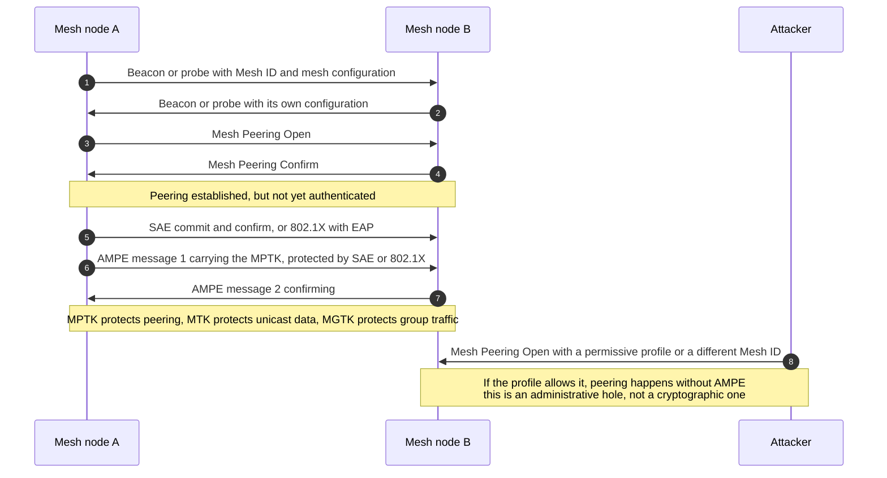

Four points that are easy to get wrong:

- **Peering and authentication are separate stages.** "Mesh Peering Open/Confirm" (MPM) establishes the
  link; **AMPE** (Authenticated Mesh Peering Exchange) then authenticates it and installs keys. A mesh
  profile that does not require AMPE peers without authentication, and there is no error message.
- **Three keys, three scopes.** **MPTK** protects the peering exchange itself (per peer link), **MTK**
  protects unicast data on that link, **MGTK** protects group-addressed mesh traffic. Rekeying one
  without the other is how you get a link that authenticates but cannot forward.
- **Knowing the fronthaul PSK does not admit you to the mesh** — and vice versa. In a well-built mesh
  they are different secrets, which is also why "the guest password is the same as the backhaul" is a
  critical finding rather than a convenience.
- **HWMP is a routing protocol with no authentication of its own.** Path requests, path replies and root
  announcements are ordinary management frames. PMF protects some of them after peering, and none of
  them against an authenticated insider.

### 11.2 The 802.11s threat list

| Threat | Mechanism | Impact | Control |
| --- | --- | --- | --- |
| **Unauthenticated peering** | Profile mismatch, or a node that accepts MPM without AMPE | Rogue node joins the mesh, forwards or drops traffic | Require AMPE everywhere, fail closed, alert on unauthenticated peers |
| **SSID Confusion on AMPE** | CVE-2023-52424 applies to mesh peering | Peer to the wrong mesh that shares credentials | Unique Mesh ID per deployment, no credential reuse, distinct certificates |
| **Route manipulation** | Advertise an attractive airtime metric in PREQ/PREP, or replay sequence numbers | All traffic transits the attacker, blackhole or greyhole | Signed or trusted routing, metric anomaly detection, route churn alarms |
| **Path request flooding** | Flood PREQs to exhaust state and airtime | DoS, topology churn | Rate limiting, peer limits, monitoring |
| **Forwarder as insider** | Every frame transits the node in the clear at layer 2 | Full metadata, and content if above-L2 encryption is absent | End-to-end encryption above layer 2, per-node attestation, physical security |
| **4-address forwarding vs isolation** | Mesh frames carry address 4, so a forwarding node bridges segments that "isolation" was meant to separate | Lateral movement | Segment at the portal, not at the edge |
| **Key sharing across the mesh** | One PSK for every node | One compromised node compromises the mesh | Per-node credentials (802.1X or DPP), SAE with per-node identity where available |

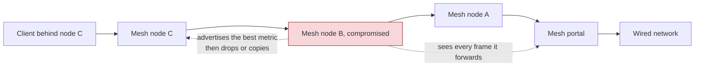

> **The 802.11s summary.** The cryptography is fine — SAE plus AMPE is a defensible design. The failure
> mode is **configuration and trust topology**: who is allowed to peer, what a node can see, and what a
> single compromised node is worth to the attacker. In a mesh, the answer to the last question is
> "everything that transits it", which is most of the traffic.

---

## 12. Mesh, part 2: EasyMesh, onboarding and the control plane

EasyMesh is where the mesh problem becomes an architecture problem, because the thing that manages the
mesh is a network service running *inside* the network it manages.

### 12.1 Controller and agent, and the trust boundary nobody drew

EasyMesh is not 802.11s. It is a **controller/agent** architecture: a Multi-AP Controller decides SSIDs,
radio parameters and steering policy; Multi-AP Agents on each AP report capabilities and measurements and
apply the decisions. Controller and agents exchange **IEEE 1905.1 CMDU** messages over whatever link
exists — Ethernet, or a Wi-Fi backhaul that may itself be an ordinary STA-to-AP connection.

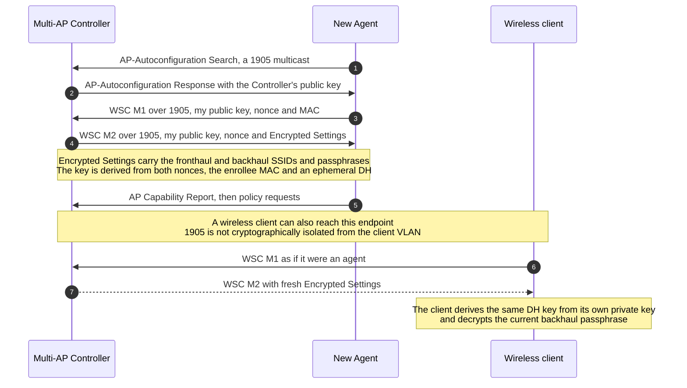

- **The control plane is a separate trust domain, and it is usually on the client VLAN.** 1905 CMDU
  frames are layer-2.5 frames; if a guest client can reach the controller's 1905 endpoint, the client is
  inside the mesh's management plane.
- **Onboarding is either WPS push-button or DPP.** The Wi-Fi Alliance's own deployment guidance is
  explicit: a network "should make use of Wi-Fi Easy Connect (DPP) onboarding instead of Wi-Fi Protected
  Setup pushbutton whenever possible, **in order to enable 1905 layer security**." That sentence is the
  whole issue: WPS onboarding gives you no authenticated control channel. §12.3 explains why DPP does.

### 12.2 "Untangling the Knot" (CCS 2024): the control plane has no trust anchor

The most useful mesh-security paper of the decade, because it is a *design* critique rather than a bug
report. Its finding, in one paragraph:

> EasyMesh's network access policy setup (NAPS) uses WSC M1/M2 carried in 1905 frames, with encryption
> derived from an ephemeral Diffie-Hellman between whoever claims to be an enrollee and the registrar.
> There is no trust anchor, so **the encryption only protects against a passive observer**. Any party that
> can send an M1 gets a fresh M2, derives the DH key from its own private key, and decrypts the current
> fronthaul and backhaul passphrases. Since the attacker can repeat this whenever the keys rotate, it
> defeats revocation by rekeying.

Concretely: an in-network attacker (an ordinary associated client) follows the protocol, pulls fresh
policies, and regains access after every passphrase change. The authors demonstrated it against products
including Netgear Orbi and Wyze, and showed the same class of cross-layer trust failure in a proprietary
mesh (ASUS AiMesh). The root cause they name is precise and portable: **cryptographically enforced
isolation was replaced by logical separation, and the protocol endpoints are reachable from roles that
should never speak them.**

### 12.3 Onboarding: WPS, DPP, and why the QR code is the crown jewel

Every mesh needs a way to admit a new node, and the onboarding method determines whether the control
plane has a trust anchor at all.

| Method | What authenticates the new node | What the operator does | Security consequence |
| --- | --- | --- | --- |
| **WPS push-button** | A two-minute window in which anyone may enrol | Press a button on both devices | A window with no identity check, and no anchor for anything built on top |
| **WPS PIN** | An 8-digit PIN, verified as two 4-digit halves | Type a PIN | Roughly 10⁴ + 10⁴ guesses with no rate limit: hours, and often minutes |
| **DPP (Wi-Fi Easy Connect)** | A bootstrapping public key, carried in a QR code, NFC tag or PIN | Scan a code | The joining device proves possession of the bootstrap key; the configurator signs a **connector** that authorises it |

DPP is a genuine improvement, and it is worth knowing the flow because it is the shape every future
onboarding mechanism will copy:

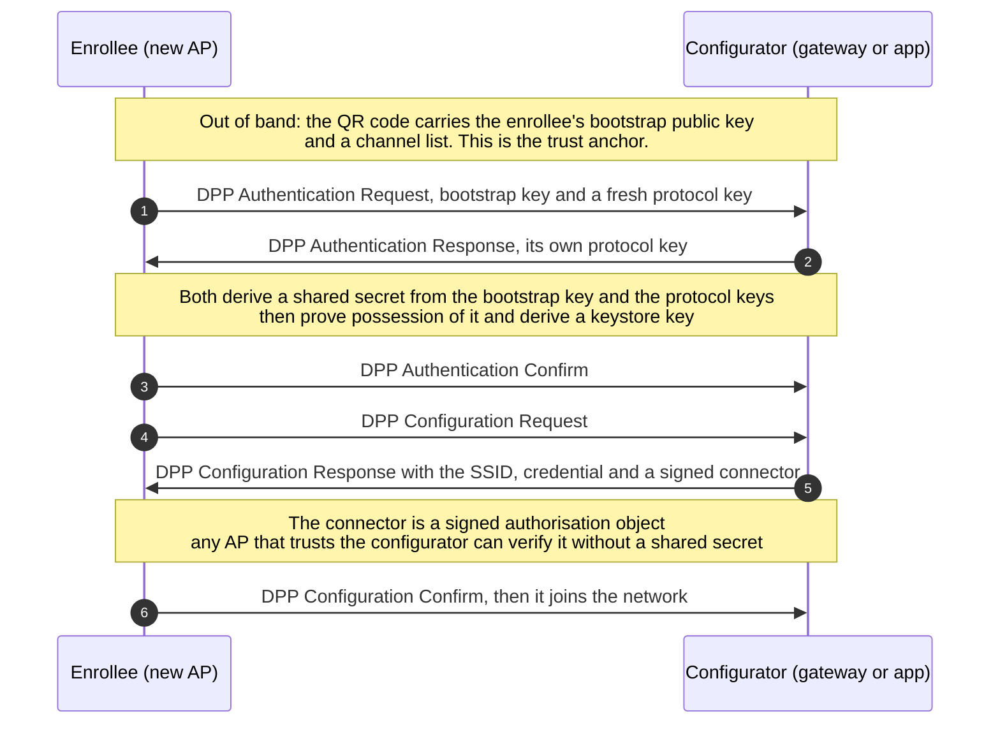

Three properties are worth naming, because they are what WPS lacks:

- **The bootstrap key is a public key, not a shared secret.** Scanning the code gives the configurator a
  way to *verify* the enrollee, not a password that both sides know.
- **The connector is a signed capability.** An AP does not need to share a key with every other AP; it
  needs to trust the configurator's signing key, so authorisation scales and revocation becomes possible.
- **Nothing in the exchange requires the control plane to be on the client VLAN.** That is the property
  EasyMesh's NAPS lacks, and it is why the deployment guidance prefers DPP.

The cost is that the QR code becomes a permanent identifier: it is printed on the device, it does not
change, and it is the thing an attacker needs. That is precisely what the next paper measured.

### 12.4 WCDCAnalyzer (NDSS 2026): the privacy of the onboarding channel

A companion result on the same protocols — Wi-Fi Direct, Easy Connect and EasyMesh. Three weaknesses,
none of which breaks the session key:

| Weakness | Mechanism | Effect |
| --- | --- | --- |
| Bootstrap-key hash oracle | An attacker can test guesses against the advertised hash | Confirms a guess about a device's bootstrap key |
| Static global MAC in QR bootstrap data | The QR payload carries a fixed identifier | A device is trackable across locations even with RCM enabled |
| Reusable DPP chirp hash | The chirp hash does not change per session | Passive tracking of a device and its owner's movements |

The lesson is that **onboarding is a privacy event**: the QR code on the bottom of an AP is a permanent
identifier, and the convenience of "scan once, join forever" is paid for in linkability. Rotate bootstrap
keys, invalidate them on factory reset and ownership transfer, and never treat a printed code as a
secret.

### 12.5 The mesh attack-surface matrix

Use this as an assessment checklist; each row is a different failure mode and a different owner.

| Boundary | What to verify | Typical failure |
| --- | --- | --- |
| **Fronthaul** | AKM, cipher, PMF required, client isolation, VLAN role | WPA3 on the gateway, WPA2 on a satellite |
| **Wireless backhaul** | SAE with H2E, unique high-entropy PSK, PMF, dedicated SSID | Backhaul reuses the fronthaul passphrase |
| **Wired backhaul** | Port trust, 802.1X on the switch port, VLAN for 1905 | Any port on the LAN can claim to be an agent |
| **Control plane** | Is 1905 reachable from client VLANs? Are controller and agent roles authenticated? | A client speaks WSC M1 and gets the passphrase |
| **Onboarding** | WPS off, DPP with rotatable bootstrap keys, revocation on removal | A printed QR code that never changes |
| **Adoption and lifecycle** | Revocation on removal, factory-reset invalidation | A stolen node still holds the backhaul key |
| **Firmware** | Per-node patching, not just the gateway | One satellite three years behind on CVEs |

---

## 13. Operations: configuring, verifying, migrating

The ladder now reaches the part that decides whether any of the above matters. A correct design deployed
with one wrong bit is an incorrect design, and the wrong bit is usually in a field nobody reads.

### 13.1 Seven principles, each earned by a section above

| Principle | Why | Where it came from |
| --- | --- | --- |
| **1. Treat layer 2 as a hop, not a boundary** | Any client that can associate can attempt everything in §9 | AirSnitch, Framing Frames |
| **2. Bind identity to a key, not a password** | Passwords are guessable, shared and reusable across SSIDs | §2, §6.4, §9.6 |
| **3. Constrain what a group key can reach** | One GTK for all clients is an insider's tool | §9.7 GTK abuse |
| **4. Keep the control plane in its own network** | 1905, WSC, DPP and vendor control frames are reachable from clients by default | §12.2 |
| **5. Make patchability a security property** | Kr00k and FragAttacks were fixed in firmware, not in standards | §9.3, §9.4 |
| **6. Fail closed on security negotiation** | Transition mode, permissive mesh profiles and optional PMF are all downgrade paths | §6.6, §11.1 |
| **7. Measure what the mechanism can actually see** | A WIDS sees deauth floods, not a flipped A-MSDU bit | §8, §9.8 |

### 13.2 The configuration that corresponds to those principles

Illustrative hostapd fragments, because the names are what people get wrong:

```ini
# WPA3-Personal, SAE only, H2E, PMF required, GCMP-256
wpa=2
wpa_key_mgmt=SAE FT-SAE
sae_pwe=2                 # H2E only, no hunting-and-pecking
ieee80211w=2              # PMF required, not optional
rsn_pairwise=GCMP-256
group_mgmt_cipher=BIP-GMAC-256
sae_require_mfp=1         # refuse SAE peers that do not do PMF
transition_disable=1      # tell clients to remember "no WPA2 here"

# Enhanced Open, for the guest SSID
wpa=2
wpa_key_mgmt=OWE
ieee80211w=2

# Enterprise, standard mode
wpa_key_mgmt=WPA-EAP-SHA256
ieee80211w=2
rsn_pairwise=GCMP-256
```

Four rules that matter more than the syntax:

1. **`ieee80211w=2`, never `1`, on new deployments.** Optional PMF means an attacker chooses the
   weaker path.
2. **No PSK on the same BSS as SAE** unless you have a dated exit plan and Transition Disable enabled.
3. **Different secrets per role.** Fronthaul, backhaul, guest, IoT and mesh peering each get their own
   credential; the whole SSID Confusion class depends on reuse.
4. **One SSID per trust level.** A "corporate" SSID that also admits personal phones is a flat network
   with a nice name.

### 13.3 Verifying what you actually deployed

| Question | Command or check | What good looks like |
| --- | --- | --- |
| Which AKM is in use? | `iw dev wlan0 link`, or Wireshark `wlan.rsn.akms` | `SAE` or `WPA-EAP-SHA256`, never `PSK` |
| Is PMF on? | `iw dev wlan0 link` shows MFP, or RSNE capability bits | `MFP-required` |
| Which cipher? | `wlan.rsn.pcs` in a beacon | `GCMP-256` on Wi-Fi 7, `CCMP-128` at minimum |
| Is TKIP still anywhere? | Any beacon with cipher `00-0F-AC:2` | Nothing |
| Is transition mode still open? | beacon advertises both `:2` and `:8` | Only during a dated migration |
| Is the mesh peering authenticated? | `wpa_supplicant` logs, AMPE messages in a capture | AMPE present for every peer link |
| Is 1905 reachable from a client VLAN? | From a guest client, try to reach the controller's 1905 endpoint | No response, and an ACL that says why |
| Is the group key per client? | Vendor documentation, or test whether one client can decrypt another's broadcast | Per-client GTK or documented equivalent |

The single most useful habit in that table is the first row and the fourth: **read a beacon before you
read a datasheet.** A vendor's claim about WPA3 is a claim about a configuration, and the configuration
is in the RSNE.

### 13.4 Reference architecture

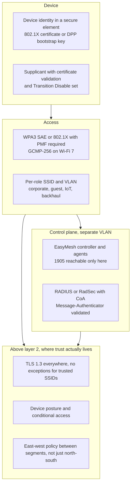

### 13.5 Decision table by deployment

| Deployment | AKM | Cipher | PMF | Non-negotiable extra |
| --- | --- | --- | --- | --- |
| **Home, modern clients** | SAE with H2E | GCMP-256 where available | Required | Unique passphrase per SSID, WPS off, DPP for onboarding |
| **Home, legacy clients present** | SAE plus PSK, transition disable | CCMP-128 minimum | Capable | A dated plan to remove PSK |
| **Enterprise, managed devices** | 802.1X with EAP-TLS | GCMP-256 | Required | Certificate validation pinned, no EAP termination |
| **Enterprise, BYOD** | 802.1X with TEAP or EAP-TLS provisioning | GCMP-256 | Required | Onboarding that installs a certificate rather than a password |
| **Government, defence, OT** | 192-bit mode, EAP-TLS only | GCMP-256 plus BIP-GMAC-256 | Required | Separate physical infrastructure, no interop |
| **Guest / public** | OWE | CCMP-128 minimum | Required | Client isolation at MAC **and** IP, per-client GTK, no L2 adjacency to anything |
| **IoT** | Per-device PSK, or DPP | CCMP-128 | Required where supported | Own SSID and VLAN, egress filtering, no broadcast forwarding |
| **Mesh backhaul** | SAE with unique PSK, or DPP onboarding | GCMP-256 | Required | 1905 confined to a dedicated VLAN, per-node credentials |

### 13.6 Migrating without lying to yourself

A four-stage plan that survives contact with a real client fleet:

1. **Inventory.** Every SSID, its AKM, its PMF bits, its cipher, and the fraction of clients that are
   WPA3-capable. You cannot plan a transition you cannot measure, and most enterprises cannot answer
   "what fraction of my clients support SAE" on day one.
2. **Dual-advertise, then disable.** Enable transition mode or PCM/RSNO, watch the WPA2-only population
   fall, and set the date. Enable Transition Disable so clients that *can* do SAE stop falling back.
3. **Turn PMF from capable to required.** This is the step that breaks legacy clients, so do it per SSID
   with a rollback plan, and expect the failures to be printers and industrial handhelds.
4. **Retire the old profile.** WPA2-only SSID off, TKIP nowhere, PSK only where a dated exception
   exists. Then re-audit, because step 4 usually reveals a forgotten SSID.

Two accelerants and one brake:

- **6 GHz forces the issue.** WPA3 is required there, so every tri-band deployment is a WPA3 deployment
  whether or not the 5 GHz SSID has been migrated.
- **Wi-Fi 7 forces the cipher.** A BSS enabling EHT or MLO must enable GCMP-256, so the "we will do
  ciphers later" plan ends when the first Wi-Fi 7 AP is installed.
- **The brake is the client fleet**, and it is the only legitimate reason to stay in transition mode.
  Everything else is inertia wearing a project plan.

---

## 14. The horizon: what changes next

### 14.1 Post-quantum: the amendment is 802.11bt

**What breaks.** Every classical public-key operation in Wi-Fi: ECDH for SAE and DPP, ECDSA and RSA for
certificates, and the Diffie-Hellman inside TLS. Symmetric keys survive with a caveat — Grover's
algorithm halves the effective length, so a 128-bit key gives roughly 64-bit security, which is
survivable but argues for 256-bit keys in long-lived deployments.

**Why act before the quantum computer exists.** *Harvest now, decrypt later*: an adversary recording
today's handshakes gains nothing from SAE's forward secrecy against a **future** compromise of the
long-term key — but gains everything against a certificate-based deployment where the recorded TLS
handshake can be broken once the private key falls. NIST has said it will disallow classical key
establishment and signatures in US government systems after 2035, and the 802.11 task group's own
background text cites exactly that.

**What the standard is doing.** P802.11bt, *Post-Quantum Cryptography*, PAR approved in September 2025,
with a scope that is broader than "swap the algorithm":

- **PQC AKM suites** — new selectors for key establishment and authentication using PQC algorithms.
- **PQC digital signatures and key establishment** — for certificate-based and SAE-PK-style
  authentication.
- **A PQC password-authenticated key exchange** — a PAKE built on post-quantum primitives, which is a
  genuinely hard piece of cryptography rather than a drop-in replacement.
- **Modifications to the key handshake protocols** — the 4-way handshake's PTK derivation and the
  EAPOL-Key frame formats have to change.
- **Proof of work** in the authentication exchange, because PQC verification is *more* expensive than
  ECDH and would otherwise hand attackers a cheaper DoS than §6.7's.
- Plus **PQC OWE**, alignment with the CNSA 2.0 suite, and the usual editorial work.

**Status, precisely.** Draft 1.0 went to Working Group Letter Ballot 297 with **650 comments**; 232 were
resolved by the September 2026 session, and the editor was instructed to produce Draft 1.1. The PAR runs
to December 2029. So: a published amendment is years away, and products will lag it by a certification
cycle.

**The engineering problem nobody mentions: byte counts.** PQC is not just slower, it is bigger:

| Algorithm | Public key or ciphertext | Signature |
| --- | --- | --- |
| ML-KEM-768 (FIPS 203) | 1,184 B encapsulation key, 1,088 B ciphertext | — |
| ML-KEM-1024 | 1,568 B, 1,568 B | — |
| ML-DSA-65 (FIPS 204) | 1,952 B | 3,309 B |
| SLH-DSA-128s (FIPS 205) | 32 B | ~7,856 B |

An 802.11 MSDU body is at most 2,304 bytes, an EAP exchange is fragmented across EAPOL frames, and a
certificate chain in a EAP-TLS deployment is already several kilobytes. Move to ML-DSA-65 plus ML-KEM-768
and a four-frame EAP exchange becomes a dozen or more, with a corresponding increase in join latency and
in the number of ways to lose a fragment. That is why 802.11bt touches the handshake and not just the
algorithm identifiers — and why "PQC will be a firmware update" is wrong for anything certificate-based.

**What to do now, in order.** Inventory where public-key cryptography actually is (certificates, EAP
methods, DPP bootstrap keys, RADIUS TLS), prefer crypto-agile designs where the algorithm is a
configuration and not a build-time constant, and treat the certificate lifetime as a migration clock:
a ten-year device certificate issued today outlives the transition.

### 14.2 Multi-link and multi-AP: new keys, new trust domains

Wi-Fi 7's MLO is the first change to the key architecture in a decade, and it has three security
consequences that are easy to state and hard to get right:

- **One PTK, many links.** A single TK encrypts unicast on 2.4, 5 and 6 GHz. That is efficient and it
  means **compromise of one link's TK compromises all of them** — the blast radius of a key disclosure
  went from "this band" to "this device pair".
- **Per-link group keys.** GTK, IGTK and BIGTK are per link, carried in MLO KDEs (selectors
  `00-0F-AC:16/17/18` for GTK/IGTK/BIGTK and `:19` for the MLO Link KDE). A client on three links holds
  three GTKs, so the group-key surface grows while each key's reach shrinks.
- **One PN space across links.** The 48-bit packet number is shared, which is correct for security and
  brutal for firmware: the radios must synchronise a counter, and a desync shows up as replay failures
  on one link while the others are fine.
- **The MLO Link KDE carries per-link RSN information.** That is a defence: a forged beacon on one link
  claiming weaker security can be detected, because the client has a protected copy of what that link
  actually advertised.

For **802.11bn / Wi-Fi 8**, the security question is coordination. Multi-AP coordination (MAPC) means APs
share channel state, schedule each other's transmissions and coordinate beamforming; that requires a
trust relationship, a key distribution mechanism and an authorization model *between APs*, which is a
different problem from AP-to-client security. Expect it to be handled by vendor coordination plus
existing backhaul security first, and standardised later — mark any claim that Wi-Fi 8 has "solved
multi-AP security" as `VERIFY`.

### 14.3 AI-era threats: three concrete ones and one speculative one

`02-18` covers what AI does *for* Wi-Fi. Here is what it does *to* it.

1. **Adversarial inputs against learned radio functions.** A learned rate adapter, channel selector or
   steering score is a classifier fed by measurements an attacker can influence. Manipulating observed
   RSSI, injecting interference patterns or spoofing measurement reports are all *evasion* attacks
   against a model with no formal specification — and there is no conformance test that can fail.
2. **Offloading moves the trust boundary.** 802.11bu lets a station send inference work to an AP. That
   means prompts, context and possibly data leave the device and are processed on infrastructure the
   user does not own. Tenant isolation, attestation of what the AP is running, and a data-processing
   agreement become Wi-Fi security questions, which they never were before.
3. **Sensing leaks what encryption protects.** §10.4. A CSI stream is a sensor feed, and a model that
   infers occupancy or activity is processing personal data even though every frame was encrypted.
4. **Agent identity (speculative, flagged `VERIFY`).** When the traffic on the network is generated by
   agents acting for a user, "the device authenticated" stops being a sufficient authorization statement.
   Whether Wi-Fi needs an agent-level identity — versus leaving it to the application layer — is an open
   question, and the honest answer today is that nobody has proposed a mechanism.

### 14.4 The mesh's next five years

Three trends, each with a security consequence:

- **Mesh as the default home topology.** More nodes, more physical access, more firmware to patch. The
  home mesh is now the largest population of unmanaged, internet-connected layer-2 forwarders in
  existence.
- **Onboarding moves to DPP.** Good for security (no shared passphrase in a WPS exchange, and a
  verifiable connector), but it makes the QR code and the bootstrap key the crown jewels — see §12.4.
- **Mesh interworking with Matter, Thread and carrier Wi-Fi.** More credential types in one box, and
  more code paths that parse untrusted frames.

### 14.5 Regulation: security became a market-access requirement

| Regime | In force | What it demands | Effect on Wi-Fi products |
| --- | --- | --- | --- |
| **EU RED delegated act (EU) 2022/30** with **EN 18031-1/-2/-3:2024** | 1 August 2025 | Network protection, privacy protection, fraud protection for radio equipment; no universal default passwords, secure update mechanism | Security is now a CE-marking question, not a feature list |
| **UK PSTI Act** | 29 April 2024 | No universal default passwords, published vulnerability disclosure, stated update period | Applies to consumer connectable products, Wi-Fi routers included |
| **US Cyber Trust Mark** | Labelled programme from 2025 | Baseline cyber hygiene, update support, disclosure | `VERIFY` the current labelling status per product class |

The important consequence for architects: **the support window is now a security parameter.** A mesh node
with a five-year firmware commitment is a different risk from one with eighteen months, and EN 18031's
secure-update requirement makes that explicit. When a satellite AP in a home mesh stops receiving
updates, it does not stop forwarding.

### 14.6 How to watch the standard rather than the news

Every dated claim in this note will decay. The discipline that keeps a document honest is to know where
the date comes from:

| Claim type | Where the truth lives | How often it changes |
| --- | --- | --- |
| What an amendment requires | The published IEEE standard's clause text, via the 802.11 WG draft page | At each revision or amendment |
| What is coming | The **PAR** and CSD for the task group, plus its meeting update page | New PARs a few times a year; letter-ballot results per session |
| What a product must support to be certified | The Wi-Fi Alliance certification requirements and the relevant spec (WPA3, EasyMesh, Easy Connect) | With each certification wave |
| What is deployed | A capture, not a press release — §13.3 | Continuously |
| What is legal | The regulation's own text and its applicability date | Rarely, but retroactively |

The task groups worth following by name: **TGbi** (privacy), **TGbt** (post-quantum), **TGBK** (the
maintenance group that publishes the consolidated revision), and the pre-PAR study groups whose output
becomes the next amendment letter. A file name, a PAR number and a date is the minimum citation for any
claim about the future; anything less is a slide.

---

## 15. Synthesis

### 15.1 Map every attack in this note to a control

| Attack | Control that actually stops it | Control that does not |
| --- | --- | --- |
| WEP keystream reuse, FMS, chopchop | CCMP: a per-key 48-bit PN and a real MAC | A longer WEP key |
| TKIP Michael forgery | CCMP, i.e. removing TKIP entirely | Short rekey intervals |
| Offline dictionary on a captured handshake or PMKID | SAE | A longer password alone |
| Evil twin | Certificate validation with a pinned CA, or SAE-PK | User education |
| Deauth flood | PMF with SA Query | MAC filtering |
| KRACK class | Patched firmware, OCV | WPA3 alone |
| FragAttacks | Patched firmware, and the standard's fixes | A stronger cipher |
| SSID Confusion | No credential reuse, distinct RADIUS Common Names | Hiding the SSID |
| AirSnitch | Per-client GTK, isolation at MAC and IP, segmentation | Client isolation as shipped |
| EasyMesh policy theft | 1905 on a dedicated VLAN, DPP onboarding, role authentication | Changing the passphrase |
| Mesh route manipulation | Trusted peering, route anomaly detection, above-L2 encryption | AMPE alone |
| Harvest-now-decrypt-later | PQC or hybrid key establishment (802.11bt, when it ships) | Longer RSA keys |

### 15.2 Ten questions this note should let you answer without notes

1. **Why did WEP fail in four independent ways?** A 24-bit IV guarantees keystream reuse, a linear CRC
   cannot detect modification, there was no key management, and shared-key authentication handed out a
   keystream oracle. Any one of them alone would have been enough.
2. **Why is SAE better than PSK if both use the same password?** SAE converts guessing from an offline
   computation on a captured handshake into an online interaction, and adds forward secrecy. The password
   is not stronger; the attack economics change.
3. **What did Dragonblood break?** Not the PAKE. The first-generation password-to-element encoding
   (hunting-and-pecking) leaked through cache and timing, and transition mode allowed a downgrade. Fixes:
   H2E, Transition Disable, SAE-PK.
4. **What did KRACK break?** The 4-way handshake's assumption that a key is installed once. A
   retransmitted message 3 reinstalls the key and resets the PN, giving nonce reuse. Ten CVEs, including
   FT, TDLS, PeerKey and WNM sleep mode.
5. **Why did FragAttacks affect WPA3?** Because it attacked framing: the A-MSDU present bit was not
   authenticated, fragments could be mixed across keys, and the fragment cache survived reconnection. No
   key exchange can fix a receiver that trusts an unauthenticated header bit.
6. **What does PMF actually protect, and what does it not?** It protects deauth, disassoc and robust
   action frames after association (BIP for group-addressed). It does not protect beacons before
   association, probe requests, or the SSID's identity in the handshake — those need beacon protection,
   OCV and SSID binding respectively.
7. **What makes 192-bit mode different from "WPA3 Enterprise"?** A closed suite: AKM 12 only, GCMP-256
   only, BIP-GMAC-256 only, EAP-TLS only, P-384 or RSA-3072, and no interoperability by design.
8. **Why can an insider with the PSK still attack other clients?** Because the PSK only gates
   association. Everything after that is authorization: group keys, client isolation, VLANs and
   above-L2 encryption. AirSnitch shows the isolation part failing without any key being broken.
9. **What is the mesh's structural weakness?** Every node is an authenticator, a forwarder and a
   controller client. 802.11s's cryptography is fine; the risk is admission policy and what one
   compromised forwarder sees. In EasyMesh the control plane (1905/WSC) is the vulnerability, because it
   has opportunistic encryption and no trust anchor, and it is reachable from the client VLAN.
10. **What is the post-quantum plan, and which amendment is it?** 802.11bt (not 802.11bi, which is the
    privacy amendment). New PQC AKMs, PQC PAKE, PQC signatures and key establishment, handshake
    modifications, proof of work against DoS, PQ-OWE. Draft 1.0 drew 650 comments in 2026; the PAR runs
    to 2029.

### 15.3 A reading path through the literature

This note compresses about forty papers. If you want to read the field rather than the summary, this
order gives you the argument with the least redundancy:

| Order | Read | Why this one, at this point |
| --- | --- | --- |
| 1 | Borisov, Goldberg, Wagner, *Intercepting Mobile Communications* (MobiCom 2001) | The taxonomy that defines the problem class, written before the fix existed |
| 2 | Cam-Winget, Housley, Wagner, Walker, *Security flaws in 802.11 data link protocols* (CACM 2003) | The argument that link-layer security cannot be fixed link-layer-locally |
| 3 | He, Sundararajan, Datta, Derek, Mitchell, *A modular correctness proof of IEEE 802.11i and TLS* (CCS 2005) | What "the protocol is correct" actually means, before §9 shows what it does not cover |
| 4 | Vanhoef, *Key Reinstallation Attacks* (CCS 2017) | The pivot: protocol proofs versus implementation state |
| 5 | Vanhoef, Ronen, *Dragonblood* (IEEE S&P 2020) | The best case study in side channels inside a PAKE, and in remediation design |
| 6 | Vanhoef, *Fragment and Forge* (USENIX Security 2021) | The first clean statement that framing, not key exchange, is the weak layer |
| 7 | Schepers, Ranganathan, Vanhoef, *Framing Frames* (USENIX Security 2023) | Queues as a security object; the ancestor of the 2024–2026 mesh work |
| 8 | Gollier, Vanhoef, *SSID Confusion* (2024) | One unbound field, six protocols, and a lesson about identity |
| 9 | *Untangling the Knot* (CCS 2024) and Zhou et al., *AirSnitch* (NDSS 2026) | The mesh and isolation papers that turn "trust boundary" from a metaphor into a technique |

### 15.4 The three sentences, if you have thirty seconds

> Wi-Fi's cryptography has been sound since 2004; its framing, state machines and control planes have
> not, which is why every serious attack since 2017 exploited an unauthenticated field next to strong
> encryption. WPA3 fixed the key exchange and made PMF mandatory, but authorization and isolation still
> live above layer 2, so segmentation and above-L2 encryption are not optional. The next two fronts are
> post-quantum key establishment in 802.11bt and the mesh control plane, where the standard is still
> catching up with what researchers demonstrated in 2024 and 2026.

---

## Anchors

Checkable facts, with dates and numbers, in the order they appear:

- **WEP** shipped in IEEE 802.11-1997: RC4, **40-bit** key, **24-bit** IV sent in the clear, **CRC-32**
  ICV, four default keys selected by a 2-bit field, no per-packet key derivation and **no replay
  protection**. The 104-bit variant arrived with 802.11b and changed only the key length.
  **Shared-key authentication** returns a WEP-encrypted challenge the station already knows, which yields
  that frame's keystream to any observer.
- **Borisov, Goldberg and Wagner** (MobiCom 2001) classify WEP attacks as passive, active,
  active-with-known-plaintext and table-based. **Fluhrer, Mantin and Shamir** (SAC 2001) break RC4's key
  schedule as used by WEP. **Stubblefield, Ioannidis and Rubin** (ACM TISSEC 2004) make key recovery
  practical on 802.11b. An **FBI** demonstration in 2005 recovered a 128-bit WEP key in about **three
  minutes**. **Tews, Weinmann and Pyshkin** (WISA 2007) recovered a 104-bit key in **under 60 seconds**
  from roughly 40,000 frames (aircrack-ptw).
- **WPA** was a Wi-Fi Alliance certification (2003) built on **TKIP**: per-packet key mixing from the base
  key, transmitter address and a **48-bit TSC**, plus the **Michael** MIC and **countermeasures** (two MIC
  failures within 60 s shut the BSS, rekey, and impose a 60 s penalty).
- **Beck and Tews** (disclosed 2008, published at WiSec 2009) decrypt the last **12 bytes** of an ARP
  reply in **12–15 minutes** by running a chopchop variant on a different QoS TID and pacing guesses to
  stay under the countermeasure threshold; **Michael is reversible**, so those bytes yield the MIC key
  and allow forgery on TIDs whose counter is still low. **Vanhoef and Piessens** (2010) removed the length
  limit with fragmentation; the **NOMORE** attack (Vanhoef and Piessens, 2015) broke RC4 in TKIP in about
  an hour.
- **802.11i** was ratified **24 June 2004**; **WPA2** certification followed in **September 2004**;
  **802.11w** (PMF) was published in **2009**; **802.11s** (mesh, SAE, AMPE) in **2011**; **802.11aq** in
  **2018**. A modular formal proof of 802.11i's 802.1X phase, 4-way handshake and group key handshake for
  an unbounded number of principals and sessions is He, Sundararajan, Datta, Derek and Mitchell, CCS 2005.
- **WPA2-Personal** derives `PMK = PBKDF2(HMAC-SHA1, passphrase, SSID, 4096, 256)`; the **PMKID** is
  `HMAC(PMK, "PMK Name" || AP MAC || STA MAC)`, which makes a single beacon sufficient for an offline
  dictionary attack (the PMKID attack, published 2018).
- **WPA3** was announced at CES on **8 January 2018** and launched on **25 June 2018**; WPA3 updates
  followed in **December 2019** (server certificate validation for EAP-TLS/TTLS/PEAP) and
  **December 2020** (**OCV** and **beacon protection**).
- **AKM selectors**: `00-0F-AC:1` 802.1X/SHA-1, `:2` PSK, `:4` FT-PSK, `:5` 802.1X/SHA-256, `:6`
  PSK/SHA-256, `:8` SAE, `:9` FT-SAE, `:12` 802.1X/SHA-384 Suite B 192, `:18` OWE, `:24` SAE-EXT-KEY,
  `:25` FT-SAE-EXT-KEY. Ciphers `:2` TKIP, `:4` CCMP-128, `:8` GCMP-128, `:9` GCMP-256, `:10` CCMP-256;
  group management `:6` BIP-CMAC-128, `:12` BIP-GMAC-256; MLO KDEs `:16/17/18` (GTK/IGTK/BIGTK) and
  `:19` (MLO Link KDE).
- **WPA3-Enterprise 192-bit mode** (WPA3 Specification v3.5): AKM `00-0F-AC:12` only, GCMP-256 pairwise
  and group, BIP-GMAC-256 group management, PMF required, EAP-TLS with
  `TLS_ECDHE_ECDSA_WITH_AES_256_GCM_SHA384`, `TLS_ECDHE_RSA_WITH_AES_256_GCM_SHA384` or
  `TLS_DHE_RSA_WITH_AES_256_GCM_SHA384`, P-384 or RSA ≥ 3072, HMAC-SHA-384 for the PTK, and no
  interoperability with any other mode.
- **AKM `00-0F-AC:1` is not used** in an association that negotiates EHT or MLO, nor in the 6 GHz band
  (WPA3 Specification v3.5, §11.2 and §11.3). A BSS enabling EHT or MLO **shall** enable GCMP-256.
- **Wi-Fi CERTIFIED 7** (January 2024) requires WPA3, PMF and beacon protection, and requires Enhanced
  Open support in open networks.
- **Dragonblood** (Vanhoef and Ronen; disclosed April 2019, published at **IEEE S&P 2020**, pp. 517–533,
  DOI 10.1109/SP40000.2020.00031): CVE-2019-9494 (SAE side channel), CVE-2019-9495 (EAP-pwd side channel),
  CVE-2019-9496 (SAE confirm validation), CVE-2019-9497 and CVE-2019-11235 (EAP-pwd reflection and
  invalid curve), plus transition-mode and group downgrades. CERT/CC VU#871675. The published analysis
  prices a **10¹⁰-entry dictionary at under $1 of EC2 time**.
- **SAE** uses the **Dragonfly** PAKE (RFC 7664); **H2E** is required in WPA3 Release 3 and the 6 GHz
  rules; groups 19 (P-256), 20 (P-384), 21 (P-521); **SAE-PK** adds a signature to detect a rogue AP that
  knows the passphrase — `VERIFY` its exact Wi-Fi Alliance release naming.
- **PMF** (802.11w-2009): BIP-CMAC-128 for group-addressed robust management frames, PTK protection for
  unicast deauth/disassoc, **SA Query** before teardown. **Beacon protection** adds a **BIGTK** and a MIC
  over the beacon body except the timestamp. **OCV** puts the operating channel information into the
  4-way handshake and checks it against the channel the frame arrived on.
- **CCMP-128**: AES-CCM, 128-bit key, 48-bit PN, nonce = `PN || A2 || priority` (104 bits), AAD built
  from the MAC header, 8-byte MIC. The **A-MSDU present** bit in QoS control is **not** in the AAD
  (CVE-2020-24588). **GCMP-256**: AES-GCM, 16-byte MIC.
- **KRACK** published **16 October 2017**; CERT/CC VU#228519 lists **ten CVEs**, CVE-2017-13077 to
  CVE-2017-13088, covering the 4-way handshake, the group key handshake, FT, PeerKey, TDLS and the WNM
  sleep-mode response; on Linux and Android 6.0+ a reinstall could install an all-zero key.
- **Kr00k**: CVE-2019-15126, disclosed by ESET in **February 2020**, all-zero TK for queued frames after
  disassociation on Broadcom and Cypress chips.
- **FragAttacks**: disclosed **11 May 2021**, USENIX Security 2021; three design CVEs (CVE-2020-24586,
  -24587, -24588) plus implementation CVEs CVE-2020-26139 to CVE-2020-26147.
- **Framing Frames**: USENIX Security 2023 (Schepers, Ranganathan, Vanhoef); unauthenticated power-save
  bit and undefined security context for queued frames.
- **SSID Confusion**: CVE-2023-52424, disclosed May 2024 (Gollier and Vanhoef); affects WEP, WPA2, WPA3
  SAE, 802.1X/EAP, AMPE mesh peering and FILS.
- **AirSnitch**: NDSS 2026 (Zhou, Pu, Liu, Qian, Tan, Krishnamurthy, Vanhoef); every tested router and
  network was vulnerable to at least one attack; techniques are GTK abuse, gateway bouncing and port
  stealing.
- **Untangling the Knot**: CCS 2024; EasyMesh NAPS uses WSC M1/M2 over IEEE 1905 with opportunistic
  encryption and no trust anchor, allowing an in-network client to obtain fresh fronthaul and backhaul
  passphrases and defeat revocation-by-rekey.
- **WCDCAnalyzer**: NDSS 2026; three onboarding privacy weaknesses — a bootstrap-key hash oracle, a static
  global MAC in QR bootstrap data, and a reusable DPP chirp hash.
- **DPP** (Wi-Fi Easy Connect) authenticates with a **bootstrapping public key** carried out of band (QR,
  NFC, PIN) and issues a signed **connector**; WPS PIN is 8 digits verified as two 4-digit halves, which
  makes it offline-breakable (Viehböck, 2011).
- **MAC randomisation** fails on behaviour rather than on the address: Vanhoef et al. (ASIACCS 2016) show
  that frame sequences link randomised addresses; Martin et al. (PETS 2017) show the failure is systematic
  across phone models.
- **802.11bi** is *Enhanced Privacy Protection*: PAR approved **9 February 2021**; Draft 4.0 SA ballot
  February–March 2026 with 98 comments; approved for publication in the second half of 2026, so the
  citation is **802.11bi-2026**. Its mechanisms include client privacy enhancements (frame anonymization,
  MAC change during association, encrypted Reassociation Request with the DS MAC Address element, clauses
  12.16.6.1 and 12.16.6.2) and AP-side beacon privacy.
- **802.11bt** is *Post-Quantum Cryptography*: PAR approved September 2025, PAR expiry December 2029;
  Draft 1.0 Letter Ballot 297 received **650 comments**, 232 resolved by September 2026, Draft 1.1 in
  preparation. Scope: PQC AKMs, PQC signatures and key establishment, a PQC PAKE, handshake modifications,
  proof of work against DoS, PQC OWE.
- **MLO key architecture**: one PMKSA and one PTK per MLD pair with
  `PTK = KDF(PMK, ANonce, SNonce, AP MLD MAC, non-AP MLD MAC)`; the same PN space is used for all setup
  links; GTK/IGTK/BIGTK are per link, delivered in one 4-way handshake via MLO KDEs.
- **OWE** is RFC 8110 (2017); Wi-Fi Enhanced Open certification followed in 2018.
- **802.11bh-2024** restores services affected by randomised and changing MAC addresses; **802.11bi**
  addresses privacy itself.
- **Mesh keys in 802.11s**: MPTK per peer link, MTK for unicast data, MGTK for group traffic; peering is
  MPM, authentication is AMPE (SAE or 802.1X). **EasyMesh onboarding**: WPS push-button or DPP; Wi-Fi
  Alliance guidance prefers DPP explicitly "in order to enable 1905 layer security".
- **EN 18031-1/-2/-3:2024** support Commission Delegated Regulation **(EU) 2022/30**, applicable from
  **1 August 2025**, adding cybersecurity, privacy and fraud-prevention essential requirements to the
  Radio Equipment Directive for internet-connected radio equipment. The **UK PSTI Act** regime applied
  from **29 April 2024**.
- **NIST FIPS 203, 204 and 205** (ML-KEM, ML-DSA, SLH-DSA) were published on **13 August 2024**.

---

## Related

- [[02-3 WLAN - Ecosystem - WFA Certification, EasyMesh and prpl]] — the certification programmes and
  the EasyMesh/controller-agent model whose security properties §12 attacks.
- [[02-5 WLAN - STA-AP Discovery, Authentication and Association - Scanning, WPA3 and the Join State Machine]]
  — the join sequence this note assumes, from scanning to the 4-way handshake.
- [[02-6 WLAN - Multi-AP Roaming, Healing and Steering - 802.11k, 11v, 11r, BTM and Self-Healing]] — 802.11r's
  key hierarchy and the FT variant of KRACK.
- [[02-7 WLAN - Wi-Fi EasyMesh - Operation, Tuning and Troubleshooting]] — the operational view of the
  control plane that §12 shows to be a trust boundary.
- [[02-13 WLAN - Reliability, Low Latency and Determinism - What the Wi-Fi Stack Can Actually Do]] — why
  availability cannot be defended at layer 2, and what determinism costs.
- [[02-14 WLAN - Wi-Fi Fundamentals - History, Architecture, PHY, MAC and the Road to Wi-Fi 7]] — the MAC
  header fields that §5.2 and §9 show being abused, in their normal context.
- [[02-15 WLAN - The Transceiver - From Superheterodyne to Wi-Fi 7 and the AI-Native Radio]] — the PHY
  layer that fingerprinting and CSI-based sensing observe.
- [[02-18 WLAN - AI in Wi-Fi - Learning Inside the Protocol and the 802.11bx Vision for PHY and MAC]] — the
  AI-in-the-radio half, including the 802.11bu offload model whose privacy boundary §14.3 describes.
- [[06-3 Machine Learning - Foundations, Core Algorithms and Applications]] — the adversarial-ML
  background behind §14.3.
- [[12-1 SECURITY - Cryptographic Foundations - Primitives, Protocols and Trust Anchors]] — the general
  cryptography this note specialises: AEAD, PAKEs, post-quantum migration and the failure taxonomy.
- [[12-2 SECURITY - Threats and Defences - Attack Surface, Detection and Incident Response]] — the
  detection and response side of what §9 describes.
- [[12-3 SECURITY - Standards and Architecture - Risk, Controls, Compliance and Zero Trust]] — the
  compliance and architecture frame around §13 and §14.5.

---

## References

1. IEEE. *IEEE Std 802.11-1997 — Wireless LAN Medium Access Control (MAC) and Physical Layer (PHY)
   Specifications*. The original WEP definition, including shared-key authentication.
2. IEEE. *IEEE Std 802.11i-2004 — Medium Access Control (MAC) Security Enhancements*. Ratified 24 June
   2004; the origin of RSNA, CCMP and the 4-way handshake.
3. IEEE. *IEEE Std 802.11-2020 — Wireless LAN Medium Access Control (MAC) and Physical Layer (PHY)
   Specifications*. Clause 12 (Security), including 12.7.6 (4-way handshake) and the RSNA key hierarchy.
4. IEEE. *IEEE Std 802.11w-2009 — Protected Management Frames*. Deauthentication/disassociation
   protection, BIP-CMAC-128, SA Query.
5. IEEE. *IEEE Std 802.11s-2011 — Mesh Networking*. Mesh points, MPM, SAE, AMPE, MPTK/MTK/MGTK, HWMP.
6. IEEE. *IEEE Std 802.11be-2024 — Enhancements for Extremely High Throughput*. Multi-link security
   procedures: one PMK and PTK per MLD pair, one PN space across setup links, per-link GTK/IGTK/BIGTK
   delivered in a single 4-way handshake.
7. IEEE. *IEEE Std 802.1X-2020 — Port-Based Network Access Control*. The controlled-port model that
   RSNA imports.
8. IEEE 802.11 Task Group BI. *P802.11bi — Enhanced Privacy Protection*, task group update and PAR,
   <https://www.ieee802.org/11/Reports/tgbi_update.htm>. Draft 4.0 SA ballot of February–March 2026.
9. IEEE 802.11 Task Group BT. *P802.11bt — Post-Quantum Cryptography*, task group update and approved
   PAR/CSD, <https://www.ieee802.org/11/Reports/tgbt_update.htm>. Scope, Draft 1.0 Letter Ballot 297 and
   the proof-of-work work item.
10. IEEE 802.11. *Project Authorization Requests (PARs)*, <https://www.ieee802.org/11/PARs/index.html>.
    The authoritative list of active and inactive amendments.
11. Wi-Fi Alliance. *WPA3 Specification v3.5*. AKM and cipher selectors, transition mode, 192-bit mode,
    and the EHT/MLO cipher requirements.
12. Wi-Fi Alliance. *Wi-Fi CERTIFIED 7 Technology Overview*, January 2024. The WPA3, PMF, beacon
    protection and Enhanced Open requirements for Wi-Fi 7.
13. Wi-Fi Alliance. *Wi-Fi CERTIFIED WPA3 December 2020 update brings new protections against active
    attacks: Operating Channel Validation and Beacon Protection*, 2020.
14. Wi-Fi Alliance. *Wi-Fi EasyMesh Deployment Guidelines*, technical note v1.0. The DPP-over-WPS
    onboarding recommendation and the 1905-layer security rationale.
15. Wi-Fi Alliance. *Wi-Fi Easy Connect (Device Provisioning Protocol) Specification*. Bootstrap keys,
    DPP authentication and configuration, and connectors.
16. Borisov, N., Goldberg, I., Wagner, D. *Intercepting Mobile Communications: The Insecurity of 802.11*.
    MobiCom 2001. The four-class attack taxonomy and the shared-key authentication oracle.
17. Arbaugh, W. A., Shankar, N., Wan, Y. C. J. *Your 802.11 Wireless Network has No Clothes*. IEEE
    International Conference on Wireless LANs and Home Networks, 2001.
18. Cam-Winget, N., Housley, R., Wagner, D., Walker, J. *Security flaws in 802.11 data link protocols*.
    Communications of the ACM 46(5), 2003. Why the link layer cannot fix this by itself.
19. Fluhrer, S., Mantin, I., Shamir, A. *Weaknesses in the Key Scheduling Algorithm of RC4*. SAC 2001.
20. Stubblefield, A., Ioannidis, J., Rubin, A. D. *A key recovery attack on the 802.11b wired equivalent
    privacy protocol (WEP)*. ACM TISSEC 7(2), 2004.
21. Tews, E., Weinmann, R.-P., Pyshkin, A. *Breaking 104 bit WEP in less than 60 seconds*. WISA 2007.
22. Tews, E., Beck, M. *Practical attacks against WEP and WPA*. WiSec 2009. The TKIP chopchop variant,
    the Michael reversal and the countermeasure pacing.
23. Vanhoef, M., Piessens, F. *All Your Biases Belong to Us: Breaking RC4 in WPA-TKIP and TLS*. USENIX
    Security 2015 — the NOMORE attack; and their earlier fragmentation-based extension of the TKIP attack
    (2010), which removed the length limit on forged frames.
24. He, C., Sundararajan, M., Datta, A., Derek, A., Mitchell, J. C. *A modular correctness proof of IEEE
    802.11i and TLS*. CCS 2005, pp. 2–15. DOI 10.1145/1102120.1102124.
25. Vanhoef, M., Piessens, F. *Key Reinstallation Attacks: Forcing Nonce Reuse in WPA2*. CCS 2017;
    CERT/CC VU#228519, CVE-2017-13077 to CVE-2017-13088. <https://www.krackattacks.com/>
26. Vanhoef, M., Ronen, E. *Dragonblood: Analyzing the Dragonfly Handshake of WPA3 and EAP-pwd*. IEEE
    Symposium on Security and Privacy, 2020, pp. 517–533. DOI 10.1109/SP40000.2020.00031.
27. Harkins, D. *Dragonfly Key Exchange*. RFC 7664, 2015. The PAKE underneath SAE and EAP-pwd.
28. Vanhoef, M. *Fragment and Forge: Breaking Wi-Fi Through Frame Aggregation and Fragmentation*. USENIX
    Security 2021; CVE-2020-24586, -24587, -24588 and CVE-2020-26139 to -26147.
    <https://www.fragattacks.com/>
29. Schepers, D., Ranganathan, A., Vanhoef, M. *Framing Frames: Bypassing Wi-Fi Encryption by
    Manipulating Transmit Queues*. USENIX Security 2023.
30. Gollier, H., Vanhoef, M. *SSID Confusion: Making Wi-Fi Clients Connect to the Wrong Network*. 2024;
    CVE-2023-52424.
31. Zhou, X., Pu, J., Liu, Z., Qian, Z., Tan, Z., Krishnamurthy, S. V., Vanhoef, M. *AirSnitch:
    Demystifying and Breaking Client Isolation in Wi-Fi Networks*. NDSS 2026.
32. *Untangling the Knot: Breaking Access Control in Home Wireless Mesh Networks*. ACM CCS 2024.
    EasyMesh NAPS analysis, WSC M1/M2 over IEEE 1905, and the revocation-by-rekey failure.
33. *WCDCAnalyzer: Wi-Fi Direct, Easy Connect and EasyMesh analysis*. NDSS 2026. The three onboarding
    privacy weaknesses.
34. ESET Research. *Kr00k: Serious vulnerability affecting Wi-Fi encryption*, February 2020;
    CVE-2019-15126.
35. Vanhoef, M., Matte, C., Cunche, M., Cardoso, L. S., Ryck, P. *Why MAC Address Randomization is not
    Enough: An Analysis of Wi-Fi Network Discovery Mechanisms*. ASIACCS 2016.
36. Martin, J., Rye, E., Doan, R., Augustin, F., Bagga, R., Brown, T., Kaplan, A., Ranganathan, A. *A
    Study of MAC Address Randomization in Mobile Devices and When it Fails*. PETS 2017.
37. Cheshire, S., Aboba, B., Geller, B. *Opportunistic Wireless Encryption*. RFC 8110, April 2017.
38. Simon, D., Aboba, B., Hurst, R. *The EAP-TLS Authentication Protocol*. RFC 5216; and Mattsson, J.,
    et al. *EAP-TLS 1.3*. RFC 9190.
39. Zhou, H., et al. *Extensible Authentication Protocol (EAP) Tunneled Transport Layer Security
    Authenticated Protocol (TEAP)*. RFC 7170; Funk, P., Blake-Wilson, S. *EAP Tunneled TLS*. RFC 5281;
    Sheffer, Y., et al. *EAP-pwd*. RFC 5931.
40. Winter, S., et al. *RADIUS over TLS (RadSec)*. RFC 6614; Chiba, M., et al. *Dynamic Authorization*.
    RFC 5176.
41. National Institute of Standards and Technology. *FIPS 203, Module-Lattice-Based Key-Encapsulation
    Mechanism Standard*; *FIPS 204, Module-Lattice-Based Digital Signature Standard*; *FIPS 205,
    Stateless Hash-Based Digital Signature Standard*. 13 August 2024.
42. National Institute of Standards and Technology. *SP 800-97, Establishing Wireless Robust Security
    Networks: A Guide to IEEE 802.11i* (2007); *SP 800-153, Guidelines for Securing Wireless Local Area
    Networks (WLANs)* (2012).
43. European Commission. *Commission Delegated Regulation (EU) 2022/30* supplementing the Radio
    Equipment Directive, with harmonised standards *EN 18031-1:2024*, *EN 18031-2:2024* and
    *EN 18031-3:2024*; applicable from 1 August 2025.
44. UK Department for Science, Innovation and Technology. *Product Security and Telecommunications
    Infrastructure Act 2022*, security requirements in force 29 April 2024.
45. hostapd and wpa_supplicant documentation, <https://w1.fi/>. Configuration parameters used in §13.2
    (`sae_pwe`, `ieee80211w`, `sae_require_mfp`, `transition_disable`) and the MLO key derivation
    behaviour confirmed in the source.
46. Aruba and Cisco WPA3-Enterprise configuration guides. The 192-bit and GCMP-256 RSNE examples and the
    CNSA cipher-suite requirements restated in §7.4.

---

_Copyright (c) 2026 Washington Ruan and contributors · licensed under **GPL-3.0-or-later** or **AGPL-3.0-or-later**, at your option · see `LICENSE` and `LICENSE-AGPL`._
