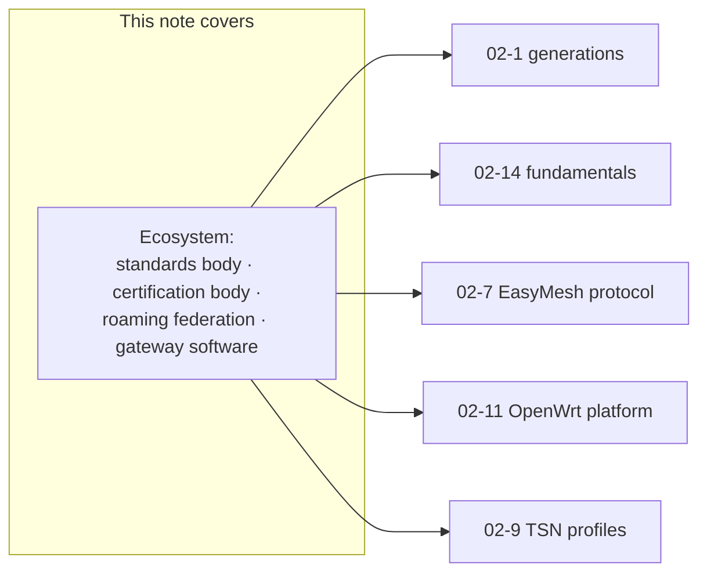
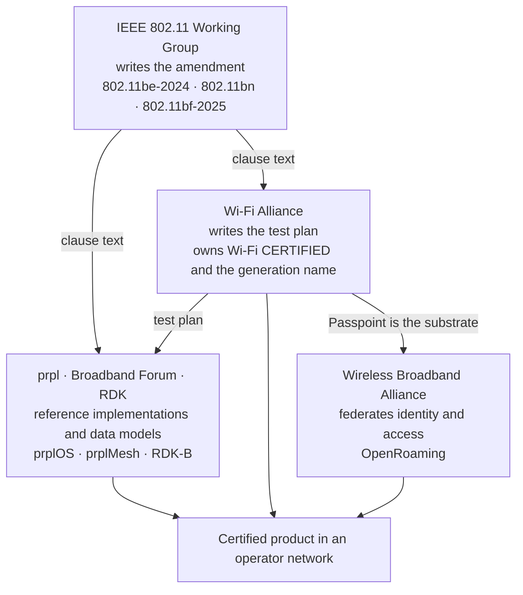
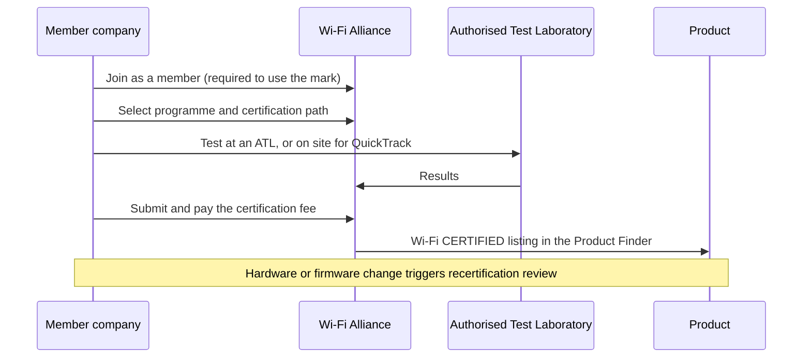
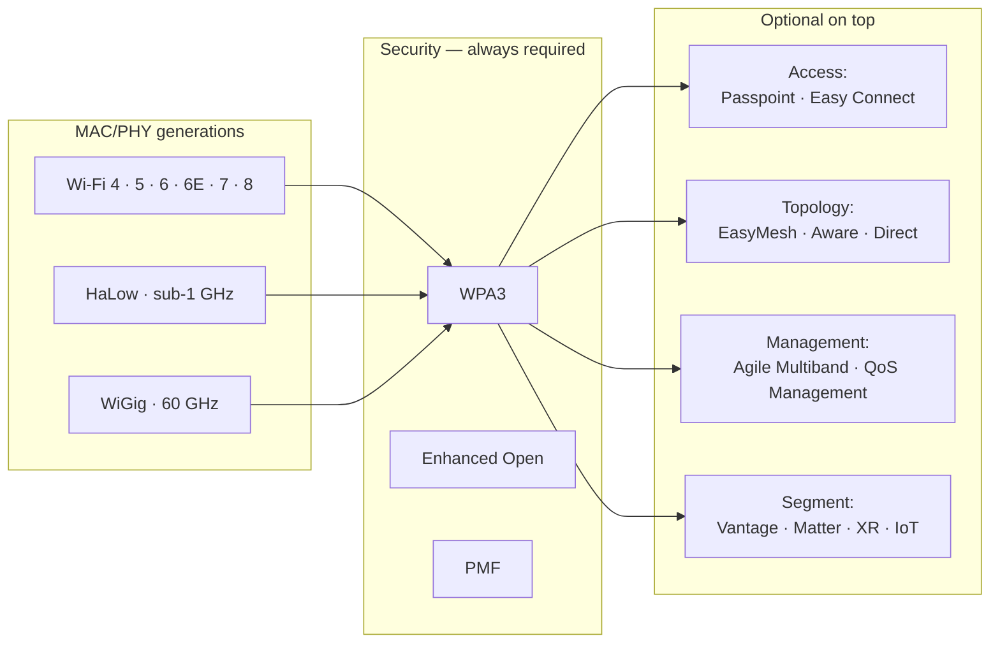
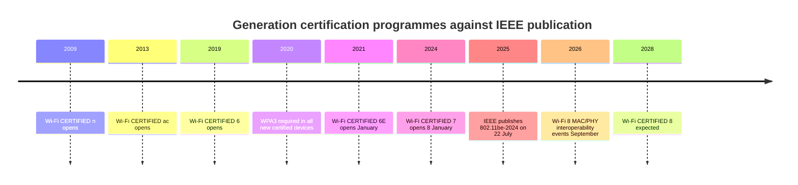
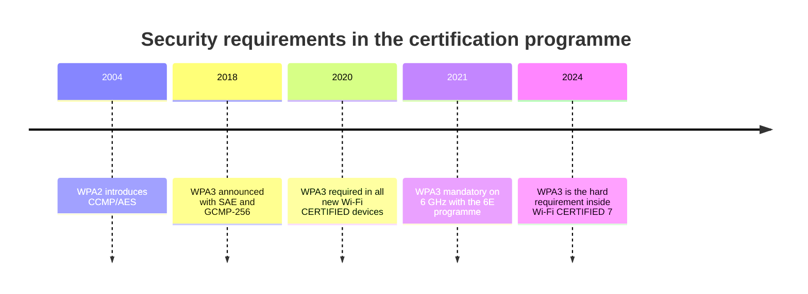
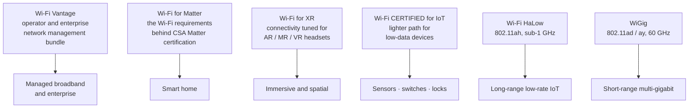
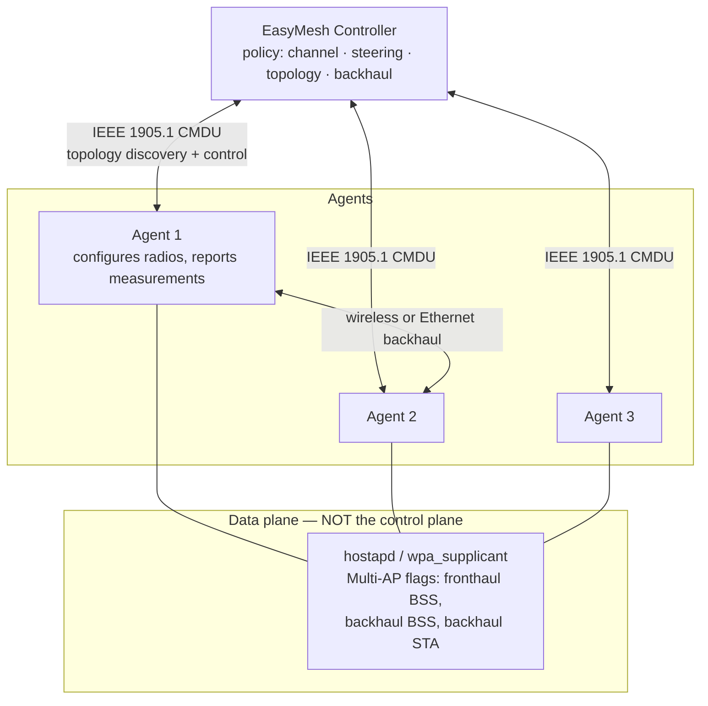
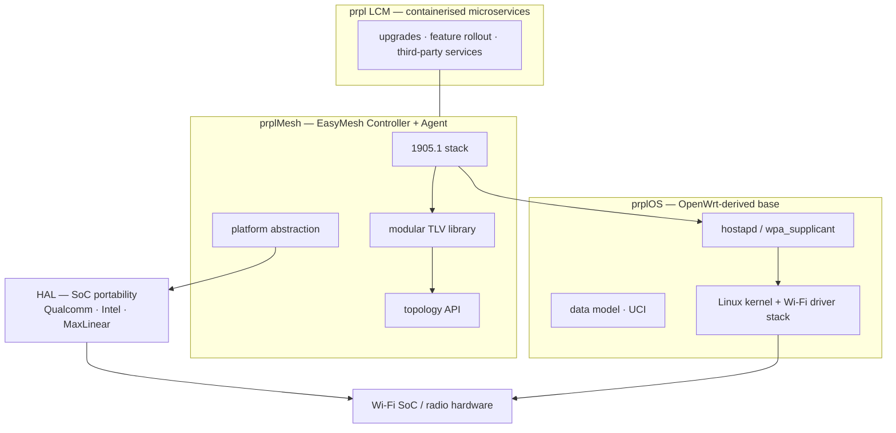
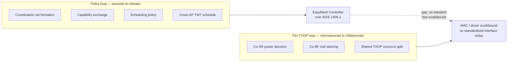

# WLAN — Ecosystem: WFA Certification, EasyMesh and the prpl Stack

Four different bodies decide what a Wi-Fi product is allowed to claim, and they are not the same body.
This note is about that layer: who writes which rule, what the certification catalogue actually contains,
how Multi-AP and gateway software fit under it, and where each programme lands as a shipped application.

For the PHY and MAC of the generations themselves, see [[02-1 WLAN - Wi-Fi Generations Evolution - Wi-Fi 4 to Wi-Fi 8 and Beyond]].

## 1. Who writes what — four bodies, four artefacts

The single most useful thing to hold in your head about this layer is that **the standard, the test, the brand
and the deployment software come from four different organisations**, and they move on four different clocks.

| Body | Artefact it owns | What it can and cannot do |
| --- | --- | --- |
| **IEEE 802.11** | The standard: PHY and MAC clauses | Defines mechanisms. Cannot decide what ships — ratification is not a product requirement |
| **Wi-Fi Alliance (WFA)** | Test plans, the `Wi-Fi CERTIFIED` mark, the generation names `Wi-Fi 4/5/6/6E/7/8` | Decides interoperability and what may be marketed. Does **not** write the standard |
| **Wireless Broadband Alliance (WBA)** | Roaming federation: OpenRoaming, WRIX, RCOIs | Federates identity and access across operators. Consumes WFA Passpoint rather than replacing it |
| **prpl Foundation / Broadband Forum / RDK** | Gateway software: prplOS, prplMesh, RDK-B, data models | Make certification implementable on real silicon. Not a standard body; a reference-implementation body |

Three consequences that decide arguments in design reviews:

1. **Certification, not ratification, gates product claims.** Wi-Fi 8 silicon and routers were being sold while
   `802.11bn` was still a draft. A product can be "Wi-Fi 8 ready" without any standard existing.
2. **The two clocks are years apart.** `802.11be-2024` was board-approved on 26 September 2024 and published on
   22 July 2025, but Wi-Fi CERTIFIED 7 opened in **January 2024** — *before* the standard was published. The
   certification programme was built against a stable draft.
3. **A certified feature is not a deployed feature.** Certification proves the device passed a test plan; it does
   not prove the network uses it. MLO can be certified on an AP and still be disabled by the operator.

### 1.1 The naming convention is a WFA marketing decision

Wi-Fi 4/5/6/6E/7/8 are **not** IEEE names. The IEEE says `802.11n`, `802.11ac`, `802.11ax`, `802.11be`,
`802.11bn`. The WFA introduced the numeric scheme so that consumers could read a box. This matters technically
in one place: **Wi-Fi 6E is not a new PHY**, it is 802.11ax operating in 6 GHz, and it got its own number for
marketing reasons alone.

## 2. How a product actually becomes certified

| Step | What is really involved |
| --- | --- |
| Membership | A company **must** be a WFA member to certify, to use the `Wi-Fi CERTIFIED` logo, and to be listed |
| Programme choice | Generation programme (`Wi-Fi CERTIFIED 7`) plus any number of optional programmes (WPA3, QoS Management, EasyMesh …) |
| Path | The Alliance offers several paths to suit different product histories; **FlexTrack** and **QuickTrack** are the two named publicly. `VERIFY`: the current full list and which one applies to a derivative product |
| Test | At an **Authorised Test Laboratory (ATL)**. As of 7 October 2026 the "Where to Certify" page listed **twelve** ATLs, and the geographic distribution is worth knowing: **DEKRA in Spain was the only European location, Element the only North American one** |
| Recertification | Changing hardware or firmware on a certified product triggers the recertification rules in *Certification Overview, Recertification* — check the current version before a board spin |
| Scale | From the first certification in **2000** to **more than 85,000** certified products |

> **The scheduling consequence.** Because ATL capacity is finite and a new generation roughly doubles the test
> case count, certification queue time is a real line item in a product schedule. Wi-Fi 7's MLO test load was
> widely reported as roughly double that of Wi-Fi 6. Budget for it.

## 3. The programme catalogue

The Alliance groups its programmes into eight categories. This table is the map; the sections below fill in the
ones that matter in an interview.

| Category | Programmes | What it is for |
| --- | --- | --- |
| **Wi-Fi (MAC/PHY)** | Wi-Fi CERTIFIED 4, 5, 6, 6E, 7, 8 · Wi-Fi HaLow · WiGig | The generation itself; sub-1 GHz and 60 GHz variants |
| **Security** | WPA3 · Wi-Fi Enhanced Open · Protected Management Frames | Authentication, encryption, open-network protection, management-frame protection |
| **Access** | Passpoint · Wi-Fi Easy Connect · Wi-Fi Protected Setup · Asynchronous Service Discovery | Getting a device onto a network and provisioning it |
| **Alternative topologies** | Wi-Fi Aware · Wi-Fi Direct · Wi-Fi EasyMesh · TDLS | Device-to-device, mesh, tunnelled direct links |
| **Applications** | Miracast · Wi-Fi Location · Proximity Detection | Display, indoor positioning, proximity triggers |
| **Network management** | Wi-Fi Agile Multiband · Wi-Fi Data Elements · Wi-Fi Optimized Connectivity · Wi-Fi QoS Management · WMM | Steering, telemetry, QoS, admission control |
| **Performance** | Wi-Fi Device Metrics · Wi-Fi Home Design · Voice-Enterprise · CWG-RF | Measurement tooling, design tooling, voice quality, converged cellular/Wi-Fi RF |
| **Segment-specific** | Wi-Fi Vantage · Wi-Fi for Matter · Wi-Fi for XR · Wi-Fi CERTIFIED for IoT | Operator/enterprise bundles; smart home; XR headsets; narrowband IoT clients |

Two further items appear in Alliance material as topics rather than as their own certification:
**Wi-Fi TimeSync** (sub-microsecond clock synchronisation, announced January 2017) and
**AFC DUT** (automated frequency coordination device-under-test for 6 GHz standard power).

The shape of that diagram is the practical rule: **the generation programme is the floor, security rides on
every product, and everything else is a choice about which market you are selling into.**

## 4. Generation programmes

| Programme | Opens | IEEE basis | Headline contents |
| --- | --- | --- | --- |
| Wi-Fi CERTIFIED n (Wi-Fi 4) | 2009 era | 802.11n | MIMO, 40 MHz, aggregation |
| Wi-Fi CERTIFIED ac (Wi-Fi 5) | 2013 era | 802.11ac | 80/160 MHz, 256-QAM, DL MU-MIMO |
| Wi-Fi CERTIFIED 6 | 2019 | 802.11ax | OFDMA, UL/DL MU-MIMO, 1024-QAM, TWT, BSS Color |
| Wi-Fi CERTIFIED 6E | **January 2021** | 802.11ax in 6 GHz | Same PHY, 6 GHz band; **WPA3 mandatory on the band** |
| Wi-Fi CERTIFIED 7 | **8 January 2024** | 802.11be | 320 MHz, MLO, 4K QAM, 512 compressed BlockAck, MRU, triggered uplink access, EPCS |
| Wi-Fi CERTIFIED 8 | Not open yet | 802.11bn | Multi-AP coordination; interoperability events 2026 |

### 4.1 Wi-Fi CERTIFIED 7 — the two-tier MLO rule

The single most misquoted fact about Wi-Fi 7 certification. The programme does **not** require every device to
run multiple links concurrently:

| Tier | What it covers | AP | Client |
| --- | --- | --- | --- |
| **Basic link management** | Multi-link setup, link addition and removal, per-link association state | **Mandatory** | **Mandatory** |
| **Enhanced operation** | EMLSR, STR — genuinely concurrent multi-band operation | **Mandatory** | **Optional** |

So "every Wi-Fi 7 product supports MLO" is true at the basic tier and false at the enhanced tier. A client can be
Wi-Fi CERTIFIED 7 without ever transmitting on two links at once.

The rest of the Wi-Fi 7 feature set, as published by the Alliance:

| Certified capability | What it is |
| --- | --- |
| 320 MHz channels | Doubles the widest channel; **only in countries that make 6 GHz available** |
| Multi-Link Operation | Concurrent transmit and receive over multiple links |
| 4K QAM | 4096-QAM, 20% higher transmission rate than 1024-QAM |
| 512 compressed BlockAck | Larger, compressed acknowledgement scoreboard, less overhead |
| Multiple RUs to a single STA | More flexible spectrum scheduling |
| Triggered Uplink Access | 802.11ax triggered uplink, tuned for latency-sensitive streams |
| EPCS | Emergency Preparedness Communication Services — priority and QoS for NSEP traffic |

### 4.2 The January 2026 narrowband extension

On **6 January 2026** the Alliance extended Wi-Fi CERTIFIED 7 to **client devices that operate only in 20 MHz
channels**. Three capabilities are listed as supportable at that width: **multi-link operation**, **downlink and
uplink MU-MIMO**, and **multiple RUs**.

This is a genuinely important correction to a common misconception: **MLO does not imply wide channels.** Two
concurrent 20 MHz links satisfy it. The extension exists because sensors, wearables and industrial endpoints
have always run narrowband and were excluded from each new generation by its bandwidth floor.

### 4.3 Wi-Fi 8 certification status

The programme is **not open**. What exists:

- The Alliance scheduled Wi-Fi 7 and Wi-Fi 8 **MAC/PHY interoperability events for 7–11 September 2026**, in
  California, Taipei and Beijing, with two further sessions in California in Q4 2026.
- Those events are tagged to `Wi-Fi CERTIFIED 8`, but **an interoperability event is not a certification**: it
  carries no pass or fail criterion. Its purpose is to surface interoperability problems among vendors.
- Formal opening is expected in the **2027–2028** window. `VERIFY` the exact date against Alliance announcements
  before committing a production schedule — secondary sources disagree.

The positioning is worth quoting precisely: Wi-Fi 8 is defined by **ultra-high reliability** — more throughput
at a given poor signal quality, lower latency, lower AP power draw and better peer-to-peer operation — rather
than by a higher peak rate.

## 5. Security programmes

| Programme | Mechanism | Where it is required |
| --- | --- | --- |
| **WPA3-Personal** | SAE (Simultaneous Authentication of Equals) replaces PSK; resists offline dictionary attack | All new certified devices since 2020; **mandatory on 6 GHz** |
| **WPA3-Enterprise** | 192-bit security suite, GCMP-256, SHA-384/HMAC, EAP-TLS-class credentials | Optional tier; requires CNSA-grade crypto support |
| **Wi-Fi Enhanced Open** | Opportunistic Wireless Encryption (OWE) — unauthenticated encryption on open networks | Optional; fixes the "open network is plaintext" problem |
| **Protected Management Frames** | Integrity protection on unicast and multicast management frames | Required for all new certified devices; **WPA3 networks require PMF** |

Two practical notes that recur in the field:

- **6 GHz is greenfield by construction.** Because WPA3 and PMF are mandatory on the band, no legacy WPA2-only
  device can associate there. That is the single biggest operational difference between planning a 6 GHz and a
  5 GHz network.
- **Transition mode exists and is a compromise.** A WPA3 network can run a transition mode so legacy clients
  still join; doing so keeps a WPA2 network available, and therefore keeps its weaknesses available.

## 6. Access and alternative-topology programmes

| Programme | What it standardises | Typical deployment |
| --- | --- | --- |
| **Passpoint** (Hotspot 2.0) | Automatic network discovery and authentication using credentials, not SSIDs and passwords; ANQP for pre-association discovery | Carrier Wi-Fi, venues, enterprise onboarding |
| **Wi-Fi Easy Connect** | Device Provisioning Protocol (DPP) — onboard a device with no rich interface using a QR code, NFC or a PKI-based configurator | Smart home, IoT commissioning |
| **Wi-Fi Protected Setup** | PIN and PBC push-button provisioning | Legacy consumer routers; largely superseded by DPP |
| **Asynchronous Service Discovery** | Simplified IoT onboarding; benefits Matter devices | IoT |
| **Wi-Fi Aware** | Device-to-device discovery and connection with **no AP, no infrastructure and no GPS** | Proximity services, social discovery, printing |
| **Wi-Fi Direct** | A device forms its own Wi-Fi network; group owner model | Content transfer, casting, gaming |
| **TDLS** | Tunnelled Direct Link Setup — two devices on the same AP open a direct link | Low-latency peer traffic inside an infrastructure BSS |
| **Wi-Fi EasyMesh** | Multi-AP controller/agent system | Operator and retail mesh — see §9 |

The distinction that interviewers probe: **Passpoint removes the human from the authentication decision**, and
Easy Connect removes the *interface* from the provisioning step. They solve different problems and are often
deployed together.

## 7. Application, management and performance programmes

| Programme | What it delivers | Why it exists |
| --- | --- | --- |
| **Miracast** | Display of multimedia content between devices, without a Wi-Fi network | Wireless display |
| **Wi-Fi Location** | **Metre-level indoor positioning** without separate location infrastructure | Indoor navigation, asset tracking |
| **Proximity Detection** | Triggers a device-to-device action when devices come within a distance | Unlock, find-my-device, handover |
| **Wi-Fi Agile Multiband** | Lets devices respond to changing network conditions across bands | The standards-based answer to proprietary band steering |
| **Wi-Fi Data Elements** | A standardised set of KPIs for network health, exported to the manager | Turns "the Wi-Fi is bad" into comparable metrics |
| **Wi-Fi Optimized Connectivity** | More consistent connectivity when roaming within and across networks | Roaming quality as a certified outcome |
| **Wi-Fi QoS Management** | Higher priority for demanding traffic; devices can negotiate or request assignment of identified IP flows to access categories | The certification behind SCS/MSCS-style QoS |
| **WMM** | Baseline QoS with four access categories | Mandatory floor for multimedia |
| **WMM-Admission Control** | Admission control before admitting a stream | Bounded load per stream |
| **WMM-Power Save** | Legacy power save integrated with WMM | Battery with QoS |
| **Wi-Fi Device Metrics** | Test tooling to evaluate device quality with standardised measurements | Procurement |
| **Wi-Fi Home Design** | Professional design integrated into floor plans and network design | Whole-home coverage |
| **Voice-Enterprise** | Voice quality for collaboration and conferencing apps across multiple APs | Enterprise Wi-Fi calling |
| **CWG-RF** | Test programme for **converged Wi-Fi and cellular** devices — Wi-Fi RF performance and how the two radios interact | Coexistence in phones and CPE |
| **Wi-Fi TimeSync** | **Sub-microsecond clock synchronisation** between Wi-Fi devices, built on 802.11 timing measurement / FTM; announced 5 January 2017, programme launched Q2 2017 | Multi-speaker audio, and the industrial/medical/automotive cases that need tightly coupled timing |

Wi-Fi TimeSync deserves a second mention for this vault specifically: it is the **only WFA programme that
certifies a time-domain property**, and it is the closest thing the Alliance has produced to a wireless TSN
building block. The deterministic-latency story in
[[02-9 WLAN - Time-Sensitive Networking Across Wi-Fi Generations - From WMM to 802.11bn and IEC-IEEE 60802]]
starts here.

## 8. Segment-specific programmes

| Programme | Notes |
| --- | --- |
| **Wi-Fi Vantage** | A bundle rather than a mechanism: a standards-based way for service providers and enterprises to deliver network-management features that work across vendors |
| **Wi-Fi for Matter** | Landed **September 2025**. Combines existing WFA features into the set of Wi-Fi capabilities CSA's Matter certification requires, so a Wi-Fi router or speaker can be a Matter hub across ecosystems |
| **Wi-Fi for XR** | Tailored to deliver AR/MR/VR performance — latency and throughput together rather than throughput alone |
| **Wi-Fi CERTIFIED for IoT** | A lighter path for low-data devices; guidance updated October 2025. Reported to cut test cycle and cost by roughly 20–30% versus full certification — `VERIFY` the current figure |
| **Wi-Fi HaLow** | 802.11ah, sub-1 GHz, **channel widths down to 1 MHz**, range of **1 km or more** at **150 kbps**, and **more than 8,000 devices per access point**. Built for smart home, precision agriculture and IIoT |
| **WiGig** | 802.11ad/ay at 60 GHz — multi-gigabit at short range, and the natural home for 802.11bq integrated mmWave work |

HaLow is the one worth remembering numerically: it is the only Wi-Fi generation whose value proposition is
**range and device count** rather than rate.

## 9. EasyMesh — the Multi-AP programme

### 9.1 Architecture

- **Controller + Agent.** The Controller owns policy — channel selection, client and band steering, backhaul
  optimisation, topology. Agents configure radios, report measurements and execute steering.
- The control plane rides **IEEE 1905.1**, using **CMDU** messages. 1905.1 sits *above* Wi-Fi and Ethernet, so it
  works across heterogeneous links.
- Data plane: **hostapd / wpa_supplicant** carry the Multi-AP flags (fronthaul BSS, backhaul BSS, backhaul STA).
  **The control plane is not provided by hostapd alone** — a common misconception.

The protocol itself — 1905.1 CMDU mechanics, onboarding, AP-autoconfiguration, the measurement and steering
messages, tuning and troubleshooting — is taken apart in
[[02-7 WLAN - Wi-Fi EasyMesh - Operation, Tuning and Troubleshooting]].

### 9.2 What EasyMesh provides

- **Automatic onboarding** — new devices provisioned with SSID, passphrase and radio settings via WPS or a wired
  connection; no per-device manual configuration.
- **Credential synchronisation** — changing SSID or passphrase on the Controller propagates to all Agents.
- **Channel selection** — per-AP channel chosen from policy and radio capabilities.
- **Client and band steering** — moving clients to the best AP and band as they move or load shifts.
- **Backhaul optimisation** — wired backhaul prioritised over wireless; multi-hop topologies tracked.
- **Traffic separation** — separate SSIDs (guest, IoT, main) coexist with isolated forwarding paths.

### 9.3 Release maturity

EasyMesh releases **R1 through R6**. **v6.0** was announced in **August 2024** and became mandatory for newly
tested mesh devices from **31 December 2024**; it is the Wi-Fi 7-era release, adding AP/bSTA MLD configuration
and MLO topology and link metrics. prplMesh **6.0.1** implements R6, with much of the R6 work having landed early
in the 5.1–5.2 line.

### 9.4 Do not conflate these

| Technology | What it is | Layer |
| --- | --- | --- |
| **802.11k** | Radio resource measurement | Roaming assistance between independent APs |
| **802.11v** | BSS transition management / network management | Roaming assistance |
| **802.11r** | Fast BSS transition | Fast reauthentication on roam |
| **802.11s** | Mesh point standard with **HWMP** L2 path selection | Actual L2 mesh forwarding |
| **EasyMesh** | Controller/agent coordinated multi-AP system over **IEEE 1905.1** | Coordinated management and control |

- `usteer` / `dawn` on OpenWrt implement 802.11k/v/r-style roaming assistance between *independent* APs sharing an
  SSID. That is **not** EasyMesh.
- 802.11s L2 forwarding combined with a bridge can create loops if an Ethernet path also exists — plan STP or run
  a routing protocol (batman-adv, babeld) instead of relying on HWMP.

### 9.5 How EasyMesh relates to the other programmes

EasyMesh is a **topology** programme. It is normally combined with a generation programme, WPA3, and — in
operator deployments — Wi-Fi Vantage or Agile Multiband. It does **not** replace 802.11k/v/r: those remain the
mechanisms the steering decisions are *executed* with, as covered in
[[02-6 WLAN - Multi-AP Roaming, Healing and Steering - 802.11k, 11v, 11r, BTM and Self-Healing]].

## 10. The gateway software layer: prpl, RDK-B and Broadband Forum

Two properties matter: prplMesh **does not supply** the driver stack, hostapd or the data model — it consumes
them — and the HAL is what makes one mesh codebase portable across SoC vendors.

- **prplOS** — an OpenWrt-derived, operator/manufacturer-grade platform. Backed by operators (Orange, Vodafone,
  Verizon, AT&T) and vendors (Huawei, Nokia, TP-Link, ZTE, Qualcomm). Not generally downloadable for home
  routers; tied to ISP projects.
- **prplMesh** — open-source, carrier-grade EasyMesh implementation:
  - Implements **both Controller and Agent**; buildable as either or both.
  - Targets **prplOS / OpenWrt and RDK-B**; supports multiple SoCs (Qualcomm, Intel, MaxLinear among them) via a
    **HAL (hardware abstraction layer)**.
  - **IEEE 1905.1 stack**, a **modular TLV library** (add TLVs without writing source), and a high-level API
    exposing network topology for external control.
  - Depends on platform components it does not provide: a Wi-Fi driver stack (e.g. pWHM), hostapd/wpa_supplicant,
    and the underlying data model.
  - Continuously validated against the WFA EasyMesh test suite in CI; the test framework supports emulated or
    real devices.
  - Originated from a **full mesh solution contributed by Intel**; part of a prpl Foundation + Broadband Forum
    collaboration.
- **prpl LCM** — containerised microservice approach, decoupling Wi-Fi gateway functions (upgrades, feature
  rollout, third-party services) from the base OS image.
- **RDK-B** — the cable/operator reference design kit. prplMesh targets it as a second host platform, which is
  why the same mesh code can appear in a telco gateway and an RDK-B cable device.
- **Broadband Forum** — owns the data model work (TR-069/TR-369 USP lineage) that operator gateways are managed
  through. prpl and BBF collaborate; this is where "how does the operator configure this" is settled.

### 10.1 OpenWrt-side practical notes

- UCI syntax for mesh/multi-AP is **not standardised** and varies by release, package and vendor SDK. Many
  EasyMesh implementations on OpenWrt today are vendor SDKs (MediaTek, Qualcomm) or prplMesh.
- An ordinary 802.11 STA in 3-address mode **cannot** bridge multiple MACs behind it — the upstream AP only knows
  the STA's MAC. Transparent L2 bridging over a Wi-Fi STA requires **WDS / 4-address mode** (`option wds '1'`,
  needs support on both ends), or hiding the MACs behind relayd / NAT / proxy ARP.
- Backhaul choice is the first architectural decision: Ethernet (most stable) vs dedicated Wi-Fi radio (costs a
  radio) vs shared Wi-Fi radio (splits airtime).

## 11. OpenRoaming — the federation on top of Passpoint

Passpoint solves *automatic authentication*. It does not solve *who is allowed to roam with whom*. That is what
the WBA's OpenRoaming adds.

| Element | What it does |
| --- | --- |
| **Cloud federation** | A federation of networks and identity providers; based on **WRIX** (Wireless Roaming Intermediary eXchange) |
| **Cyber security** | PKI plus **RadSec** — RADIUS over TLS — removing the need for static IPSec peer-to-peer tunnels between operators |
| **Network automation** | An automated **RCOI** (Roaming Consortium Identifier) framework for provisioning policy on devices and networks |

- Announced **28 May 2020**. Any organisation running a **Wi-Fi CERTIFIED Passpoint**-enabled network may join.
- RCOIs split into **Settlement Free** and **Settlement**, then into consortium types and service levels
  (none / silver / gold) that define network QoS and how often QoS is reported.
- Reported scale is **more than 3 million hotspots**. Verticals targeted: retail, hospitality, education, smart
  cities, automotive, aviation.

The layering is worth stating in one sentence: **IEEE defines the frames, WFA certifies that Passpoint works,
WBA federates the business relationships that let a Passpoint network accept a stranger's credentials.**

## 12. Application map — which programme serves which deployment

| Deployment | Programmes that actually matter | Why |
| --- | --- | --- |
| **Operator home gateway** | Wi-Fi CERTIFIED 7 + WPA3 + EasyMesh + Wi-Fi Vantage / Data Elements | Multi-AP is the product; Data Elements is how the operator measures it |
| **Smart home / Matter** | Wi-Fi for Matter + Easy Connect (DPP) + Wi-Fi HaLow for the far corners | No screens to configure with; range beats rate |
| **Enterprise** | Wi-Fi CERTIFIED 7 + WPA3-Enterprise + Agile Multiband + Optimized Connectivity + Voice-Enterprise | Roaming quality and voice are the complaints that generate tickets |
| **Industrial / TSN** | Wi-Fi TimeSync + Wi-Fi QoS Management + a profile such as IEC/IEEE 60802 | Certification alone is a toolbox; a profile is what makes it buyable |
| **Immersive / XR** | Wi-Fi for XR + Wi-Fi CERTIFIED 7 (MLO enhanced tier) | Latency and throughput simultaneously, not either |
| **Public venue / carrier offload** | Passpoint + OpenRoaming + Wi-Fi CERTIFIED 6/7 | Removes the captive portal and the credential guessing |
| **Healthcare** | 6 GHz (WPA3/PMF greenfield) + sensing + Data Elements | Clean spectrum, no legacy devices, measurable |
| **Automotive** | CWG-RF + TimeSync + OpenRoaming | Converged cellular and Wi-Fi radios in one device |
| **IIoT sensor fleets** | Wi-Fi HaLow, or Wi-Fi CERTIFIED 7 at 20 MHz since January 2026 | Narrowband clients were previously locked out of each generation |

## 13. Development direction

The design questions this ecosystem must answer next. The first is a **time-scale** question, and drawing it
makes the gap obvious:

Everything on the left can be expressed in today's data model; everything on the right needs an interface into
the MAC that the ecosystem does not yet standardise. **That gap is the most defensible thing to say about Wi-Fi
8 in a system-architecture interview.**

- **Where does coordination signalling live?** Coordination that is *policy* — coordination set formation,
  capability exchange, scheduling policy — belongs in the EasyMesh Controller over 1905.1. Coordination that must
  meet **per-TXOP deadlines** — Co-SR power decisions, Co-BF null steering — cannot ride a control plane with
  1905.1 latency. It needs a faster southbound path into the MAC, which today has no standardised form.
- **How does MAPC coexist with MLO TID-to-link mapping?** TTLM is **intra-STA** (which of a device's links
  carries which traffic); multi-AP coordination is **inter-BSS** (which AP transmits when). They compose, and the
  conflict is **airtime budgeting across the two mechanisms**.
- **What must prpl extend on the management plane?** Cross-BSS topology and capability exchange; telemetry
  sufficient for Co-SR/Co-BF decisions (RSSI, CSI-derived steering intent, per-STA interference); and coordination
  state — coordination sets and shared TXOP schedules — represented in the data model.
- **Cross-AP TWT.** Scheduled stations on neighbouring BSSs must not collide, so TWT service periods need to be
  coordinated across APs, not just within one.

### 13.1 Adjacent IEEE work the ecosystem will have to certify

- **802.11bf-2025** (WLAN sensing), published **26 September 2025** — sensing without cameras; smart home,
  healthcare monitoring, industrial presence detection.
- **TGbi** — enhanced privacy protection.
- **TGbp** — Ambient Power Communications.
- **TGbt** — post-quantum cryptography.
- **TGbq** — Integrated mmWave (60 GHz).
- **AI Offload SG** — chartered to produce a PAR for offloading compute-intensive AI inference to Wi-Fi APs and
  edge devices.

The pattern to notice: **every one of these is a candidate for a new certification programme**, and the
certification programme is what makes it a market. Sensing is the clearest case — the standard exists and the
programme does not yet.

## 14. What certification does not guarantee

Worth stating explicitly, because it is the question behind most "but it's certified" arguments:

1. **It does not guarantee performance.** Certification proves conformance to a test plan, not throughput,
   latency or coverage in your building.
2. **It does not guarantee the feature is enabled.** MLO can be certified and off.
3. **It does not guarantee cross-vendor behaviour at scale.** Interoperability events exist precisely because
   two certified products can still interoperate badly.
4. **It does not cover the deployment.** Channel planning, AP placement and backhaul are outside every test plan;
   Wi-Fi Home Design is the closest thing the Alliance offers, and it is design guidance, not a guarantee.
5. **It is a snapshot.** Recertification rules mean a firmware update can take a product out of compliance if the
   change is not reviewed.

## 15. Interview package

**Ten answers to have ready**

1. *Who writes Wi-Fi?* IEEE 802.11 writes the standard; the WFA writes test plans and owns the generation names;
   the WBA federates roaming; prpl/BBF/RDK write gateway software.
2. *Is Wi-Fi 6E a new PHY?* No. It is 802.11ax in 6 GHz. The number is a marketing decision.
3. *Does every Wi-Fi 7 device support MLO?* Basic link management on both AP and client, yes. Enhanced
   concurrent operation (EMLSR, STR) is mandatory for APs and optional for clients.
4. *Can a 20 MHz device be Wi-Fi 7?* Yes, since 6 January 2026 — with MLO, DL/UL MU-MIMO and multiple RUs.
5. *Is WPA3 mandatory?* In all new Wi-Fi CERTIFIED devices since 2020, and on 6 GHz specifically. PMF is required
   for all new certified devices.
6. *Why is 6 GHz greenfield?* WPA3 and PMF are mandatory on the band, so WPA2-only clients cannot associate.
7. *What is EasyMesh's control plane?* IEEE 1905.1 CMDUs between a Controller and Agents. hostapd carries the
   data-plane Multi-AP flags but is not the control plane.
8. *Is EasyMesh the same as 802.11s?* No. 802.11s is L2 mesh forwarding with HWMP; EasyMesh is coordinated
   management and control.
9. *What does prplMesh not provide?* The driver stack, hostapd and the data model. It consumes them, and uses a
   HAL for SoC portability.
10. *What is OpenRoaming built on?* Wi-Fi CERTIFIED Passpoint, plus RadSec, WRIX and DNS discovery, with RCOIs
    for policy.

**Ten numbers**

| Number | Fact |
| --- | --- |
| 8 January 2024 | Wi-Fi CERTIFIED 7 opens |
| 6 January 2026 | Wi-Fi CERTIFIED 7 extended to 20 MHz-only clients |
| January 2021 | Wi-Fi CERTIFIED 6E opens |
| 2020 | WPA3 required in all new certified devices |
| 85,000+ | Certified products since 2000 |
| 12 | Authorised Test Laboratories on the Alliance list, October 2026 |
| 7–11 September 2026 | Wi-Fi 7 and Wi-Fi 8 MAC/PHY interoperability events |
| 28 May 2020 | WBA launches OpenRoaming |
| 3 million+ | OpenRoaming hotspots reported |
| 8,000+ / 1 km / 1 MHz | Wi-Fi HaLow: devices per AP, range, minimum channel width |

**Five corrections to make out loud**

| Popular claim | Correction |
| --- | --- |
| "The WFA writes the Wi-Fi standard" | IEEE 802.11 writes it. The WFA writes test plans and owns the brand |
| "Wi-Fi 7 means every device uses multiple links at once" | Only APs must support the enhanced tier; clients may implement basic link management only |
| "MLO requires wide channels" | Two 20 MHz links satisfy it, and that case has been certifiable since January 2026 |
| "EasyMesh is mesh forwarding" | It is coordinated management over 1905.1; forwarding is 802.11s or plain bridging |
| "Certified means it will work well in my building" | Certification proves conformance to a test plan, not deployment performance |

---

## Anchors — verified facts

- **Division of labour:** IEEE 802.11 writes the standard; the **Wi-Fi Alliance** writes certification test plans
  and owns the generation names (`Wi-Fi 4/5/6/6E/7/8`); the **WBA** federates roaming (OpenRoaming);
  **prpl / Broadband Forum / RDK** produce gateway reference software and data models.
- **Wi-Fi CERTIFIED 7:** launched **8 January 2024**. Features: 320 MHz (6 GHz only), MLO, 4K QAM, 512 compressed
  BlockAck, multiple RUs to a single STA, triggered uplink access, **EPCS**. MLO is two-tier: **basic link
  management mandatory on AP and client; enhanced (EMLSR, STR) mandatory for APs, optional for clients**.
  Extended on **6 January 2026** to **20 MHz-only clients** (MLO, DL/UL MU-MIMO, multiple RUs).
- **Wi-Fi CERTIFIED 6E:** opened **January 2021**; 802.11ax in 6 GHz; **WPA3 mandatory on the band**.
- **WPA3** required in all new Wi-Fi CERTIFIED devices **since 2020** and mandatory on 6 GHz; **PMF required for
  all new certified devices**; WPA3 networks require PMF. **Wi-Fi Enhanced Open** is OWE.
- **Wi-Fi 8 certification:** not open. Interoperability events **7–11 September 2026** (California, Taipei,
  Beijing) plus two more in California in Q4 2026, tagged `Wi-Fi CERTIFIED 8` but **carrying no pass/fail**;
  formal opening expected **2027–2028** (`VERIFY` the exact date — sources disagree).
- **Scale:** more than **85,000** certified products since **2000**; **twelve** ATLs on the Alliance list as of
  **7 October 2026** (DEKRA Spain the only European, Element the only North American).
- **Programme categories (eight):** MAC/PHY generations, security, access, alternative topologies, applications,
  network management, performance, segment-specific.
- **Wi-Fi HaLow:** 802.11ah, sub-1 GHz, channel widths from **1 MHz**, range **1 km or more** at **150 kbps**,
  **more than 8,000 devices per AP**.
- **Wi-Fi TimeSync:** announced **5 January 2017**, programme launched Q2 2017; **sub-microsecond** clock
  synchronisation built on 802.11 timing measurement / FTM.
- **Wi-Fi for Matter:** landed **September 2025**. **Wi-Fi CERTIFIED for IoT:** guidance updated October 2025.
- **EasyMesh:** Controller + Agent, control plane over **IEEE 1905.1 (CMDU)**, data-plane Multi-AP flags in
  hostapd/wpa_supplicant; releases **R1–R6** — v6.0 announced **August 2024**, mandatory for newly tested devices
  from **31 December 2024**.
- **prplMesh:** Controller + Agent, targets **prplOS/OpenWrt and RDK-B**, **HAL** for SoC portability, **TLV
  library**, IEEE 1905.1 stack, CI validation against the WFA EasyMesh test suite; based on an **Intel-contributed**
  full mesh solution; prpl Foundation + Broadband Forum collaboration.
- **OpenRoaming:** launched by the WBA on **28 May 2020**; built on **Passpoint + RadSec + WRIX + DNS discovery**;
  **RCOIs** split into Settlement Free and Settlement with service levels none/silver/gold; **3 million+**
  hotspots reported.
- **802.11s** uses HWMP for L2 path selection; combining it with a bridge risks loops unless STP or a routing
  protocol is used.
- **802.11bf-2025** (WLAN sensing) published **26 September 2025**.

## Related

- [[02-16 WLAN - Radio Resource Management - Channels, Power, Admission and the Roaming Algorithms]] — what the certified primitives are for: 802.11k/v/r and MBO as the vocabulary of radio resource management, and Agile Multiband as the programme that certifies they interoperate
- [[02-1 WLAN - Wi-Fi Generations Evolution - Wi-Fi 4 to Wi-Fi 8 and Beyond]] — the generations whose certification
  programmes this note catalogues: which IEEE amendment each programme is built on and when the two clocks diverged
- [[02-7 WLAN - Wi-Fi EasyMesh - Operation, Tuning and Troubleshooting]] — the Multi-AP control plane taken apart:
  1905.1 CMDU and TLV numbers, PBC and DPP onboarding, AP-autoconfiguration M1/M2, the 4-address backhaul, the
  measurement families, and how to tune and debug a live network
- [[02-6 WLAN - Multi-AP Roaming, Healing and Steering - 802.11k, 11v, 11r, BTM and Self-Healing]] — the
  message-by-message detail behind the controller's steering decision: client steering, association control,
  backhaul steering, and where the 1905.1 policy stops and 802.11 begins
- [[02-10 WLAN - Baseband and Driver Architecture for Wi-Fi 6, 7 and 8 - Qualcomm as the Reference Design]] — what
  certification has to reach: a driver that ships in mainline Linux, firmware and board data as shipped artifacts,
  and which of the announced Wi-Fi 8 features actually exist in products
- [[04-3 Embedded Software Architecture - Patterns, Layering and Wireless System Structure]] — gateway layering,
  control/data plane separation, A/B update architecture
- [[02-2 WLAN - Power Saving Mechanisms and Evolution - Legacy PS, TWT and Wake-Up Radio]] — what WFA actually
  certifies on power: WMM-PS, and broadcast TWT / extended sleep / dynamic SMPS in Wi-Fi CERTIFIED 6 Release 2
- [[02-9 WLAN - Time-Sensitive Networking Across Wi-Fi Generations - From WMM to 802.11bn and IEC-IEEE 60802]] —
  what certification actually requires once QoS becomes deterministic: Wi-Fi QoS Management with SCS, MSCS and
  DSCP mapping, Wi-Fi TimeSync, and why a profile such as IEC/IEEE 60802 is what turns a toolbox into something
  buyable
- [[02-8 WLAN - Scheduling - Channel Access, EDCA, OFDMA Resource Allocation, Airtime and Implementation]] — where
  WMM certification constrains the EDCA parameters, and what the Multi-AP layer can and cannot say about airtime
- [[02-4 WLAN - Packet TX-RX Datapath and Offload Evolution - Aggregation, Block Ack and the Host-Device Split]] —
  what the mesh control plane sits on top of: forwarding fast paths, PPE/WED offload, and why a bridged AP needs
  flow tracking
- [[02-5 WLAN - STA-AP Discovery, Authentication and Association - Scanning, WPA3 and the Join State Machine]] —
  what certification actually mandates in the join sequence: WPA3 and PMF, SAE with H2E, and how an EasyMesh
  controller's steer maps onto a BSS transition
- [[02-11 WLAN - OpenWrt and the Software Architecture of a Wireless System - netifd, ubus, hostapd and the SDK Trade-Off]] —
  the software a Multi-AP or prpl deployment lands on, and why a default OpenWrt image has no controller of its own
- [[02-14 WLAN - Wi-Fi Fundamentals - History, Architecture, PHY, MAC and the Road to Wi-Fi 7]] — the substrate:
  what the technology is, where the certifications come from, and the vocabulary every programme assumes
- [[02-15 WLAN - The Transceiver - From Superheterodyne to Wi-Fi 7 and the AI-Native Radio]] — the analog half no
  certification programme specifies, and the EVM and sensitivity numbers the radio has to meet anyway
- [[04-1 Embedded Systems RTOS and Hardware Interfaces]]
- [[06-2 Agent Systems and Edge Orchestration]]

---

## References

**Wi-Fi Alliance — primary**

1. Wi-Fi Alliance. *Wi-Fi CERTIFIED 7* — programme announcement, 8 January 2024.
   <https://www.wi-fi.org/news-events/newsroom/wi-fi-alliance-introduces-wi-fi-certified-7>
   - The authoritative feature list and the market estimate of 233 million Wi-Fi 7 devices in 2024 rising to
     2.1 billion by 2028.
2. Wi-Fi Alliance. *Explore all technologies* — the programme catalogue grouped into access, alternative
   topologies, applications, network management, performance, security, Wi-Fi (MAC/PHY) and segment-specific.
   <https://www.wi-fi.org/node/47512>
   - The source for the eight-category map in §3 and for "more than 85,000 certifications" since 2000.
3. Wi-Fi Alliance. *Our Brands* — the split between license-free public brands and member-only certification
   marks. <https://www.wi-fi.org/our-brands>
4. Wi-Fi Alliance. *Why Wi-Fi CERTIFIED* — the value argument per stakeholder, and the note that WMM,
   WMM-Power Save and Wi-Fi Protected Setup exist as separate programmes.
   <https://www.wi-fi.org/why-wi-fi-certified>
5. Wi-Fi Alliance. *Wi-Fi CERTIFIED TimeSync brings precise time synchronisation to Wi-Fi devices*, 5 January 2017.
   - Sub-microsecond synchronisation, the four-timestamp method, and the industrial/medical/automotive cases.

**Standards the programmes are built on**

6. IEEE Std 802.11be-2024. *Enhancements for Extremely High Throughput (EHT)*. Board approval 26 September 2024,
   published **22 July 2025**. ISBN 979-8-8557-1956-7.
7. IEEE Std 802.11ax-2021. *Enhancements for High Efficiency (HE)*. Published 19 May 2021.
8. IEEE Std 802.11ac-2013 / IEEE Std 802.11n-2009 — the VHT and HT amendments behind Wi-Fi 5 and Wi-Fi 4.
9. IEEE Std 802.11ah-2016 — Wi-Fi HaLow, sub-1 GHz.
10. IEEE Std 802.11bf-2025. *WLAN Sensing*. Board approval 28 May 2025, published **26 September 2025**.
11. IEEE Std 1905.1a-2014 — the Multi-AP control-plane transport EasyMesh rides on.
12. IEEE Std 802.11-2024 — the base document, published 28 April 2025.

**Roaming federation**

13. Wireless Broadband Alliance. *WBA OpenRoaming opens the door to create one global Wi-Fi network*, 28 May 2020.
    <https://wballiance.com/?p=14834>
14. CableLabs. *WBA OpenRoaming to Enable Global Wi-Fi Roaming* — the technical decomposition into Passpoint,
    DNS discovery, RadSec and WRIX, plus the RCOI categories and service levels.
    <https://www.cablelabs.com/wba-openroaming-to-enable-global-wi-fi-roaming>

**Gateway software**

15. prpl Foundation. *prplMesh* and *prplOS* project documentation — Controller/Agent build options, the HAL
    boundary, the TLV library, and CI validation against the WFA EasyMesh test suite.
16. Broadband Forum. TR-069 / TR-369 (USP) — the management and data-model lineage operator gateways are
    provisioned through.

**Practice and cross-checks**

17. Henry, J., Gupta, B., Hart, B., and Smith, M. *Wi-Fi 7 In Depth*. Cisco Press, 2024 — the four authors are
    802.11 voters, and the IEEE 802.11 working group page links the book as its detailed guide to 802.11be.
18. Geraci, G., et al. *Wi-Fi: Twenty-Five Years and Counting*. Proceedings of the IEEE 113(11), 2025 ·
    arXiv:2507.09613 — the independent cross-check on the ecosystem timeline.
19. Gast, M. S. *802.11 Wireless Networks: The Definitive Guide*, 2nd ed., O'Reilly, 2005 — still the clearest
    published account of how the certification programmes relate to the underlying amendments.

---

_Copyright (c) 2026 Washington Ruan and contributors · licensed under **GPL-3.0-or-later** or **AGPL-3.0-or-later**, at your option · see `LICENSE` and `LICENSE-AGPL`._
